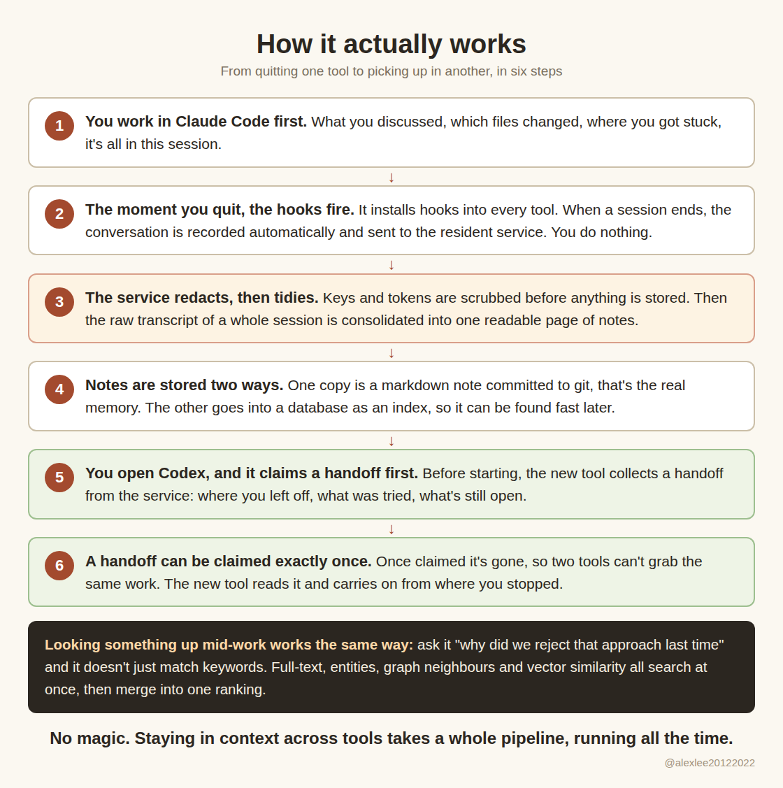
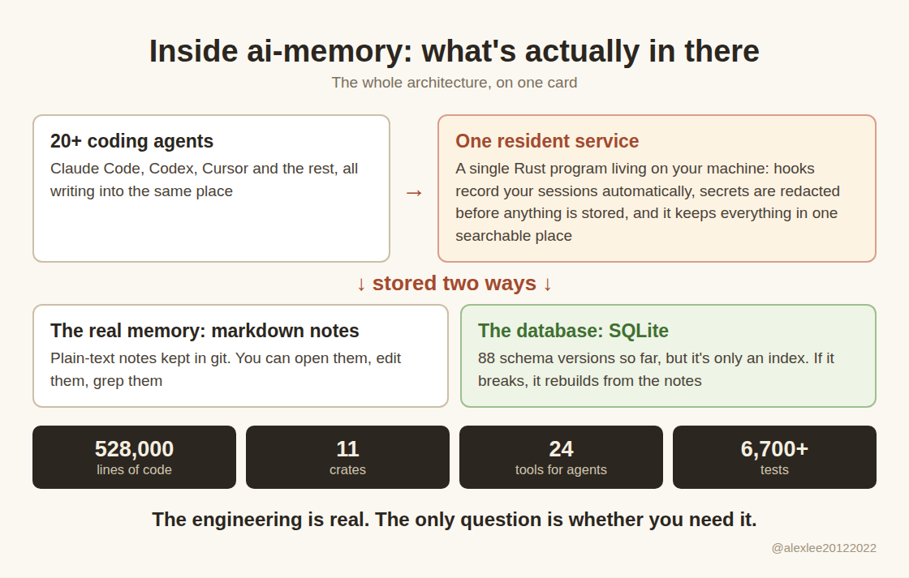
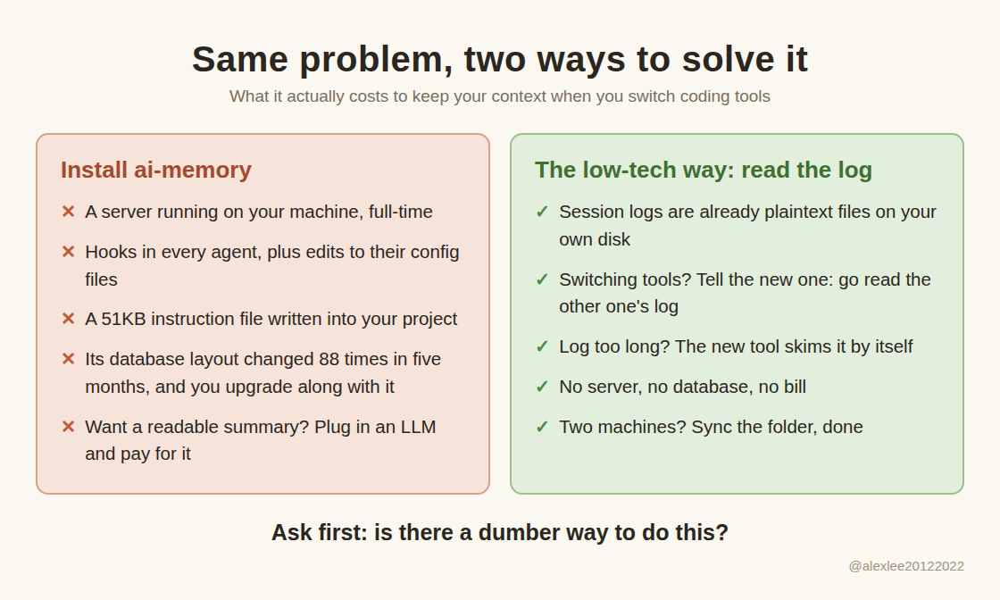

There's a project on GitHub right now that's hard to ignore, called ai-memory: 528,000 lines of Rust, sitting at No. 9 on today's overall trending chart, past 14,000 stars and still climbing. I couldn't resist. I installed it, ran it for real, and read the code from end to end.

This teardown runs a bit long, and I think it's worth your time. If you'd rather skip it, here's the verdict in one line: the thing is real, the engineering is real, but the problem it solves probably has a dumb, free workaround available to you already, so don't install it just yet. And it's not a one-off, either. Projects shaped like this keep showing up, and they've started to make me ask: are they actually as useful to us as they look?

## The problem it's solving

The pain it targets is real enough. You're halfway through something in Claude Code, you switch to Codex, and the new agent knows nothing about the two hours you just spent. You end up briefing it from scratch, again. The reason is mundane: each agent keeps its session logs and context in its own place, so there is nothing shared for the next one to pick up. ai-memory's answer is a separate resident memory service that twenty-odd coding agents all share. Whichever agent you quit, the next one walks in and picks up where you left off.

## How it works

You finish a session in Claude Code and quit, and the hooks it installed record the conversation automatically and send it to the resident service. The service scrubs the sensitive stuff first, keys and tokens, then consolidates the raw transcript of the session into one page of notes.

The notes live in two places: a markdown copy committed to git, which is the real memory, and a database index so things can be found fast. Open Codex next and, before it starts, it claims a handoff from the service and reads where you left off. Ask it about something old mid-work and the same machinery searches several signals at once and merges them into one ranking.

The handoff even has rules: a handoff can only be claimed once, so two agents can't grab the same piece of work at the same time. I tested that rule, by the way. Claim the same handoff a second time and it tells you there's nothing pending.

## What I verified

- One resident service, shared by twenty-odd coding agents
- Sessions recorded automatically when they end, secrets redacted before storage
- Lookups run several signals at once and fuse them into one ranking: full-text, entities, graph neighbours, optional vectors, and the observations it records
- A handoff can be claimed exactly once, then it's gone
- 24 MCP tools and around 70 CLI subcommands
- The real memory is markdown notes in git; the database is a rebuildable index

This is not one of those repos with a gorgeous README and a hollow shell underneath. 528,000 lines of Rust, 11 crates, 88 database migrations. I ran more than 1,200 of its tests and every one passed. I also tried to catch it out: I planted a fake API key in a prompt I knew its hooks would capture, then went straight into the database to see what actually got stored. What got stored was the redacted version. Not one character of the fake key survived. That part is done properly.

The search is serious too, several retrieval signals fused into one ranking. And there's a detail in its published benchmark that I genuinely liked: the no-LLM path, plain full-text search, scores 0.951, which is slightly better than its own built-in vector search at 0.945. Those numbers are self-reported, I didn't rerun them. But a project willing to print "vectors aren't our best path" in its own scorecard is being honest with you, and that's rarer than it should be.

## How 528,000 lines got written

You might say, 528,000 lines and 1,200 green tests, surely that's weight. Three years ago, yes. Not anymore. Most of this codebase was written by AI. That he builds heavily with AI is something the author says openly, no hiding it; the share itself, somewhere around two-thirds, is my estimate from tearing it down. He says the AI help let him port the whole thing from Ruby to Rust in a weekend, and the README credits Claude Code as a collaborator.

Think about why that happened. For those of us who work with agents every day, the agent has quietly become a wishing machine. You name a feature, out loud, in plain words, and it goes and implements it. The cost of building software has fallen through the floor. So the last couple of years have produced a wave of projects like this, each more complete than the last, gorgeous READMEs, stars and forks piling up. Many of them aren't scams. The code is real, the work is often decent.

## What the user pays

Wishing is free for the maker and not free for the user. Every feature the author wishes into existence is a feature you have to learn, configure and maintain once you adopt the thing.

Just count this one:

- A resident server running on your machine
- Hooks in every agent you use
- A setup flow that edits your config files
- A 51KB instruction file written into your project
- 88 changes to its own database layout in five months
- A 37-minute compile

Production got cheap. Adoption costs exactly what it always did, and every cent of it lands on the user's side of the ledger.

## Where the pitch and the product part ways

A headline feature is that it works with no LLM configured, and will tidy your sessions into readable pages by itself. I ran it with no API key at all, opened the page it produced, and got one line of log-speak: "1 prompt, over 42s, ended (exit)." That's the summary.

If you want a summary a human would actually want to read, you plug in an LLM and pay for API calls, and at that point the cost gap between this and the paid memory services shrinks a lot.

## My dumb workaround

And the job it does for all that money? Here's my own setup, which is embarrassingly low-tech. Claude Code and Codex both keep their session logs as plaintext JSONL files on your own disk. When I switch agents, I tell the new one: go read the other agent's session log and pick up the context. It goes and reads it. If the log is long, it skims and greps like the rest of us. Done. No server, no database, no bill.

Two machines, you'll ask, the logs aren't in the same place. Sync the folder. Git works, anything works, half an hour once and you're set for good. Running a permanent service for that is maths I can't make add up.

The longer I sit with this, the more I think the trick generalises. Plenty of problems that send us shopping for a big, beautiful project turn out to be embarrassingly small. One instruction. One file that's already sitting there. A few lines of script. A beautiful project is the answer to the wishes its author made. That is not the same thing as your problem.

## Who it's actually for

It's not useless for everyone. A team that needs one shared memory across several people, all using different agents, genuinely can't do that with the memory files each agent ships. The claim-once handoff and the multi-user permissions exist for exactly that, and they're well designed. Long projects bouncing between machines and agents every day, same story, worth a look. For the rest of us, solo developers who switch between at most two agents, everything extra it gives you is cost.

So my advice, next time one of these huge, complete, chart-topping projects shows up, is don't install it yet. Ask first whether the thing it solves is something you already have a dumber way of doing. If you do, stop there. The day a whole team needs to share one memory, ai-memory will still be here.

And I'm curious: when you switch agents, how do you carry the context over? If you've got something cheaper than reading the log, I honestly want to hear it.

Source: https://github.com/akitaonrails/ai-memory
