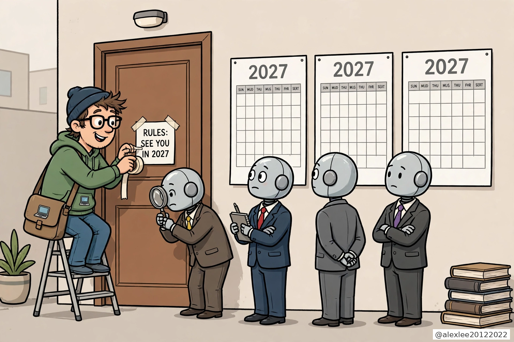
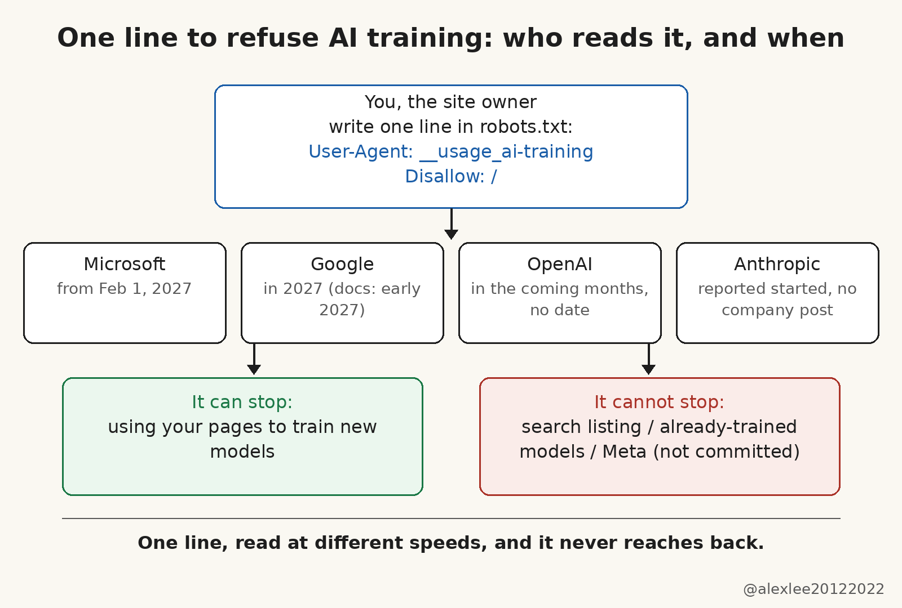

One robots.txt line to refuse AI training, and no single start date

Your website can now say no to AI training in a single line. That is real progress, and it is not protection yet. The document behind the line is a draft, the start dates are scattered and mostly in 2027, and no line you add now reaches back to models that already trained on your pages. If you add the line and stop there, you will feel protected while the models that already learned from your pages, and the crawlers that have not signed on, carry on unchanged.

The gap between that progress and real protection starts with what robots.txt actually is: a plain text file at the root of a website, which crawlers conventionally read before they fetch anything. It carries no enforcement of its own. It is a request that a crawler operator chooses to honor. A shared wording is useful because it replaces one entry per company. Because it has no enforcement, it settles nothing by itself.

Until now, saying no meant keeping a stack of company-specific wordings. Google has offered Google-Extended since 2023, OpenAI has GPTBot, Anthropic has ClaudeBot, and Bing has its own rules. A site owner had to write one entry per company, and missing one meant that company's crawler simply had no instruction from you. The new signal replaces that stack with one shared entry, written once and read by every company that signs on.

The entry looks like this. User-Agent: __usage_ai-training. Disallow: /. The token, with two underscores at the front, sits where a crawler name normally goes, but it is not a crawler. It is a label for one purpose only, generative AI training. Disallow under this token does not mean stay away from my site. It means do not use what you fetch here to train a model. Allow lines carve out exceptions, for a press kit, say. A robots.txt file is organized into groups, each starting with a User-Agent line. A group keyed to User-Agent: * does not count as expressing a preference for this token, and a file with no group naming the token expresses no preference at all.

Training, in the draft's definition, means using your pages to change what a model has learned, the parameters inside it. That narrow meaning matters, because it draws the boundary of the whole signal. Reading your pages to build a search index is a different purpose. Quoting them in an answer is a different purpose. The token covers neither, and anyone who adds it expecting their site to vanish from search or from AI answers is going to be disappointed.

Only one company gives a firm date; the rest are vague or dateless. Microsoft gave the firmest date, February 1, 2027, when Bingbot starts honoring the new preferences as it crawls (its old NoArchive and NoCache tags stop counting after March 1, 2027). Google gives 2027, and its crawler documentation narrows that to early 2027. If you opt out with the shared token without explicitly mentioning Google-Extended, Google plans to treat your opt-out as if Google-Extended were disallowed.

OpenAI says it aims to implement the signal in the coming months and gives no date. Anthropic's part comes from the draft's author, Kevin Kelley, who works at Anthropic. Writing on the IETF mailing list, Kelley said Anthropic has started implementing support, but rollout across its services will take time. Anthropic has published no announcement of its own so far. A remark on a mailing list is not a company announcement, and that difference matters.

The document behind all of this is an individual Internet-Draft, filed on October 30, not an approved IETF standard. It carries no IETF endorsement, and it expires on May 3, 2027 unless it is revised or adopted. Put the draft's expiry together with robots.txt's lack of enforcement, and their commitment is only a promise to read the line, not a guarantee anyone will honor it.

Search eligibility does not change, and both Google and Microsoft say so plainly. Content already collected or already trained on is untouched, because the draft judges preferences when pages are fetched, and a model that has already learned has no opt-out button. Meta has published no commitment so far to honor the token, so one line does not cover the whole web even when 2027 arrives.

I run a site myself, so my own answer is straightforward. Keep the company-specific blocks you already have, because those are what works today. Add the shared line now, while you are thinking about it, so it is already sitting there when each company's switch flips. Do not tidy the old entries away in a cleanup, and do not treat the new line as a finished shield. After 2027, when your pages have been recrawled, check whether the companies that promised to read it actually behave as if they did.

The check that matters is on your own file, not in a press release: the old entries stay, the new line sits beside them, and after 2027 you look for whether the behavior changed. If your site has a robots.txt, it is worth ten minutes this week to open it and check what is already in it, and whether this line goes in now or waits for 2027. Bookmark this blog if breakdowns like this save you a round of guessing; I keep posting them on AI, security and open source.

Sources: [Search Engine Land (2026-10-30)](https://searchengineland.com/google-also-gives-publishers-more-control-over-how-ai-uses-their-content-499971); [RR Tech Pulse (updated 2026-10-31, with the Anthropic-correction note)](https://rrtechpulse.com/stories/robots-txt-ai-training-opt-out-signal/); IETF draft draft-kelley-aipref-training-preference-signal-00 (Kevin Kelley, 2026-10-30).
