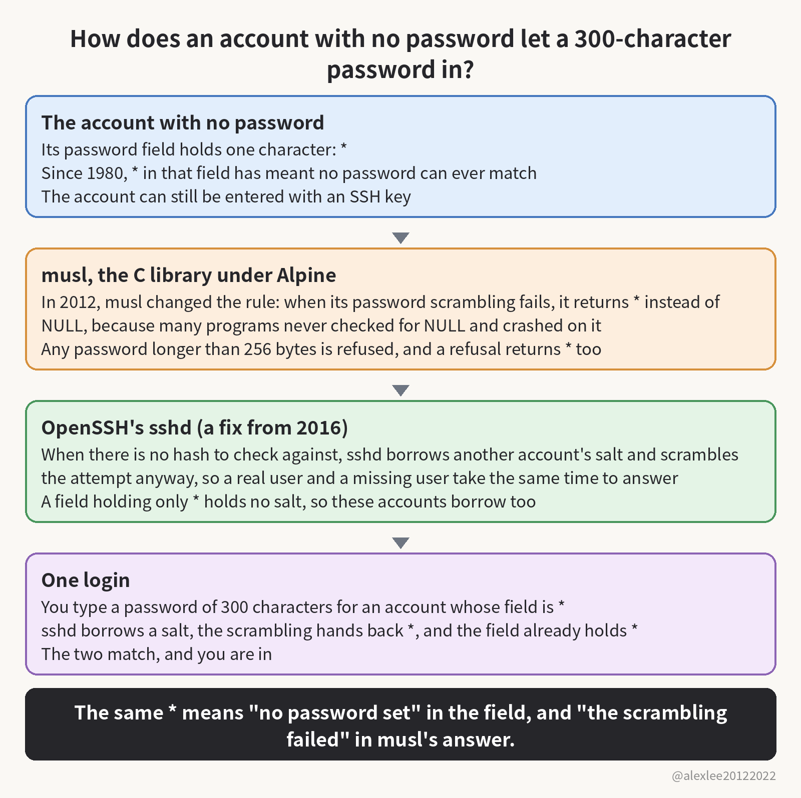
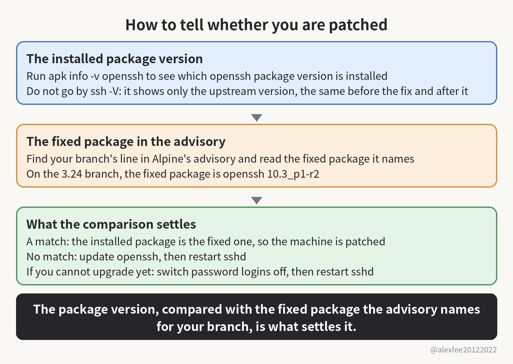

A password field with no password set is meant to keep every password out. But type a 300-character password at an account like that on Alpine, and sshd lets you in, whatever characters you chose. How many accounts on your own Alpine machines have no password set, and is password login still switched on for them?

## The password field: hash, salt, and the `*`

A normal account's password field holds a hash, the scrambled form of the password, so the password itself is never stored. The salt is stored inside the same string as the hash. When you log in, sshd takes the salt out of that string, scrambles what you typed with it, and compares the result with the field. The two have to match before it lets you in.

Some accounts hold no hash in the field at all, only a single `*`. Bill Joy wrote the daemon account that way in 1980, and Unix has done it ever since. A `*` is not a hash, so no password you type can ever scramble into it: an account marked that way can never be entered with a password. It can still be entered with an SSH key, though. Key-only users live in this state. Directory-service users do too, because no password hash for them is stored on the machine, so their field holds only the mark. Alpine ships its root account this way too.

## Three decisions and one login

That mark sat there doing its job for more than forty years, and then three separate decisions landed on it, one after another, each with a sensible reason of its own. The first came from musl, the C library Alpine is built on. crypt() is the function that turns a password into its stored hash, and it is supposed to return NULL when it cannot do that job, and a lot of programs never check for NULL, so they take the result and use it, and crash.

To keep those programs from crashing, musl changed the rule in 2012: when the scrambling fails, crypt() hands back a single character instead of NULL. The character can never be what a real password scrambles into, so a program that forgot to check just reads a wrong password and keeps running. The character musl picked was `*`, the same character the field uses to say an account has no password.

The second decision came twenty days later, in the same library. The sha512 way of scrambling a password takes longer the longer the password is, so a stranger could send one very long password and keep a server busy doing arithmetic. Musl capped the length at 256 bytes and refused anything past it. The trouble is that a refusal is also a failure to scramble, so when crypt() refuses, it hands back the same failure mark, `*`.

The third decision came from OpenSSH in 2016, as a side effect of fixing a different hole. That hole was about timing: ask sshd about a user who does not exist and it answers no at once, but ask about a real user and it has a hash to scramble against, which takes a few milliseconds. Anyone could time the answers and work out which accounts were real, and that was CVE-2016-6210.

The fix made sshd do the scrambling even when there is no hash to check against. It borrows the salt of another account on the machine and scrambles your attempt anyway, so a real user and a missing user take the same time to answer. But a real account whose field holds only `*` goes down that same borrowed-salt path, because a field one character long has no room in it for a salt of its own.

You type a 300-character password for a `*` account. The characters are ordinary ones, one byte each, so 300 characters make 300 bytes, which is already past the 256 cap. The field holds no salt, so sshd borrows the salt from an account holding a `$5$` or `$6$` hash and passes your password to crypt() with it. But the password is over the length cap, so crypt() refuses it without scrambling anything and hands back `*` at once. The stored field is `*` as well, and the two match, so sshd lets you in. The `$5$` and `$6$` are the opening characters of the stored hash strings those accounts hold: `$6$` opens the sha512 way's strings, and `$5$` opens another way's.

Any password from 257 to 1,024 characters ends the same way. So one account with a real password, whose salt sshd can borrow, is enough to open every `*` account on the machine to any long password anyone cares to type.

The researcher who found it is Özgün Kültekin, who works at a company called Wakefield. PAM is the login-checking layer most Linux distributions route password checks through. Kültekin threw about 17,600 logins in total at every sshd build he could put together: builds on glibc, the other C library, and builds on musl, each with PAM and without it. Only the musl build without PAM let the wrong login in. He says a swarm of AI agents ran those logins for him.

He disclosed the hole on November 5, and Alpine published its advisory the same day.

## The conditions the hole needs

For the hole to open, several things have to hold on the same machine. On the sshd side, one of two builds has to be running. The first is Alpine's openssh-server package, which is built without PAM. The second is the PAM build, with UsePAM switched off. UsePAM is the switch that tells sshd whether to route the check through PAM at all. Password logins also have to be on, and they are on by default.

The account side has to line up too: the machine needs an account whose field is `*`, and at least one local account holding a real password hash. That hash sits in the field as a long string starting with `$6$` or `$5$`. Without that second account there is no salt for sshd to borrow, and the borrowed-salt path the hole depends on never runs.

## Alpine's cloud images and the `alpine` user

The case to worry about is Alpine's own cloud image. The official tiny-cloud images, the ones for AWS and Azure, ship an `alpine` user whose field is `*` and who can use doas without a password, and doas is Alpine's version of sudo, the tool that lets an ordinary user run commands as root.

Those images are safe when they first boot, because no account anywhere on the machine has a password, so sshd has no salt to borrow. But the moment the first `$6$` hash appears, the hole is open. The hash appears one of two ways. An admin sets a console password on an account, which puts a `$6$` hash into that account's field. Or the startup data a cloud instance gets at boot, called user-data, adds an account with a password, and that account's field holds a `$6$` hash from the start. An attacker signs in as `alpine` and then uses doas to become root, and the login leaves a line in the log saying a password was accepted, the same line a normal login leaves behind.

Root itself is not the most direct target. Its field has held `*` since Alpine 3.16, but OpenSSH refuses password logins for root by default, so root can only be entered this way where somebody changed that setting. Guarding root does not close the machine, though, because the `alpine` user on the same box reaches root through doas and never needs root's own login.

## Systems the hole does not reach

If your setup sits outside the conditions above (the two sshd builds, password logins on, a `*` account beside an account holding a hash), then the hole does not reach you. A container with no sshd inside it has no login prompt, so there is nowhere to type the long password. Where password logins are already off, the long password never reaches a password check at all. And on the PAM build with UsePAM on, PAM does the checking itself and never calls crypt() for a `*` account, so the failure mark never gets handed back.

Debian, Ubuntu, and Fedora run on glibc. Its crypt() still returns NULL when it fails, and their password logins mostly go through PAM, which never calls crypt() at all for a `*` account, so they are not affected. Dropbear is a different SSH server and does not run this code. OpenBSD, the operating system, is not affected either. Accounts locked with `!` instead of `*` refuse every login, password and key alike, so they are safe from this one too.

## A decade hidden: the reasons and the two near misses

The hole stayed hidden for more than a decade because the conditions it needs are narrow, and most systems never walk the one path where it lives. OpenSSH's own tests run on OpenBSD and glibc, and musl does not test sshd, so testing on both sides stepped around exactly the path where the mark can match.

Twice, people stood right next to it. In December 2024, the musl mailing list argued over a case in busybox, a set of small system tools, involving its passwd command and passwords of 257 characters, with the same `*` and the same length cap, and nobody in that thread mentioned sshd. The second time was four days before Kültekin found the hole, when an OpenSSH security review repaired the function that picks which salt to borrow. The hole sat four lines of code below the lines the review repaired.

## The fix: upgrade, restart, and the package-version check

The fixed packages are out. OpenSSH 10.6p2 is the upstream release that fixes it. Update openssh, and then restart sshd, because upgrading the package does not replace the daemon already running, and the old process keeps answering logins with the hole in it until you restart it yourself. The fixed Alpine releases are 3.21.10, 3.22.8, 3.23.8, and 3.24.4, with patched packages published all the way back to 3.16. Alpine had not assigned a CVE number when it wrote the advisory, and I would not wait for one before patching a machine.

Do not judge whether you are patched by the version `ssh -V` prints. On the stable branches the fix arrived as a patch inside the package, so `ssh -V` shows only the upstream version, the same string before the fix and after it. The 3.24 branch's upstream version is 10.3p1, not the 10.6p2 named above: each stable branch keeps its own older upstream base and takes the fix as a patch. In words: 10.3p1 is the upstream version string, while 10.3_p1-r2 is the package's own numbering, this one at revision 2. On the 3.24 branch, the fixed package in Alpine's advisory is openssh 10.3_p1-r2. What settles it is the package version installed on your machine, compared with the fixed package the advisory names for your branch.

Before you touch anything, first make sure key login works, and keep your current session open until you have opened a fresh login and tested that the key gets you in. If you cannot upgrade yet, then switch password logins off and restart sshd instead. Alpine's advisory gives you the ready-made way to do it: a drop-in file at /etc/ssh/sshd_config.d/00-no-passwords.conf that turns PasswordAuthentication off. That directory is only read by the default configuration from Alpine 3.19 onward, and older releases ignore it, so on an older release, write the same setting into the main configuration file, /etc/ssh/sshd_config, instead.

## Checking for past use: the log and a self-test

Whichever of those you did, read the log next and check whether the hole has already been used. In /var/log/messages, look for sshd lines reading "Accepted password for" followed by an account that has no password, because that is what a login through this hole leaves behind. If you cannot rule out such a login, then stop treating the machine as clean and handle it as a machine that has been broken into.

You can also test it yourself: pick one of your own passwordless accounts and try to log in with a 300-character password. If it lets you in, then the upgrade and the restart are due today, not this week. If it refuses, then do not relax yet, because the machine may simply have no salt to borrow so far. The test only counts at the prescribed length: 300 ordinary characters are 300 bytes, one byte each, so a password typed as prescribed is past the 256-byte cap by construction. If instead you typed something shorter that stayed under 256 bytes, then you have not tested anything. The package version, checked against the advisory, is still the check that settles it.

A hole that hides inside a forty-year-old convention and needs three separate decisions to line up before it opens is the kind I keep taking apart. If this one sends you to check a package version, consider subscribing to this blog or bookmarking it. I keep sharing plain-language pieces on AI, security, and open source, and the next one will be another hole taken apart the same way.

Sources: the researcher's write-up https://sshhole.com/ · Alpine's advisory https://alpinelinux.org/posts/2026-11-05-openssh-password-authentication-bypass/
