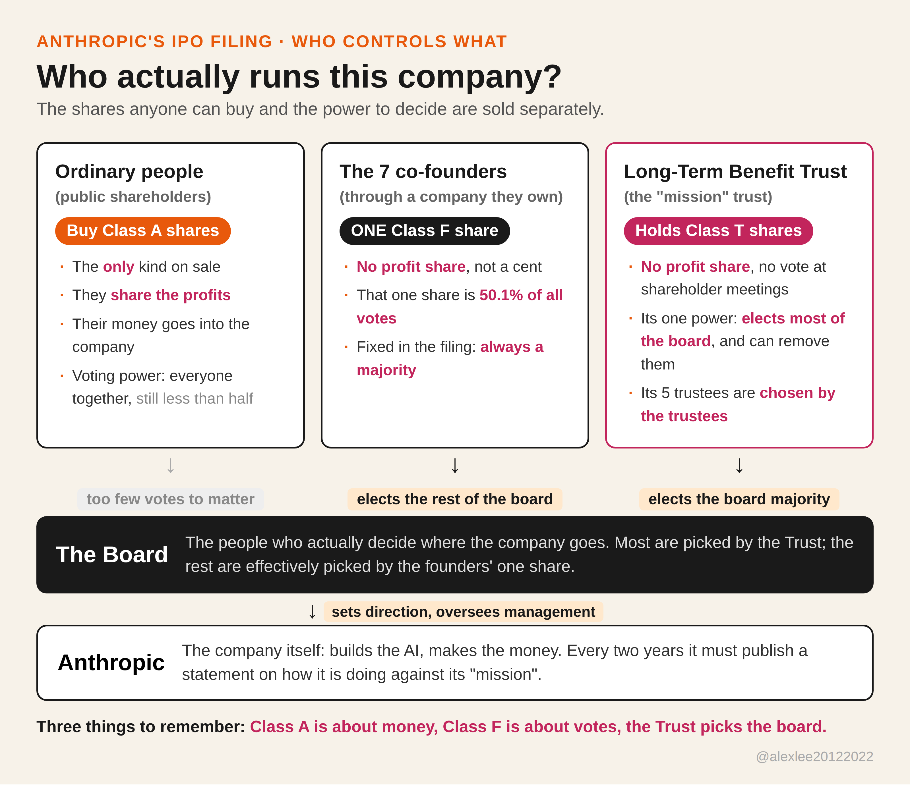

if you buy shares in a listed company, you usually get two things for your money: a claim on the profits, and a vote, small but real, on who runs the place. anthropic's s-1, filed on october 26 for a nasdaq listing under the ticker ant, sells you the first and keeps the second. the share count and the price range are still blank in the document, so nothing is trading yet and the listing itself is still some distance off. the governance pages, though, are completely written, and they are the part of this filing worth reading slowly.

the business numbers are large enough that plenty of people will want in. revenue for the first half of 2026 was $16.3 billion, against roughly $1.1 billion in the same half last year. the net loss printed in the filing is $80.7 billion, which looks like a building on fire until you reach the footnote: about $72.4 billion of it is a non-cash accounting charge on convertible notes, not cash that walked out the door. the operating loss for the half was $693 million, and the second quarter on its own posted an operating profit of $974 million, the company's first. the wall street journal reports that the company is aiming to list in the week of november 16, raising more than $100 billion at a valuation between $1.5 and $2 trillion. that timeline is the journal's reporting, not a promise in the filing.

the structure underneath those numbers is this. the public can only buy class a shares. each class a share carries one vote and a genuine economic claim: if the company makes money, that is the share the money flows to. the founders hold something else. just before the offering, the company will issue a single share of class f stock, one share, to a limited company owned by the seven co-founders together. that one share is entitled to votes equal to 50.1 percent of the total voting power of the whole company, fixed at that level, on the questions shareholders vote on generally, including electing the directors the trust does not elect. the class f share has no economic rights at all. it cannot be used to take money out. what it carries is votes, and enough of them that every public shareholder voting together, on the best day they will ever have, still adds up to less than half. the filing does not dress this up, to its credit. it states plainly that anthropic will list as what nasdaq calls a controlled company. i have held shares in companies for years and i am used to my one vote not mattering much in practice. not mattering in practice and not mattering by design, printed in the prospectus, are two different things.

the other half of the structure is a trust, the long-term benefit trust. it holds a third kind of share, class t, which carries no economic rights and no vote on the questions shareholders generally decide. what it carries is the right to elect and remove the class t directors, and the class t directors will be a majority of the board. the trust's written job is to keep the company balanced between three things: the financial interests of shareholders, the interests of the people affected by what the company does, and the purpose written into its charter, the responsible development and maintenance of advanced ai for the long-term benefit of humanity. the trust does not run the company day to day, and the filing is clear about that. it chooses most of the people who oversee the people who do.

so who chooses the trustees? the filing answers that too, and the answer is the trustees themselves. there are five seats. the trustees in office appoint new trustees by a majority vote among themselves, and they can remove one of their own number the same way. a trustee serves a term of one year at a time, and there is no limit on how many times a trustee can be renewed. the trustees also fix their own compensation, which the trust agreement limits to a reasonable cash amount set by the trustees each year. and the filing volunteers one more detail, in its own words: in practice to date, the trustees and the company's executives have collaborated closely on sourcing, interviewing, and selecting trustees. the people currently in the seats are not nobodies, and i am not going to pretend otherwise. the chair, buddy shah, ran givewell and now runs the clinton health access initiative. richard fontaine runs a national security think tank in washington. ben bernanke chaired the federal reserve. christopher stubbs is a harvard physicist. one seat is currently empty. these are serious, accomplished people. the question was never whether they are serious. the question is who can replace them on the day they are wrong, and on the filing's own text the answer is each other.

picture the day a structure like this is actually used, because it was not designed as decoration. say that a few years from now the board, with its majority of trust-chosen directors, decides that a highly profitable product line has to be slowed down or shut because it sits badly with the mission. public shareholders who think that decision is wrong have, in an ordinary listed company, a whole set of tools: they can vote, they can campaign, they can replace directors. here those tools were put away before the public arrived. their shares vote and lose. the directors they most want gone were never elected by shareholders in the first place. and changing the structure itself is harder than losing a vote. while the trustees object to the change, the trust's terms can only be amended if the founders' company, the employee shareholders (class e, a limited-vote class held by staff other than the founders), and the public shareholders all vote for it together, with some of those votes needing far more than a bare majority. if the founders' share is ever gone, it takes 85 percent of the public shares, with the trustees still objecting. i understand the reason this was built, and part of the reason is real. public markets genuinely do push companies to cut corners for the next quarter's number, and a frontier ai lab that can be pushed around by its own share price is a danger of a different kind. anthropic's answer is to take the steering wheel away from the market. what the filing never answers is why the wheel had to be handed to a small group that appoints itself, with no outside hand anywhere in the chain.

arguments about structures like this usually end with the mission. anthropic is a public benefit corporation, the purpose is written into the charter, the trust exists to guard it, and i do not doubt that the people who wrote all this down meant it sincerely. what i doubt is something else. a safeguard that cannot be removed is also a safeguard that cannot be corrected. and this is not a company selling software subscriptions. it is building the strongest generally capable ai systems in the world, systems a lot of us believe could gather a kind of power no company has gathered before. if that is the business, then who can overrule the handful of people at the top is not an internal housekeeping detail. it is part of the safety question itself. on the day the small group at the center reads a situation badly wrong, or slowly becomes the thing it was built to guard against, the people whose money funds the company, and the much larger public that has to live with the results, hold no vote that reaches the problem. what they will get is the statement the company is required to publish every two years on how it is doing against its purpose, which the filing says it intends to post on its website, after the fact.

to put it plainly: if you were planning to buy their stock simply to make money, my advice is to buy it. over the long run i am sure it will make you a great deal of money. but if you are buying with the idea that, as a shareholder, you will have a part in the company's decisions, influence where it goes, or keep watch over how it is run, you are likely to be badly disappointed. that say was allocated before the first public share was priced. of course, none of this has anything to do with 99 percent of ordinary people, people like you and me. and still i think it is something everyone should pay attention to. the reason is simple. this is the first time a frontier lab has been made to write down, in a legal document, exactly how much say the public gets. it may turn out to be a good beginning. it may turn out to have opened a pandora's box. who knows? maybe only time will tell.

Sources: Anthropic, PBC, Form S-1 filed with the U.S. SEC on Oct 26, 2026, https://www.sec.gov/Archives/edgar/data/2130357/000162828026067168/anthropicpbc-sx1.htm ; Anthropic's announcement, https://www.anthropic.com/news/s1-sec ; the listing timeline and valuation figures are Wall Street Journal reporting, as marked in the text.
