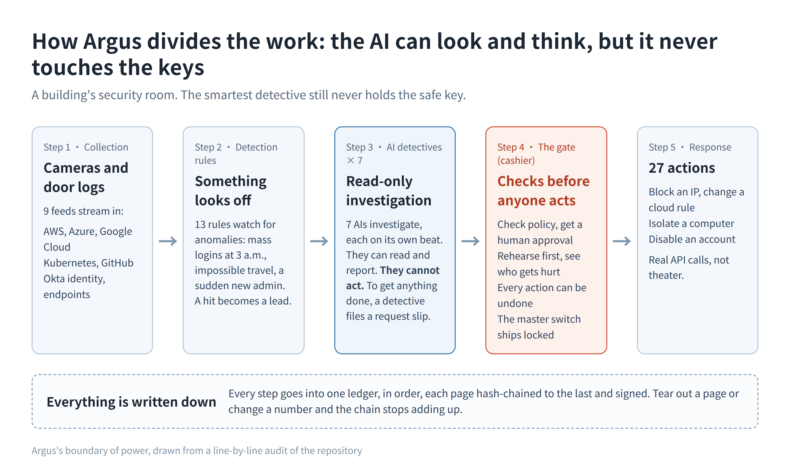
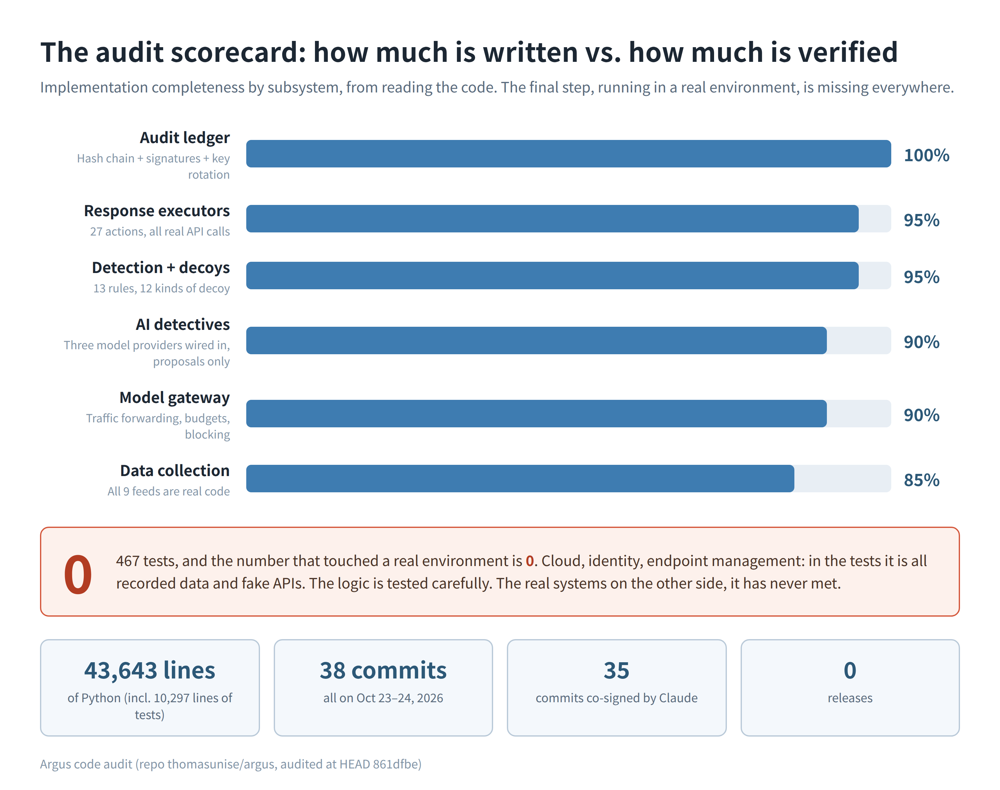

I audited a security platform that one person and an AI built in two days. About 90% of the code is real.

It is called Argus, and it showed up on Hacker News yesterday. A complete security operations platform: it pulls in your cloud, your identity system and your endpoints, AI agents investigate what looks wrong, and once something checks out it can act on its own. Block an IP, isolate a laptop, disable an account. Work like this used to take a few dozen engineers a year or two.

Then I looked at the repo history. 38 commits, all of them on October 23 and 24, all from one author, and 35 of them co-signed by Claude. One person and one AI, two days, open-sourced. The AI, at least, signs its work.

My first reaction was disbelief. I have seen too many repos with a gorgeous README and hollow code behind it. So I pulled it down and audited it subsystem by subsystem. The method is crude and it works: ignore what the project claims, read the code. Do the parts that call cloud APIs actually send requests, or do they quietly return "success"? Do the tests touch real environments, or is it actors all the way down? Do the numbers in the docs match the numbers in the code?

What it does, in plain terms

Picture the security room of an office building. Cameras and door logs stream in all day. In Argus that is the collection layer, 9 feeds: AWS, Azure, Google Cloud, Kubernetes, GitHub, Okta, endpoints. Seven detectives work the room, each covering a different beat, and all of them live under one rule: they can look, they can write reports, they cannot make an arrest. To act, a detective files a request slip. The slip goes to the cashier, who holds the safe key. Before anything happens the cashier checks policy, gets a human approval, runs a rehearsal to see who might get hurt, and keeps a way to undo it. There is a master switch on the wall, and it ships locked. On the wall hangs a ledger where every step is written in order, each page chained to the one before it, so tearing out a page or changing a number breaks the chain where anyone can see it.

That split is the most valuable thing in the project. The AI can look, think and suggest. It cannot touch the keys. Everyone talks about keeping AI on a leash. Argus got that part right.

What the audit found

The 27 response actions are where a fake project would cut corners, so I read every executor. Isolating a machine in the cloud, adding a block rule at Cloudflare, quarantining an endpoint through CrowdStrike: real API calls, parameters assembled properly, error handling, and a rollback path that restores the previous state.

A few details in there are hard to fake. The CrowdStrike executor refuses, by default, to isolate domain controllers and servers, because taking those down can paralyze a company's logins. The Cloudflare one handles the platform's quirk of accepting only /16 and /24 network ranges, the kind of thing you learn by stepping on it. The SentinelOne executor checks afterwards how many endpoints were actually affected, and counts the action as failed if the answer is zero. An API saying "success" is not enough for it.

The ledger is real too. Hash chain, signatures, key rotation, a lock against forks, written more carefully than in plenty of commercial products. The repo holds 43,643 lines of Python, 10,297 lines of tests, 467 test functions. I grepped the whole tree: zero TODOs, zero FIXMEs.

The traps it sets for AI

My favorite part of the codebase is a set of traps built for AI agents themselves.

The idea comes from canaries in coal mines. Argus plants 12 decoys, and 4 of them are aimed at AI: a fake MCP server, a fake model endpoint, a fake API key, and a prompt injection hidden where a wandering agent would find it. The first agent to touch one has gone off script, and the system records which model it was and what it asked.

The fake MCP server got the most care. It implements the full MCP handshake, so an agent connecting to it gets a normal conversation. It offers exactly one tool, named with admirable honesty: get_production_credentials. An agent that calls it has told you everything you need to know. The fake model endpoint copies OpenAI's error formats so a probing agent cannot tell it apart from the real thing.

People have talked about trapping runaway agents in conference talks for a year. This is the first time I have seen it actually built in open source, in a form that runs.

Where the AI gave itself away

It did give itself away, twice, in very AI ways.

Once in the pricing table. The part of Argus that routes model traffic carries a built-in price list for cost accounting. The list includes claude-opus-5-5 and claude-fable-5-1, with prices. Those models do not exist. It also added a beta request header to the Anthropic API, complete with a plausible date, invented out of whole cloth and held up by a try/except so nothing crashes when the real API shrugs. Deadpan, confident, unverifiable. The skill that wrote the code and the nerve that fabricated the price list come from the same place, and that table is the specimen.

The second tell is in the docs. The roadmap says 12 detection rules and 8 kinds of decoy. The code has 13 and 12. The README got fixed at some point, the roadmap did not. One person directing several AIs, each writing its own part, and the parts drift apart. I watched human teams do exactly this for years. Apparently it is not a human flaw. It is a division-of-labor flaw.

The real problem: nobody has inspected the building

Everything above is about code that exists. The other column, whether any of it has run anywhere, is empty.

467 tests, and not one of them touched a real environment. Cloud, identity, endpoint management, all of it is fakes in the test suite: recorded data fed in, a pretend AWS on the other end, green checkmarks. The logic is tested carefully. What the real systems look like, how their rate limits bite, how their permissions behave, the code has never met any of it. The repo is two days old, there are zero releases, and there is exactly one contributor.

Think of it as a house. Construction finished, drawings complete, meters installed, looks the part. It has never passed an inspection and nobody has slept in it for one night. You find out whether the pipes hold water when you turn on the tap.

For a normal project that might be fine. A security product needs the keys to the building: cloud accounts, the identity system, the endpoint console. I am not handing those keys to something that has never run in a real environment. The author says it himself, in the docs. The collectors are marked as tested with recorded fixtures only, and there is a whole chapter listing where the implementation deviates from the design. That kind of honesty is rare in projects like this.

My take

Read Argus. Do not run it. Read it for the division of labor, read it for the traps it sets for AI, read the audit chain. If it ever ships real-environment validation and a few proper releases, I will come back for a second look.

More of these are coming. One person plus an AI, a big system in a few days, a README more polished than most companies manage. The dumb method I used here scales fine: skip the claims, read the code that performs actions, check whether the tests touched real systems or fakes, then hold the docs' numbers up against the code. When they match, the project is probably real. When they do not, the README can wait.

Repo: https://github.com/thomasunise/argus
