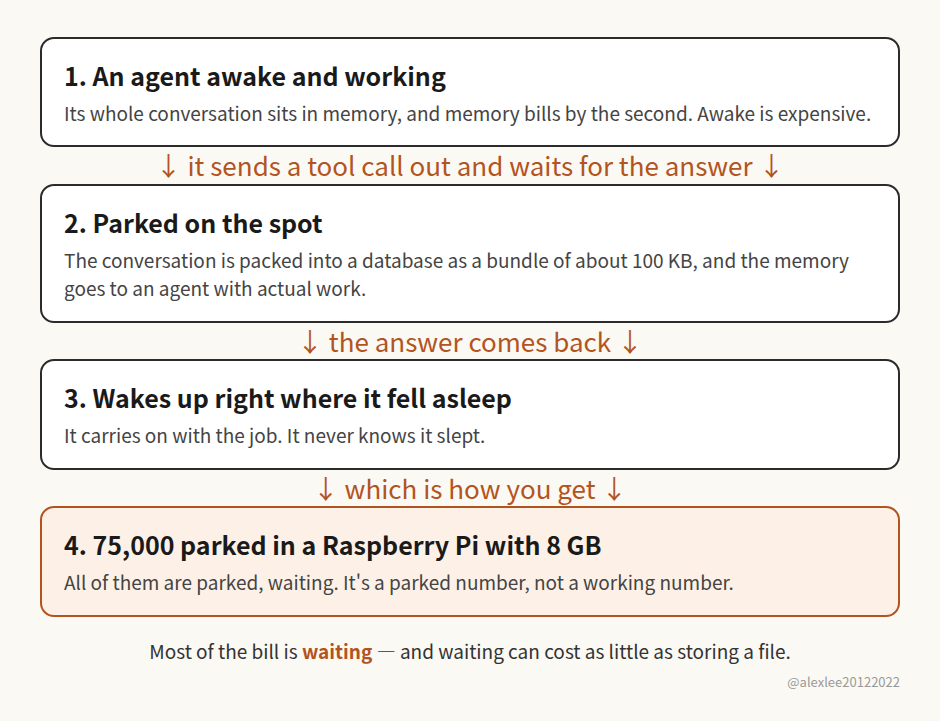

AWS says Infinity held 75,000 agents at once on a Raspberry Pi. Sounds insane, right? But you can't read that number the way AWS wants you to. Those are 75,000 agents parked, not 75,000 agents working, and that's a very different claim. Does that make the thing worthless? Not to me, I actually like it quite a bit. Because it goes after the most expensive habit an agent has, which is waiting.

Think about an agent's day for a second. It asks a database something and waits for the answer. It calls a slow tool and waits for the tool. It waits for another agent to finish, and it waits for a human to click approve. Most of its day is waiting. And while it waits, the whole conversation has to sit in memory, because dropping it would mean losing the thread. Memory bills by the second. Park one or two agents like that and nobody cares. Park ten thousand and the bill gets ugly. The worst part is you barely notice it happening, because the cost is spread across every agent you run.

So how does Infinity get out of paying for all that waiting? The short version is that it parks the agent properly. The moment an agent starts waiting, Infinity packs the whole conversation into a database and frees the memory for an agent that has actual work to do. When the answer comes back, the conversation gets unpacked exactly as it was, and the agent picks up in the middle of the sentence it stopped on, as if nothing had happened. Parked like that, an agent shrinks to a bundle of about 100 KB. Do the math: 100 KB times 75,000 comes to a bit over 7 GB, and a Raspberry Pi 5 has 8 GB. That's the whole demo. Now, if all 75,000 woke up and started working at the same moment, the Pi would fall over on the spot, no question. But when does that ever happen? In any real fleet, most agents are parked most of the time anyway. That's just what the load actually looks like.

And none of this is a new idea, which honestly is part of why I trust it. Operating systems have done this for decades. Most processes spend most of their time asleep, so you swap the sleeping ones out and give the machine to the ones that are awake. We mostly stopped bothering at some point, because processes got so cheap that leaving everything awake cost almost nothing, and it was simpler. Agents are not cheap. So the old trick is worth money again. Even the way Infinity wakes an agent up is borrowed: if something outside needs its attention, the message gets dressed up as a tool result and slipped in, and the agent wakes up and carries on, never knowing it was asleep.

If waiting really is free, the whole picture changes. An agent stops being a job you start, run and shut down. It can just live somewhere for days, for weeks, asleep nearly all of that time, surfacing now and then for a tool result, a new message, a human clicking approve, and then it's out again. And at that point the hard problem isn't running agents anymore. It's the roster. You've got ten thousand of them asleep: which one wakes first? And when one does wake up, does it still remember exactly what it was in the middle of?

That said, this thing isn't really built for people like you and me. A normal developer runs a few dozen agents at most, and that's already a lot. The ones who actually need this are the AI companies, and the bigger companies that have started running agents all over the place internally. If you're running thousands of them at once, shaving memory stops being an academic question and becomes a line on the bill. So if you work in this industry, or your job touches this stuff, I'd really suggest taking an afternoon and trying it. And if you're an ordinary person like me, reading through its code and stealing the ideas from it is a perfectly good afternoon too.

One last thing for the people running agents in production: how many agents are you actually running? And have you ever measured how much of their time they spend awake and working? Does it even reach a tenth?

Source: AWS Open Source Blog, "Introducing Infinity, a runtime for extreme agent concurrency", Oct 23, 2026, https://aws-news.com/article/2026-10-23-introducing-infinity-a-runtime-for-extreme-agent-concurrency
