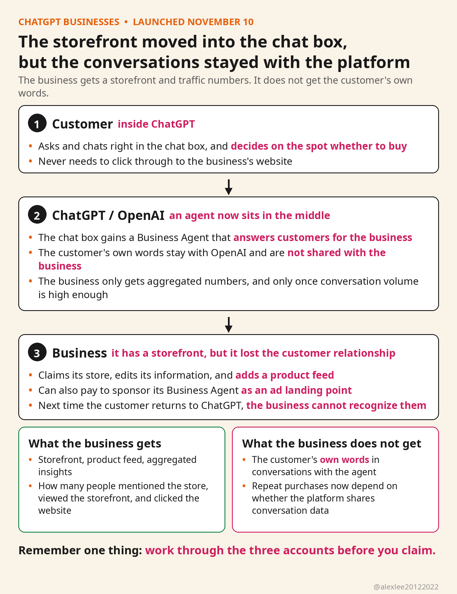

On November 10, OpenAI launched a feature for businesses in ChatGPT called Businesses, and it is still in beta. A business can now claim its own store inside ChatGPT. After it claims the store, it can edit its information, and it can also list products. Customers ask their questions right in the chat box. A Business Agent answers them on the business's behalf. The chat box has gone from a question-and-answer tool to a place where you can open a shop.

Claiming a store runs through a tool called Business Hub. The business claims its store first. Only after OpenAI verifies it can the business change key information such as the store name and address, and it can also add a product feed. A product feed is the product data, and it carries prices and stock status. OpenAI also shows the business aggregated insights: how many people mentioned this store, how many people viewed the storefront, and how many people clicked through to the business's website. With that, the storefront is there, and the traffic numbers are there too.

What has really changed is not that there is one more place to display products, but that the chat box now contains a Business Agent that answers customers for the business. The customer does not need to click through to the business's website. For example, the customer can ask right inside ChatGPT whether this item of clothing comes in size M. The Business Agent answers on the spot. At launch, this is open only to eligible e-commerce and online service businesses in the United States.

But the business cannot see the customer's conversations with the Business Agent. OpenAI has said that it does not share users' conversations with the Business Agent with businesses, and that businesses can only see aggregated numbers. And OpenAI only gives the business those aggregated numbers once the conversation volume is high enough. The platform holds the customer's own words, but the business holds only summary numbers. In the same conversation, the platform and the business see different things.

A business can also pay to sponsor its Business Agent. Clicking an ad lands on the Business Agent. The sponsored placement will be labeled. But a sponsored answer and a natural answer look the same, and both appear in the same chat box, so the customer has to pay extra attention in order to tell a sponsored answer from a natural answer.

The real change in this is not the feature itself, but the relationship between businesses and the platform. Before, when a customer wanted to buy something, the customer went to the business's website first to look at the products, and the customer also asked customer service there, and compared prices there. Now the asking and the comparing have moved into ChatGPT, and only the final step of placing the order still stays on the business's website. The business thinks it has gained one more channel for reaching customers, but in fact it has moved its own storefront into ChatGPT's chat box. The few minutes in which the customer makes the decision all take place inside ChatGPT. OpenAI can see every sentence.

There is one more layer, and that layer is repeat purchases. When a customer has bought something on the business's website, the business knows who that customer is, and next time it can reach that customer directly. The customer asks the Business Agent questions inside ChatGPT, and then the conversation is over. Whether the customer buys is decided right there in the chat box. But the conversation stays in OpenAI's hands, and the business only receives aggregated numbers. Next time that customer comes back to ChatGPT, the business cannot recognize them. From now on, repeat purchases also depend on whether the platform gives the business the conversation data.

Before you claim a store, work through three accounts. The first one: if the business's product feed stops, does the storefront still exist inside ChatGPT, or is the storefront itself something that OpenAI lends to the business?

The second one: who owns the conversation data between customers and the Business Agent? The conversation stays in OpenAI's hands, and the business only receives aggregated numbers. Later, if the business wants to handle repeat purchases and customer service on its own, what will it use to do that if it does not have this conversation data?

The third one: once sponsored placements appear, how many display positions are left for natural answers? Today the Business Agent answers customers on the business's behalf. If a competitor pays tomorrow to buy the landing point, will this business's Business Agent answer still rank ahead of the natural answers?

Every time the channel for reaching customers moves to a new place, the platform writes the rules first, and businesses come in afterwards. Whether to claim a store is the business's own choice, but before going in, the business should think these three things through clearly first, and then decide whether to move its storefront into OpenAI's chat box. If this piece was useful to you, consider subscribing to this blog or bookmarking it. I will keep sharing things in AI, security, and open source that I have checked and used myself.

Source: Reuters, November 10, 2026, https://www.reuters.com/technology/openai-lets-businesses-claim-chatgpt-profiles-adds-ai-agents-us-e-commerce-firms-2026-11-10/
