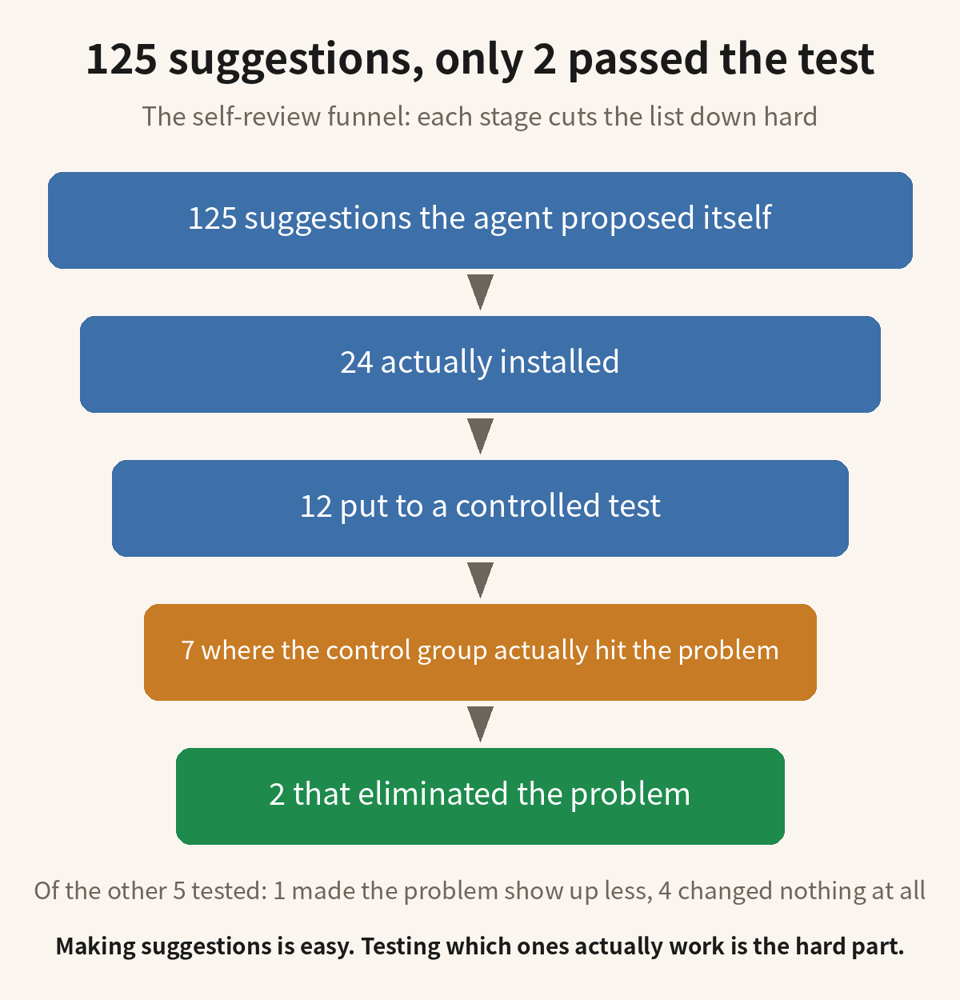

## This is how most people use agents now

Most people now work with an agent the same way. The agent drifts off course while it works, you point it out, and it corrects itself. Getting it exactly right the first time is basically too much to ask, because an agent isn't a wishing machine.

Once the job is done, you ask it to sum things up. It goes back over the run and lists, one by one, where it went wrong and where it got stuck. What comes out of that retrospective usually goes straight into the project configuration, or into the agent's own core constraints file, so the next job starts with those lessons already loaded. Some people go one step further and distill those notes into a skill.

The point is straightforward: don't make the same mistakes next time. When the next project or the next task comes along, the agent should take fewer detours and do the job more accurately, with less friction.

## Someone put the retrospective to the test

The habit sounds so reasonable that almost nobody stops to ask whether it actually works. Recently, though, someone actually tested whether it works. The result didn't match what most people would expect.

Two researchers, Treude and Baltes, first had Claude Code run 30 bug-fixing tasks, and then had it look back and review its own work. The retrospective asked just one question: what needs to change in the setup that runs the agent? Claude Code came up with 125 suggested improvements in total.

The tool they used for the retrospective is called /retro. After a task finishes, it has the agent read the whole session back from the start and propose changes to the harness (the stuff that runs the agent: the software, the configuration, and the instructions given to the agent). Changing the harness means changing the setup the agent starts with on its next task.

The experiment used 30 tasks from SWE-bench Verified, all of them real issues from real repositories. The 125 suggestions were first classified one by one. The researchers picked 24 of them and actually put them in place. Then they picked 12 of those 24 and put them to a controlled test on later tasks.

The test was a comparison, run separately for each change. They picked a follow-up task from the same repository as the task that had produced the change, and opened two brand-new sessions for it. One session had that change in place and the other didn't. They then compared the two sessions. The question was whether the session with the change did less of the behavior that the change was supposed to eliminate.

Of the 12 changes taken into the test, 5 could not be tested at all. In the control sessions, run without the change, the problem the change was meant to fix never came up. The control sessions are the only reason anyone knows this. Without them, the 5 changes would have finished their test runs with no problem ever showing up. That clean run would have been taken as proof that the changes worked. In fact, the 5 were never tested at all: the problem never came up, so no comparison ever happened for them. Of the remaining 7, 2 eliminated the behavior completely. One more made the behavior show up less often, and the other 4 changed nothing at all.

So, back to whether it actually works: retrospective summaries aren't completely useless. Of the 12 changes taken into the test, 2 really did eliminate the problem completely, and 1 more made it show up less often. The other 9 of the 12 either changed nothing or were never tested at all. That was the yield from 125 suggestions the agent produced.

## Why most of the 125 suggestions didn't help

The quality of the suggestions themselves is also a problem. Of the 125, 43 were about lint, and 18 of those recommended the same practice no matter what had actually happened in the task. Suggestions like that don't grow out of evidence. The agent is just restating an approach it already believed in.

Some changes made things worse. In their paper, Treude and Baltes report that some changes actually made the agent do extra work on unrelated tasks. Once a change is in place and nobody tests it again, it just stays there. From then on, every time the agent runs a task, it does a little extra work it didn't need to do.

The problem isn't how many suggestions the agent makes. The problem is that the agent reviews its own just-finished task. It sees that task only from its own point of view. Wherever it got stuck this time, it takes that spot to be the thing to change next time. But where it got stuck and what actually needs changing are two different things.

Without a control group, the agent can't tell two things apart: whether the change really fixed the problem it was meant to fix, or whether that problem was never going to show up again anyway. Reviewing yourself, by yourself, can't separate those two. Of the 12 changes above, 5 landed exactly in this blind spot. The problem never appeared in their control sessions, so there was nothing to compare, and they were never actually tested.

The 43 lint suggestions among the 125 included 18 that recommend the same practice no matter what happened in the task. Those 18 are boilerplate. A suggestion that would show up word for word on a different task has nothing to do with what actually happened in this one. Save a suggestion like that as experience, and next time you will simply read back the same ready-made line. The evidence from this task never got saved along with it.

Nothing in this workflow ever removes a change, so the changes pile up. The more they pile up, the further the agent drifts from how it originally worked. And every untested change you add is one more chance for unrelated tasks to pick up extra work.

## How to do it right

Step one: go through the retrospective yourself first. If you have development experience, a quick scan is enough to spot the ones that are off: the ones that are plainly wrong, the ones that repeat something already said, and the boilerplate that would hold on any task. Delete those on the spot instead of saving them for testing later. This step runs on your own experience, it takes a few minutes, and what survives it is what actually gets tested.

Step two: hand the surviving suggestions to a new agent to test. Open a brand-new session, in the same project as before. Write the surviving suggestions into the project configuration for this test, have the new agent read them first, and then have it redo the job you just finished. The agent does the running. You don't have to sit beside it keeping records, and you don't have to wait for the next task to show up.

Step three: look at how the redo went. You can see at a glance whether the redo repeats the mistakes from the first run, the ones you had to point out while the agent was working. If it doesn't repeat them, something among the surviving suggestions does work. If it repeats them anyway, the surviving suggestions didn't do anything. When you can't tell, open another session without the suggestions and run the same job in it. Comparing that run with the redo settles whether the suggestions did anything. That two-run comparison is the same one the paper used, except that the paper ran its comparisons on later tasks instead of on a redo of the same job.

Step four: decide what stays and what goes, based on the result. If the mistakes didn't come back in the redo, the suggestions you tested have earned a permanent place: leave them in the project configuration, or move them into the agent's core constraints file, and keep them there for the long term. If the mistakes happened anyway, delete those suggestions instead of letting them sit in the configuration taking up space. And if you want to know which single suggestion did the work, run the same test on each suggestion separately. That is exactly how the study tested its own changes, one by one.

When the next job comes along, it runs under the constraints that survived. The agent then reviews that job and produces a new retrospective. You delete the plainly wrong, the repeated, and the boilerplate from the new retrospective, and you test what remains by redoing the job. Round after round, the constraints get cleaner. In the end, what is worth distilling into a skill is the set of constraints that is still standing after several rounds of this loop.

## Distilling into a skill comes last

A batch of suggestions has to be tested this way, round after round, with the redo confirming each time that the mistakes don't come back. Only then should anything from that batch be written into a skill. When you write them down, note that redo alongside them: where the mistake originally happened, and whether it came back in the redo. Whoever picks the skill up later can then see directly why each suggestion earned its place.

The raw text the agent wrote during its retrospective does not go into the skill as a whole. Mixed into that raw text are judgments that were never tested, along with boilerplate that would hold on any task. What belongs in the skill is a few lines picked out of the raw text, the ones that went through the deletion pass in step one and were verified by the redo in the steps after it. When those lines go in, they should be rewritten as rules and carry the record of that redo with them. Copy the whole raw text in, and you have copied the untested parts in with it.

The paper's conclusion at the end makes the same point: generating changes and putting them in place is only the first step. You also need a way to know whether a change actually helped on later tasks, and a way to fix or remove the changes that didn't help.

If you also have your agent review and summarize its own work, and you want to distill those summaries into a skill, the redo test described above can be applied directly to your own setup. Please like this post and give me a follow. I will keep publishing hands-on tests like this one.

Source: Treude and Baltes, "How Do Coding-Agent Harnesses Self-Evolve?", arXiv:2610.34938, https://arxiv.org/abs/2610.34938

#AIAgents #LLM #AIEngineering
