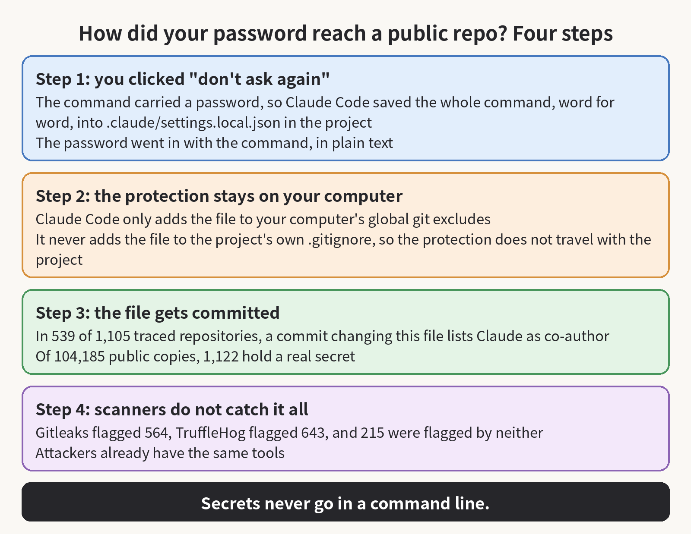

Have you ever clicked "Yes, and don't ask again" in Claude Code? If the command you approved that time carried a password, then your password may be sitting in a public repository right now. This week the security company Apiiro searched GitHub for one filename, .claude/settings.local.json, and pulled up 104,185 copies. In 1,122 of them there is at least one real secret, and together they hold 1,379 secrets.

## Take a concrete case

You ask Claude Code to connect to a production database, and the command you hand it contains PGPASSWORD= followed by the actual password. Claude Code asks before it runs the command, and when you click "don't ask again," it saves the whole command, word for word, into .claude/settings.local.json in the project, as a rule that lets it skip asking next time.

The next run goes ahead without a prompt, and the password stays in that file, in plain text.

## Sometimes the saved rule is a pattern, something like npm test *, and a pattern holds no password, so nothing leaks that way

Other times the rule is one exact command, and then everything that was in the command is saved with it. Apiiro's researchers reproduced this with the current models, Opus 5.5 and Fable 5.1, so it is not a leftover from an old version.

## The file is meant for your own machine, and Claude Code does try to keep it there

The first time it writes the file inside a git repository, it adds the filename to the global git excludes file, which is an ignore list stored in your own git settings. Once that list names the file, git on your computer skips it in every repository you work in.

## The list lives in your settings on your computer, though, and that is where the protection ends

Once the file is in the repository, a teammate who clones the project gets it as an ordinary project file, because the list that names it lives in your own git settings, and their git does not have that list. Claude Code never adds the file to the project's own .gitignore either, so the protection stays behind when the project moves. And if the file was committed before the ignore took hold, then the list cannot pull that committed copy back out.

## You may not be the one who committed the file, either

The researchers traced 1,105 repositories, and in 539 of them, the commits that changed this file list Claude as a co-author. Their reading is that Claude often commits the file itself. So even if you have never typed git add for this file, it may already be in your repository.

## The researchers also broke the 1,379 secrets down by type

Database passwords are the largest group, with 379. SSH logins for public servers come next, with 43, and then tokens for GitHub, GitLab and npm, with 42. AWS keys account for 23. Those four groups add up to 487, and the research does not break the remaining 892 down any further.

## More than a third of these secrets open a database directly, and the database passwords are only part of that set

Sixty-three organizations are caught up in this, and the two hardest cases are a database vendor's own admin-level cloud key and the owner password for a medical-records database. The researchers were not loose about what counts as a real secret, either: a string had to match a known key format, or a password or token had to sit next to a public server address, and an AI reviewer still had to agree before it counted.

## Apiiro did not try logging in with these secrets, though, so what they have shown is exposure, and they have not shown that anyone has used one of them to get in

Those are two different claims, and the research only supports the first one. But you cannot shrug it off either, because one organization the researchers notified wrote back and confirmed that its key was still live when they heard about it.

## The files carrying secrets are not new uploads

As of November 2, every file carrying a secret was still on its repository's default branch, and half of them had been there for at least 217 days. Deleting the file from your repository now does not fix it, because git keeps the older versions: the researchers found another 734 secrets in those older versions, spread across 509 repositories.

## Forks carry the same secrets: this file has been forked 211 times, from 74 repositories

The team-shared .claude/settings.json holds secrets too: the researchers checked 76,011 copies and found secrets in 298 of them. The researchers also found secrets in agent chat logs saved inside repositories. The current files hold 1,379, the older versions hold 734 more, and the team-shared file and the saved chat logs hold more still. Counting all of that together, the researchers reach 2,539 secrets across 1,994 repositories.

## You might expect repository secret scanning to have caught these

The researchers ran gitleaks and TruffleHog over all 104,185 copies. Gitleaks flagged 564 of the 1,122 files that hold a secret, and TruffleHog flagged 643. The two tools' flags overlap, and together they flagged 907 of the files. The other 215 were flagged by neither tool.

## Most of the secrets the two tools missed are passwords written inside commands

A scanner works by matching known key formats, so it can spot a string that is shaped like an AWS key. But the word after PGPASSWORD=, after sshpass -p, or after mysql -p looks like any other word in the command, so the scanner passes over it.

## In September 2025, a worm called Shai-Hulud ran TruffleHog, the same scanner the researchers used, on the computers it infected, hunting for secrets

TruffleHog can flag 643 of the 1,122 files, so anyone who runs it over these files can find the same 643. And because all of this sits under one fixed filename, .claude/settings.local.json, anyone can work through the copies one by one with a GitHub filename search.

## People did report this early

On August 11, 2025, a user filed a bug report saying that approved commands were being stored in this file word for word, API keys and tokens included. That report never got a reply, and on January 3, 2026, after 60 days with no activity on it, an automated bot closed it as "not planned." The four related reports the researchers cite have all been closed by the same bot since, the most recent on November 6, 2026, and according to the researchers, Anthropic, the company that makes Claude Code, has not replied to any of them.

The researchers also read the documentation of sixteen coding agents in all, and of those sixteen, Claude Code is the only one that saves the full approved command into a project file by default.

If you use Claude Code every day, then the first thing to do is a search: look through your GitHub organization for .claude/settings.local.json and for .claude/settings.json, and search the git history of every repository too, because the file may be deleted by now while the secret is still sitting in an older version.

## When you find one, then you should keep the order straight: you rotate first, and you clean up afterwards

Once a file has been public, you have to assume someone has already copied it, so you change every password, token and key that ever appeared in it, and only then do you go back and clean the history.

## For the cleanup itself, you stop git tracking the file with git rm --cached, and you add the filename to the project's own .gitignore

That step is what makes the protection travel with the project, because the list on your own computer stops counting the moment the project lands on a different machine.

## Then you open the copy on your own computer and delete the rules that hold a secret

From here on, when a command needs a password, you put the password in an environment variable and write only the variable name in the command, $DB_URL for example, so even when the rule gets saved, all it holds is a name. You approve patterns rather than single commands too, Bash(npm run:*) instead of one exact command, because a pattern cannot have your password inside it.

## This file ends up outside GitHub too

It is a plain-text JSON file sitting in the project folder, so it can also ship inside an npm package, a Docker image, a zip archive or a synced folder, and your cleanup has to cover those places as well.

## The number that stays with me from this research is 217 days

A password can sit in a public repository for that long and its owner hears nothing, because no step between the commit and the search ever comes back to warn him. Until Anthropic changes what gets saved, the only protection you have is the pause before you run a command: when a password is about to go into a command line, you turn it into a variable first.

I keep writing about AI, security and open-source tools. If you use Claude Code every day and this was useful, consider subscribing to this blog or bookmarking it.

Sources: Apiiro's research https://apiiro.com/blog/coding-agents-leaking-secrets-github-dont-ask-again · The Hacker News https://thehackernews.com/2026/11/claude-codes-dont-ask-again-file.html
