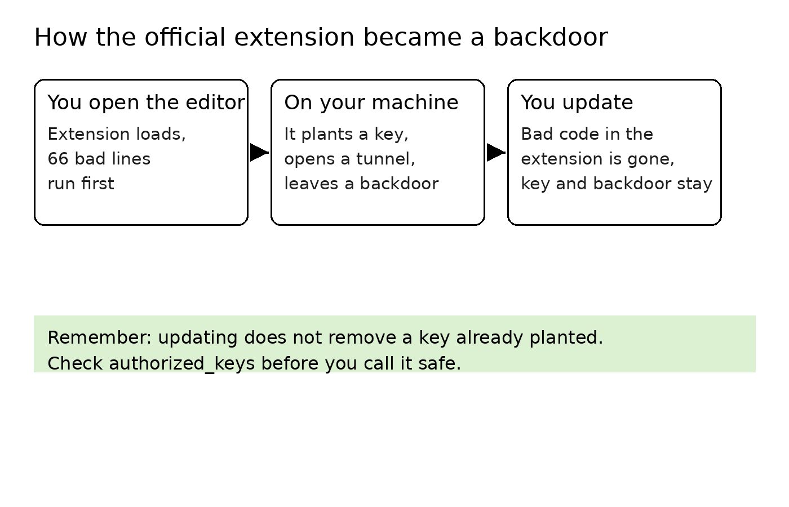

On October 29, two builds of the Claude Code extension in Cursor's marketplace were swapped for tampered ones. Versions 2.1.312 and 2.1.313 went up under Anthropic's verified account and name, with a 66-line loader inserted ahead of the real extension code, and the loader ran as soon as the editor opened. The two builds were available for about 11 hours, and Cursor said on X that at most 5,000 users installed or updated to them.

Anthropic did not write that loader, and it did not publish these builds. In its words, a malicious actor "used access to Cursor's marketplace to publish a tampered extension," and Anthropic "was not involved with building, publishing, or hosting this." The attacker got into Cursor's publishing path, and the file was changed before it reached you.

When did you last open the authorized_keys file on your own machine? Would you recognize every key in it?

I ask because the path this attack took ends at that file. Here is what the loader did, so the checks below make sense. It started by sending out a profile of the machine: hostname, username, operating system and architecture, home directory, current working directory, public IP address, the email in your global Git config, and the names of up to 40 environment variables whose names contain words like KEY, TOKEN, SECRET, PASS, AWS, or GCP. The report went to the attacker's server over plain HTTP, on port 8099.

That first report carried the variable names and left the values behind. The names alone tell the attacker which cloud accounts a machine holds and roughly which kinds of credentials are stored on it. The values only become reachable once he can log in, so he built himself a way in, in three parts.

The first part is a key: he added an Ed25519 key he controls, labeled svc-telemetry, to ~/.ssh/authorized_keys. That file is the allow list for SSH logins, and any key written into it can log into your machine. The second part switches the machine's SSH service on: Remote Login on a Mac, sshd on Linux, OpenSSH Server on Windows.

The third part is a reverse SSH tunnel to 134.209.82.225, reconnecting roughly every 60 seconds when it drops, so the attacker's server can reach back into your machine through it. To make that access survive a reboot, each operating system gets a way to restart it: on a Mac a LaunchAgent named com.apple.sysmond, a name chosen to look like an Apple component, which it is not; on Linux a crontab entry that runs at reboot; on Windows it tries to create a scheduled task called SysMon.

One part of the early reporting was wrong and has since been corrected. The first analyses pointed at Open VSX as the source; the tampered builds were only ever in Cursor's marketplace. Microsoft's October 30 analysis reached the same conclusion.

The other channels were all checked and are clean. The npm package, the Microsoft Marketplace build, and the Open VSX build are the normal releases, and the 2.1.312 on those channels is a normal version, and the tampered 2.1.312 existed only inside Cursor's marketplace. What you need to check is the copy you installed inside Cursor, not a copy from anywhere else.

Open ~/.ssh/authorized_keys and look for a key labeled svc-telemetry. On a Mac, search the LaunchAgents folders for a file named com.apple.sysmond. On Linux, open your crontab and look for a reboot entry you did not write.

On Windows, open Task Scheduler and look for a task called SysMon. Then look at the running processes for a long-lived ssh or autossh carrying a reverse forward that points back at port 22 on your own machine. If none of these turn up, this loader planted nothing on your machine.

Cursor states one limit that helps you judge your own risk. Turning the SSH service on takes administrator rights on Mac and Windows machines, and an extension normally does not have them, so on most of those machines the key was written but the attacker never completed the login. That limit describes most machines, but which case yours is can only be settled by the checks above.

If you do find something, do not delete it first. Save a copy of the authorized_keys file, save the LaunchAgent, crontab entry, or task you found, and note the command and parameters of the tunnel process while it is still running. With the evidence kept, remove the key, remove the persistence entries, and stop the tunnel.

Then, working from a clean machine you trust, rotate every credential the affected machine has stored, typed, or used. OpenSourceMalware's advice goes further, and I agree with it: rebuilding the machine is safer than deleting the artifacts you found and calling trust restored. You can remove what you found, but you have no way to confirm there was nothing else.

Once this machine is checked, a few standing habits cover the next one. The first is the file from the opening question. Your authorized_keys is the list of keys allowed into your machine; open it now and then, and every key in it should be one you recognize. This time the planted key was labeled svc-telemetry. Next time the label will be different, so the habit that works is recognizing every key, not searching for one word.

The second habit: if you do not log into this machine over SSH, turn Remote Login off. A planted key is only usable while the machine is running an SSH service; with the service off, the key gets nobody in. Most machines escaped a completed login this time because turning the service on needed administrator rights. Keeping that switch off on your own machine holds that same step at your admin password permanently. This blocks the login step, but it does not block the machine-profile report, so it works together with the other habits, not instead of them.

The third habit: install fewer extensions, and know which ones you have. An extension is a program that runs inside your editor with your account's permissions; it can read your files and run commands. This incident also shows what a verified badge actually proves. It proves whose account published the file, but it does not prove the file in this release was untouched. Checking the badge is still worth doing, because it stops the lookalike-name trick, but it cannot be your guarantee about the file itself.

The fourth habit concerns updates: do them, and know which half they cover. Anthropic replaced the two builds with 2.1.314, and the new build is clean, with the loader gone. The key already written into authorized_keys is still there, the persistence entries are still there, and the profile that already went out cannot be called back. After an incident like this, cleanup goes by the checklist, item by item, because a current version number is not evidence that a machine is clean.

Cursor took its whole marketplace down, rotated its own keys, rebuilt the marketplace before bringing it back, and worked with the hosting provider to take the attacker's server offline. But it still has not explained how a tampered build got into its marketplace in the first place. Anthropic says its own systems were not breached, while Kevin Beaumont, who wrote about the incident early on at DoublePulsar, criticized how Anthropic handled it: it did not notify users, and the tampered build was replaced quietly.

I maintain open-source projects, and most of what publishing takes lives on my development machine: GitHub tokens, cloud credentials, code that has not been released yet. So a stranger who can walk into a machine like that over SSH, and keep coming back, does not need to steal anything, because everything he needs is already on it. How a tampered build got into the marketplace, the platforms have not explained, and I do not know when they will. But the checks on my own machine can be done today.

The two builds sat in the marketplace for about 11 hours. How long the key sits in your authorized_keys depends on when you go and look at the file. Put everything else down for a minute, open that file today, and while you are there, confirm that Remote Login is off if you do not use it. If this was useful, bookmark it and subscribe. I keep writing up the practical side of AI, security, and open source.

Sources: OpenSourceMalware's analysis https://opensourcemalware.com/blog/trojanized-claude-code-extension-plants-persistent-ssh-backdoor · Cursor's security notice https://cursor.com/blog/claude-code-extension-security-notice

The "at most 5,000 users" figure is from Cursor's statement on X: https://x.com/cursor_ai/status/2116074289053175808
