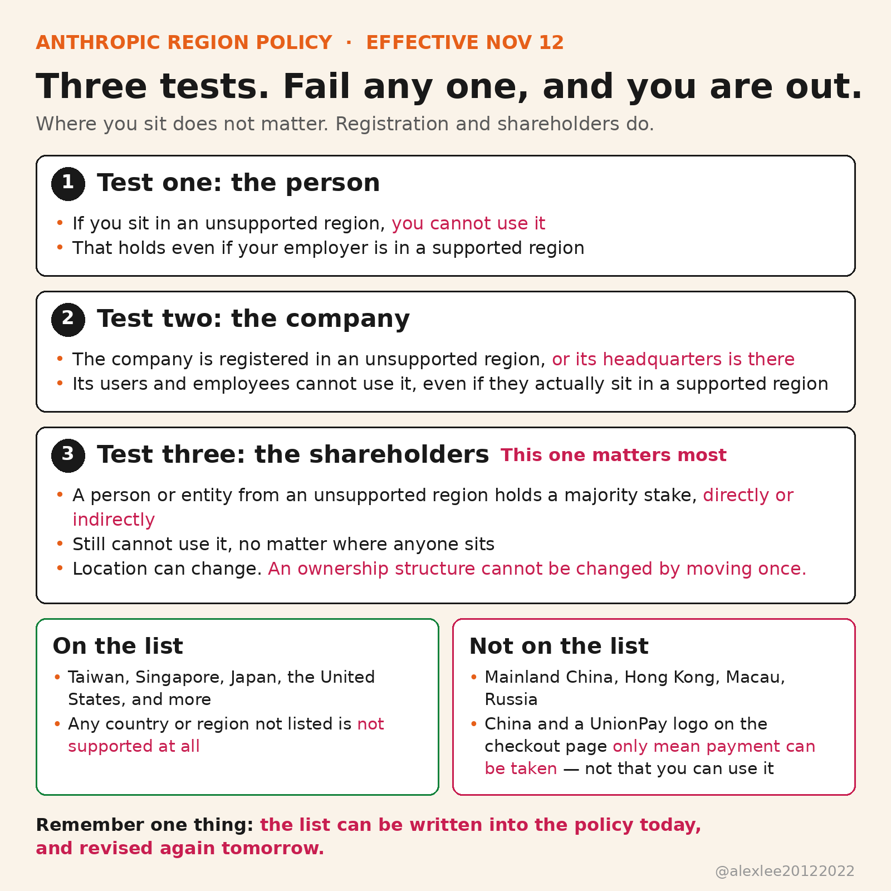

Open Claude Code tomorrow, and you may find that it no longer recognizes you. Anthropic announced its updated region policy on October 8, but the policy only takes effect on November 12, which is tomorrow.

The policy is called the Supported Regions Policy. It covers apps such as Claude.ai, Claude Code, and Cowork. The API is inside its scope too. Claude models offered through cloud platforms and authorized resellers are covered in the same way.

Taiwan, Singapore, Japan, and the United States are on the list. Mainland China, Hong Kong, Macau, and Russia are not on the list. The policy states this plainly: any country or region that is not listed is not supported. So this is not a partial restriction, because outside the list there is simply nothing.

The policy then splits "not supported" into three tests. The first test looks at the person: if you sit in an unsupported region, then you cannot use it, even if your employer is based in a supported region. The second test looks at the company: if a company is registered in an unsupported region, or its headquarters is there, then its users and employees cannot use it, even if those people actually sit in a supported region. The third test looks at the shareholders: if a company is majority owned or controlled, directly or indirectly, by a person or entity from an unsupported region, then it cannot use it either, and where its people sit makes no difference.

The third test is the one that matters most among the three. The first two tests target location, and location can change, because a person can travel and a company can open a branch office. The third test targets ownership instead, and an ownership structure cannot be changed by moving house once. The line this policy draws is not about where you are, because the line is about who controls your company.

Take a company that is registered in Hong Kong, while its employees work remotely from Singapore. That company is still out, because the second test looks at the place of registration. Now take a company that is registered in the United States, and all of its employees are in the United States too, but mainland Chinese capital holds a majority stake in it. That company is also out, because the third test looks at who controls it. Sitting in a supported region only gets you past the first test, while the second and third tests can still stop you.

The list itself will change too. The policy says these countries and regions are offered "currently," and that word "currently" means the list will be revised again. The policy was announced on October 8 and takes effect on November 12, so only a little over a month sits between the announcement and the effective date. The real worry this time is not whether you appear on this version of the list, but whether your toolchain can withstand the list changing one more time.

Some people hope to get around the policy through a cloud platform, but the policy closes that road too. Its scope is written plainly: Claude models offered through cloud platforms and authorized resellers are inside the policy as well. So the Claude you buy in a cloud marketplace still has to pass the same three tests, and changing the seller does not solve the problem.

One more point is easy to misunderstand. The Claude upgrade page has recently shown mainland China, Hong Kong, and Macau as options, and those options came with a UnionPay logo. Many people saw that and assumed access had opened up. In fact, those options only mean that the payment processor can take the money, and they do not mean that you can use the product. Whether you can use it is decided only by the Supported Regions Policy, which counts three things: where you actually are, where your company is registered, and who controls your company. The options on a checkout page decide none of that.

November 12 is not a new ban wave either, although that is an easy misreading. Region restrictions existed before this date, but this update writes the tests down in full and fixes their scope. Once the effective date arrives, the new text is what gets applied. So do not wait until tomorrow to check, because once an account actually runs into trouble, it is already late to look for a way out.

You can check three things right now. First, which region you are sitting in at the moment. Second, where your company is registered and where its headquarters is located. Third, whether a person or entity from an unsupported region holds a majority stake in your company. Ownership has to be counted on two levels, direct and indirect. If any one of the three tests catches you, then you should prepare a fallback.

The fallback is not an appeal, because an appeal will not work: Anthropic writes this list, and Anthropic alone decides whether the list changes. The fallback is to build your toolchain so that its parts can be swapped. Claude Code is only one entry point for writing code. The model can come from another vendor, the agent tool can come from another vendor, and the coding workflow itself can be replaced with another one, so the work in your hands keeps running. If you spend one afternoon today making that entry point replaceable, then your work does not have to stop when the list changes again tomorrow.

The list can be written into the policy today, and the list can be revised again tomorrow. You cannot control what Anthropic writes into its policy, but you can control whether your toolchain bets everything on one vendor's list. If this piece helped you, consider subscribing to this blog or bookmarking it. I keep sharing AI, security, and open-source work that I have checked and used myself.

Sources: Anthropic, Supported Regions Policy https://www.anthropic.com/supported-countries
