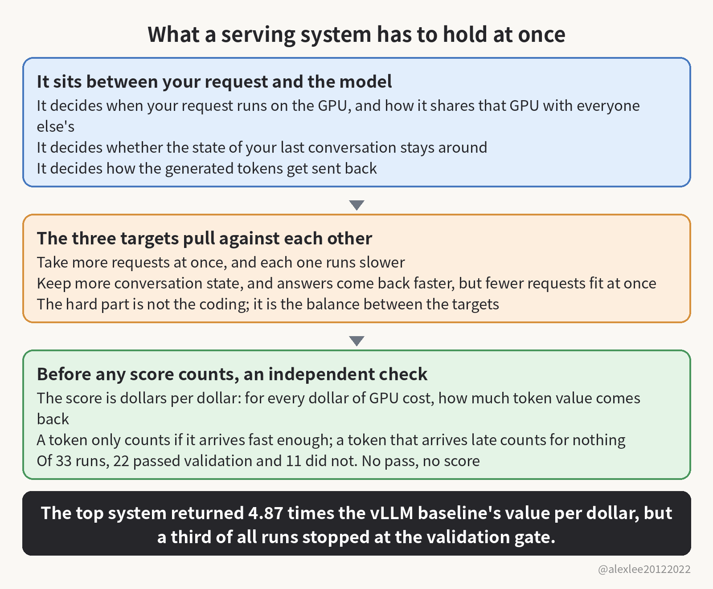

On November 4, researchers at CMU posted a new benchmark on arXiv called ServerBench. Say you run an inference serving system yourself, and someone puts an agent-designed version in front of you and says it beats what you run now. Would you swap it into production without checking it first?

The benchmark brought in 11 coding agent models (the kind of agent that writes code for you), ran three deployments, and made 33 runs in total. In each run, one model designed a complete LLM inference serving system on its own, and the system was then run and scored under a real workload.

Of the 33 runs, 22 handed in a system that passed validation, and 11 did not. The top score came from the system Claude Sonnet 5.5 designed on Gemma E4B: for every dollar of GPU cost, it returned 2.97 dollars of token value, which works out to 4.87 times the vLLM baseline. vLLM is the open-source system most people use to run inference serving, and the field treats it as the default reference.

Your request meets the inference serving system before it reaches the model. This layer decides when your request runs on the GPU and how it shares that GPU with everyone else's, and the sharing decides how long you wait. It also decides whether the state of your last conversation stays around, because keeping it means the next round does not have to compute everything from scratch. And it decides how generated tokens get sent back, because sending them back a few at a time wastes overhead, while holding them too long makes you wait.

Doing that job well means holding three things at once: how many requests the system can take, how fast the answers come back, and whether the answers are right. A function that handles only one of those is easy to write, because it only has to get its one thing right, and its inputs and outputs are fixed in advance.

Put all three into one system under real traffic, though, and they start pulling against each other. If you want to take more requests, then more of them have to share the GPU at the same time, but the more they share, the slower each one runs. If you want answers back faster, then you keep more of the last conversation's state, but state takes up memory, and the more you keep, the fewer requests fit at once. So the hard part of designing this system is not the coding but the balance between targets that pull in opposite directions, and that balance is exactly the job ServerBench hands to the agent.

The score is called dollars per dollar: for every dollar of GPU cost, the token value that comes back is the score. One condition sits on top of that, though, because a token only counts if it arrives fast enough, and a token that arrives late counts for nothing.

That condition exists to stop cheating. Without it, a system could hand its answers back as slowly as it liked. The token count would look just as good, but the person waiting would have waited far too long, and a late token is useless to them. On top of the latency condition, the benchmark replays real sessions with their context intact, so an agent cannot treat every request as brand new and save compute by throwing the context away. And every system has to pass an independent check before any of its numbers count, because only a system that passes validation gets a score at all.

Of the 22 runs that passed validation, 13 beat the strongest baseline in the set the paper put together. The 4.87 times is measured against the vLLM baseline. But the strongest baseline those 13 runs beat was a separate one the paper set up, and the paper never says it is vLLM, so the two numbers should not be read as one.

The systems with the top scores did two things together. On one side they made capacity bigger, which means taking more requests at the same time. On the other side they picked their load: first they looked at how much GPU time a request would take and how much token value it would bring back, and then they decided whether to take it. The ones that brought back more token value than the GPU cost they used got in, and the rest either waited or were turned away.

The two have to go together, because doing only one of them leaves a hole on the other side. If you only grow capacity and never pick which requests come in, then GPU time gets spent on requests that return less token value than the GPU cost they take up, and the bigger the capacity grows, the more of it gets wasted. If you only pick your load, then a system that can only take a few requests at a time caps what you can earn back, no matter how well you pick. When both happen together, the extra capacity lands on exactly the requests that were picked, and that is how the scores got up there.

An agent improves its design by running experiments and reading the performance feedback, so the experiments shape whatever it ends up learning. If you tune against a generic test whose traffic looks nothing like real traffic, then the settings you land on are wrong for real traffic, because the experiment has been teaching the wrong lesson the whole time. The paper says the feedback became usable once the experiments started asking the real workload where it was slow, because the slowest point only shows itself when the real workload runs.

The third finding is the one I care about most, and if I were running a team, I would put it first. Every optimization adds a new path through the code, and a new path can go wrong in ways the old path never did. So the paper says each new path an optimization brings in has to be checked on its own, because you cannot assume it is as reliable as the path it replaced.

Speed is easy to measure, because one run tells you how fast you got. Correctness is different, because if you never check for it, then a system can be wrong and you will never see it. A rising score looks like success to an agent that only chases the score. So it will naturally trade correctness away for speed, unless someone stands next to it and checks what it hands in. The score itself is built only from token value per dollar of GPU cost under a latency condition, so nothing in it reports whether the answers are right, and correctness stays invisible unless someone checks it.

The independent validation in ServerBench is what stands in the way of that. The 11 runs that did not pass fell at that gate, because a system that cannot get through validation counts as never submitted. Without that gate, the fast ones among those 11 would have posted good-looking scores, and people would have taken them and used them.

Put the three findings together and they describe a loop that is closing: agents have started designing the systems that serve the models, and the models inside those systems are the ones running the agents. Once that loop is turning, the craft of infrastructure work shifts with it. Writing the system yourself still matters, because the checks only work if someone understands the system well enough to know what has to be checked. But the more important skill from here is catching a system that is fast and wrong, and stopping it before it ships.

The 4.87 times is the number I expect to travel furthest, because it is dramatic and easy to remember. But 22 and 33 are the numbers I will keep, because they say something plainer. Eleven of the 33 runs could not hand in a system that passed validation, and that is a full third of the 33. So treat the 4.87 times as one lab's result for now (the numbers are the paper authors' own, and I have not re-run the benchmark myself), not as a settled fact.

If you run inference for a living, then before you swap in any agent-designed system, take a look back at your own checks. Whether they can stop a system that runs fast and answers wrong is something to settle before the swap, not after. If taking a benchmark apart like this is useful to you, consider subscribing to this blog or bookmarking it. I keep writing about AI systems that run under real traffic, and about how to check them.

Source: the paper https://arxiv.org/abs/2611.06841
