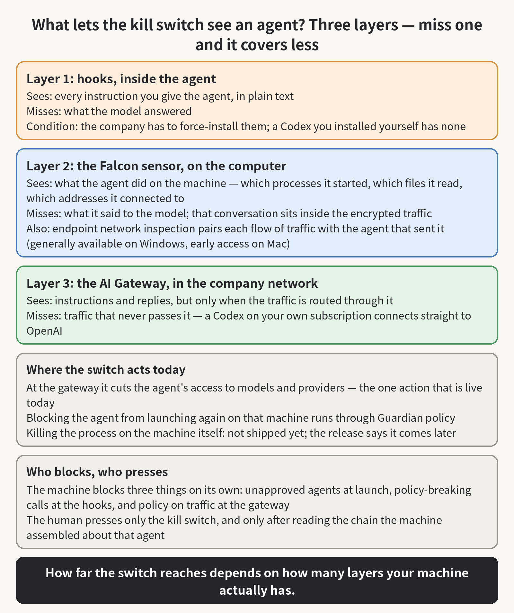

On November 3, at its Fal.Con Europe conference in Barcelona, CrowdStrike launched an AI Kill Switch inside Falcon Guardian, its system for finding and governing the AI agents running across a company. The pitch is simple: when an agent goes off course, a security admin can terminate it, block it from launching again, and cut off its access to the enterprise network. It sounds like you install the product and the switch is just there, ready to press.

I walked through that claim using the Codex I run every day. Codex sits on my machine, and everything it exchanges with OpenAI travels over HTTPS, which means the traffic is encrypted before it leaves. If a gateway sits somewhere in the company network, all it sees is an encrypted stream. It cannot tell a prompt from a response, and it cannot tell which message should be blocked and which should pass. So how does this switch see an agent at all, and how does it stop one? I read the launch release, the product page, and the broader announcement from the same day.

The answer is that the switch does not rely on decrypting anything. It relies on three layers that have to be installed on your machine in advance. If a machine is missing one of those layers, then the switch can see less of what the agent does, and it can stop less of it too.

The first layer lives inside the agent itself, in the form of hooks. Claude Code, Codex, GitHub Copilot, Cursor, and the other widely used agents all expose hook interfaces: every time the agent receives an instruction or gets ready to call a tool, a hook can look at it first and block it on the spot if it breaks policy. Guardian plugs its checks into those hooks. Because the hook sits inside the agent, it sees the prompt in plain text, and HTTPS never enters the picture.

Hooks come with two conditions, though. The first is that somebody has to install them. On a company-managed machine, that can be forced. For Codex, OpenAI's enterprise documentation says an admin can define managed hooks in a configuration file called requirements.toml, have the company's device management tooling push those hooks to every machine, and employees cannot turn them off; the admin can even set Codex to run only the managed hooks.

But if the company never deploys any of that, a Codex you installed yourself contains no such hooks, and nothing it does gets reported to anyone. The second condition is that hooks do not see everything. CrowdStrike admits this in its own announcement: hooks see the prompt, but they miss the model's response, and they cannot catch every action an agent takes. OpenAI's documentation adds a quieter caveat: if a hook's callback errors out or times out, the hook can simply fail, and the tool call goes ahead anyway.

The second layer is the Falcon sensor on the machine. The sensor watches the agent at the operating-system level: which processes it starts, which files it reads, which outside addresses it connects to. All of that is visible to the sensor, so even an agent with no hooks leaves a record of what it did on the machine.

What the sensor cannot see is what the agent said to the model, because that conversation is inside the HTTPS connection, and the sensor is outside it. The best it can do is line the records up afterward: this process connected to that address at that time and sent this much data. Guardian also has a feature called endpoint network inspection, which exists to pair those two sides together: which network traffic came from which agent, and what that agent did on the machine right after sending it. That feature is generally available on Windows, and Mac is still in early access. CrowdStrike is open about the blind spot in a network-only view, too: if an agent runs a local open-weight model on the machine, it has no network conversation at all, and the network-inspection side has nothing to pair with what the sensor records.

The third layer is the gateway. Guardian includes an AI Gateway, and a company can route its AI traffic through it. When traffic passes through the gateway, prompts and responses can be inspected, usage can be counted, and policy can be enforced at that point. The gateway sees content not because it can crack HTTPS, but because the traffic was deliberately sent to it. If your Codex is your own subscription and it connects straight to OpenAI when you open it, no company gateway sits on that path, and this layer simply does not exist for that agent. The gateway is not failing at its job in that case.

Which of those layers a machine has decides what the kill switch can do to the agent running on it. The part that is live today acts at the gateway: it rapidly cuts off an agent's access to designated AI models and providers. That is the product page's own description of the action. An agent that depends on the gateway stops getting model responses once it is cut off, and a task that cannot get responses cannot keep going. The other two actions are blocking the agent from launching again on that machine or group of machines, which runs through Guardian policy, and cutting off its access to the enterprise network.

The action the name most suggests, killing the agent's process directly on the endpoint where it runs, is the one the release schedules for later: terminate first at the gateway, and soon on the endpoint. So whether pressing the switch today stops an agent outright depends first on whether that agent goes through the gateway. If it does, its model access is cut and the task stops. If it does not, what you have is the relaunch block and the network cut, because the most direct blow has not shipped yet.

So is the interception done by a person, or automatically by the system? You have to split it, because this system divides the two on purpose. Three parts are automatic. An agent that is not on the approved list gets blocked when it tries to launch. Hooks block policy-breaking prompts and tool calls at the source, before anything is sent. And the gateway enforces policy on the traffic passing through it, masking sensitive data that should not reach a model and blocking what should not pass. The kill switch itself is the human part, and CrowdStrike's own words for it are "Human in Control, Fully Logged." An authorized admin triggers it, and every action lands in an audit trail, the record of who did what and when.

That raises the obvious question: with thousands of agents running in a company, how is a human supposed to keep up? In CrowdStrike's own demo material, one Fortune 500 customer inventoried 18,000 agents on its endpoints, and only 300 of them were approved. Nobody can watch 18,000 agents, so the design has the machine do the filtering first. Unapproved agents never get past launch, so no human has to think about them. For the ones the detection flags, the system assembles the agent's story into one chain before a human ever looks at it: who deployed it onto that machine, what instructions it received, which tools it called, which files it read, and what it sent out, with a risk score attached to each agent, and an estimate of how far the damage could spread (the blast radius) while an incident is still unfolding.

By the time a chain reaches the admin, the automatic layers have already disposed of everything they can decide on their own, so the only judgment left is whether that one chain adds up to a line being crossed.

That division of labor has one precondition nobody can engineer away: the human only sees what the detection layer flags. If an agent holds legitimate permissions and does the wrong thing inside those permissions, like sending a file that should never leave to a recipient who is on the approved list, the automatic layers see no violation, so detection may not flag it, and the chain never reaches anyone's screen. There is nothing wrong with the switch in that scenario. The problem is that the person who is supposed to press it may never learn there was anything to press it about.

The switch also cannot undo anything. It stops what has not happened yet. Data an agent already sent, files it already deleted, and operations it already completed before someone pressed the switch do not come back.

My own way of reading announcements like this one is to ignore the name of the button at first, and to ask which layer does the seeing and which layer does the stopping, and then to count how many of those layers actually exist in my environment. If you roll agents out at a company, then you should check three things on your own machines. Are the sensor and the managed hooks actually installed? Does your agents' traffic actually pass through the gateway? And when an agent that is not on the approved list tries to launch, does it really get blocked? Once you have those three answers, you will know how far this switch reaches over the agents you actually run.

If this was useful, consider subscribing or bookmarking — I keep writing about AI, security, and open source.

Source: https://www.crowdstrike.com/en-us/press-releases/crowdstrike-introduces-ai-kill-switch-for-ai-safety/
