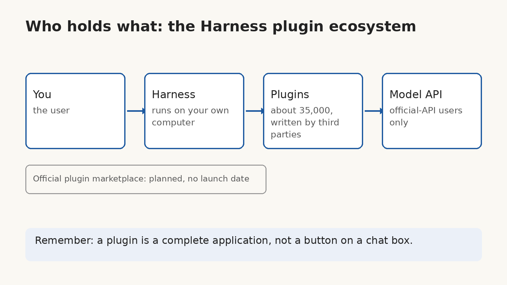

On November 4, 1.54 million people opened DeepSeek Harness. Whatever AI assistant you use, how much of what it does for you comes from plugins someone else wrote?

Harness is the agent app DeepSeek launched on August 13, with a desktop version following on September 29. It runs on your own computer, and the browser is its interface: you open it, hand it a task, and it calls models, runs tools, and gets the work done. On the evening of November 5, DeepSeek's product team published its first set of numbers. Daily active users on November 4 stood at 1.54 million, and that count covers only people going through the official API. Anyone connecting through a third-party API is not in the number.

On September 30, the seven-day average was still 271,000. Five weeks later, the single-day figure for November 4 was 1.54 million, about 5.7 times as many. The same release carried three more figures. These users burn about 92 trillion tokens a day, and third-party plugins already number around 35,000, with about 60% of active users having built or installed at least one.

What these numbers really show is not that DeepSeek's model got smarter. The gap between models is closing, because every lab now has a model good enough. What is actually pulling ahead is the ring of plugins around the model, written by other people for Harness.

These plugins are not little buttons added to a chat box. A Harness plugin is a complete application. The examples DeepSeek itself highlighted include a creator workbench that puts idea notes, script writing, cover design, and storyboarding in one interface, a design plugin that merges design and copy polishing, and a reading plugin for papers that keeps highlighting, translation, and note-taking in one place. What those three plugins can do already replaces features Harness ships itself.

So the logic of growth has changed. A tool like this used to be judged on its own model and its own features. More than half of Harness users now run third-party plugins, so how good the tool is depends a great deal on what other people built for it. DeepSeek has read the same numbers, and it is preparing an official plugin marketplace, with token grants and other support for plugin authors. No launch date has been announced.

The 92 trillion figure can be worked one step further. Divide it by 1.54 million and you get roughly 60 million tokens a day for each daily active user. That is my own arithmetic, not a per-user number DeepSeek published, so read it only as an order of magnitude. Still, it makes one thing plain. An agent is not chatting with you for a few minutes. It is doing a full day of work for you, and the compute that work takes sits on a different scale from chat entirely.

But the faster the ecosystem grows, the more concrete the security side of it gets. A plugin is code written by a third party. It runs inside your agent, with your permissions, reading the files you handed to the agent. Harness's own safety notice says it plainly: the software has not undergone a security audit and must not be treated as secure or production-ready. It also says the project can execute model-generated code and commands, load third-party plugins, and reach the network, processes, credentials, and files made available to it.

Plugins are fine to install, and with 35,000 of them nobody can read each one's code before installing. So before you install one, look at which files it reads and which tools it calls, and do not skip that step, because once it is installed it runs with your permissions. Work that holds real credentials should not be handed to Harness before it has passed a security audit. Wait until the official marketplace and its review process exist, then judge whether they actually work.

Look further out, and the contest for agent tools has moved to a new field. Everyone has a model now. The difference is whose ecosystem holds the things you need to get work done. And once an ecosystem grows, review, revenue cuts, and malicious plugins come with it. If this piece helped you, consider subscribing to this blog or bookmarking it. I keep sharing what I have checked and used myself across AI, security, and open source, and when the plugin marketplace launches, I will write up whether it actually works.

Source: Figures published by DeepSeek's product team on the evening of November 5, reported by Bloomberg and the South China Morning Post on November 8–9; numbers post https://x.com/Fangzm168/status/2119773866260103170 ; safety notice https://github.com/deepseek-ai/deepseek-harness/blob/master/SAFETY.md
