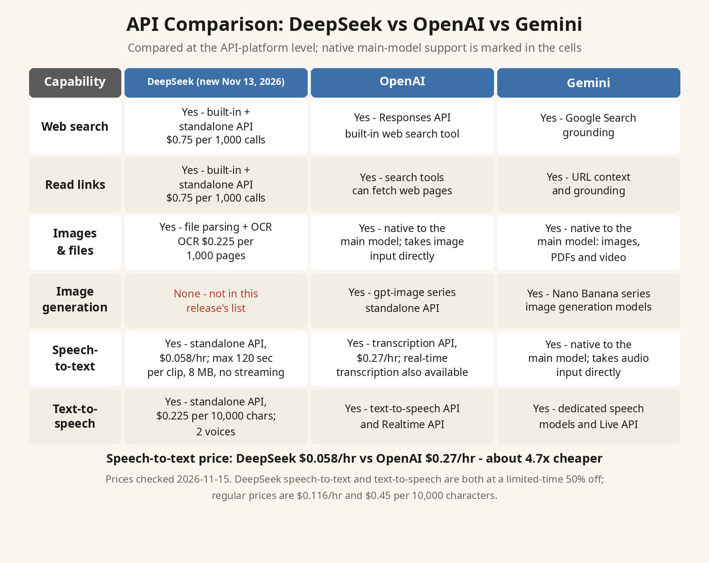

On November 13, DeepSeek posted four times in a row on X and announced a batch of new APIs. Developers can now call the search, file parsing, URL reading and voice capabilities that were already in use inside the DeepSeek App, and they can call them in two ways. They can turn on a built-in feature inside a chat request, or they can call each capability on its own as a separate API. The built-in list has eight features in total, and it starts with web search, where the answer comes with citations.

File parsing handles images and files, and handwritten content is inside its scope as well. The URL reading feature fetches a page first, and then the model reasons over what the page says. Three more features are about the conversation itself, because the system generates a title after the model answers, a safety check looks for risks in the user input and the model output, and user metadata markers pass time zone, place and language to the model, so the model can use that information when it answers.

The last two features are deep search and voice. Deep search means that the model searches the web and reads links on its own while it reasons through several steps, and, as DeepSeek's documentation is reported to say, it calls tools about 20 times at most in one run. Voice has two parts, because the system turns speech into text after the user speaks, and then it reads the text aloud after the model answers.

If a developer wants to turn on a built-in feature or deep search, then the model has to be DeepSeek V4.1-Flash, and the model name written in the interface is deepseek-flash. The parameters still go through when the wrong model is used, but the feature does not turn on. So you should confirm that you are calling this model before you start the integration work.

## Native support in the main model and separate platform APIs

When you put DeepSeek, OpenAI and Gemini side by side, you first have to get the basis of the comparison straight, because the answer changes when the basis changes. If you only ask whether one main model can take voice in and send voice out by itself, then the three companies give different answers. If you ask whether the whole API platform offers the capability, then all three have a matching service. So the comparison below uses the platform basis, and I will mark the places where the main model supports something natively.

## Capabilities OpenAI and Gemini already had

OpenAI's Responses API already had a built-in web search tool, and it appeared earlier than this DeepSeek announcement. OpenAI's main model can take image input directly, so the image reading item does not need a separate parsing service. Image generation has its own gpt-image family of APIs, and that family can also be called as a built-in tool inside Responses, which means that the platform covers both reading images and making new ones inside the same surface.

Voice is the item that people often get wrong, because many of them mix up OpenAI's main model with OpenAI's platform. The platform has a separate transcription API, and the model recommended now is gpt-transcribe, at $0.0045 per minute, which works out to $0.27 per hour. That transcription API handles recorded audio files, and it also offers live transcription. The platform also has a text-to-speech API, and its models include tts-1 and gpt-4o-mini-tts, so speech goes in both directions on the platform.

Alongside transcription and text-to-speech, OpenAI also has the Realtime API, and it can hold a conversation with voice in and voice out directly. There is also a date to plan around, because tts-1 and gpt-4o-mini-tts have been announced for retirement on January 6, 2027, and work will move to Realtime after they retire. So anyone who integrates them now should count that date in from the start, instead of finding it later.

Gemini differs from OpenAI again, because Gemini's official model documentation lists text, image, audio, video and PDF among the input types of its main model. That means that a user can send a piece of voice audio, and the main model can take it directly, without a separate transcription step first. For search, Gemini uses Google Search grounding, which connects the model's answer to Google search results. For drawing, Gemini has the Nano Banana family of image generation models.

For speech generation, Gemini has its own family of text-to-speech models, and its Live API can hold a conversation with voice in and voice out. So if you only look at the range that the main model supports natively, then Gemini's main model can take more kinds of input directly than the main models of the other two companies, because audio is already one of the input types of its main model.

## DeepSeek pricing and limits

DeepSeek charges the same price for search and for URL reading, at $0.75 for every thousand calls. OCR is charged by the page, at $0.225 for every thousand pages, and OCR recognizes text inside images and files, so it pulls words out of a page. It does not generate a new image by itself. Search and URL reading share one price, while OCR uses a different unit, because search and reading are counted by calls, while OCR is counted by pages.

Speech-to-text (ASR) is charged by the hour, and its price is now $0.058 per hour, because it is at a limited-time half price, so the original price is $0.116 per hour. Text-to-speech (TTS) is charged by the number of characters, and its price is now $0.225 for every ten thousand characters, while the original price is $0.45 for every ten thousand characters, and it is also at a limited-time half price. Both discounts are time limited, so the original prices are the ones to keep in view.

You can do the arithmetic on speech-to-text. DeepSeek charges $0.058 per hour, while OpenAI charges $0.27 per hour, so the OpenAI price is about 4.7 times the DeepSeek price. Search is a different case, because I did not check the official price lists for the matching OpenAI and Gemini tools item by item in this round. So for search I only give DeepSeek's own unit price here, and I do not compare it with the other companies.

Image generation is the one item that only DeepSeek lacks among the three, because OpenAI has the gpt-image family and Gemini has the Nano Banana family. If an app needs a user to upload an image and then needs a new image generated from it, then this batch of DeepSeek APIs cannot cover that step. The developer still has to connect an image generation service from another company for that part of the product.

The limits on speech-to-text are more specific. DeepSeek's ASR allows 120 seconds at most for one segment, the file can be 8MB at most, and it does not support streaming transcription, while it supports 21 languages. Because of these three limits, it fits short speech clips, which is the use that its numbers point to. But when a user speaks into a microphone continuously and expects text to appear while they speak, then its current use differs from OpenAI's live transcription and from Gemini's native audio input.

On the text-to-speech side, DeepSeek offers 2 voices and 10 languages, and it can stream its output over WebSocket. OpenAI's matching models have 11 to 13 voices, so if an app needs to let users pick a voice, then the choice that DeepSeek can offer right now will be much smaller, because two voices cannot cover the same range of preferences as eleven to thirteen voices.

## DeepSeek packaging and chat-demo

DeepSeek also differs from the other two in one specific part of its approach, and the difference sits in how you connect to it. OpenAI puts its built-in tools mainly inside the Responses API, while Gemini uses the generateContent interface with grounding and tool calls. Those two existing setups matter here, because DeepSeek's choice only stands out when you set it against the way the other two already expose their tools.

DeepSeek turned the search, file parsing and voice work that was already in use inside its App into parameter switches, and it added those switches to its existing Messages, Responses and Chat Completions endpoints, where the server runs them. Alongside the built-in route, it also made the same batch of capabilities into separate APIs, so a developer can call only one of them, and the developer does not have to move the whole chat flow over to get that one capability.

The company also open-sourced a front-end demo at the same time, and its name is chat-demo. The demo supports importing DeepSeek conversation records into it, and two days after it was open-sourced, the repository had gathered 1,507 stars. That count is the total from those first two days alone. The official claim is that a developer who follows this demo can rebuild the DeepSeek App inside their own app.

That claim is DeepSeek's own wording, and I have not installed this demo myself, so I will not draw a conclusion here about how far it can actually reproduce the App. The demo itself is sitting there, and developers can read its code themselves, and then they can judge how far it still is from an app that they could use directly.

## Cost calculation and checks before integration

Tool fees and token fees are charged separately, and that holds for all three companies, because OpenAI's price list also says that models with tools charge extra for the tools. So the number a developer has to work out is how many searches they will call each month, how many pages of files they will read, and how many hours of speech they will transcribe, and then they multiply each count by its unit price and add the result to the token fee. If you only look at the token unit price, then you will leave the tool fee part out of the total.

I usually have an agent read web pages and read files for me, so when I look at a price list like this, I estimate the call counts first, because search and file reading both build up by calls and by pages. Before you integrate, you can work through one week of real records once, and then you will know roughly how much of the total cost the tool fees will take, and you can decide which features stay on by default and which ones wait until the user clicks.

If you're building a chatbot or an agent and you're choosing which provider to use for search, files and voice for the work you are doing, then please collect this post and subscribe to the blog. I'll keep publishing comparisons like this one, where I put a few providers side by side, check the numbers first, and write down where each one falls short.
