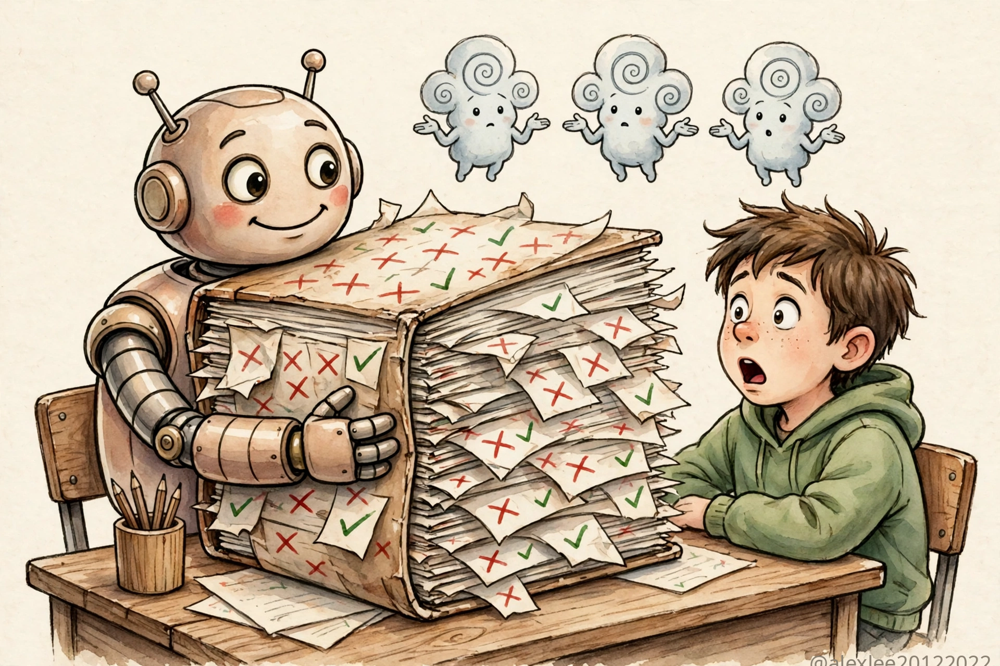
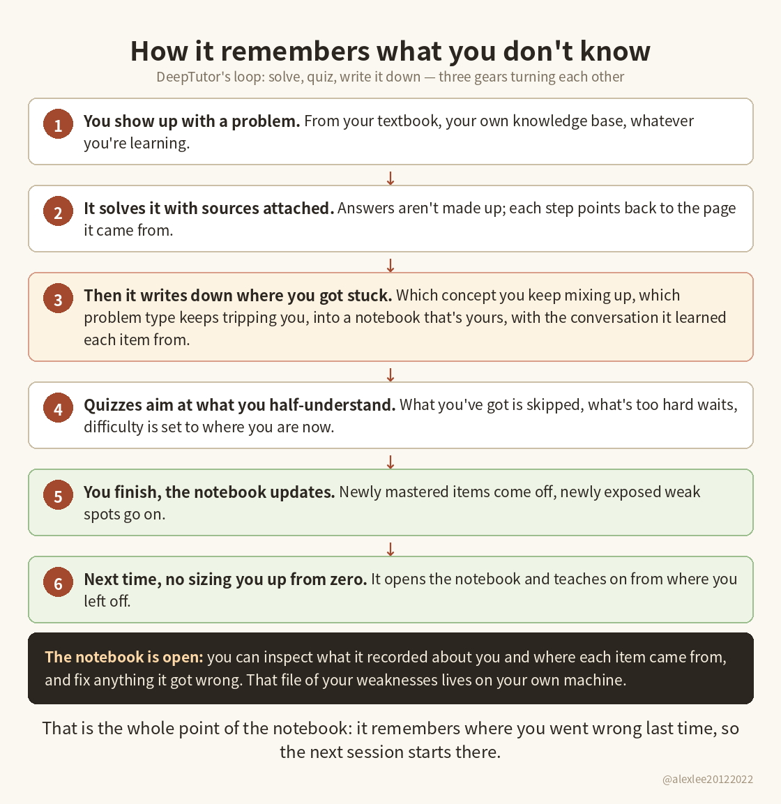
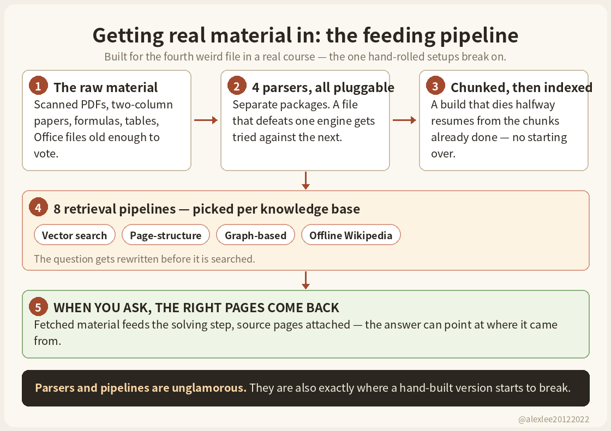
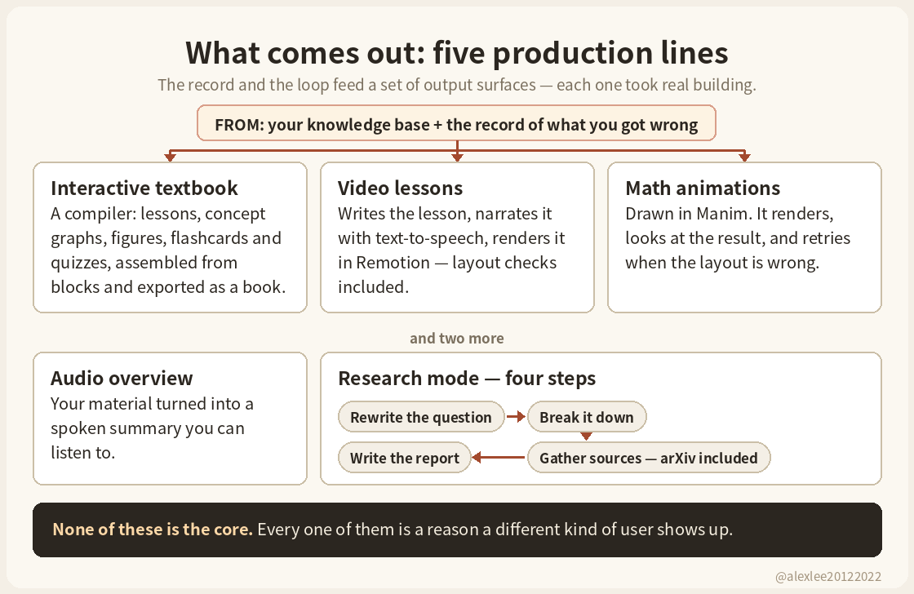
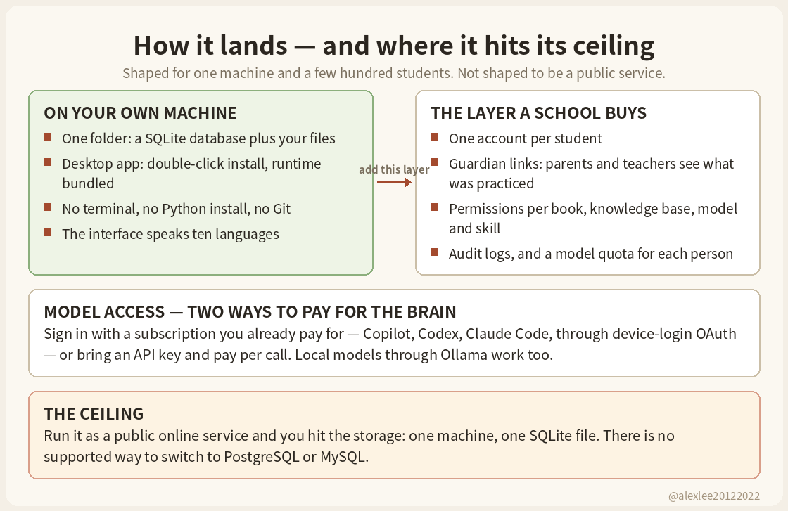
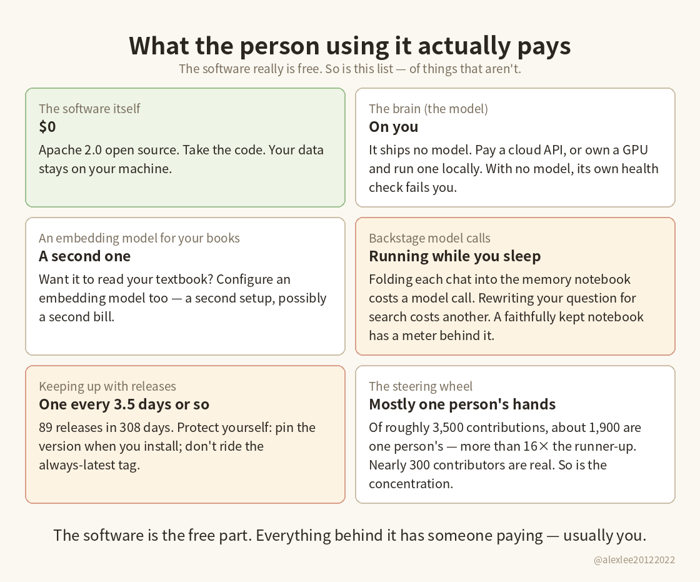

An open-source AI tutor out of the University of Hong Kong had 1,369 stars four days after its repository was created. Ten months later it is at nearly 54,000, and more than 5,000 of those arrived in the last four days alone. On October 28 I installed its v1.7.0 release and took it apart. Before the write-up was finished, v1.7.1 landed on October 31.

This is a long one, and the verdict needs the length to be fair. Here it is up front: DeepTutor's core, a structured record of what you got wrong and a loop that quizzes you from it, is the team's own engineering. It is also, in 2026, the one part of the product a single agent skill can copy. What a skill cannot copy is everything built around that core, and the 54,000 stars are mostly for the surroundings: a platform, a delivery shape for people who do not live in a terminal, and a lab that knows how to launch. If you are a technical user studying alone, you may need none of it. That distinction is the whole piece.

## The honest baseline: what a chat box already remembers

Any serious test of a tutor's memory has to start with what the ordinary chat box does today, because it does more than it did two years ago. Inside one conversation, the model sees what you said earlier in that same conversation. That part was never in doubt.

Across conversations, the big platforms have all added a memory layer of their own. ChatGPT keeps saved memories, facts it stores about you, and on top of that it can reference your past chat history when it answers. Claude's memory is on by default on its consumer plans and stores what it learns as topic files you can open, read and edit. Gemini has a Memory setting that learns from your past chats. The fine print differs by vendor: Claude leaves sensitive topics out by default, and Gemini's version only learns when Keep Activity is on. So the picture of the chat tutor as a goldfish that forgets you between sessions does not survive contact with 2026.

What that memory is not, though, matters just as much. OpenAI's own help page puts it plainly: memory does not retain every detail from every conversation, and ChatGPT decides which available information is relevant. What the platforms keep is the kind of thing a good assistant keeps: your preferences, your projects, the level you are roughly at. A study record is finer than that. It is not "this person is weak at physics." It is: on these dates you attempted these problems, you dropped the sign in the lens formula twice and mixed up image distance once, and last Tuesday you finally got three of that type right in a row. A quiz engine can compute with a record like that. A paragraph of preferences cannot drive it, because the individual events were never written down anywhere.

## The core: a record a quiz can compute with

DeepTutor, from the DeepTutor team at the University of Hong Kong's data science institute, builds that fine-grained record on your own machine. The record has three layers. The bottom layer keeps the raw record of every interaction, append-only, never rewritten, the way an accountant keeps the original receipts. The middle layer distills those records into facts about you, which concepts you keep mixing up, which problem types keep tripping you, each fact pinned to the interactions it came from, so a wrong conclusion can be traced back and removed. The top layer pulls those facts together into one learner profile.

On top of the record sits a working loop. When you ask it to work a problem, it classifies what kind of problem it is, works it, and checks its own result before showing you. Then it turns around and quizzes you, pitched near your current level, and the wrong concept in your answer gets written back into the record, which shapes what it asks next time. A scheduler decides when old material comes back for review, with different spacing for different kinds of knowledge. Solve, quiz, write it down, resurface it later. That loop, running on that record, is the core of the product, and it is the part most chat tutors do not have.

## The core is also the part a skill can copy

Everything in the previous section is a file format plus a set of instructions. Give a modern agent a skill file that says "keep the record in these three layers, quiz from it, resurface mistakes on this schedule," point it at a folder on your machine, and it will run a version of the same loop. Spaced repetition is a table of intervals and a queue of due items; the scheduler in this codebase is sensible engineering, not magic. For one technical user, studying alone, in a tool they already live in, the skill version covers most of what the core does. I have read the counterargument in the project's own materials and in the coverage of it, and none of it answers this point, because the point is correct, about the core.

So if the core fits in a skill, the obvious question is what the other roughly 330,000 lines of Python and 330,000 lines of TypeScript in this repository are for. That is where the actual product lives.

## What surrounds the core

Real study material is ugly: scanned PDFs, two-column papers, formulas, tables, Office files old enough to vote. DeepTutor ships four pluggable document parsers as separate packages, so a file that defeats one engine can be tried against another, and its indexing pipeline can resume from the chunks it already processed when a build dies halfway instead of starting over.

Behind that sit eight swappable retrieval pipelines, not one: vector search, structure-based page retrieval, graph-based variants, an offline Wikipedia backend, each selectable per knowledge base, with query rewriting in front of them. A skill can wire up a parser and a vector store for your clean files. The fourth weird file from a real course is where the hand-built version starts to break, and this project has clearly been broken on those files and fixed, repeatedly; its issue tracker carries exactly those bugs from exactly those users.

The record and the loop feed a set of output surfaces that each took real building. There is an interactive textbook compiler: lessons assembled from blocks, concept graphs, figures, animations, quizzes, flashcards, interactive elements, exported as a book. There is a video lesson pipeline that writes a lesson, narrates it with text-to-speech and renders it in a Remotion project with layout checks. There is a math animation agent built on Manim that renders an animation, looks at the result, and retries when the layout is wrong.

An audio overview turns your material into a spoken summary. A research mode rewrites the question, breaks it down, gathers sources including arXiv papers, and writes up a report. The notebook was rebuilt around pages and blocks, with an editing assistant whose changes only land when you accept them. None of these is the core. Every one of them is a reason a different kind of user shows up.

DeepTutor runs a "partner" system: a persistent tutor companion that lives inside 18-plus chat channels, WeChat, QQ, DingTalk, Feishu, WeCom, Telegram, WhatsApp, Slack, Discord and more, including partner group chats. A student can study inside the chat app they already use, and the partner can be present between sessions in a way a conversation window is not. A skill is session-shaped; it exists while you are talking to your agent. A resident companion on eighteen networks is a service, with connections to keep alive and messages to push, and that is a different species of software.

The multi-user layer is institutional: accounts, guardian relationships between parents or teachers and learners, per-resource permissions covering books, knowledge bases, models and skills separately, audit logs, device credentials, personal model quotas. Thirty-eight test files cover just this layer. A school does not adopt a folder of markdown and a prompt; it adopts accounts and permissions and an audit trail, or it does not adopt at all.

Its provider layer covers the usual API vendors and local models through Ollama, and also the subscription kind: Copilot, Codex and Claude Code through device-login OAuth, so a user can run it on a subscription they already pay for instead of a metered API key. The desktop app for Mac and Windows, officially still a preview, is a double-click install with a bundled runtime that starts the whole web interface without the user touching a terminal, a Python install or Git. The interface speaks ten languages, with consistency checks for the translations in its build pipeline. The whole repository carries 905 test files. You can argue with the taste of any of this. You cannot call it a wrapper.

The neatest evidence of where skills actually sit in this architecture is in its own service layer. DeepTutor has a built-in skill registry, its own hub for installable skills, and the repository itself ships a SKILL.md whose entire job is to let an external agent drive DeepTutor through its command-line interface. In this architecture, skills are a plugin layer on top of the platform, and one of them is literally the remote control for the platform. The criticism "a skill could do this" gets the dependency backwards.

## Can you actually use it?

I installed it, took the install apart, read the code and the release notes, and read the team's paper. I did not connect a model and study with it for a month. Nobody should sell you a verdict on long-term learning from an install test, including me.

A bare install of the v1.7.0 core took about two and a half minutes and 190MB on disk, dependency check clean. The core is chat, a command line and an SDK. The web interface everyone screenshots is a separate, heavier install. My install came with 25 module folders, solving, quizzing, the knowledge base, memory, the notebook among them.

And the first thing the software did was fail me: its own health-check command, doctor, reported two failures, no chat model configured and no embedding model configured (the one that turns your materials into searchable numbers). It tells you what's missing instead of performing "all set," which I respect, but it also states the terms plainly. Out of the box, DeepTutor does nothing until you bring a model, an API key and a budget. That was the core install, by hand, in a terminal. The desktop package exists precisely because most of its intended users would stop at the first of those steps.

The running costs are structural, not incidental. The software is free, Apache 2.0. It does not bring a model. Every question, every check, every quiz is a real call to a real model, and some of the spending happens where you cannot see it: after a session, a further call distills what happened into the record, another call may rewrite your next question against that record before it is asked. The record remembers better the more it is maintained, and maintenance is metered.

Meanwhile the upkeep above the software never stops. In 308 days the project shipped 89 releases, one every three and a half days on average, 15 of them in September and October alone, and v1.7.1 arrived three days after the version I installed, adding desktop preview apps and four more interface languages. The 1.7.0 upgrade notes also carry a trap that the 1.7.1 notes repeat word for word: if an old command-line package is still on your machine, uninstall it first, or you may pay for the new version and still be running the old one. I have not installed 1.7.1; everything hands-on in this piece is 1.7.0.

And the steering wheel sits mostly in one pair of hands. GitHub counts 3,205 contributions across 268 accounts; about 1,900 of them, roughly six in ten, are one person's, more than sixteen times the runner-up's 116. There is a real tail behind that person, 49 accounts with five or more contributions, so it is not a one-person repository. If that one person stops, the three-and-a-half-day release rhythm stops with them, and your upkeep problem becomes a survival problem.

## Why it is actually hot

None of the above fully explains 54,000 stars, including the near-vertical part: 1,369 stars in the first four days, and over 5,700 in the four days before I wrote this. Products do not get that shape from quality alone. The curve is a staircase, and staircases have mechanics.

The first step is the name on the door. HKUDS is the Hong Kong University lab behind LightRAG, a retrieval project with 40,000 stars of its own. English coverage of DeepTutor name-checks the lab's track record in the opening lines. A new project from a lab with a hit does not start from zero attention; it starts from a subscriber base. Note what the backing is and is not: it is a respected lab's brand, a paper and a project site. I found no university-level announcement behind it, and the launch did not need one.

The second step is the cadence feeding the chart. A release every three and a half days keeps putting the repository in front of GitHub's trending page, and trending puts it in front of the next wave of stargazers. The single biggest day, over 2,300 stars on October 29, came right after v1.7.0 shipped modular installs and the desktop preview. The release rhythm is the marketing department.

The third step is the category it sits in. One reviewer of the launch put it bluntly: it is a signal about self-hosting, not about tutoring. In a market where the big chat apps tutor for free inside their own clouds, "your materials, your record, your machine, models you choose" is a position a large crowd wants to endorse, and starring is how that crowd endorses things. The finished shape matters to the same crowd: most open-source tutors are a demo or a library, and this one installs like a product.

The fourth step is the breadth itself. Each subsystem is a separate door. The video lessons get shared to one audience, the math animations to another, the research mode to a third, the chat-app partners to a fourth, and the record-keeping story to a fifth. A narrow tool has one surface for the world to notice. This one has a dozen, and "it does everything" is itself the headline in much of the Chinese coverage.

Then the other side. In the last week of October the package was downloaded from PyPI roughly 1,200 to 1,950 times a day. Its issue tracker took 202 new reports in thirty days, and they read like real users on real machines: the desktop app missing a locally installed tool, a provider failing on Windows, old Office files passing upload and dying in parsing. What I could not find is a single named school or institution saying it runs this for its students, and the largest of its 6,658 forks has 26 stars, which is not what adopted platforms' forks look like. So the count is best read as a large crowd, a real and growing minority of users, and an institutional story that has not happened yet.

## The paper's two numbers, in their place

The project has a paper from the university team, and two numbers from it travel widely. They are supporting evidence, not the verdict, and both need their labels left on.

The 10.8% comes from TutorBench, a benchmark the team built itself: simulated students working through university course material with the system, its explanations and practice questions marked by another large model against a scoring guide, 3.91 out of 5, against a comparison score of 3.53 in the same benchmark. That is a judged quality score for teaching output inside a simulation. It is not a learning outcome. Nobody pre-tested and post-tested a group of real students.

The 29.4% needs an even closer look. It comes from a separate set of experiments where DeepTutor's solving was compared against four simple tutors the authors built themselves, and in that experiment its headline component, the personalization engine, was switched off the entire time. However good that number is, it has nothing to do with the record-keeping that is supposed to make the system worth installing.

The paper's limitations section is more honest than its abstract: it says plainly that the evaluation rests on simulated students and that whether its add-on features actually help people learn needs longitudinal studies with real humans. Hold them to their own caveat.

## Who it is actually for

If you are working through a course on purpose, preparing for an exam, or chewing through a thick textbook, and you will still be at it in three months, the full platform earns its weight for you: your materials go through parsers that can handle them, the record builds up session by session, and the quizzing starts from where you actually are. For that use I would install it, full version, Docker so the environment stays put, and pin it to one version instead of taking the always-newest image. Pinning means giving up features that land every few days, which is a fair price for a course that runs for months.

If you teach, or run a small school or tutoring operation, your reason is a different layer: the accounts, the guardian relationships, the permissions and the audit trail. That layer is the part no chat app and no skill gives you at all, and it was plainly built for your shape, one account per student, materials handed out by an admin, parents able to see what was practiced.

If the person who needs to use it does not live in a terminal, your reason is the desktop package and the chat-app partners. Judge those on whether your student actually opens them, because a tutor that lives where the student already chats has a chance a dashboard never gets.

And if you are a technical user studying alone, do not install it. Write the skill. The record format and the quiz loop, which are the parts that would actually change your results, fit in a skill file and a folder, inside the agent you already use, with no Docker stack, no release treadmill and no second system to keep alive. You give up the book compiler, the video lessons, the partners and the admin layer, and if you were never going to use them, you gave up nothing.

If you want help with tonight's homework, the answer is still neither: the chat app you already have remembers your level and your preferences well enough for that, and it costs you no setup at all.

## Using it with your kids

Could it raise your child's grades? It might help them close one specific gap, but as of today the project has not shown that it raises exam scores, and it certainly has not shown that it can replace a tutor or a cram school. My recommendation is plain: use it as a practice coach for weak spots, and do not cancel the human help because of it.

The evidence situation is the one from the paper section, and it does not improve by being pointed at a child: simulated university students, judged by a model, is not a child's score moving. Where it can help is in making practice less random, because the record of what your child got wrong can steer what gets practiced next, and a child whose mistakes get collected tends to meet the same problem again before an exam rather than after it. That route assumes a child willing to sit down and practice. The guardian layer does give you something a chat app does not: assigned materials and reports you can check, which helps you verify what the child actually practiced. A report can prove they sat down and used it. It cannot prove they learned.

A good tutor does more than explain. A tutor watches whether the child is stuck, guessing, or has drifted off, knows what the school teacher covers next week, and stops the copying when it starts. DeepTutor sees only what the child typed and uploaded. A cram school sells more than questions and explanations too: a fixed timetable, timed tests, a room full of peers applying pressure. DeepTutor cannot hold that rhythm for your child.

Judge it by what your child can do without it: unseen problems, closed book, before and after two weeks of practice on one weak unit, and watch the school quizzes. If those move, consider trimming part of the one-on-one hours. If they do not, it stays a question-answering tool, and the grade claims stay unproven. A young child should not be left alone with it either; somebody still has to check whether the content is right and whether the child is copying answers.

## Building a business on it

You can. The license is Apache 2.0: commercial use, modification and paid products built on it are all allowed, keep the license notices, mark your changes, and stay off their trademark, the name and logo are not yours to sell under. If you run tutoring, the multi-user mode was built for exactly your shape: one account per student, workspaces and progress kept apart, an admin handing out materials and permissions, guardian relations for parents. A few hundred of your own students is the case it was designed for.

If you are a developer hoping to use it as the base of a public SaaS platform, go and read how it stores data before you write a line. Every user's state lives in one directory on one machine, SQLite plus files, and the official documentation says there is no supported way to plug in PostgreSQL or MySQL. With few users that is called simple. At scale it is a ceiling, and the data layer becomes your rebuild, on top of the same version choice from before: pin one version and drift away from upstream, or follow a release every three and a half days and pay a regression test each time. There is no third option.

## What changed in 1.7.0, and what 1.7.1 already did to it

Since the version most readers would install today is no longer the one I tested, the short version of the delta: 1.7.0 made installation modular, rebuilt the learning workspace and the notebook around pages and blocks with an editing assistant, added in-browser video lessons, and let a knowledge-base build resume from where it died instead of starting over. Three days later 1.7.1 added desktop preview apps for Mac and Windows, four more interface languages, and a round of chat and lesson fixes, and its upgrade notes repeat the old-package warning exactly. If you install, you are installing into that current. Decide beforehand whether you are riding it or pinning against it.

Models will only get cheaper, better at explaining, and better at remembering you in the ordinary conversational way. Cores like this one will keep getting cheaper too: anything that is a file format and a loop, a skill will absorb within a season. What does not get absorbed is the unglamorous ring around a core, parsers that survive real files, surfaces for every kind of user, accounts and permissions for institutions, and someone keeping all of it running three releases a week.

When you judge the next AI tool with a frightening star count, that ring is what I would price: not whether the trick is clever, but who it is packaged for, what it plugs into, and whether the crowd around it is using it or applauding it. DeepTutor's record answers the first question a tutor has to answer. Its platform is the answer to the second. Applause and usage are not the same number, and telling them apart is most of the job.

If pieces like this are useful, subscribe or bookmark this blog. I keep taking apart AI, security and open-source tools the way I'd want them taken apart before I install them. And tell me: what is the heaviest tool you ever installed for a job a small script or a single skill later turned out to do just as well, or the other way around?

Project: https://github.com/HKUDS/DeepTutor/releases/tag/v1.7.0

