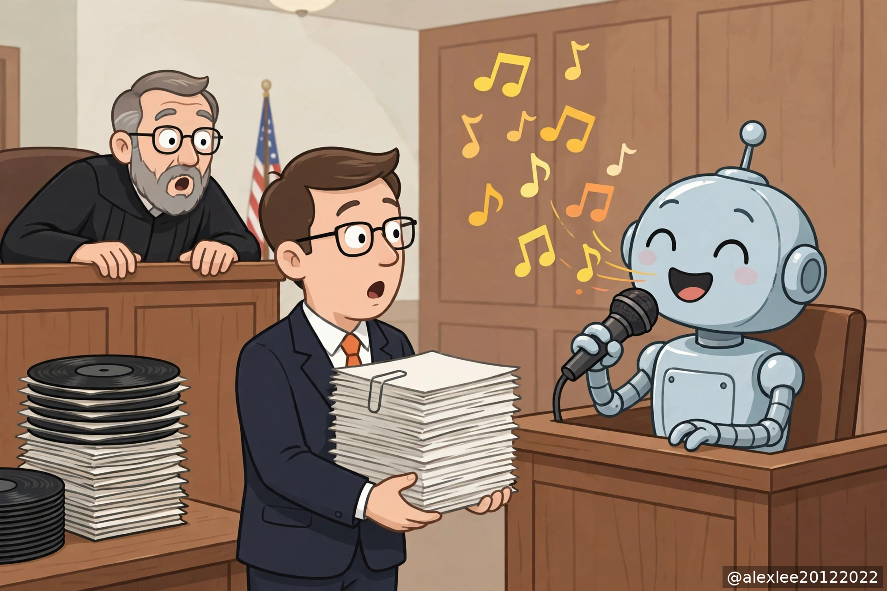

274 Elvis songs were used to train AI. Here's how the rights holders found out

On October 23, the owners of Elvis Presley's music sued Anthropic in federal court in the Northern District of California. A subsidiary of Authentic Brands Group is the lead plaintiff. The complaint says Claude was trained on 274 Elvis songs without permission. The copyright claim alone, at the statutory maximum of $150,000 per song, comes to $41.1 million. With the other claims added, the total asked for is about $48.6 million.

Anthropic says it disagrees with the claims and will defend itself. The case has not been decided. Everything below about the case comes from the plaintiffs' complaint.

The training set is not public, and there is no way to open a model up and inspect what it remembers. So the plaintiffs questioned the model and looked at what came out.

The complaint lists the kinds of questions they asked. They asked for lyrics by title. They asked for a song in the style of Elvis. They asked for something "original." They asked it to remake an old song for a modern audience. According to the plaintiffs, Claude repeatedly returned material very close to the originals: the hooks were there, the structure was there, some words were changed, and the overall frame was not.

The exhibits include a line from Claude itself, describing what it had just generated as "very close to the original." The complaint also notes that Anthropic had been sued over lyrics before and had added guardrails, the filters meant to stop it from outputting lyrics. According to the plaintiffs, the outputs continued anyway.

This works on Elvis because a famous work does not exist on the internet as one copy. It exists as thousands of copies. Lyrics sites print it, forums paste it, reviews quote it, and karaoke videos carry it in subtitles. When the same song is read a few thousand times during training, the model memorizes parts of it word for word.

In 2023, researchers tested this to the limit. They made ChatGPT repeat a single word over and over until it left its normal chat mode and began outputting long passages of text it had read during training. The whole exercise cost about $200 and produced more than ten thousand verbatim samples. Their conclusion was that alignment training does not delete these memories. It only covers them up in normal use.

But if a model can recite your song, that proves it memorized the song. It does not prove which copy it learned from. Strictly speaking, it does not prove that any particular file sat in the training set, because lyrics this famous are available through legal channels as well.

The reverse also holds: if a model cannot recite your work, that proves nothing. Most material these systems read is never memorized word for word. So questioning a model only works on work famous enough to have been memorized, and all it shows is what the model remembers.

The second layer an ordinary person can check is the public corpora. Many training datasets are public, or have leaked, and their contents can be searched.

For books, a journalist at The Atlantic built a searchable database where you can enter your name and check whether your books are in Books3. Books3 is a corpus of roughly 190,000 pirated books, and it was used in the training of several major models. In 2025 the same journalist made LibGen searchable as well: about 7.5 million books and 80 million papers, also searchable by name.

For images, a site called Have I Been Trained lets you check whether your pictures are in LAION-5B, a dataset of 5.8 billion images. For code, BigCode offers a tool called Am I in The Stack: enter your GitHub username and see whether your repositories are in The Stack dataset. And you can check whether your own website has been crawled by searching Common Crawl's index by domain, which keeps crawl records.

A hit shows your work appears in a corpus that labs commonly draw from. What a company takes back still goes through filtering, deduplication and sampling, and most of it is discarded. Which part was actually used in training is not visible from outside.

The journalist who built the LibGen search stated this limit himself: nobody can know exactly which parts of LibGen Meta actually used. So a hit is enough to register a claim or join a settlement process. It is not enough, on its own, to serve as courtroom proof that your work was trained on.

The third route is statistical, and researchers have tried it with limited results. The idea is that a model is less "surprised" by text it has read before, so by measuring its surprise word by word you can infer whether it has seen a given text. In 2024, a large evaluation tested these membership-inference methods one by one and found that, for a single work, their accuracy was only slightly better than chance. Some earlier results that looked accurate turned out to be measuring the style difference between older and newer text, not memory. The use of these methods that does hold up is at the level of a body of work: take everything an author has written together, and you can say something defensible about the set as a whole. It does not resolve to one song or one book.

There is also a method for future work: plant a unique invented passage in what you publish, and in theory it can be tested for later. The experiments say the planted text has to be long, and repeated many times in the data, before it can be detected. A medium-length passage repeated a hundred times was not detectable. Planted markers can also be removed during data cleaning, when they are treated as duplicates. This only helps work that has not been published yet. It does nothing for a song or a book that has been online for years.

So far, the one complete and usable training list that has appeared in public was produced by a lawsuit. The authors' case against Anthropic settled for $1.5 billion, and the settlement website now hosts a list of works that can be searched by title: more than 482,000 works, at $3,000 each, so authors can check whether their books are on it. That list exists because the case reached the discovery stage, where a court can require a company to hand over internal records. What the training actually used was put on the record for the first time.

The Elvis complaint contains one more allegation that bears directly on checking. The plaintiffs say that when Anthropic took the lyrics into its training database, it deliberately removed the copyright information attached to them: the lines identifying the writer, the publisher and the rights holder. If that happened, model outputs would never carry the credits, and rights holders would have no trail to follow back from an output. At this stage this is the plaintiffs' allegation. Whether it holds up is for the case to decide.

Putting the layers together, the conclusion is limited but clear. A model can be questioned, and that only reaches work that was memorized word for word, which in practice means famous work. Public corpora can be searched, and that only proves a work appeared in a corpus, not that a given company used it to train a given model. Statistical methods give approximations that do not resolve to individual works.

The complete list, which company used which of your works in which model, exists only in the companies' internal records, and outsiders have only ever reached it through discovery in litigation.

That produces a practical difference. Companies and publishers with large catalogs can afford lawyers and can get to the discovery stage. Everyone else has questions they can ask a model and indexes they can search, which give you a lead when they hit, and tell you nothing when they miss. The cases now running are also setting the standard for what counts as evidence. When an independent musician, a small-press author or a programmer with public repositories later asks the same question, that standard is the one that will be applied to them, whether it fits their situation or not.

For your own work, the list of things to do is short, and all of it can be done today. Run the checks that exist: books against Books3 and LibGen, images against Have I Been Trained, code against Am I in The Stack, your site against Common Crawl. If you get a hit, save a screenshot. That is the closest thing to evidence an ordinary person can hold. From now on, keep your own timestamps in order: commit histories for code, revision histories for drafts, anything that shows your work existed before a model's output resembled it. Robots.txt blocks and opt-out registries are worth doing as well, but be clear about their scope. They govern future crawling. They do nothing about a model that has already been trained. What a model has already learned cannot be opted out of afterwards.

My judgment is this. Until companies publish their training lists themselves, the most an ordinary person can establish is that a work appeared in a corpus. Anything beyond that has required a lawsuit. The Elvis rights holders can check further than the rest of us. The difference is not the method. It is that they can afford litigation. Have you checked your own work? A book, a picture, a repository. It takes a few minutes, and it tells you which layer you are on.

https://www.hollywoodreporter.com/music/music-industry-news/anthropic-elvis-presley-lawsuit-ai-1236739617/
