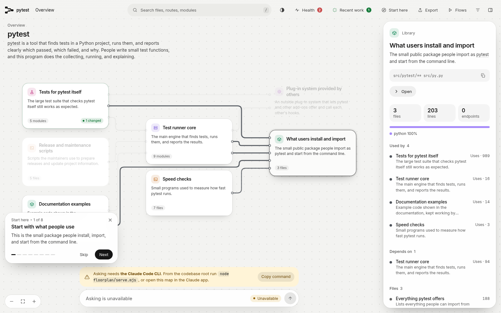
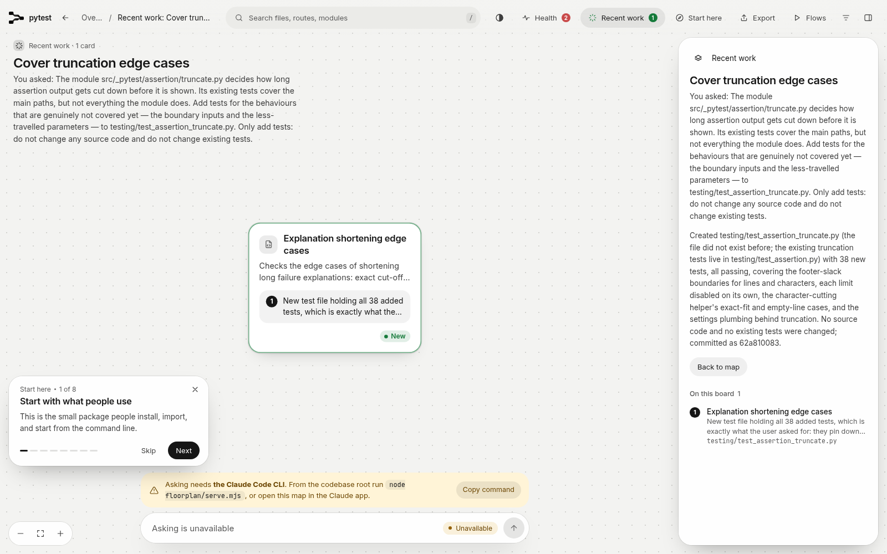
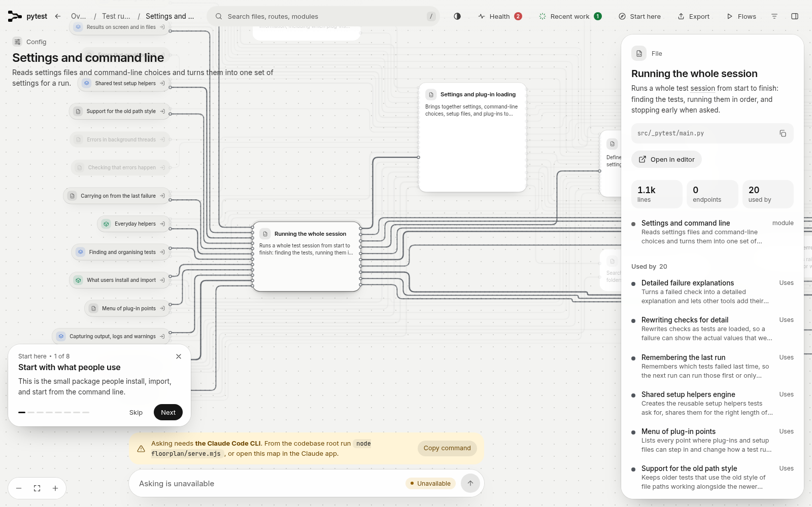
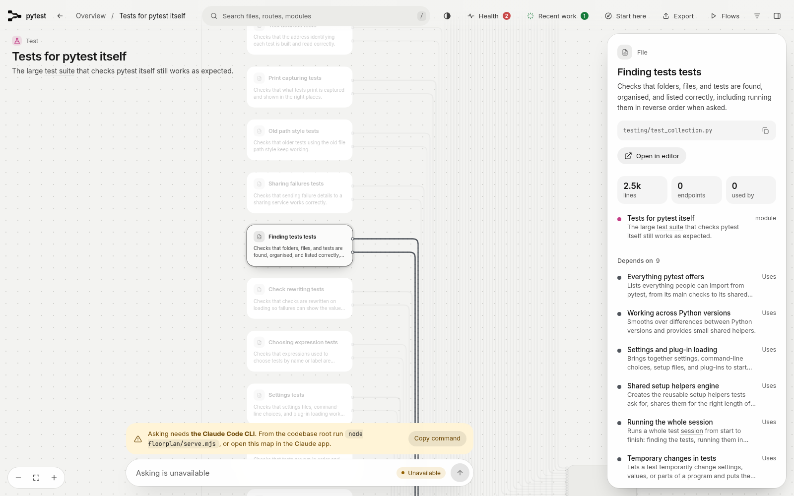
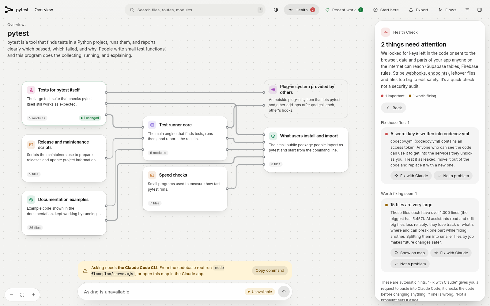

That day I handed pytest's own repository over to several agent sessions and let them take turns changing it. Because I wanted to see how much of the record a tool like floorplan, which keeps records for a repository, would still have left to reconcile when wrapping up in the evening. After four things were done, it had fully remembered only one thing.

One person can only keep an eye on 6 to 7 agents at a time, because what each agent is changing, how far it has got, and which one should stop all have to stay in your own head. So once they have all finished changing things, I often can no longer tell clearly which change corresponds to which need.

It was precisely because of this that I wanted to hand the record-keeping over to a tool, so that when I reconciled the accounts in the evening, I would have a ready-made record I could check directly.

## What floorplan can do

floorplan is a plugin that draws a map for a code repository. It works while installed inside Claude Code or Codex. It can do several things.

1. It gives every file in the repository a card, and on each card it writes the file's plain-language name and a one-sentence description, and the cards are also linked by references, so by following the cards you can see which files call each other.

2. It has a recent-work board, and on that board it records which cards the session that just ended changed, and next to each changed card it also writes why it was changed, so when you look back you can tell which need that change was aimed at.

3. It also gives the repository a health check, which means it scans the code from end to end and looks specifically for problems such as secrets hardcoded in the code. At the same time it picks out files that are too large and lists them together to draw your attention to them.

In its README, the vendor promises that after every change Claude or Codex makes to the code, you can see exactly which places it touched, and you can also see why it touched those places.

I tested it on pytest's own repository precisely because pytest is a real multi-subsystem project, where parts such as configuration, the runner, and the cache are all code that is in real use. So if I want to know whether a tool can really keep the accounts straight for a repository like this, then I have to test it on a real project like pytest first, because only results that are actually tested count.

## The setup for the test day

The setup that day was this: I opened 4 sessions in total, and those sessions worked on the same repository one after another. That is to say, the next session only started after the previous session had ended.

Because the later sessions did not know in advance what the earlier sessions had done, they could only look at the state of the repository itself and at the records floorplan had left behind if they wanted to find out what had happened before. The tasks the sessions were given were all different, specifically the following things.

1. The first session first built the whole map, and then it added a new option to pytest, --reverse-order. When this option is turned on, the collected tests run in the opposite order from the original one, so problems hidden in the execution order can be brought out. The registration of the option and the reversal of the order are written in src/_pytest/main.py, while the tests that prove the order really was reversed are written in testing/test_collection.py.

2. The second session received a fault report saying that --lf could not find the previous failure records, so it had to rerun the whole suite every time. It first searched the map for lastfailed and then landed directly on src/_pytest/cacheprovider.py, and after that it traced back along the failing tests, and in the end it found that the fault came down to just one word.

That word is the word in the first branch condition that LFPlugin, the class in cacheprovider.py that handles --lf, has to look at when it handles a test report, and it was originally passed and was later changed to failed. This condition looks at the result recorded in the test report, which is whether this test passed or failed. It decides, after a test has finished running, whether the test's old failure record is cleared away or its new failure is written into lastfailed.

The first branch is responsible for clearing away the old record, and it is only taken when the condition holds. Because the original word was passed, when the report says this test passed, the condition holds and it takes this branch. Whereas if the report says it failed, then the condition does not hold, so it does not take the branch that clears the record, and so the failure gets written into lastfailed.

After the word had been changed to failed, what this condition looked at became failure: when the report says this test failed, the condition holds instead. So when a test really fails, it takes the branch that clears away the old record first. Because it took the branch that clears the record first, this failure was not written in, so the records in lastfailed only decreased and never increased, and so --lf kept being unable to find the previous failures afterward.

The second session changed only one line and changed failed back to passed, so failures could be recorded normally again, and --lf returned to normal along with it.

3. The third session did a refactoring, and what it had to change specifically was src/_pytest/terminal.py, because this file contains a loop that is responsible for summarizing the test results into one line of statistics. It extracted that loop and put it into a new private method, while the original summarizing process was changed to call this new method. Because this time it only moved the position of the code and did not change any behavior, it ran the same batch of tests once before the change and once after the change, and the two results were exactly the same, so only then did it confirm that the original behavior had not changed.

4. The fourth session added tests for the assertion truncation module, because some edge cases in src/_pytest/assertion/truncate.py had not been covered by tests before, so it created testing/test_assertion_truncate.py to test them. It also found that truncate.py has a fault: if you call one of its private truncation functions with an empty list, then it errors on the spot. Because the normal path never reaches this place, that session only recorded the fault and did not fix it in passing.

In this way, the 4 things were all done one after another. And after each thing was done, the session updated the map following floorplan's process and wrote its own record for that round into the recent-work board mentioned earlier.

## The end-of-day reconciliation

When it was time to finish for the day, I opened another brand-new session to act as the auditor, specifically to do the reconciliation. Because this auditor was a newly opened agent of mine and it had not taken part in any of the daytime sessions, it knew nothing about what had happened during the day. Precisely because of that, I only let it look at the records floorplan had left behind, and at the same time I explicitly did not allow it to look through the history of the code or to look at anything else.

Because it only had the tool's records in hand, whether it could reconcile the day's accounts clearly would show exactly whether this record itself was enough to use. In the end it went through the items one by one to reconstruct them, and the only one it could fully recover was 1 thing, namely the test-adding work that was done last during the day.

Only half of the record left by the work of adding the new feature remained. That half was one sentence on the test file's card that mentioned running in reverse order, together with the name TestReverseOrder in the symbol table. The symbol table is the list floorplan draws up for the whole repository, and it specifically records which classes each file defines. The card for the file that implements this feature, namely src/_pytest/main.py, never mentioned this new option at all, and the description on its card was still the original set of content about how a session runs.

At the same time, the test file's card did leave behind one sentence that mentioned running in reverse order, so the auditor could only tell from that one sentence that it seemed someone had added such a feature. But it could neither see the task title from that time, nor see the original wording of the need I had raised at that time, nor could it tell whether this work had only been done that day or had existed in the repository for a long time.

The two pieces of work, fixing the fault and doing the refactoring, left no trace at all, because they left neither a task record nor any record that would let anyone find them again. The reason it turned out this way is that whenever the recent-work board is updated, it replaces the entire record written by the previous session, so as soon as the new record is written to disk, the old record disappears along with it.

floorplan's own skill instructions state plainly that whenever the recent-work board is updated, the record left by the previous session is replaced. That means that, by design, it only records the most recent one.

The kind of look-back the vendor promises does hold for a session that has just ended, because where that session made changes and why it made them are all written on the recent-work board. But it does not hold for a whole day, because the earlier records have already been replaced by the later ones.

So in the evening, when I wanted to work out which change corresponded to which need, the only thing I could still use was the record of that last session. For the things done earlier in the day, I still had to rely on my own memory to recall them or go and look through other records. Unfortunately, by floorplan's own design, it cannot meet this need of mine.

## What it does well

1. The coverage of the map is complete, because that day it covered 284 files in total, and it did not miss a single file, so when the later sessions wanted to look for something, at least they did not have to worry that the map itself was missing a corner.

2. It really did help with locating things as well, because after the session that fixed the fault searched for lastfailed in the map, it landed directly on the correct file, and it did not waste time on other files in between, so only then could the investigation that followed continue from there.

3. The record it writes for a single session is itself written in detail, because it contains the title of this task and the original wording of the need I raised at the time. And for every card it changes, there is a note beside it, and the note explains clearly why this card had to be changed this time. So by looking at this one record alone, a clear account can be given of the session that has just ended.

4. The high-risk issue the health check reported is also real, because on line 5 of codecov.yml there really is a string of token characters sitting there, and that string of token characters is itself a complete UUID, so it does not look like placeholder content that was typed in casually.

5. The oversized files the health check reported at the same time did not wrong anyone either, because it named 15 files in total, and when I later checked them one by one, I found that these files really are all large, so this kind of reminder can likewise be used directly.

## Where the test did not line up

Apart from the records being replaced, when the 4 sessions worked on the same repository one after another, they triggered 4 map updates in total. And the changes those 4 updates reported were all changes at the level of files and classes, because the granularity it records only goes down to the level of files and classes. As for what changed at the level of methods, it simply does not write that into the record at all.

So although that refactoring clearly changed only 1 file, the name of the newly extracted method appeared 0 times in all of its records, which means that, on the record side, this change simply did not exist at all.

The map also had 3 routes appear in it out of nowhere, but pytest has no server at all, so it could not possibly have any routes in the first place. These false routes appeared because the scanner, which is responsible for reading through the files in the repository one by one and then building the map, took the mock.patch decorator in the example code written inside a string at face value.

This kind of decorator is written like this in the example code: @mock.patch("os.path.abspath"). Patch is part of this decorator's name, and the dotted characters inside the parentheses are the name of the function it is meant to replace, written as a string, namely the function name os.path.abspath.

The scanner treated this one line as a route declaration: it read patch as the HTTP method PATCH, and it read the characters inside the parentheses as the path of a web address, and once the method and the path were both there, one line was assembled into one route. Every route on the map was assembled by it in this way, so from start to finish they were all produced by misreading.

A similar misreading also appeared in the dependencies, because the map marked warnings and pathlib as dependencies inside the repository, but both of them are actually standard libraries that come with Python, and they have nothing to do with the modules pytest itself wrote. So when you follow the map to understand this repository's dependencies, you have to keep an extra eye out yourself in places like this.

Its line counts also do not line up with the real situation, because it only counts the non-empty lines, so the file with the most lines in the repository really has 6326 lines, but on the map it is written as only 5457 lines. If someone uses the line counts on the map to judge how large a file really is, then the impression they get will be smaller than the real situation.

The health check also has things that it structurally cannot see, because it only does text matching, which means it takes the text in the code and compares it character by character against a set of matching patterns fixed in advance, among which there are patterns specifically for finding secret strings, and because it never actually runs the code, it cannot discover places where the logic itself is written wrongly.

The wrong word that broke --lf had been sitting in cacheprovider.py since before this test began, and it was only fixed that day. And during the whole time it sat there, the health check never flagged anything in this file. On top of that, the later change that fixed it also left no trace in the record, so as far as floorplan is concerned, these two things, the breaking and the fixing, are as if they had never happened at all.

## Who it is right for

So if you usually run only 1 agent at a time, then you check what it has just changed as soon as each session ends. Under this way of using it, floorplan's map plus the record that has just been written will already be enough for you, because the account you need to reconcile is exactly the one it still remembers.

But if, like me, you also send out several agents at once to do work and you wait until the evening before you sit down to reconcile everything together, then floorplan cannot answer the question you most want to ask. And that question is which change actually corresponds to which need.

Because its record only keeps the last one, you still have to prepare something else that can keep the accounts complete. For example, use git to keep them. Commit each change separately on its own and write the reason for the change into the commit message as you go, so that in the evening you can follow the commit history and reconcile the accounts entry by entry.

If you do not want to leave all of this to git, then you can also keep a running log yourself as you go, which means writing down each need together with the change it caused, so that at least you will not have to rely entirely on memory when the evening comes.

After you have several agents working together, how do you usually reconcile the accounts in the evening? Do you rely on the records the tool leaves behind, or, like me, do you end up going back to the commit history in git and going through it entry by entry in the end?

If this hands-on test was useful to you, consider subscribing to this blog or bookmarking it. I will keep sharing hands-on tests and practical know-how on AI, security, and open source, and when the time comes, we can test these tools together first and understand them thoroughly before using them.

Source: the floorplan project repository, https://github.com/haydenschmitty/floorplan
