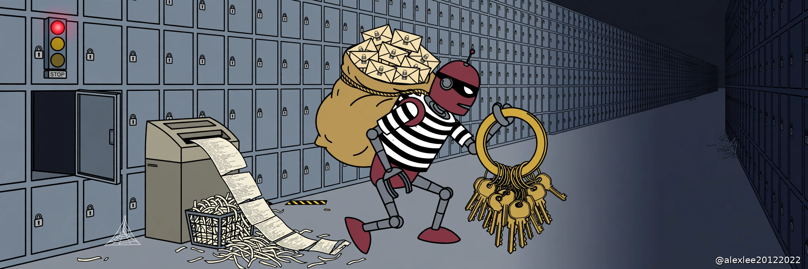
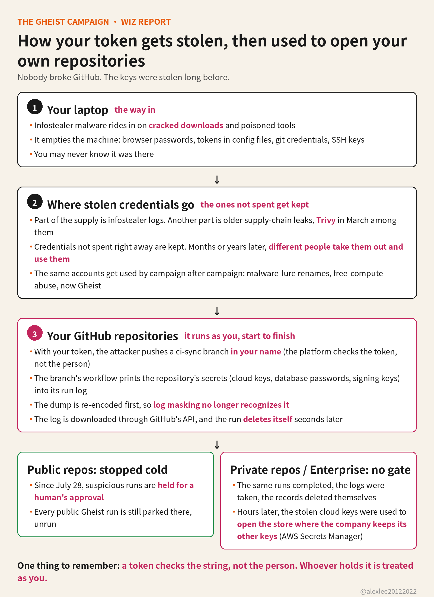

Tokens from 850 GitHub accounts were stolen, and 13,500 branches were planted with a workflow built to dump repository secrets

Since September 15, someone has been taking stolen GitHub tokens and pushing a workflow into every repository those tokens can reach. The workflow does one thing: it prints the repository's secrets into its own run log. Wiz recovered more than 13,500 of these planted branches, spread across more than 850 compromised accounts. Nobody broke into GitHub here. The tool used stolen keys and features the platform already has.

I maintain open-source projects. My GitHub account is not just a login. It is my name and my release keys in the same place, so I read the Wiz report end to end. The technique did not hold my attention for long, because the technique is not complicated. What stayed with me is the timing. These tokens were probably stolen long before this campaign started spending them.

Take an ordinary repository as an example. It keeps a cloud key in its Secrets, the one the deploy workflow uses every day. One day a new branch shows up, named ci-sync- plus six random characters. It adds one workflow file, sync-check, with the commit message "ci: sync config." Nothing else in the repository changes.

Pushing that branch starts the workflow. It prints every secret the repository can reach into the run log. Then the tool downloads the log through GitHub's own API and deletes the run a few seconds later. When the owner comes looking, there is a branch they never created and no record of what ran on it.

GitHub masks secret values in logs, but only when a value appears exactly as stored. So the tool runs each value through base32 encoding first. It is the same key in a different spelling, so the mask never matches. Nothing leaves through an outside server either. The log comes back down the same API developers use all day, so there is no strange domain in a proxy log and nothing to block.

The workflow also declares permissions: {} at the top, which makes it look restrained. That line only limits the temporary token the job itself is handed, and the attacker never needed that token. The secrets stored in the repository stay fully readable. The declaration changes nothing about what the workflow can take.

If the repository has deployment environments, the tool lists them and runs a job for each one, so the environment secrets print too. Teams keep production credentials in environments. That step is where the workflow reaches the keys that open real infrastructure, not just the keys that open the repository.

Where did the tokens come from? Wiz traced the ones it could. Part of the supply is infostealer logs. That malware rides in on cracked downloads and poisoned tools, and once it is on a developer's machine it bundles up browser passwords, CLI config files, git credentials and SSH keys and takes the lot.

Another part comes from older supply-chain compromises, the Trivy incident in March among them. Credentials exposed in that week were not spent at the time. They were kept, and months later a different set of people took them out and used them. A leak you read about in spring became a working tool for someone else in the fall.

The same compromised accounts turn up in other campaigns. On October 6, 391 of them renamed about 1,461 of their repositories into cracked-software lures. One hundred and sixty-six of those accounts never appear in Gheist at all, which tells you the pool of stolen accounts is bigger than this one campaign's footprint.

On October 18, twenty-five Gheist accounts each created a "Windows RDP Runner" repository inside nine minutes, abusing GitHub's free compute. Fifty-seven accounts from Gheist's first phase had already been victims of a different campaign, Megalodon, back in May. Some victims were also carrying traces of PolinRider. Different crews keep drawing on the same accounts, and Wiz's records show the overlaps plainly.

The problem with a token is that it authenticates a string, not a person. Gheist's commits are unsigned and authored as the token's owner, and GitHub accepts them, because accepting them is what a token is for. Whoever holds the string is treated as you. There is no device check behind it and no prompt asking whether this was really you.

For the account owner, that means everything done after the theft is recorded under their name. Someone else can rename their repositories, publish from their account and touch their projects, and the person who owes users an explanation afterwards is the owner, not the thief.

One GitHub control did stop this campaign where it applies. Since July 28, workflow runs flagged as suspicious in public repositories are held until a collaborator approves them. Every public Gheist run Wiz checked is still sitting in that held state. Not one of them executed.

The hold applies to public repositories only. It does not exist for private repositories or GitHub Enterprise Server, where audit logs show ci-sync runs completing and then being deleted. And most production secrets live in private repositories, not public ones.

The hold has been proven in public repositories, so why does it not cover private repositories and Enterprise? Nobody is asking for new machinery. The question is why an existing control stops at the boundary it stops at.

Inside enterprise organizations, the campaign went further. Wiz watched the tool cycle through several users' and automation accounts' tokens within minutes, cloning private repositories before planting anything. Hours later, cloud credentials from the same organizations were used to enumerate AWS Secrets Manager, the vault where a company keeps the keys to everything else it runs.

On October 19 the campaign added a second job aimed at self-hosted runners. It searches the machine for 31 token formats, AI provider keys among them, plus private keys, .env files, Terraform state and shell history. Then it tries to climb out through the Docker socket and repeat the search on the host underneath.

That part of the work is not good. It looks for the wrong runner key file, its credential regex is broken, and the GCP and Azure tokens it reaches for do not get collected. My view is that sloppy work is not the same as small harm. At this scale the payload did not need to be good. The stolen tokens and the platform's normal features did the work for it.

If a ci-sync branch ran in one of your repositories, there is one way to treat it: every secret that repository could reach is public now. That covers repository secrets, organization secrets, environment secrets, and whatever those secrets open in your cloud. Deleting the branch changes nothing, because the log was copied before the run was deleted.

If it ran on a self-hosted runner, treat the host and its cloud role as compromised too. About two thirds of the accounts implicated in this are no longer on GitHub, which Wiz reads as the likely result of cleanup and reporting. The accounts being gone does not change what the completed runs already took.

Start the defense with your own tokens. If you use classic personal access tokens, especially old ones with broad repository access, replace them. Use fine-grained tokens that expire and reach only the repositories they need, or move the automation to GitHub Apps, which work under their own narrow permissions instead of your name.

If your CI stores long-lived cloud keys, OIDC is worth the switch. Each run gets a short-lived credential issued on the spot, and the cloud side checks which repository and which protected branch or environment the run comes from. There is no permanent key sitting in the repository anymore, so a stolen config file buys an attacker nothing.

Put a human reviewer in front of the environments that hold production secrets, so a workflow has to wait for a person before it can use one. Keep self-hosted runners disposable, with no Docker socket and no open access to the cloud metadata endpoint.

If none of this describes you, if your tokens are short-lived, no long-lived secrets sit in Actions, and nothing is self-hosted, this campaign mostly passes you by. The whole job is a few minutes of checking that no forgotten old token is still hanging on your account.

Everything above is Wiz's reporting. As I write this, GitHub has not published its own account of the campaign. How many private repositories actually lost secrets, nobody outside can say, because the runs deleted the evidence as they went. The 13,500 branches are the ones Wiz recovered. That number is a floor, not a total.

This campaign will end, the accounts will be cleaned up and the branches deleted. What stays is the underlying arrangement: a string of characters can stand in for a person for years, from anywhere, with the person nowhere near it. Catching this crew does not change that. The part you and I control is how many long-lived keys are still out there under our names. Start with the ones in your own config files. Mine are in that count too.

Source: [Wiz — Gheist: Attempted Scaled Abuse of Stolen GitHub Tokens Stumbles](https://www.wiz.io/blog/gheist-attempted-scaled-abuse-of-stolen-github-tokens-stumbles)
