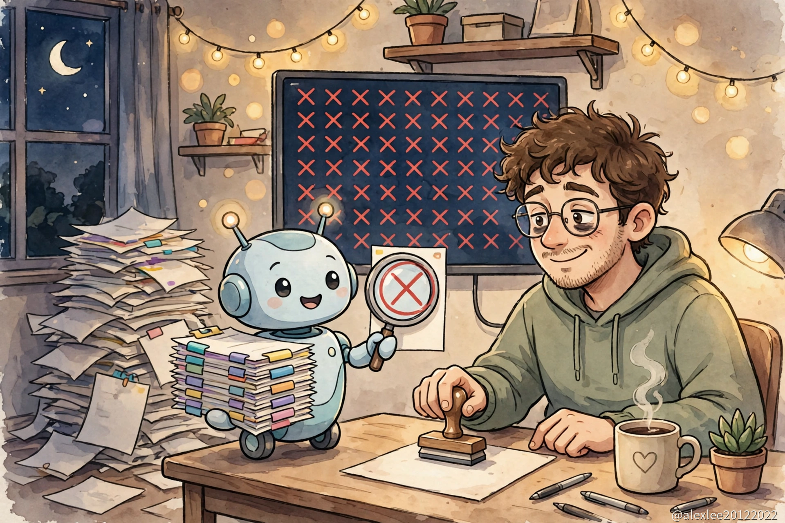

GitHub made Agentic Workflows generally available on October 28. The idea is simple to describe. Instead of writing Actions YAML by hand, you write a Markdown file that says, in ordinary words, what you want done. GitHub turns that file into a standard Actions workflow, and an agent runs inside it. It sorts new issues, reads failed CI runs, keeps documentation current, and drafts tests. It works on the Free, Team, and Enterprise plans. If the workflow runs on the default Copilot engine, you need a Copilot licence as well.

If you have ever kept a small open-source project going, you know how a week on it actually fills up. Writing a new feature might take one evening. The rest disappears into small tasks that never end. A pull request fails its checks and someone has to open the log and read it. New issues arrive with no labels and half the information missing, and each one needs a reply before it goes stale. The CI file you copied from another project two years ago breaks again because the runner image changed. None of these tasks is difficult on its own, but they come back every week without a break, and because a project run by two or three people only has so many evenings, that is where the time goes.

This is how small projects fade. Although the code can stay perfectly fine, the upkeep stops first. A week goes by with nobody reading the CI failures. Then a month. Issues sit unanswered. Someone new finds the project, sees a red build badge and forty issues with no replies, and leaves without trying it. From the outside, a project with no upkeep looks abandoned, and people treat it that way, so it becomes true.

Agentic Workflows is aimed at exactly those tasks. The agent reads first and hands you drafts. It reads the log of a failed CI run and writes down which step failed and what the error message points at. It reads a new issue, works out which label fits, and drafts the reply that asks for the missing pieces. When a change lands without tests, it drafts a first set for the maintainer to check. None of these drafts change anything on their own. They wait for a person to check them. If the drafts are usually right, the maintainer no longer spends the week on that reading: someone has done it first, and what is left is checking and deciding, which is the part that needs a person anyway.

For a project just starting out, there is more at stake than saved time. Looking after issues, summarising CI results, and keeping docs current are habits, and most small projects never pick them up. To automate them the old way you had to write Actions YAML well enough to express them, and then keep the discipline of running them every week. People who are new to maintaining a project usually have neither the YAML nor the routine, so the habits never form, and the project looks neglected long before anything is wrong with the code. Writing the habit down once, in plain words, and letting it run on its own is a way for a two-person project to behave like a much bigger one. Every issue gets a first reply. Every failed build gets a plain explanation attached to it. The documentation stops quietly going out of date.

Getting started is the easy part, because what you write is a Markdown file in your own words, which asks much less of you than learning Actions YAML, and that matters most for the beginners this is supposedly for. What you have to learn next is not the writing itself but two habits: stating a requirement clearly enough that an agent reading it cold does what you meant, and reading what comes back the way you would read work from a contributor you do not know yet. The cost comes in two parts. First, every agent run is metered, though GitHub does provide a forecast command so you can estimate what a workflow will cost over time before you let it run regularly. Second, apart from the run charges, the Copilot licence for the default engine is a fee of its own.

The agent spends its day reading text written by strangers: issue reports, pull request descriptions, comments. Beginners are the ones who most need to understand this part, because a beginner is the most likely to accept whatever the default settings are and move on, and what the agent reads is exactly where the risk sits. Some of that text will contain instructions. The agent has to work out which instructions are yours and which are just part of what it was asked to read, and the two arrive mixed together in the same sentences.

GitHub's arrangement starts from the cautious end. The agent runs read-only, so it can look at your repository without changing it. When it wants to change something, the change has to pass two checks first: safe outputs validation, and a separate threat detection job. Only then is it applied. The run itself happens inside a sandboxed container behind a firewall called the Agent Workflow Firewall. A filter decides which GitHub content the agent is allowed to touch at all, and work that crosses into other repositories can be put inside a micro-VM, isolated from everything else. In practice this means a misunderstood instruction in some stranger's issue does not get to act directly on your project. It gets turned into a proposal, and the proposal gets checked. In my own projects I would still keep merges and releases behind a person saying yes, on top of all of that.

GitHub's announcement quotes a customer lead at Accenture, Ben Alton, who estimates the workflows save him 29 hours a week on his own development work. I would not plan around that number, because a project that gets three hours of maintenance in a whole week has no twenty-nine hours to save. That is one person's estimate of his own week at a large company, and it says little about a small repository.

What a small project can realistically get is concrete: issues that used to sit unanswered get answered, a failed build gets its cause written out, and the docs get kept current, so the work stops eating the evenings. You can tell within a month whether it is paying off: count the time you spend on the repository before and after. If checking the agent's drafts takes as long as doing the work did, the answer is no, and you will know it from your own evenings rather than from a vendor's estimate. My own inclination is to start with the tasks that only read and report, keep merges and releases with a human, and let a month of ordinary weeks settle it.

If you maintain a small repository, which of these tasks would you hand over first: reading the failed CI logs, or replying to new issues? And which one would you keep for yourself however well the agent does it?

If this was useful, bookmark the blog or subscribe for the next one. I test AI tooling on real projects and write up what actually holds up.

Source: [GitHub changelog, 2026-10-28](https://github.blog/changelog/2026-10-28-github-agentic-workflows-generally-available/)
