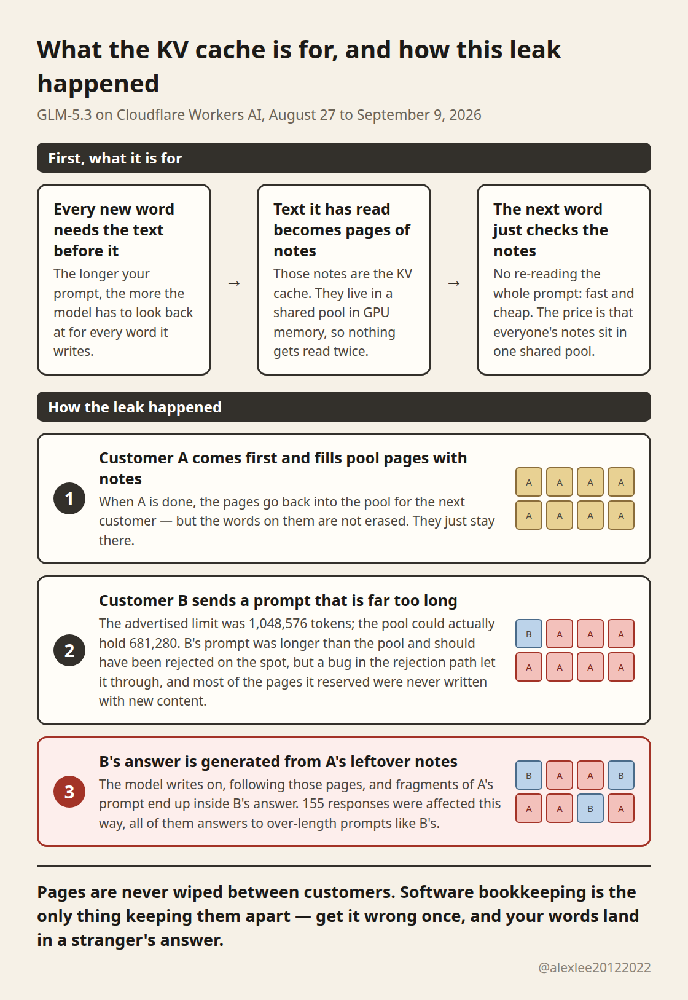
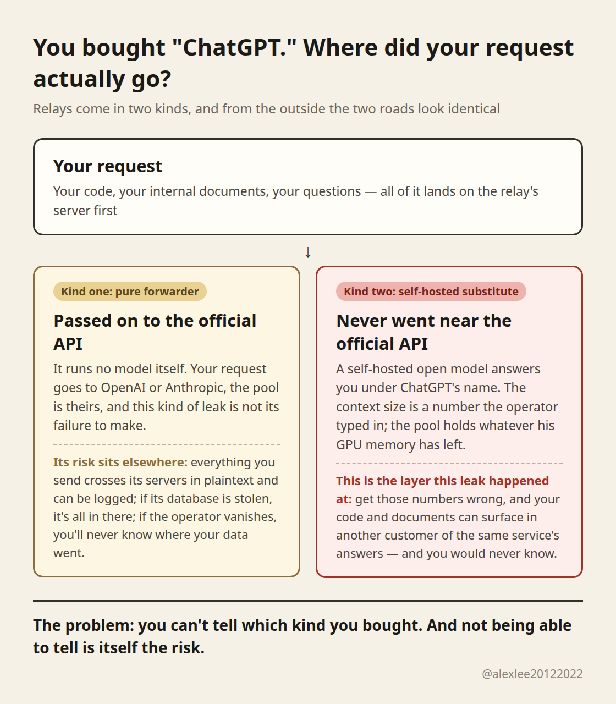

On October 26, Cloudflare disclosed a leak in GLM-5.3, a model it serves on Workers AI. For about two weeks, fragments of one customer's prompt could surface inside another customer's answer. It was fixed on September 9, and the total damage was 155 responses. If you ask me how big that incident is on its own, honestly, it isn't.

What makes it worth your three minutes is what it demonstrates. A lot of people buy their access to big models through relay services, third-party resellers, and a relay is exactly the kind of operation where this failure fits best. Whether yours is safe is a question worth sitting with.

When a model reads your prompt, it keeps notes on the text it has already processed, stored in GPU memory, so it doesn't have to redo that work as it generates. Those notes are the KV cache. To serve many customers at once, the notes live in a shared pool of memory pages, and the software is responsible for keeping everyone's pages separate.

In this case the pool could only hold 681,280 tokens, while GLM-5.3's advertised context length was 1,048,576. Do the subtraction and the gap is 367,296 tokens. A prompt longer than the pool should have been rejected on the spot. Instead, a bug in SGLang's rejection path let it through to the generation step, and that step read memory pages that still held notes written by the customers who came before. All 155 affected responses were answers to prompts longer than 681,280 tokens, and that's how strangers' prompt fragments ended up in them.

In its writeup, Cloudflare admits something that made my back go a little cold: they knew the two numbers didn't match before launch. Their reasoning was that the engine would error out on over-length prompts anyway, so they shipped it. They later enlarged the pool to hold the full context, the engine fixes rolled out through SGLang v0.5.22, and they report no evidence that anyone exploited this on purpose.

It's fixed. But notice who tripped here. Cloudflare has a dedicated security team and people paid to watch for exactly this, and it still shipped with a mismatch it already knew about.

So what does any of this have to do with relays? Everything, because it comes down to who operates the pool. The relay business quietly comes in two kinds, and a lot of customers have no idea.

The first kind is a pure forwarder. It runs no model of its own; it passes your request to the official API, the model runs on OpenAI's or Anthropic's machines, the pool is theirs, and isolation is their problem, not the relay's.

The risk with that kind sits elsewhere. Everything you send crosses its servers in plaintext. If it wants to log your traffic, it can log all of it. If its database gets stolen, your prompts and your code are in it. If the operator vanishes one day, you will never know where your data went.

The second kind runs its own deployment. The listing says ChatGPT, the price is far below official, and your request never goes anywhere near OpenAI. Behind the name, a self-hosted open model on the operator's own machines is answering you. That second kind is the one this leak is really about.

The advertised context length is a configuration number somebody types in, and that detail comes straight from Cloudflare's own post, not from my guesswork. The size of the pool is not typed in by anyone. The engine computes it at startup from whatever GPU memory is left after the model weights are loaded. Nothing forces those two numbers to agree, and checking that they do is the operator's job, done by hand.

Cloudflare's operators missed it, and missed it while knowing the mismatch was there. Now picture a small relay operator on rented GPUs, typing 1M into his pricing page without blinking. Has he ever checked how much memory his cards actually have left for the pool?

And which version of SGLang is he running? The bug in this incident was first reported to SGLang back in July, and the fixes were still rolling out through v0.5.22 on October 19. An operator on an old version can leak your data with his configuration perfectly correct.

And what are relay customers sending in? People who code through these services send unreleased code, internal documents, whole project contexts. If yours leaks, it leaks into the answer of another customer of the same little service, and your side shows nothing. Your logs stay clean. You would never find out.

The worst part is that from the outside, you cannot tell which kind you're buying. The API address looks official. The response format matches. Ask the model who it is and it will tell you, quite seriously, that it's ChatGPT. All of that can be faked, and substitution as a business exists precisely because customers can't tell.

A price far below official rates is the one signal visible from outside, and it's a signal, not proof. So the question in the title, is the relay you're using safe, has an honest answer for most people: you can't answer it, because you don't know which kind you bought. Put bluntly, not knowing is itself the risk you're carrying.

What can you actually do? Everything I'd suggest is in your own hands, because it has to be. A relay can't prove its innocence to you, and you can't verify it from outside. If you're eligible to buy the official API and able to, my advice is to skip the relay layer entirely; this whole category of risk just isn't there.

If a relay is your only option, stop trusting it like a pipe and start treating it like a stranger's machine you can't see. Don't paste unreleased code or internal documents into it whole; if something has to go in, strip the names, the addresses and the keys out of it first.

If you send long documents, pay extra attention: every response that received someone else's content in this incident belonged to an over-length prompt, and long documents are exactly what reaches that far. You won't receive a stranger's content in answers to short chats, but pages you leave behind can still be read by an over-length request that comes after you, and that direction doesn't care how short your chats are.

And when a listing offers an official model at a price that makes no economic sense, price it in your head as a substitute: fine for work that doesn't matter, a different calculation for work that does.

I'll end with genuine curiosity, because I keep meeting people who buy their model access this way. Have you ever read an answer from your relay and had the quiet feeling that the model on the other end wasn't the one you paid for? Or suspected it, and had no way to check? Tell me in the replies. I want to know how common this actually is.

Source: [Cloudflare, "Cross-request KV cache exposure in the GLM-5.3 Workers AI model"](https://blog.cloudflare.com/kv-cache-exposure-remediation/)
