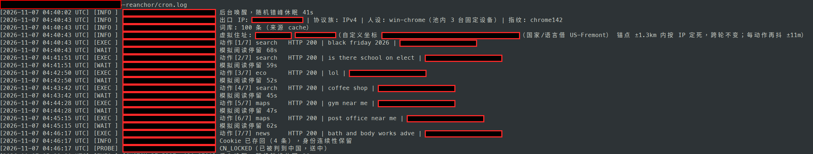
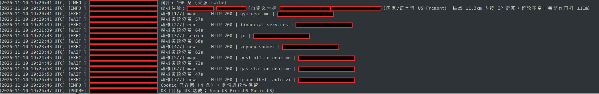

A friend of mine has a VPS in Fremont, California, and its IP is a US IP, but Google has judged that IP to be in mainland China. Once an IP is judged to be in mainland China, Gemini opens with a message that says the region is not supported, YouTube Premium cannot be subscribed to either, and Google Play likewise stays locked to the China region. Have you ever run into this yourself, where the VPS is plainly bought in the US, but Google treats you as a user in mainland China anyway?

This verdict can be changed back. I wrote a small tool that feeds the target region's traffic back to the IP, round after round, so that its region profile slowly moves back. Cron runs one round every 20 minutes, and after about 3 days of that, Google judged this IP to be in the US again.

## What "sent to China" means

"Sent to China" is the community's name for this. It means that the IP of a data center or a VPS sits physically in a place such as the US or Japan, but Google has assigned that IP to mainland China. The IP's registration information plainly says the US, but Google's services do not accept that registered location. So search, the app store, and the subscription services all handle this IP by mainland China's rules.

## What breaks once an IP is sent to China

In Google's eyes, this IP's whole region identity is wrong, so every service that lets people in by region has the same problem. Concretely, it looks like this:

1. Gemini does not work, and opening it only tells you that your region is not supported.
2. YouTube Premium cannot be subscribed to, because the subscription is processed as a mainland China one.
3. Google Play is locked to the China region, and the apps you can install and the prices you see both follow the China region.
4. Google Search results and service regions all follow mainland China.
5. Other Google services that let people in by region follow the same verdict.

Your account is affected by this too. If you only borrow the IP for a short while to get online, then the harm stays at the level of a bad experience. But if you log in to your own Google account through this IP over a long period, then the account's usual region drifts along with the IP. Given enough time, the account itself carries an extra risk of being judged an abnormal-region account, so if this can be dealt with, then it should be dealt with early.

## Why an IP gets sent to China

When Google builds a region profile for an IP, it reads more than the registration data. The registration information is only the base, and Google also reads behavior signals, which means it reads the kind of traffic this IP has carried over a long period, and it reads the usage environment of the network segment this IP sits in.

If an IP is used as a proxy or VPN exit over a long period, then most of the traffic leaving through it sits in a Chinese-language context, and in Google's eyes it is an address that mainland China users are using. Two other cases are also common. In one case, the previous tenant of a data-center IP left usage traces behind, and the IP's traffic mix had already drifted. In the other case, the users of the whole network segment are mostly Chinese-language users, and this IP was fed off course together with its segment.

Once signals like these have been fed in for long enough, the behavior profile settles the verdict and the registration information no longer decides anything. So checking an IP database does not help you here, even when the database says the US. When Google judges a region, it mainly reads behavior signals, and the registration information comes after them.

## How the pull-back works

Since the profile was fed off course by traffic a little at a time, the way back is to feed the profile back with traffic from the target region, also a little at a time. The traffic you feed in has to look like a local resident's ordinary internet use, so the language has to be the language people in the target city normally use, the location also has to land on coordinates inside the target city, and the search terms also have to be the terms trending locally that day. If requests like these keep going out for a stretch of time, then Google's behavior verdict slowly drifts back to the target region.

How do you know whether it has drifted back? Three probes are enough. A probe, as the word is used here, is an entry point where you can read Google's region verdict directly. The first probe looks at which country's domain google.com redirects you to. The second probe looks at which region YouTube Premium shows. The third probe looks at which region YouTube Music shows. Only when all three have flipped back to the target country has the IP really come back.

There is also an official route. You can submit Google's IP correction form, and you fill in the IP that was judged wrong and the country it belongs to. But Google itself writes in its documentation that processing can take more than a month, and that it will not reply to you individually. So this route can only serve as a fallback, and you cannot count on it to solve the problem in front of you.


## I split the tool out and rewrote it

The machine that was sent to China is my friend's. While I was helping him deal with this, I found IP-Sentinel, a project by hotyue (https://github.com/hotyue/IP-Sentinel), and its Google module is the part that handles being sent to China. I split that module out, rewrote it as its own tool, named it ip-reanchor, and open-sourced it on GitHub: https://github.com/alexliyu7352/google_ip

This version does one thing. It takes a VPS IP that has been judged to be in China, and it feeds local traffic from the target region back to that IP over a long period. When a round of this feeding runs, it goes through one set of actions:

1. The persona is pinned down first. The tool hashes the exit IP, and then it uses that hash to map the IP to a fixed set of 3 "home devices", and each round it picks one of them to use. One detail here can easily give you away: the request's TLS fingerprint has to match the browser version the request claims to be, so this version uses the impersonate feature of curl_cffi and generates the fingerprint for the target browser. That way, the fingerprint follows whichever version the UA claims, so the version in the UA and the version in the fingerprint stay bound together.

2. The home address is pinned down too. The tool also uses the IP's hash, and it fixes a virtual home address within 1.3 km of the target city's center coordinates. After that address is set, it never changes between rounds. Each action then places its own location point within 11 meters of that address, because that small offset imitates the natural drift of a real location fix. The original version re-rolled a new address inside a 3 km range on every round, and that amounts to moving house every 20 minutes, which no real household does, so this version changed that behavior.

3. The word list is updated every day. Every day, the tool pulls the target country's trending searches for that day from Google Trends, merges them with its built-in seed word list, and keeps 100 entries. So the words that each round searches for are the words that people in that place searched for that day.

4. One round runs 5 to 8 actions. The actions are drawn by weight from Google Search, Google News, coordinate searches on Maps, low-risk ecosystem pages, and platform connectivity checks. Ecosystem pages are Google's own pages, such as about.google and safety.google. Each action waits 45 to 75 seconds after the previous one. When two neighboring actions are of the same kind, then there is a 70% chance that the later one carries a Referer, so the round looks like someone clicking around inside a site, rather than someone typing addresses out of nowhere.

5. Cookies are stored on disk per IP. The cookies for each device are saved into a file keyed by the exit IP, and the next round keeps using them. So in Google's eyes, the visitor is one returning visitor with a continuous history, rather than a batch of new faces that start from zero every time.

6. Each round ends with a self-check. When a round finishes, the tool then runs the three probes again and appends the results to a file called probe_history.jsonl. When you open that record, you can then see which probe still reads CN and on which day each probe flipped back to the target country.

One round takes about 6 to 10 minutes from start to finish. The original had a Master-Agent hub program, and it also had Telegram notifications and remote execution, while this version is a single file on a single machine. Cron runs it on a timer, and the logs and the probe records stay on that same machine, so the attack surface is much smaller.

The original also had one more chain, and this version did not keep it. The original had a "credit purification" route, and it worked by visiting a batch of whitelisted local sites in the target region, mostly local news sites, in order to influence a fraud-score database. I could not find evidence that visiting those sites influences that database, so I did not bring that route over, because the tool should not do things that have no evidence behind them.

It cannot fake the real location of a logged-in user, and it cannot fake the GPS and Wi-Fi location data of an Android phone either. And if this IP is still serving as a proxy exit for a large number of real Chinese users right now, then the real users' signals will drown out the tool's signals, so do not expect results in that case.

## The test: 3 days, and all three probes flipped back to the US

My friend's VPS sits in Fremont in the US, and it has an IPv4 address. On November 7, the probes returned CN_LOCKED, and all three probes read CN. The three probes are the google.com redirect, YouTube Premium, and YouTube Music, and the log records them as Jump, Prem, and Music. After the diagnosis was confirmed, cron was set up on the machine that same day, and it ran one round every 20 minutes.

By November 10, the probes had flipped to OK. The three results were recorded as Jump=US, Prem=US, and Music=US, and all three read the US. From the diagnosis to the flip back, the whole thing took about 3 days.

Those 3 days are only this one machine's result, this one time. In the tool's documentation, I wrote that the change should be observed on a scale of weeks, because every machine sits in a different network segment environment, so how long the feeding takes changes along with that environment. This machine flipped back in 3 days, and that says its segment environment worked in its favor. On another machine, it may well not take 3 days.

I have put two screenshots of the run logs below, one from the first day of the run (November 7) and one from the day the probes flipped back (November 10). The exit IP and the latitude and longitude in the screenshots have both been redacted.





## How to use it

Step one: pull the code down and install it, on the VPS that needs this treatment.

```bash
git clone https://github.com/alexliyu7352/google_ip.git && cd google_ip
uv sync
```

Step two: run the health check first, and only start work after the diagnosis is confirmed.

```bash
uv run python reanchor.py probe --region US-Fremont
```

Run uv run python reanchor.py regions first, and it prints a table where you can look up the codes for all 67 cities. The US-Fremont in the probe command above comes from that table.

If the city table does not have the point you want, or you want to anchor precisely to one particular neighborhood, then pass the latitude and the longitude directly, with --lat and --lon as a pair. On a dual-stack machine, remember to add --ipv4 or --ipv6, so that you pin down the address you want to treat. If you leave that flag off, then you may fix only the v4 address, while the v6 address stays behind in the wrong verdict.

Step three: submit the official correction form as well, and keep it as a fallback.

You can find this form on Google's support pages, and once you open it, you fill in the IP that was judged wrong and the country it belongs to. After you submit it, do not sit and wait for it, because Google's processing cycle starts at a month. The form and the script then run in parallel, and whichever produces a result first is fine.

Step four: put it on cron, one round every 20 minutes.

```cron
*/20 * * * *  cd /path/to/google_ip && $HOME/.local/bin/uv run python reanchor.py run --region US-Fremont >/dev/null 2>&1
```

The program also staggers its own start by a random 0 to 180 seconds inside each run, so you do not need to add your own sleep. At one round every 20 minutes, that works out to 72 rounds a day. A region verdict only moves when it is fed this way, continuously and over a long period, but a single round shows no visible change.

Step five: watch the trend, and do not judge by a single day.

Every round's three probe results are appended into probe_history.jsonl. Look through that file every few days, and check whether the two YouTube probes have started moving from CN toward the target country. In the documentation, I wrote that the change should be observed on a scale of weeks, so no movement in the first day or two is normal. Do not decide that the tool is useless just because nothing flipped back on the first day.

## Two warnings to read before you deploy

First, a phone must never use this IP as its VPN or proxy exit. The Google framework on Android sends location data to Google on its own, and the location data it sends may not travel through the VPN and proxy channel, so even if you turn on a global proxy, the traffic can still go around it. The phone's real location data bypasses the proxy and keeps flowing to Google through the framework's own channel, and Google receives that data as data that belongs to this IP. The location signals that the phone sends will drown out the tool's signals, so this IP will not come back.

Unless you filter the Google framework's location traffic out on the server side, or you turn off both coarse and fine location for the Google framework on the phone, do not hang a phone on this IP while you expect the script to pull the IP back.

Second, if the whole network segment has been sent to China, then the IP cannot be pulled back, so do not waste effort on it. Use the probe on other IPs in the same segment first. If the whole segment reads CN, then that segment has a large amount of real Chinese-context traffic that keeps feeding this verdict. The signal volume of one tool that runs a round every 20 minutes is nowhere near the same order of magnitude as the usage of everyone else on the segment, so the tool's signals get drowned, and no region profile that can hold up gets built. In that case, change the IP, or change the data center, and do not burn time on a segment like that.

Google decides which region an IP belongs to from the record of the traffic that IP normally sends. It remembers who uses this IP, and it remembers which language those people use and where their location coordinates land, and then it judges from those records which place the IP belongs to. A record that was written wrong can also be corrected, because the verdict is accumulated record by record: as long as traffic from the target region keeps being fed back over a long period, then the new records slowly carry the verdict back. One condition still stands: the segment this IP sits in must not have been sent to China as a whole.

If this piece was useful to you, consider subscribing to this blog or bookmarking it. I keep sharing AI, security, and open-source work that I have checked and used myself, and if this project produces new test results later, then I will write a follow-up and add the data there.

