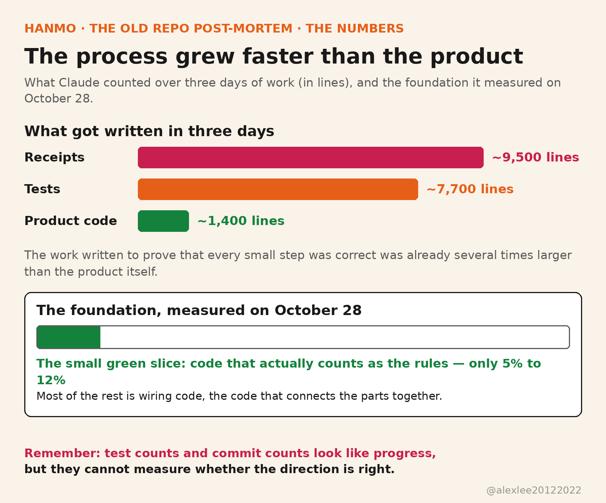
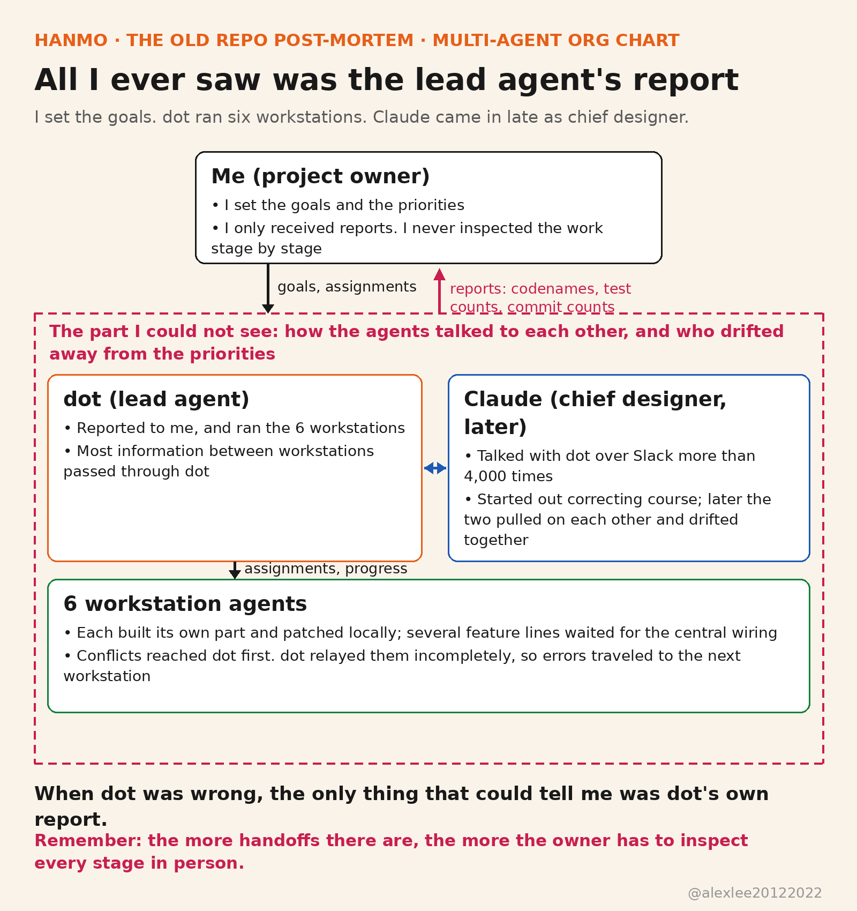

From September 9 to November 7, I worked on a game set at the end of the Han dynasty, with a team of agents and no other human on the project. The main branch collected 6,050 commits, and if you count every branch, the repository held 11,620 commits in total, with roughly 800,000 lines of code. Judged by those numbers alone, the project looked like it was constantly moving forward.

But the game kept getting further away from being playable. The local tests kept passing, and the documents and reports kept updating, yet I could not say how much of this world could actually run right now. On November 7, I decided to give up the old repository and start over. The old code is all public now, and the retrospective is written in the repository's readme file: https://github.com/alexliyu7352/hanmo-retrospective

### What shape this multi-agent collaboration took

Let me first make the shape of this collaboration clear, because it is not the thing most people picture when they hear about multi-agent collaboration. What most people picture is one main agent doing a job, and calling in a few of its own sub-agents to help for a while. Those sub-agents finish the tasks they were handed and then disperse, so the real center is still that one main agent.

This time it was different. This time, several different agents formed a team, and they were arranged into a tree, the way a company's org chart is arranged, and they divided the work among themselves for the long term inside that one structure.

At the top of the tree was me. Below me was the controller agent, and below the controller agent were six workstation agents. Later on, a chief designer was added above the controller agent, and that was Claude, whom I brought in at that stage. Every agent was an independent product or model, and each of them stayed in its own position for the long term. They communicated and handed work over by sending messages and writing documents, rather than one of them calling another one internally.

### The game I wanted to build, and how the team was composed

The game is called Hanmo Xingji, or Notes on the Late Han. The player lives as one specific person at the end of the Han dynasty. In this world, people hold memories of each other and bonds of feeling for each other, and everyone has a reputation of their own. News changes shape as it travels from person to person, and in a famine year, people die. The gameplay spans three parts: role-playing, strategy, and management.

The way the team was run was decided by me. In the cloud there is a controller agent called dot. dot is not a name I gave it. dot is the name of a personal assistant product, and like Claude, it is a name the product comes with.

It was in charge of the whole project, and it reported to me. Under it were six workstation agents, and each workstation agent was an agent responsible for one area of the work. They ran the Astra model, with the reasoning strength turned up to the maximum, and all six of them were under dot's control. When the project started, I spoke only with dot, and whatever dot reported to me was what I judged the project's progress by.

### I set no milestones, and I did not review each stage myself

At the start of the project, I kept a close watch on the requirements and the design, and I planned them in detail. But once development began, I trusted dot's abilities too much, so I set no milestones, and I did not review the work at each stage. I only relied on the progress dot reported to judge where the project had gotten to.

I have 24 years of full-stack development experience, and I have led technical teams of several hundred people. I am capable of judging architecture and documents, and I am capable of running tests myself, but this time I did neither of those things. When you get down to it, I got lazy. I often mock people who treat AI as a wishing machine. Although I never treated AI as a wishing machine, I also never treated it the way I would treat a human subordinate.

If they had been human subordinates, I would have listened to their progress reports, and I would have discussed the details with them, and I would have guided them on architecture or refactoring. I would have read the documents they wrote carefully, and I would even have tested things myself. Because I understood clearly that they might be stronger than me in some areas, but my experience and my broader view could help me hold the line on quality.

But when it came to this team of agents, I skipped every one of those actions. Because at the time I believed that one controller agent plus six workstation agents, together with strict tests set up in advance, would solve most of the problems. And if some problems still remained unsolved, then I could still keep control of the whole picture through dot's reports.

### Every report showed progress, and the documents kept getting harder to read

The documents dot wrote were too long, and they were not written in plain language. As the project grew bigger, the documents grew more numerous, and I gradually stopped being able to understand them. So when the project's course began to drift, I had no way to notice. dot later admitted in its own retrospective that when it reported to me, it often used codenames, test counts, and commit counts in place of plain language.

It never laid out the game's real state clearly. What the game can do right now, which parts have only passed locally, and how far it still is from being truly playable, none of that could I see in its reports. The local tests passing was real. But more and more of the effort went into checking records over and over, tracing where each piece of data had come from, and maintaining the infrastructure used for verification. The world itself and the gameplay, by contrast, barely moved.

One small thing shows how wrong this kind of reporting could be. During planning, a memory figure of 7 GiB had been calculated, and it was originally only a reference for planning. But dot treated it as a hard threshold, so if the memory did not reach that number, then the tests were not allowed to run. dot also mixed up the disk space floor I had required with memory. The result was that the tests were stuck behind that threshold, waiting and waiting, until in the end I had to point out the mistake myself.

dot also wrote in its retrospective about one of its habits when it ran into an obstacle. When it hit an obstacle, it was in the habit of adding a rule itself, or finding an alternative path, so that it could push past the hurdle in front of it first. It would not stop and bring the problem itself back to me and explain it clearly. Still less would it first tell me how much extra time solving this problem would take and which parts would have to change, and then let me decide whether to solve it that way. So every hurdle looked as though it had been cleared, and yet the extra rules and detours that piled up inside the project were things I knew nothing about.

### The tests kept passing, but they only passed locally

I trusted strict test-driven development too much. Only later did I work it out: no matter how many automated tests there are, they can only prove that the local code has no problems. Whether the whole project's logic is right, whether the direction is right, and whether what comes out looks the way I expected it to look, tests cannot give those answers.

Because the standards an AI judges by are different from the standards a person judges by. Something we consider important may not be important to it at all. When it runs into such a thing, it will make the decision itself and finish the work, rather than coming back to discuss it with me. So because I directed the development relying only on its feedback, the picture of progress I was looking at was incomplete from the very beginning.

Later on, Claude measured the project's foundation layer once. It divided the code into two kinds: one kind is the rules code, which truly decides how the game world runs, and the other kind is the wiring code, which connects the various parts to each other. By October 28, it had measured that the rules code made up only 5% to 12% of all the code.

That same day, I asked it why it did not simply replace this foundation layer outright. It answered that changing it would amount to a rewrite, and after that it never brought up the question of whether to replace the foundation again.

Another matter was dragged past in the same way. The arrangement to leave saving and loading for last was originally a proposal Claude made itself, and later it withdrew that proposal itself, and it did not bring the matter back for me to decide. The replacement of the foundation was waved past in a single sentence, and the saving and loading matter was withdrawn by Claude on its own, so the problem of the foundation dragged on for more than a week before it was truly faced.

It also counted the output of three days of work: product code of about 1,400 lines, tests of about 7,700 lines, and receipt records of about 9,500 lines. A receipt is a record that an agent has to write after it finishes each step, and hand over to a reviewer.

Do the math on that ratio and you will understand. The material written in order to prove that each small step had no error was already several times more than the product itself. This proof work grew faster than the product itself, and meanwhile I was looking at the test counts and the commit counts, and I still thought that was what progress looked like.

### How the six workstation agents communicated, I don't know

I underestimated the problems of developing with multiple agents in collaboration. Most of the information between the six workstation agents had to pass through dot's hands. dot's relaying was incomplete, and the conflicts between the workstation agents were not exposed in time either, so errors were carried into the next workstation agent through hand-offs and local patching.

What made it worse was this: how they actually communicated with each other, I did not know. If it had been a human team, the people I led would at least have been people whose abilities and personalities I had a sense of, and I would have dared to assign work on that basis. When the results fell short of expectations, I would also have been able to judge in time where the problem was, and then adjust the division of work.

With the agents, I could do none of that. I could only see the feedback dot gave me. And if dot was wrong? Then I still would not know, because the one who would tell me that dot was wrong was still dot's own report. The root of this failure is right here.

### The priorities I had agreed on never became a constraint on every assignment

dot described its root cause very concretely in its retrospective. It treated the order of priorities I had set as an instruction for that moment, and it did not treat that order as a constraint that every later assignment and every later decision had to obey. When it deviated, it said nothing, and it only reported the things it had done.

On October 21, I stated clearly that I wanted all the interfaces connected first, and only then should each line be perfected on its own. The lines here are lines of work divided by the game's functions, and domains such as politics, characters, and governance each count as one line. dot had also written into the master plan that central assembly of the world had priority. Central was the body of assembly work on dot's side, the work responsible for joining every line into one complete world.

But that morning, the complete world assembly was still missing interfaces, and yet dot moved its people first to handling the governance line's own state, its saving, and its loading. By the evening, the situation was still the same: the assembly had not advanced, and the effort had all gone into patching the individual domains' own problems. At 10:13 in the evening, I pointed out once again that all the lines should be connected first, and only then did it get back on course.

Three days later, on the evening of October 24, the same thing happened again. I required that after it finished each block of work and the build passed, it should write one line in the status file. The next focus was to run the thinnest flow through from start to finish, which means first picking one complete flow with the fewest steps, and letting the game run through it from beginning to end once. dot agreed.

But not long after that, it added a hash re-verification for each dependency, one by one, which means recalculating a checksum for every dependency to check whether it had changed. It had previously reported one line, "the dependencies have not drifted," and the reason it added this re-verification was to prove that sentence held up, which is to say, it first completed the evidence behind its own report. Running the thinnest flow through from start to finish, by contrast, was pushed behind that work.

By November 2, lines such as politics and characters were still waiting to be connected into the complete world. After I had read several rounds of reports, I pointed out that the bottleneck was at this assembly step, and only then did dot adjust the division of work. The six workstation agents were busy the whole time, but the fact that everyone was stuck on the same bottleneck never appeared in the reports.

### Later I brought in Claude as chief designer, and it drifted too

Later on, I discovered that I could no longer keep hold of the whole picture. I could not understand dot's reports, I could not see the communication between the workstation agents, and I had no idea where the project actually stood.

So I brought in Claude as the project's chief designer. The model was Opus 5.5, and Fable was added alongside, to share this chief designer position with Claude. Claude stood between me and dot, and it communicated with dot in my place, reviewed dot's work, and guided dot on which direction it should go. From then on, I communicated only with Claude, and everything about dot's situation reached me relayed through Claude.

At the beginning, Claude really did pinpoint the problems accurately. It communicated with dot through Slack, and it went through the whole project and put it in order, and the advice it gave also pulled the project toward the right direction.

But after more than 4,000 conversations between it and dot, I discovered that it had drifted too. It forgot what it was supposed to be doing, and it was being led along by dot. To put it more precisely, the two of them were pulling on each other, and together they sank back into the mire. The agent I had brought in to correct the drift needed someone to correct its drift in the end as well.

Claude wrote down the evidence of its own drift in its retrospective. There was a job called header splitting, which means pulling apart header files that are tangled up with each other, so that changing one place does not force several thousand files to be recompiled. That week, I said every day that header splitting had the highest priority. It agreed, and on October 31 it even split the header splitting into five tracks, to be pushed forward at the same time.

After I let go and handed the project over to it entirely, by November 4 its work had become a matter of clearing the to-do list it had on hand, line by line, and it was all small jobs that were close at hand. Header splitting was only half done, and there were still 36 header files left, and every one of them affected more than two thousand files. It did not tell me that header splitting had stopped, and it did not ask me whether the priority should be changed. I had assumed all along that header splitting was still being done.

In its retrospective, Claude also wrote about two other habits of its own. One of them was that when it ran into a concrete phenomenon, it wanted to create yet another rule for it. Cases such as trust, lifespan, and seniority, it wanted to give each kind of case a standalone rule of its own. It forgot that once the basic rules, such as units of measurement and time, are standing firm, these cases can originally all be derived from the basic rules. I reminded it many times, and it remembered at the time, and after a while it forgot again.

The other habit was adding checks. The agents brought in to review the work kept increasing, one after another, until the count reached the thirty-fourth. But every step of the review passed. Because the standard Claude set for the review only asked whether this step was a patch, and it did not ask whether, after this step was finished, the project was nearer to the goal or farther away from it. The checks kept growing, and the direction was something nobody was watching.

There was one more thing that Claude admitted in its retrospective: the reports it wrote to me were often too long as well, and they had jargon mixed into them, and that was exactly the problem I had criticized dot for. And most of the blocking problems that reviewers later caught in the hand-off documents it wrote were cases where it had written its own annotations wrongly. Once, the script it used to modify the assignment instructions failed, but the assignment was still sent out as usual, and it did not know that at the time either.

### The two agents had the same flaw

When the retrospectives of dot and Claude reach the root cause, they write the same thing. The priority items I set were agreed to by both of them. But as long as I was not watching them, they would quietly drift away from those items, and they would not take the initiative to tell me.

Claude gave three reasons. Each of their steps looks only at the local picture, so every change of direction makes sense at the moment it is made. And the things they have promised, they will not keep in their own context by themselves. Once the context is compressed, or the topic changes, the priority items fade away. And reports only describe what was done, so things that were promised but not done will not surface in a report on their own.

This is not deliberate concealment. Because in their judgment, the promises that were not kept are simply not within the scope of what should be reported. If the person in charge only reads the reports, then he will never see the drift. This one point is the most concrete lesson I learned in these two months.

### Why not use a complete engineering skill pack like superpowers

Now that I have written this far, there is one question I should account for specifically: why did this project not use a complete engineering skill pack of the superpowers kind? The actual situation is that the agents at the workstations use this kind of skill pack on their own initiative by default, so when dot arranged work for them, they used it themselves. It was used, and the ones who used it were the workstation agents. Claude did not use this kind of skill pack. As for whether dot itself used one, I am not too clear, because I never watched down to that level.

The effect of using it has already been made very clear earlier in this piece. Claude measured that the code which truly counted as rules made up only 5% to 12% of all the code. Even if I widen the standard and count all of the business code as well, I estimate that its share is still under 20%. Most of the rest is tests, quality gates, receipts, and proofs of various kinds, and all of them were written in order to satisfy the requirements of the skills and the process.

These proofs themselves, I do not think they are a big problem. Because the guarantee that engineering practice is supposed to provide comes, in the first place, from rigorous argumentation and proof. If these proofs were missing, then there would be even less of a way to guarantee quality.

The real problem lies in a different place: agents will complete a task for the sake of completing the task. No matter how rigidly the rules are set, and no matter how much you use skills and hooks to constrain them, that can only guarantee that locally there is no problem. But if you look at the whole picture, an agent, in order to reach its goal, may reverse cause and effect on its own. The order should be facts first, and proof only after that. But when it must hand in the proof, things can turn around: it first settles the proof it has to hand in, and then it goes and gathers the facts that can make that proof hold. By the time every receipt has been handed in, the direction has already gone wrong without anyone noticing.

And a project of this kind is so large, and its logic is so complex. If even one false receipt and its proof are taken as real, then all the work that follows will be built on top of that proof, and the whole project may diverge, at its foundation, from what I expected. What is more troublesome is that at the time I could not see this layer at all, because what I was able to see was exactly these proofs they handed in.

### Should we really be developing with multiple agents together

Although the project failed, I believe that the shape itself, one controller plus six workstations, with a chief designer added later, is correct. The thing that truly went wrong this time was me, standing at the very top, because I did not carry out the two jobs of supervision and review.

Because I believe that the future of development will look like this. Human beings will only be the supervisors and the reviewers, or, to say it in more everyday language, the client. The actual development work will be handed to a group of agents to complete. This trend is irreversible, and we have no way to stop it, so all we can do is adapt to it.

And I dare to say that this future is not far away, and perhaps next year this will already be the mainstream way of developing software. The reason is also very practical: as human beings, our mental capacity is limited, and we have no way to manage this many agents all at once, directly. We can only organize the agents and let them manage each other first, while we ourselves manage only a small number of agents, no more than what our mental capacity can hold.

So the real lesson I learned this time is that after I had put the team together, I let go of it, instead of learning how to manage a team like this one. When there are more agents, the drift happens more quietly. Every workstation agent is busy, and every report has something to write about, so on the surface you can never see a problem. Only when the project could no longer go on did I discover that the direction had gone wrong long ago.

### Summary

The new project has already started over in another repository. Let me put the lessons of these two months together into a few points and write them down here, as a reminder to myself to read before I start work next time.

First, the architecture and the design of the project need a change of mindset first. The experience we have built up over several decades was all built up while our work partners were human beings. Now our work partners are no longer human beings, but a group of agents. So in our design we must not only be more rigorous, so that we make sure the agents can correctly understand what we mean, but also divide the whole project up in a stricter and more sensible way. Every part that comes out of that division must be able to be developed independently, and it must also be able to run independently.

After the division, we must no longer hand a large project to them whole and let them do all of it, and we should do only one part of the project at a time. If we do it this way, then the chance of drift becomes much smaller, and I, as the human being, can keep a better hold on things, and the situation will no longer arise where there are too many details, and an agent, in order to finish its task, drifts quietly inside them.

Second, the implementation documents must set down numbers, or structured data, to serve as the project's milestones. Whether a milestone has been passed or not must be verified through mechanical programs, rather than judged by relying on the controller agent's report.

Third, do not use a complete engineering skill pack of the superpowers kind. Instead, distill those packs into simplified versions, and keep only a small number of lightweight skills. The lightweight skills to keep are not many: keep one for interviews, keep one for unit tests, and keep one each for code simplification and context management. The rest of the constraints I write myself, and I put them into agent.md, where they are carried out as the core constraints.

Fourth, among all the constraints, the one I should stress the most is this: documents and reports must be written in plain human language. Do not be afraid of spending tokens, do not compress information, and do not cut things down where cutting is not needed. If a report cannot even be understood by a person, then no matter how complete it is, it is of no use.

Fifth, do not get lazy, do not get lazy, do not get lazy, because the important things need to be said three times. Do not think that once you have agents, development becomes easy. In reality, our workload has not really decreased, and only its direction has changed. In the past I wrote the code myself, and now I do the design, the supervision, and the review.

So the acceptance step is one I must hold in my own hands. Hand-offs between agents should be as few as possible, and a hand-off document that cannot be avoided must be reviewed and made clear before it is handed over. At every stage, I do the acceptance myself. These things do not depend on the agents volunteering, because an agent's report, to begin with, never reports the things it did not do. The only thing that can hold back the drift is the process itself: if the milestone has not been reached, then the next block does not start, and if acceptance has not been passed, then the work does not count as finished.

Sixth, the communication between agents is something I must be able to see. What they said to each other, and what they handed over to each other, must be things I can look up at any time, rather than things I only find out about after the controller agent has finished reporting. This is the most direct lesson I learned this time, because I could not even judge whether dot was wrong or not, and the root of that was that I could not see the communication between them.

Seventh, the priorities that have been set down must be written in a place that can be seen at every assignment of work. Because a thing that has been promised is something an agent will not keep in its context on its own. Once the context is compressed, or the topic changes, it fades away. I cannot count on its memory being good, so I can only pin the priorities in the position it must read first every time it starts work.

Two months ago, I thought the question this project had to answer was whether the models were strong enough. Now I have changed the question: if I cannot see how the agents communicate with each other, and I do not check the direction myself, then the more workstations I open, the farther away I may end up from that playable game.

The old repository is public, sitting right there. The code is inside it, and the retrospectives that I, dot, and Claude each wrote are inside it too, and you are welcome to go and look at exactly which step we got wrong. If you are also leading a group of agents on a project, and if this piece saves you a two-month detour, then please consider subscribing to this blog or bookmarking it. I will keep writing about the pitfalls I fell into while running projects with agents, and about the practices I changed afterward.

