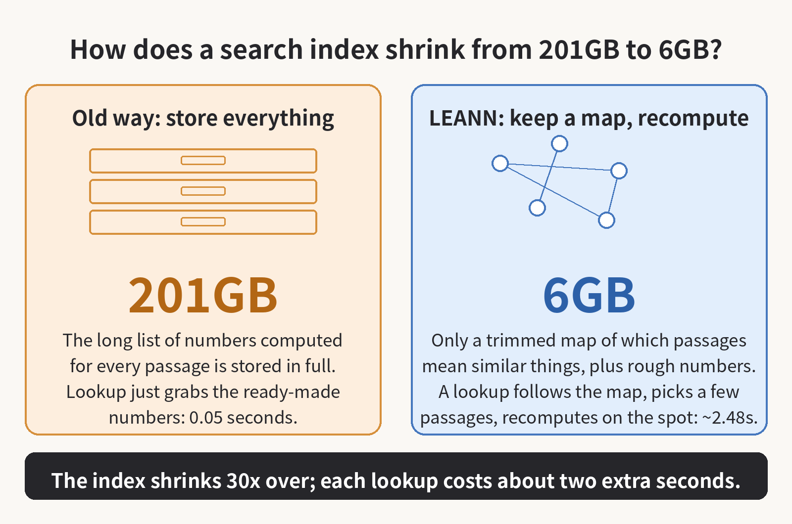

LEANN cut a 60-million-passage index from 201GB to 6GB. Is trading disk space for waiting time worth it?
If you've messed around with a local knowledge base (RAG), you know the model often isn't what eats your disk. The search index is.

The basic idea is simple. To let an AI answer questions from your email, chat history, or documents, you chop the files into small passages and turn each one into a long list of numbers (a vector) that you store. Add up enough passages and those lists take a lot of room. For 60 million Wikipedia passages, a conventional index comes to 201GB. Plenty of local setups die right there: the model runs fine, the index has filled the drive.
LEANN, open-sourced by Berkeley's Sky Computing Lab, takes a pretty drastic shortcut: it doesn't store the full vectors.
It keeps a trimmed graph that shows which passages mean similar things, plus a compressed, rough version of the numbers. When you search, you follow the graph and use the rough numbers to pick out a few likely candidates, then you take the original text of just those passages and recompute their full vectors on the spot. A search only ever needs a handful of passages, so there was never much point in storing numbers for tens of millions of them just in case.

That gets the 60-million-passage index down from 201GB to 6GB, and an index over 400,000 chat messages from 1.8GB to 64MB. Accuracy held up too. On a standard question-answering test (the team's published figures; I haven't rerun them), LEANN and the old approach both answered 25.5% of questions correctly at the same recall setting, meaning each one found nine of the ten passages it was supposed to find.
Retrieval does get slower, though. On that same test the old index found the passages in 0.05 seconds and LEANN took 2.48 seconds, about 50 times slower. In normal use the model spends around 20 seconds writing the answer anyway, so the total goes from roughly 20 seconds to about 22 and you barely notice. On harder questions that pull evidence from several passages, the team measured 44.8 seconds for retrieval alone on a Mac. That one you do notice.
Whether it's worth it depends on where you run it. On my own machine, for my own files, I'd switch without thinking twice. I'd gladly wait two extra seconds to get that much disk back. For an online service handling a lot of queries at once, that 50x slower retrieval is a real question, and I'd want it load-tested properly before betting a service on it.
If you find this kind of paper teardown useful, bookmark this blog or subscribe for the next one. Most papers put the flattering number in the title and hide the cost in a table near the back. I'll keep digging through those tables and working out what the numbers actually mean.

Source: [MarkTechPost's report on LEANN (MLSys 2026)](https://www.marktechpost.com/2026/10/27/leann-vector-index-mlsys-2026/)
