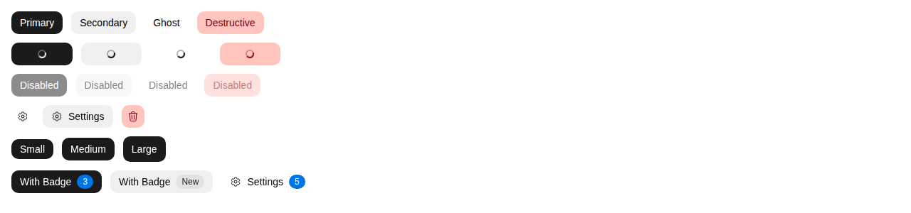
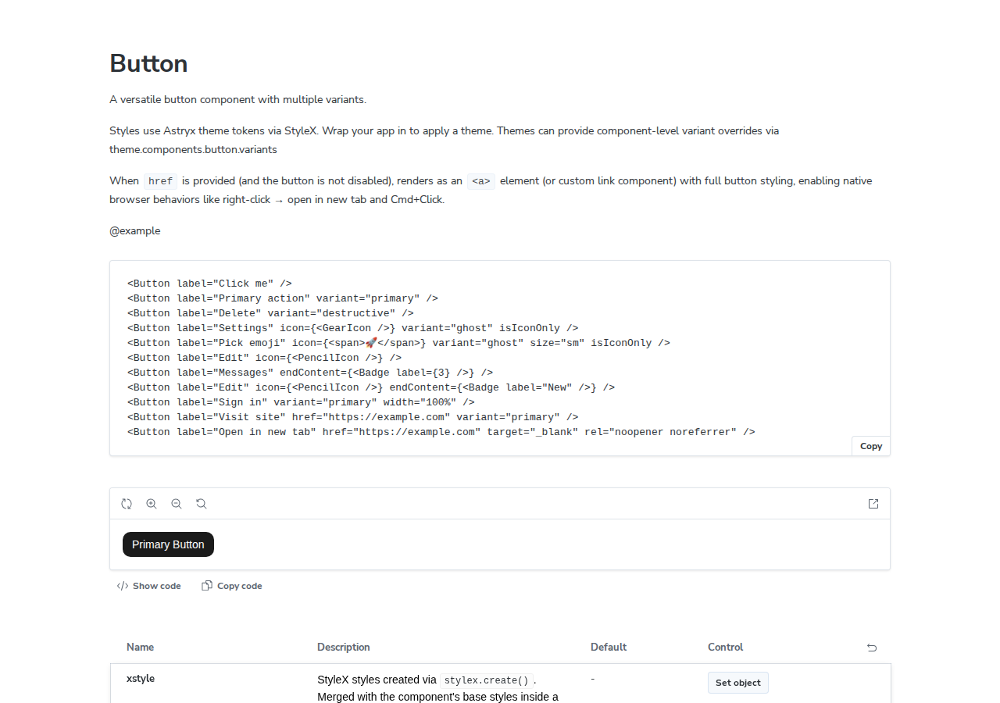

When was the last time you asked an agent to build a page and it got it right on the first try? Meta just open-sourced a design system called Astryx. It ran inside Meta for eight years, powering more than 13,000 apps. What sets it apart is not how many components it ships, but that people and agents build interfaces with the same set of tools.

The project lives on GitHub as meta/astryx, under the MIT license, built on React 19 and StyleX. It ships more than 150 accessible components, seven ready-made themes, dark mode, and a CLI. On GitHub Trending for November 9 it ranked second overall, gaining 3,324 stars in a day to reach 18,670.

Its API, docs, and CLI were designed together, under one set of conventions, so a person and an AI assistant build the same way, from the same reference. One of its principles puts it plainly: every change that made Astryx easier for AI made it easier for people too.


Conventions are what hold the system together. Every component follows the same naming, prop, and composition rules, and every one is fully documented, so once you have learned a few, people and agents alike can predict how a component they have never used will behave.

Take Button as an example: its prop definitions sit right in the source file. The comments beside each field spell out what the field means, and some of them also mark the default value.

```tsx
export interface ButtonProps extends BaseProps<HTMLButtonElement> {
  /** Ref forwarded to the root element */
  ref?: React.Ref<HTMLButtonElement>;
  /** HTML button type attribute. @default 'button' */
  type?: 'button' | 'submit' | 'reset';
  /** HTML name attribute for form submission. */
  name?: string;
  /** HTML value attribute for form submission. */
  value?: string | number | ReadonlyArray<string>;
  /** Associates the button with a form element by ID. */
  form?: string;
  /**
   * Accessible label for the button (required for accessibility).
   * Rendered as visible text by default. When `isIconOnly` is true,
   * used as aria-label instead.
   */
  label: string;
  /**
   * The visual style variant of the button.
   * @default 'secondary'
   */
  variant?: ButtonVariant;
  /**
   * The size of the button.
   * @default 'md'
   */
  size?: ButtonSize;
```

(From the astryx repo, packages/core/src/Button/Button.tsx — the ButtonProps definition, excerpted)



Nothing is locked down either. The building blocks are exported directly, and when you need to go deeper, a command called swizzle ejects a component's full source into your project for you to own. A theme is just a set of CSS custom property overrides, so a designer can restyle the whole system without forking the library or wrapping its source.



The next contest among UI component libraries will not be about which one looks best. Agents already build interfaces for people, so getting it right on the first try is a better test of a library than how many components it ships. Looked at that way, a new standard is taking shape: are the conventions clear enough, do the docs let an agent follow along, and can the CLI be called by an agent directly?

Astryx is still in beta, so its API may change. My suggestion is to take a real page and have an agent build it with Astryx, then count how many rounds it takes to get it right. That tells you more than reading the docs about whether the library is built for agents or just says it is. If your project needs a stable version for the long term right now, wait until it settles.

The next time you pick a component library, your first question may no longer be whether it looks good, but whether an agent can build a page with it and get it right the first time. The last time you asked an agent to build a page, how many rounds did it take before it got it right? If this piece helped you, consider subscribing to this blog or bookmarking it. I keep sharing what I have checked and used myself across AI, security, and open source, and when the next library built for agents shows up, I will write up whether agents actually build right with it.

Source: Meta Astryx repository https://github.com/meta/astryx
