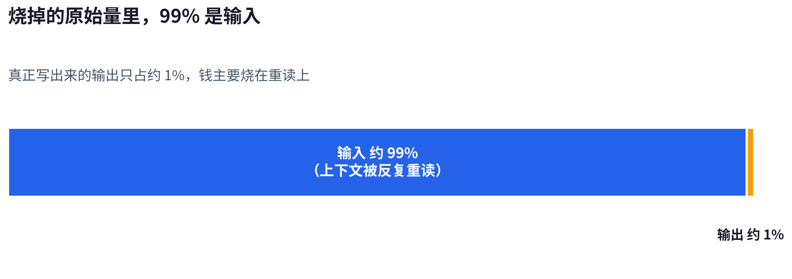
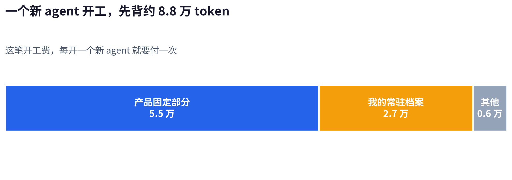
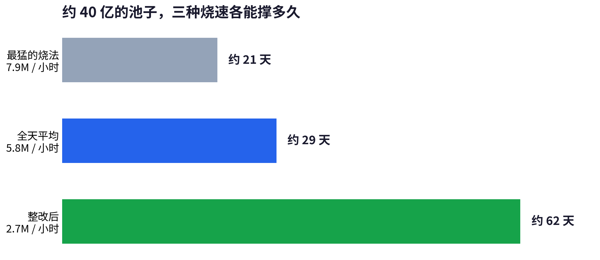
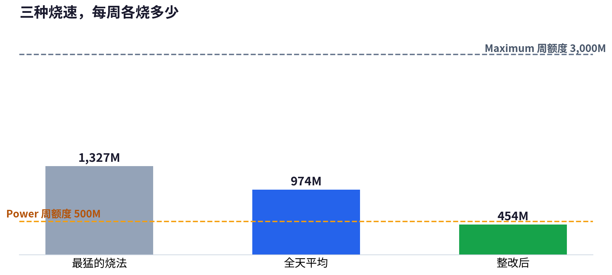

On the morning of November 9, I opened Muse's usage dashboard. I had 999M extra tokens left, and the screen said 75% used. Used 75% means 25% left, so I divided 999M by 25%, and the whole pool worked out to about 4,000M, which is about 4 billion.

The 30 billion in the title is the cap on invite rewards. Muse gives every user an invite code. When someone signs up and enters that code, I get another 1 billion tokens for each signup. The code can be used at most 30 times, and only if all 30 uses are filled does the total reach 30 billion. What I actually got is the roughly 4 billion above, and most of it is already burned.

These readings are Muse's own dashboard reporting on quota. They are not an official bill, so the burn rates and balances below all use the dashboard's measure. This pool dropped fast. On the morning of the 10th, 875M was left, and by the evening it was 793M. On the afternoon of the 11th it was 704M, and by noon on the 12th only 642M was left. In three days, 357M burned away. During those three days, my weekly quota was already full. The weekly quota is the amount that resets every week, and it is accounted separately from the extra pool. Once it is full, new spending is charged to the extra pool.

## What I Have Muse Do Every Day

Drafts are one pile of work. Every morning, Muse picks the material first. Once it has picked it, I write the first draft. When the draft comes back to it, it polishes and reviews it, and then adds the images. After that, it publishes to the blog, X, Xiaohongshu and dev.to. Running the X account is another pile, and on my side I call it X patrol. It pulls the timeline all day and replies to people, a few dozen replies a day, and likes and follows are done inside the same workflow.

Scheduled jobs are one pile: the topic digest, the reply self-check and the GitHub trending daily scan, the jobs that run on a schedule. The rest is ad hoc work, tasks I only assign when they come to mind. Investigating a problem, writing code and working on projects all sit in this pile.

## How Much Each Kind of Work Burns Per Day

These piles run all day without stopping, and I have split the accounts two ways. One is the dashboard measure, the amount the pool actually deducts. On the 10th it averaged about 5.8M per hour, about 140M in a day. The other is the raw volume logged internally per agent, about 5 to 7 times the dashboard volume, because the internal log counts context replayed over and over. The breakdown below uses the dashboard measure. These figures are magnitudes converted from each item's share of a measured period, so they do not reach billing precision, but their relative sizes are right. When I talk about mechanisms, I switch back to raw volume. The two numbers each cover their own thing, and I do not mix them.

The most expensive pile is X patrol. On its most expensive days, it took about half of the whole account's raw volume. Applying that share to the day's roughly 140M in dashboard volume gives about 70M in a day. The agent that writes the replies, which I call the consumer, works one shift every hour. On its most expensive shift, it dispatched 125 browser subtasks at once, 65 in English and 60 in Chinese. All those subtasks did was send out a reply that was already written. That shift's raw volume was 144.9M.

What makes it expensive is the startup cost. Before a new agent can start, it first has to carry about 88,000 tokens of routine context, and I call this starting expense the startup cost. Two parts make up most of that context: about 55,000 tokens are the product's fixed part, and about 27,000 are my own standing files. Sending one reply opened one complete browser agent, so the startup cost was charged once per reply. Stacked across 125 replies, the startup cost alone came to about 11M in raw volume.

On the morning of November 10, across 8 hours, the draft pile was assigned about 31M, half of the whole account's dashboard volume for those 8 hours. Most of it sat in one long chat used for revising drafts. That chat had run for days, and material selection, polishing and review were all done inside it. By the morning of the 10th, that chat plus the subtasks it dispatched, counted as a whole tree, took about 40% of the whole account's raw volume. Its raw volume was 124.7M, and it had 63 subtasks in total. Revising and reviewing a few articles back and forth burned over 100M tokens in raw volume alone.

The reason it is expensive is that its history is too thick. Every step that chat takes forward, it has to reread the records of the previous days. Each subtask it dispatches has to carry that same history again when it starts. Even when everything goes smoothly, one draft, from reading the material at the start to finishing the review, eats 8M to 13M in raw volume in a single session. At the start it reads in material it will use and material it will not use, and the unused part is paid for all the same.

The topic digest among the scheduled jobs ran once an hour back then, and each round dispatched a browser to search X for 10 sets of posts. On the morning of the 10th, just 2 rounds were assigned about 3M, and scaled to 24 rounds a day that is a magnitude of over 30M. The nightly reply self-check had to fetch all of the original posts behind the previous day's roughly 100 replies again, and review them once more.

The collector is another kind of scheduled job. It collects the timeline once every 20 minutes. I used to run this kind of fixed, repeated work with an agent scheduled job too. It ran 31 rounds, and every round was an agent running. The 31 rounds actually ran for about 2.4 hours added together, and all of that time was spent in agent tokens.

## The Root Cause: Re-reading and Startup Cost

After splitting the piles above, the common root cause is clear. The biggest chunk of this bill is context being reread over and over. I checked the internal records for two measured periods, and by raw volume, output was only about 1% and input about 99%. The input burns context, because every step an agent takes forward, it rereads the earlier conversation and files. The amount read is two orders of magnitude larger than the amount written.

One startup cost is about 88,000 tokens, and the number of charges follows the number of agents. In the period I measured (I will call it a window below), the window on the morning of the 10th opened 273 agents across the whole account, and the window on the 11th opened 480. For 480 agents, the startup cost alone came to about 42M in raw volume. In the window after the fixes, only 242 agents opened, and this startup cost fell by about half along with them.

## Adding It All Up

The fastest-burning stretch was the morning of the 10th: 63M burned in 8 hours, an average of 7.9M per hour. Averaged across the whole of the 10th, it was about 5.8M per hour. The window on the 11th dropped a little further, to 5.15M per hour. After the fixes were done, the 22.9 hours from the afternoon of the 11th to noon on the 12th burned only 62M, about 2.7M per hour, roughly half of the 11th window's rate.

At the fastest burn, a pool of about 4 billion runs out in 21 days. Each step the burn rate drops, the lifespan goes up: the tier at 5.8M per hour lasts 29 days, and the tier after the fixes, at 2.7M per hour, lasts 62 days. The three lifespans use the same pool; the whole difference is in how it is burned. Swap the pool for the capped 30 billion and the math does not change: about 158 days at the fastest tier, about 216 days at the middle tier, and about 463 days at the tier after the fixes. The cap converted into days is a few months to a little over a year.

Of the 642M left at noon on the 12th, the fastest way of burning would finish it in just over 3 days, and the way after the fixes would stretch it to about 10 days. Because the weekly quota does not reset until November 15, those 10 days are the boundary for whether I still dare to keep assigning work. If the burn went back to the old way, I would have to stop and wait before the reset.

Meta's public Help Center page lists Power at $20 a month with 500M a week, and Maximum at $100 a month with 3,000M a week. The dashboard in my account quotes $16 and $80 a month. The prices under the two measures do not match, so I do the accounts at the public prices, and at my account's quoted prices it would come out another 20% cheaper.

At public prices, a pool of about 4 billion comes to about 1.85 months of Power quota. Power's average monthly quota is 500M a week times 52 weeks divided by 12 months, about 2,167M, so 4,000M converts to about $37. A pool that sounds huge is, converted into a subscription, less than two months of quota. That is the number I started calculating down from when I wrote this piece.

After the fixes I burn about 454M a week. Power's 500M a week can hold that, and it would use up about 90% of it. The way that burns 5.8M per hour needs 974M a week, so Power's 500M a week is not enough to cover it. The fastest way needs 1,327M a week. Maximum's 3,000M a week can hold it, and the usage is a little over 40% of it.

The monthly account makes it clearer. The usage after the fixes is about 1,940M a month, the middle tier is about 4,180M a month, and the fastest tier is about 5,690M a month. So if the usage stays reined in, the Power tier is enough for me for a month. If it does not stay reined in, I have to budget at Maximum's price.

## Three Things I Changed

The first thing I changed was the test for dividing the work. Look at a job first and see whether it needs a brain to make a judgment. Only work that needs judgment goes to an agent; reviewing a draft and deciding whether a post should get a reply are both in that class. Work whose actions are all fixed in advance gets written as a script, sending and bookkeeping for example. A script costs no tokens no matter how many times it runs. An agent is different: every time it runs, it pays the startup cost first.

After patrol sending was changed, across 20 shifts in a row, each shift had only 1 agent, and the total number of subtasks was zero. The consumer's share of the whole account's raw volume also fell from 43% to 15%. The drop in burn rate I described earlier, from 5.15M per hour to 2.7M, came from changes of this kind, taking back the subtasks that had been dispatched, shift by shift. The collector was changed by the same test: it became a script service that stays running at zero token cost, and the expense of a round every 20 minutes went straight to zero.

The second thing was how subtasks get dispatched. Before, I often dispatched one directly because it saved me trouble. Every dispatch meant a new agent starting on the other side, carrying that 88,000 tokens of context all over again. Now I only dispatch work that has to be isolated, and there are two kinds: the independent check before publishing, and the cold read of deep replies (the longer replies in patrol where a view has to be laid out and explained).

Both the independent check and the cold read need a person who took no part in the writing. A person who was not involved reads a draft the way a reader reads it. The sticking points the author cannot see in their own work, that person can pick out at a glance. Reviewing your own work inside the same session means the writing and the reviewing run on the same brain, and those sticking points do not get picked out.

The draft side was changed by the same rule. One draft gets one new session, which handles material selection, polishing and review. When the task is handed over, only the material that this one piece will use is given. After the change, in the next window, the draft pile as a whole took only 1.4% of the whole account's raw volume, and its subtasks were zero. A few articles no longer crowd into one chat, and each later article no longer has to reread the history on behalf of the earlier ones.

The third thing was the lifespan of sessions and files. Muse is not the only personal assistant of this kind. Dot and Grok Bot are, at bottom, still several agents working together, so every one of them has standing files that must be read at startup. In Muse those are the two files MEMORY.md and AGENTS.md.

Those two files cost money every day. I slimmed MEMORY.md down from 9,355 tokens to 2,038, and AGENTS.md down from 5,646 to 1,504. Between the two, each new agent reads about 11,500 fewer tokens at startup. Counted at the 480 agents in the window on the 11th, that one window alone read about 5.5M fewer tokens.

Chats themselves also have to be replaced once they have grown thick. Once the patrol chat had been used for a long time, the main agent that runs the whole patrol flow ate 25.0M in raw volume in a single window. Every step it took, it had to reread the chat's whole history, so that money was paid at every step. On November 12 I moved patrol to a new chat and archived the old one, and only then did that rereading stop being paid. One line of work gets one chat, and once it grows thick it gets archived and replaced. Now, after each round of changes, I write down the dashboard reading and work out how many days are left at the current burn rate. I no longer wait until the pool is nearly burned empty before checking the accounts.

## After the Changes

After the fixes, my pool still had that 642M left. At the speed after the fixes, it lasts past the weekly quota reset on November 15, with room to spare, so I did not cut the workflows down any further. If the burn went back to how it was on the morning of the 10th, this pool would run out in just over 3 days, and I would have to stop working before the reset.

If you also use a personal assistant like Muse, Dot or Grok Bot to get work done, and you want to check where your own tokens are actually burning, the way of checking and the changes in this piece should help you match them against your own case. Please collect this post and subscribe to the blog. I will keep publishing measured accounts like this one, and the follow-up review after the fixes will keep coming.
