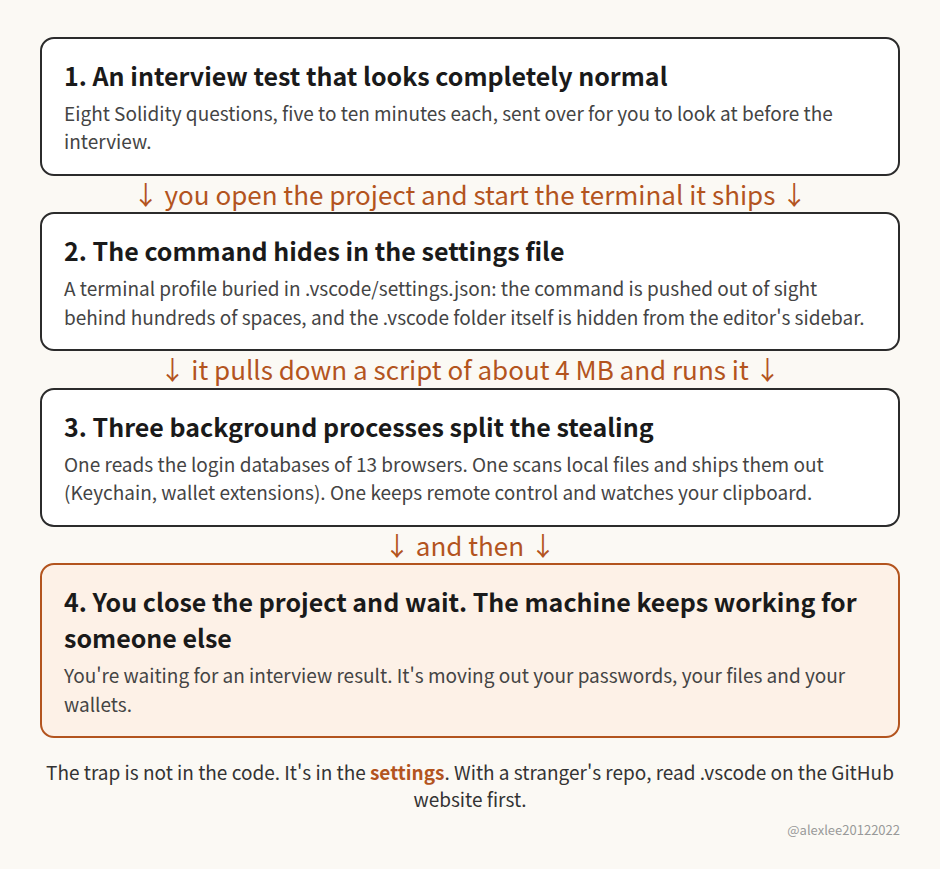

A backdoor hidden in an interview repo sounds like a small story. It involves job candidates, one fake company, one poisoned project, and if you are not currently interviewing, it is easy to file it under somebody else's problem. I nearly did. Then it kept nagging at me, because the uncomfortable part is not really the interview. It's what the case says about open source. The code in an open source project is sitting there for anyone to read. Sitting there to be read, and actually having been read carefully by somebody, turn out to be very different things.

The repo is called sol-live, and SlowMist disclosed it last week. On the surface it is a set of Solidity interview questions, eight of them, each helpfully labelled as a five-to-ten-minute job. The backdoor isn't in the questions. It sits in a settings file inside the .vscode folder. Editors like VS Code read settings that ship inside a project, and this project used that settings file to define a terminal profile. Open a terminal inside the project and the hidden command runs. The folder is hidden too, through an exclusion rule that keeps .vscode out of the editor sidebar, so even a suspicious candidate would struggle to inspect the place the command lives. Once it runs, the command pulls down an obfuscated script of about 4 MB and starts three background processes. One goes through the login databases of 13 Chromium-based browsers. Another scans local files, the macOS Keychain and whatever wallet extensions store, and ships what it finds out. The third provides remote control and watches the clipboard. SlowMist reconstructed all of this offline from the code. They haven't published a victim count, and the Windows path in the code is unconfirmed. They also found 8 more repos built the same way.

Why do we normally assume open source software is safer? The reasoning feels solid. The code is public, anyone can read it, anyone can audit it, so a backdoor would eventually be spotted. Closed source software asks you to trust a vendor you cannot inspect, while open source lets you check for yourself. I have believed some version of that for most of my career, and I still maintain open source projects, so I am not looking to talk myself out of it. The trouble is in a small swap the argument makes without announcing it. Open source gives you the right to audit. It gives you access. It doesn't give you any evidence that an audit has happened. A GitHub page carries no stamp saying how many people read the whole repo, or whether anyone at all opened the configuration folders. A project nobody has ever reviewed and a project that survived a careful review look exactly the same from the outside. Same clean page, same green buttons, same reassuring word: open.

So who actually does the reading? For a famous project, plenty of people do. It has maintainers, companies depending on it, security researchers poking at it because breaking it would be worth bragging about. Those projects are not what I am talking about. I am talking about the long tail that fills most of a working developer's week. You search for a problem, find a small repo by somebody you have never heard of, the README looks competent, and you clone it. Few stars, few forks. For a project like that, there is a decent chance nobody except the author has ever read all the code, and almost nobody has read it looking for malice. Users don't audit tools they're trying to get a job done with. They run them. Even a careful user who peeks at the code tends to look at the main feature, the part that solves their problem. Almost nobody opens .vscode, because in our heads that folder holds editor preferences, fonts and colour themes and personal habits. It doesn't feel like part of the program. That assumption is exactly the hole sol-live walked through. Everyone imagines the audit would look at the code that does the work, so the payload went and lived in the settings nobody counts as code.

Put closed source software next to it and the comparison gets stranger, because on this one narrow point the incentives run the other way. A closed source vendor can absolutely do bad things. It can collect more data than it admits to, ship sloppy security, hide behaviour it would rather you not notice. But behind the software there is a named company with a brand, customers under contract, and lawyers who know where to send the letter. If that company shipped a blatant stealer that emptied browsers and wallets, it would be betting the whole business on nobody catching it. Companies do reckless things, but usually not that reckless, because they can't run. Now look at the fake open source project. Behind it there might be nothing more than a throwaway account and a fake recruiter. Once the stealing is done, the account gets abandoned. There's no brand to protect and no company sitting there waiting to be sued. The honest reason a normal vendor shows some restraint is not that it is virtuous. It is that it has something to lose and an address where the loss can be delivered. A disposable repo has neither. So on small, unknown projects, the thing we treat as open source's safety guarantee, transparency, is mostly an unexercised possibility, while the practical restraints are actually weaker than they are for the closed source vendor we instinctively distrust.

AI is about to make a lot more of these. A convincing fake project used to take real effort. Somebody had to write believable questions, plausible code, a decent README and a hidden payload. Now one person can produce several versions of that in an afternoon, with the docs, the commit history and the exercise all reading like the genuine article. The interview is only the costume that happened to get caught. Next time it can be the little utility you were just searching for, or a starter template, or a practice project some account recommends. You will clone it the way you clone everything, and everything on your main machine is the prize if you are wrong. Your email, your GitHub, your bank, your password manager, your wallets, they all live on the same machine most of us develop on. If our habits stay as they are, each of us ends up doing the first security review of a stranger's repo in the most expensive way possible: by running it at home and finding out.

My advice is narrow, and it's aimed at people like me who touch open source projects all day. Any project you plan to run on your main machine or build real work on top of deserves a few minutes before your editor ever opens it, and that goes double when the stars and forks are few and the author is a stranger to you. Look through the files on GitHub's website first. Open the .vscode folder specifically, and pay attention to anything in the project that is set up to run by itself, settings and scripts included. Then have your local agent do a static review of the whole repo, reading the code without running it, and tell you what the project wants to do to your machine. That pass is cheap now. AI lowered the cost of faking a project, and it lowered the cost of a first audit too, so use it. If you do need to execute the project, use a virtual machine or a throwaway environment rather than the machine that holds your wallets and your main passwords. And if you have already opened a repo like this and started the terminal it configured for you, don't talk yourself into hoping it was fine. SlowMist's order is the right one: isolate the machine, use another device you trust to move your wallet assets somewhere safe, then change the passwords that matter, one by one. Change them now. There's no smarter version of that advice, and waiting only gives the other side more time with your stuff.

Think back to the last small repo you cloned from somebody you had never heard of. Did you open its .vscode folder before you opened the project?

Source: SlowMist, "Threat Intelligence: Beware Web3 Interview Questions Conceal a Data-Stealing Backdoor", Oct 23, 2026, https://slowmist.medium.com/threat-intelligence-beware-web3-interview-questions-conceal-a-data-stealing-backdoor-615cebdcb21c
