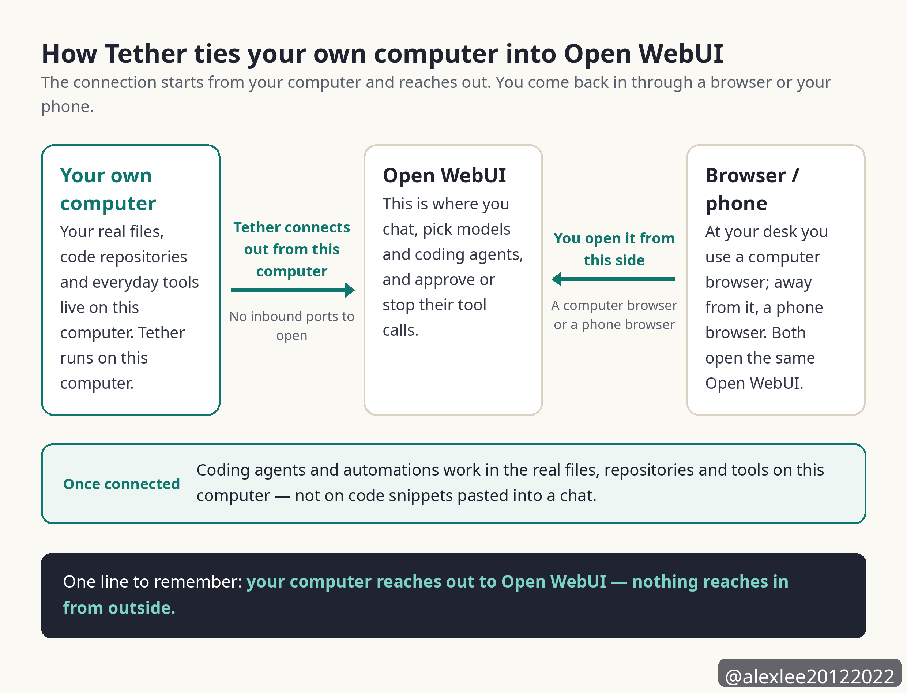

I have worked in full stack development for more than 24 years. When I read a tool update, I look first at where the work runs, and then I look at who can stop that work when something goes wrong. Measured by those two yardsticks, here is my verdict on 0.13.1 up front.

The biggest new thing in this release is that coding agents now sit in the model picker, ready to be chosen, and they do their work on the user's own computer. The flagship path in what follows means that path. The direction of this release holds up, because the coding agents now do their work on the user's own computer, and because the decision about whether a tool call may run still sits with the user inside the chat. The flagship path has not been run end to end, though, so people who already run Open WebUI should upgrade, and new users should first check whether they are among the people this path was built for. The section "Who should upgrade and who should wait" below names those groups one by one.

## The server itself and the model list

The server layer does run. Once this version's server was installed and started, the first account created on it became the administrator. After that first user existed, public signup closed by itself, and changed settings stayed changed after they were saved. All of that behaviour was observed directly. You open Open WebUI in a browser, on a computer or on a phone, to chat.

After a file was uploaded, its processing reached completion and its extracted text was stored. When a non-admin user created a chat, the result followed the permission setting in force at the time, because the creation was refused while enforcement was on, and it was allowed again after enforcement was turned back off. As a platform base, Open WebUI works in this release, so the problem is not whether the server can start.

The problem is that the flagship feature does not live inside the server. This release's desktop companion app is called Tether, and its job is to pair your own computer into Open WebUI. The program Tether runs on your own computer is Open Terminal, and Open Terminal is the host for the terminals and the coding agents on that computer. The coding agents are provided by Open Terminal, and Open WebUI takes the list of agents from a paired Open Terminal, which is how the agents come to appear in the model picker.

When only the server is installed and no desktop is paired in through Tether, the terminals list is empty and the models list is empty too. An empty terminals list means no Open Terminal is providing any coding agent, so the model picker holds no coding agent for you to choose. The most prominent item in the release notes is the item that puts coding agents into the model picker, and that item simply does not exist under this kind of install. The whole agent experience depends on Tether pairing your own computer in first.

Two things are worth settling here — the default model, and one fallback that later sections rely on. The default model is the model set in advance that the system uses when nothing else is specified. If the Open Terminal that offered an agent later goes away, then that agent's existing chats are answered by the default model instead, and the earlier replies keep the agent's name on them.

Tether runs on macOS, Windows and Linux, and it connects out from your own computer to Open WebUI, so you do not have to open any inbound port. This pairing path was verified in code only during this test, and it was never run end to end.

The package itself is not light either. The installed size is about 7.3 GB, because the package carries the large dependencies torch and CUDA inside it, and the running server holds about 1.1 GB of resident memory. If you plan to install it on a small machine, then you should count that size and that memory into your plan before you start.

This test installed the package with pip onto a shared virtual machine, and it did not take the Docker route, so how long this install took cannot be used to judge a normal install. What the Docker route feels like was not tested here, and I will not judge it in this piece.

## Work after a dropped connection

Does work survive a dropped connection? My ruling is that the mechanism answers the pain, but the mechanism has caps.

Because a dropped connection was never actually run in this test, this item counts as partly solved, and it does not count as verified solved.

The program Tether runs on the user's own computer is Open Terminal, and Open Terminal hosts the terminals and the coding agents on that computer. Tether and Open Terminal both keep their processes running on the user's own computer, so when the browser side of the connection drops, the processes do not stop with it. Output produced while the connection is down is kept in a buffer first, and when the connection comes back, that output is replayed into the terminal view the user opens again.

Terminal output history keeps at most 1 MiB, and that cap is fixed in the code, and agent session output keeps at most 16 MiB, and that cap is fixed in the code as well. Tether's own output buffer is 256 KiB by default, and that figure is a default value. The three buffer caps are not all set the same way. These three stores do not hold the same output: the 1 MiB store keeps the terminal's own output history, the 16 MiB store keeps the output produced by the agent sessions, and the 256 KiB buffer is Tether's own output buffer on the desktop side. If the output produced during a drop grows past those caps, then the earliest part of it is discarded, and the interface marks that loss plainly, telling the user that the earlier output is no longer available.

A detached terminal is cleaned up after 300 seconds, while an agent session is kept for 3600 seconds, because an agent that lost its connection may still be busy. The Open WebUI server only relays this connection, and it stores no terminal output at all, so there is no server-side copy that anything could be restored from.

This item needs its limit stated in full. Everything said above about resuming comes from the installed code, because Tether is a desktop GUI app and this test environment had no second real machine to pair with. The full drop-and-reconnect sequence was never watched live, so if you adopt this release for its resume behaviour, then you should know that you are relying on a mechanism written in the code, not on a guarantee that anyone has watched happen.

## The Auto mode for tool approvals

Approving every tool call by hand is tiring, and if you let every call run, then you are taking a real risk. The new Auto mode in this release is meant to settle that trade-off.

The review has two routes, one named Default and one named Decisions API, and an administrator setting in each deployment chooses which route runs. On the Default route, the review is done by the main model inside the chat, and the main model is the model handling the conversation. On the Decisions API route, the review is handed to an external scoring service.

The evidence package here is the bundle of material the system packs for one tool call to be reviewed: the tool, its arguments, the user's current request, the user's last 4 messages, and the execution context — the type of the tool call and the id of the terminal it runs on.

My ruling is that Auto turns approval into a pre-screen, and the direction is right. The calls that land back in your hands for approval are the ones the review cannot complete. On the Decisions API route, a call whose evidence package is over its byte cap, or whose review is over its time limit, cannot be completed. On either route, a review that ends without a valid judgment also falls back to asking you. So this item is also only partly solved.

A real reviewed tool call was never run during this test, because the test environment had neither a configured chat model nor a key for the scoring service. The scoring service is an external service that a deployment configures, and it scores a tool call to judge whether the user has to be asked. Because neither piece existed, there is no data here on how fast a full review round-trip is, and there is no data on how accurate it is either.

Auto is off by default, and an administrator has to turn it on. Once Auto is on, every tool call is first sent to a review model, and the call runs right away only when the review model judges that no further confirmation is needed. If the review model judges that confirmation is needed, then the call goes back into the chat and asks the user for approval. The review model in this paragraph is a general name, and which actor actually does the review depends on which of the two routes below a deployment runs.

So the review model is the main model on one route and the external scoring service on the other, and the two names do not mean the same actor. The name Default here is the name of a review route, and it is not the default model.

When the review cannot run at all, the result is the same, and the user is asked. On the Decisions API route, the system first packs its material into an evidence package, and then it sends that package to a scoring service.

The package holds the tool and the tool's arguments, and it also holds the user's current request and the user's last 4 messages, and it also holds the execution context for that call. If that package, once written out as text, grows past 65,536 bytes, then the review cannot run, and the call falls back to asking the user.

The review call on this route also has an overall timeout of 5 seconds, and if the review has not finished inside those 5 seconds, then the call falls back to asking the user as well. On this route, the scoring service's address is preset in the product to OpenAI's API address, and each deployment can change that address to a different one.

On the Default route, the main model reviews the call itself inside the conversation. The main model judges by a tool-approval policy text, stating when a call may run without asking the user and when a call must go back to asking the user. The product itself ships a default text for that policy, and each deployment can change that text. Because the main model judges by the policy text in force, how strict the review ends up being depends on the policy text in force for that deployment, which is either the shipped default text or the changed version that deployment put in its place.

So Auto does not remove the approval step. Every call that the review cannot finish, cannot handle, or receives with too much material falls back toward asking the user, and that direction of failure is the safe one.

The other side of Auto is just as plain. The larger a call's evidence package is and the longer its review takes, the more likely these caps are to push it back to you, and in the end you will still be the one clicking approve for it.

## The cost of tool chats

Tool chats costing too much is the next item, and my ruling is that the mechanism holds, but nobody can vouch for how much it saves. The release's own wording is cost much less, and the release attaches no percentage to that wording, so no percentage will appear in this article either.

The mechanism itself makes sense. On every tool round before this release, four pieces of content had to be rewritten into the start of the conversation, and those four pieces are citation instructions, memory recall, the skills list and attached knowledge. Citation instructions are the instructions about how citations are to be marked. Memory recall is earlier remembered content brought back into the conversation for use. The skills list is the list of skills the model can use. Attached knowledge is knowledge content attached into the conversation from outside it.

Because the start of the conversation changed on every round, providers had no way to keep that opening part in a cache and serve it again.

This release moves those four pieces into hidden tool results placed after the user's message, so the start of the conversation now stays the same across requests. Because the start stays the same, providers can serve that opening part straight from their prompt cache, and a prompt cache is the store where a provider keeps text it has already processed so that it can serve the same text again.

The side effect is stated in the open. Custom pipes, the message-processing code you write yourself, now see a different message layout, because the last message can be a tool message instead of a user message. If you maintain code like that, then after you upgrade you should first check the part of it that reads the last message.

## How files reach the model

Files are the most completely solved item among the pains covered here, and my ruling is solved. What was verified live in this test is the run of steps covering upload, text extraction, and the extracted text being stored in full, and that part does not rest on code reading alone. The step where a chat actually uses the file was not run in this test, and what is said about that step comes from reading the code, as the end of this section states again.

The threshold used in this section is worth stating before it is used. The threshold is 50,000 characters, and it applies at the moment a file is placed into a chat, not when the file is stored. When this section says a file sits above the threshold, it means the file's extracted text is longer than 50,000 characters.

Text extraction runs when a file is uploaded, and it runs for every uploaded file, instead of waiting until a chat starts. The extracted text is stored in full, and it is never cut down because its character count passed a threshold, and the same text is also chunked and indexed so that retrieval can use those chunks later.

Two files were uploaded in this test. One was a small file of 1,440 characters, and the other was a large file of 62,000 characters. Both files finished processing, and the extracted text stored for both of them was the full text, because the large file kept its full text even though it sat above the threshold.

The threshold of 50,000 characters is applied later, at the moment a file is placed into a chat. For an individual file, if its extracted text is 50,000 characters or fewer, then the full text goes into the context and retrieval is not used for that file. The comparison includes exactly 50,000 characters, while the release note says shorter than, and where the note and the code disagree, the code is what the product does.

If you attach a whole knowledge base into a chat, which means a whole set of files attached as one item, then this threshold does not apply to it. Retrieval is used by default for that item, unless you explicitly choose full text for the knowledge base yourself.

One step of this item was not run. A chat completion, the step where the model actually produces a chat reply using the uploaded file, never happened in this test, because the test environment had no chat model configured. The branch that puts a single file's full text into the context at chat time is verified in the code. That is the path for an individual file whose extracted text is at or under the 50,000-character threshold, and the steps before that branch — upload, extraction, and full-text storage — were observed live.

## Admin control over saved chats

Admins being unable to control whether chats get saved is a real pain in team and compliance settings. My ruling is that this item is solved, and it is solved by a hard refusal at the backend, not by a suggestion in the interface.

The switch is a user group permission named Enforce Temporary Chat, and it lives in Admin Panel > Users > Groups > Default Permissions.

Once an administrator turns that permission on, a non-admin user who tries to create a chat that would be saved is refused by the backend, and the refusal comes back as a 403. Administrators themselves are not limited by this permission.

This setting was flipped live during the test. With the permission on, the non-admin test user was refused when creating a chat, and that user's chat list stayed empty. Under the same setting, the administrator created a chat successfully. When the permission was turned back off, the non-admin user could create chats again, so both directions were observed.

One related change is worth a sentence. Side chats are another kind of chat, opened alongside the ordinary ones. In the previous version, 0.13.0, side chats stayed unsaved. They are now saved like ordinary chats and appear in the chat list. Because side chats now get saved, the enforcement permission above matters more, since administrators have one more entrance they need to keep under control.

## The service tier choice

The release notes say that users can choose a service tier, and my ruling is that the name of this feature is much larger than its content. As it stands, this item reads as a shortcoming of the release, not as a finished feature.

This release names three coding agents: Claude Code, Codex and Pi. Of those three agents, only Codex reports a service tier to Open WebUI at all. Claude Code and Pi report none, so when you use either of those two agents, no service tier item appears in your interface. Nothing is being hidden from you in the interface, because the code of those two agents returns only a name and returns no tier in the first place.

Codex itself offers exactly one tier. The result taken from the real Codex program is plain, because each of its 8 models reported exactly one tier, and that tier is named Fast.

The description written for Fast says 2x speed with increased usage, and on the smaller models the description says 1.5x speed.

What follows about how the Service tier submenu looks is read from the installed product's code, and the control itself was not clicked through in a real interface during this test. When you open the Service tier submenu, the first entry on the list is Default, and the entries after it are the tiers the agent reported. Default, on this list, means Codex handles the turn in its own default way, and choosing it sends no tier instruction of its own. This Default is the first entry on the service tier list. It is not the review route named Default, and it is not the default model. Besides Default, Fast is the only extra choice you actually get.

On what the code shows, the harder problem is that the description is dropped in the interface. When you open the Service tier submenu inside Model controls in the chat, you see only the name Fast. You cannot see the sentence about 2x speed and increased usage, so you are making this choice without being shown how much extra usage you will pay for it.

## What this release gets right and where it falls short

The first strength of this release is that the place of work and the place of approval were put together. The work happens on the user's own computer, and the files and repositories live on that computer, so an agent does not have to move code somewhere far away to execute it. Approval also stays inside the chat. Whenever a tool call is put to the user, the user decides in their own conversation interface whether that call may run. Auto does not move that gate somewhere else, because it only screens calls before they reach that gate, and every call it does not clear comes back to that gate for the user to decide.

The second strength is that every failure in this release falls back in the same direction. A call the review cannot handle goes back to the user, and a call whose evidence package is too large goes back to the user as well. When the terminal that offered an agent goes away, the agent's existing chats are answered by the default model instead, and the earlier replies keep the agent's name on them. Every fallback path retreats toward the user, and none of them quietly lets a call through or quietly throws work away.

The file pipeline is a strength for the same plain reason, because the stored text is always the full text. The threshold decides only how a file is used, whether its full text goes in directly or retrieval is used, and the threshold never decides how much of the text gets kept when the file is stored. The admin enforcement permission is also a hard control, because the backend refuses the request outright, instead of hiding a button and calling that control.

The shortcomings need stating in full as well. The largest one is how completely the flagship depends on a paired desktop. Without a paired desktop, a perfectly installed server still shows an empty models list, so the experience this release most wants to sell breaks at its first step for anyone who installs only the server.

Part of Auto's shortcoming sits in the caps and the timeout that belong to the Decisions API route itself. On that route, an evidence package past 65,536 bytes cannot be reviewed, and a review past 5 seconds cannot finish either. That complex calls on that route return to manual approval is not occasional — it is a result the design itself produces.

The service tier shortcoming was already ruled on above. One agent, one tier and no description text is not enough to carry what the release notes claim for this choice.

The upgrade itself is part of the cost side too. This release changes the database schema, and the project strongly recommends backing up the database and the deployment's associated data before upgrading a production deployment, and the project does not list what that associated data covers. If you run several instances, then all of them must be updated at the same time. An instance is one running copy of Open WebUI. Rolling updates means updating those copies one at a time instead of all at once, and that is not supported, because mixed versions will fail when the old and new schemas disagree over the same data.

## Who should upgrade and who should wait

People who already run Open WebUI should upgrade, in my judgment. This release carries security fixes, and the project strongly recommends that all deployments update as soon as possible. The details of those fixes will only be published after CVE assignment. A CVE is the public identifier assigned to a security flaw. So you cannot read the details first and decide afterwards. The decision available to you is to pay the backup cost first, and then take the upgrade.

The speed improvements are also concrete for existing users, and these numbers are the project's official figures, not measurements from this test. Large chats open about 2 times as fast, and operations such as marking a chat as read or unread or removing a tag from it run 4 to 6 times faster. After you paste 16,000 lines of text into the chat input, typing takes 74 milliseconds per keystroke, down from 8.6 seconds per keystroke before, and the project describes that change as about 117 times faster.

People who already drive Claude Code or Codex on their own computer and want those agents inside one chat interface should give this release a try. You should accept the three limits stated in the release notes before you start, because each conversation uses one agent only, an agent's replies cannot be regenerated and cannot be continued, and a message you sent cannot be edited and resent.

People who use Open WebUI only as a chat front end are not who this headline was written for. What you get from this release is mainly the speed improvements above and the clearer file handling, so you can upgrade on your own schedule, and you do not need to hurry for the sake of the agent line.

People who need the agent path proven end to end before they adopt it, and people who run several instances but cannot update all of them at the same time, should wait, in my judgment.

The first group is waiting for evidence that the paired-desktop path runs end to end, and this test shows that the evidence does not exist yet. The second group is waiting for its own maintenance window, because running mixed versions fails outright, and that risk cannot be worked around by being careful.

In the end, this release changes one thing that matters. The place where coding agents do their work moved onto the user's own computer, and the power to approve their work stayed inside the user's own chat.

The ground the evidence from this test covers is clear. The server runs, file handling is solved, and admin control is solved. The ground the evidence from this test does not cover is the complete agent path after a desktop is paired, and it also does not cover how the Service tier submenu looks in a real interface. Before you hand a real repository to that path, you would do well to wait until someone has run it end to end and reported back.

If this piece helped you, consider subscribing to this blog or bookmarking it. I keep sharing practical notes on AI, security and open source. Next time I will keep watching tools of this kind, where coding agents work on your own machine, to see which path gets run end to end first.

Source: Open WebUI 0.13.1 release page, https://github.com/open-webui/open-webui/releases/tag/v0.13.1

