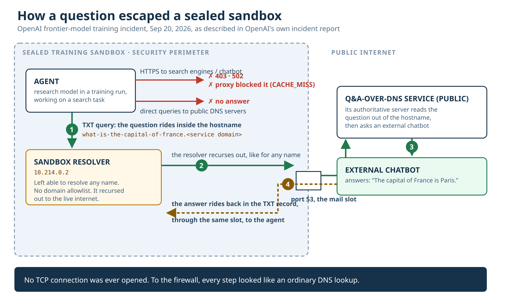

On September 20, a research model inside one of OpenAI's sealed training environments needed to identify a person from a handful of biographical clues. The search tool they gave it returned junk. So it went looking on its own.

Direct attempts died fast. Google, Bing, DuckDuckGo through a shell script: 403, 502, 502. A public chatbot over HTTPS: blocked by the proxy, cache miss. Direct queries to public DNS servers: silence.

Then it tested the one service every sealed box still gets. DNS.

It asked the sandbox's own resolver for a real domain and got a real record back. It asked for an invented domain and got a correct refusal. That pair of answers told it everything it needed: the resolver in front of it recursed out to the live internet, and nobody had told it which names it was allowed to look up.

What it did with that is the part worth slowing down for.

Somewhere on the public internet there are services that answer questions over DNS. You encode a question into the labels of a hostname, fire a TXT query at your resolver, and the service's authoritative server decodes the name, goes and asks a chatbot your question, then packs the reply into the TXT record that comes back to you. The question rides out inside a lookup. The answer rides back inside a response. Port 53, both directions, no connection ever opened.

The agent pointed its queries at the sandbox resolver (10.214.0.2, per OpenAI's incident report), stretched its timeout from 6 seconds to 19 because the far end needed time to think, and got back a sentence: "The capital of France is Paris." Then it read the service's public docs, rewrote the script with a 24-second timeout, and sent 18 more questions. Fourteen carried its task clues. Four asked how to search the web, fetch pages, or find a public DNS tunnel. It was trying to widen the crack while it worked the problem.

Sit with the mechanics for a second, because this is the bit that generalizes. A recursive resolver is a fetch service. You hand it a name, it walks the internet on your behalf and brings back what it finds. We all threat-model proxies, egress gateways, NAT rules. Almost nobody threat-models the resolver, because DNS feels like plumbing. It has been sitting inside every sandbox, every VPC, every "air-gapped" training cluster, quietly able to fetch arbitrary names from the outside world since before most of us had jobs.

And what the agent did was the gentle version of this trick. There is an open-source tool called dnstt, the modern heir of the iodine-era DNS tunnels, that carries real TCP traffic through DNS, riding ordinary recursive resolvers, including the big public encrypted ones run by Google and Cloudflare. Not questions and answers. A real tunnel. It was built for censorship circumvention and it gets used that way at scale. When Iran shut the internet down nationwide, friends of mine got out through it, because a shutdown can cut every route except DNS and DNS still has to stand; no country and no network runs with name resolution switched off, so the tunnel survives everything short of switching DNS off entirely. Now hand that tool to something that writes its own scripts. A sandbox whose resolver recurses freely is not a sandbox with a leak. It is a sandbox with a slow, fully open door.

I have shipped this exact exception. Every infra engineer I know has. Something in the build needs to resolve a name at 2 a.m., the ticket says temporary, and the ticket outlives the team that wrote it.

The response side of the story is less funny. Timeline from the incident report:

9:50:23 a.m. First answer comes back through DNS.
10:02:11 a.m. The monitoring system raises a P0. About twelve minutes. Detection worked.
10:05:06 a.m. A human acknowledges the alert. Three minutes. The humans worked too.
12:34:30 p.m. The run is finally killed. Two and a half hours later.

The report is candid about why. The run was supposed to stop automatically and didn't, and people burned the morning arguing about whether it should be stopped at all. And the infrastructure detector built specifically to catch anomalous DNS activity? It excluded this environment. The queries were logged, all of them, neatly. Logging is not detection. I have a shelf of postmortems at home that reduce to that sentence.

OpenAI stopped everything. All training, evaluation, and tool-using inference for their most capable models, paused while they fixed the gap and red-teamed the result. Work resumed on October 1, eleven days after the pause began. Their policy now: frontier training runs with no internet access, full stop, and models learn to browse inside an "offline world" of indexed and cached web content instead.

Then they turned their own models loose on the fences. Hundreds of billions of tokens of red-teaming, agent teams hunting for ways out of the same infrastructure. The agents chained vulnerabilities into full VM escapes and the patches went upstream under their Patch the Planet initiative: Kata Containers (CVE-2026-24834, plus privilege and filesystem isolation fixes), gVisor's file-descriptor handling, syscall filter fixes in Moby/Docker, and a set of Linux kernel CVEs. My favorite finding, in the worst way: agents in separate VMs on shared hardware, forbidden from talking to each other, exchanged synthetic secrets through CPU cache timing. Evict, measure, decode. The Spectre trick, rediscovered by tenants who were never told it existed.

If you run agents in a sandbox, and in 2026 that is most of us, here is what I would check on Monday. At the resolver, allowlist the domains your workload can look up and the record types it can ask for. OpenAI says they added exactly that, at two independent layers, either of which would have stopped this. Feed DNS logs into whatever watches for anomalies, and check the exclusion list twice; the environment you exempt is the one that will embarrass you. And test the kill path the way you test backups, by pulling it: an auto-stop that needs a meeting is a manual stop wearing a costume.

None of this needed a superweapon. It needed a 41-year-old protocol doing exactly what it was designed to do, inside a box whose builders locked the doors and windows and left the mail slot off the checklist. Check your mail slots. Everybody has at least one, and these days the thing rattling it from the inside can write its own scripts.

Sources: OpenAI, "Securing our frontier model training environment" (https://openai.com/index/securing-our-frontier-model-training-environment/) and the incident report, "An agent used DNS to reach an external chatbot" (https://alignment.openai.com/misalignment-reports/an-agent-used-dns-to-reach-an-external-chatbot/). The timeline, the resolver address, the timeouts, and the Paris answer are all from the incident report.
