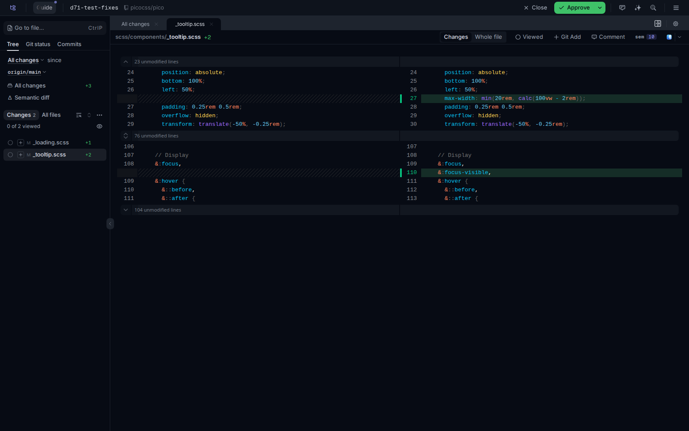
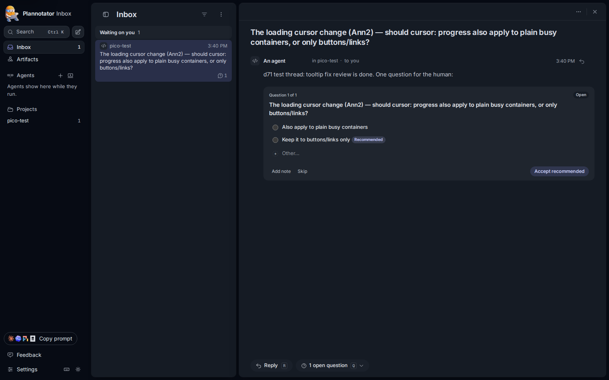

I changed 3 lines of code in the Pico CSS repository, and then I used plannotator to put 2 line-by-line annotations on those changes. I sent both annotations back in one go, and the agent fixed the first one the way I had asked. I checked its fix myself afterwards. The comments arrived with line numbers attached, and the decisions stayed on record. On those two points, the tool did what it promises.

Its headline features are a different story, because the Codex and Claude desktop apps already have built-in versions of them, so most people who work in just one desktop app do not need to install one more tool. What plannotator adds on top comes to 3 things: annotating files that are not code, an Inbox that several agents share, and an approval gate that scripts can check. All 3 sit in places the desktop apps do not reach.

## What it is, and how to install it

Plannotator is a review workbench that runs in a browser on your own machine, and the version I installed in this round was v0.28.64. After an agent writes a plan or changes some code, plannotator opens a page locally. You annotate line by line on that page, and you approve the work or send it back. What you write returns to the agent with the file, the line number, and the original text of that line, and then the agent carries on working from your comments.

Repository: [github.com/backnotprop/plannotator](https://github.com/backnotprop/plannotator)

I noticed the tool because it gained 412 stars in one day in the GitHub trending digest I read, and in ten rounds of that digest it reached No. 1 on the overall chart for the first time. When I went and checked the repository myself, the star count had already reached 10,775. A high star count only tells you that a lot of people are watching. Whether the tool is any good is a question you can only answer after you install it and run it.

You install it with a single command that pulls a script down from its official site and runs it. The script installs a 205 MB binary into ~/.local/bin on your own computer, and that binary is the tool itself. If you add --minimal to the install command, it installs that one file and nothing else, and it leaves every other configuration file alone.

A full install touches much more. In this round it changed my ~/.codex/config.toml and added a section at the end of the file that turns hooks on, and it created a new ~/.codex/hooks.json that holds one Stop hook. Every time the agent stops, that hook gets a chance to put the review page in front of me first.

It also installed 5 skills into ~/.agents/skills and another 5 into ~/.claude/skills, and it placed 4 command files for OpenCode. On top of that, it downloaded a 67 MB sem sidecar that works out semantic diffs. I could check every one of these changes after the install, and the installer hid none of them. Still, before you install it, you should know that it connects at exactly the gate between you and your agent.

## The code review round

My test field was picocss/pico. On a local branch I changed 2 files, 3 lines in total: I added a line that caps the width of the tooltip style, I added a line with &:focus-visible to the display trigger so the tooltip also shows on keyboard focus, and I added a progress cursor line for buttons and links in the loading style. Each change filled a gap that really exists in that repository. I compiled the styles once after the edits, just to confirm I had not broken anything.

After the edits, I ran plannotator review inside the repository, and that command waits where it is until the review is over before it exits. This round ran the review surface that you start by hand from the command line, because Codex was not logged in on the test machine, so I could not test the path where plannotator hooks in on its own during a real session. The page that opened in the browser showed a split diff. Its file tree said 2 files and 3 added lines, and that matched what git diff showed me, exactly.

My first annotation landed on line 27 of _tooltip.scss, on the max-width line I had just added. The problem was not that line on its own. The problem was that it fights with older settings in the same rule, because that rule already says white-space: nowrap, which forbids text wrapping, and it pairs that with text-overflow: ellipsis, which cuts off whatever does not fit and replaces it with dots.

I had capped the width of the tooltip bubble, and wrapping was still forbidden, so a long tooltip would end up cut down to a string of dots, and the user would never read the full text. My annotation said one thing: either let the text wrap, or drop the width cap, because the two settings cannot both stay.

My second annotation landed on line 44 of _loading.scss, on the cursor: progress line I had added. I asked for the progress cursor to cover more than buttons and links, because the ordinary busy containers under the general rule in _loading.scss should get it too, so that everything on the same page looks the same way while it is busy. After I had written both annotations, I clicked Send Feedback in the top bar and sent them together. The command exited right away, and the comments became its standard output, in JSON format.

The comments that reached the agent carried the file path and the line numbers, with the line numbers split into an old side and a new side. The original text of the annotated line was in there, and so were 2 lines of context on each side of it. The end of the comments also carried a set of instructions that the tool appends on its own: the agent has to rule on each comment first and back each ruling with code evidence, it may not change any code before the rulings are settled, and it may only work on these comments instead of widening the review on its own.

The agent ruled first, and only then did it touch the code. It ruled the first annotation Confirmed, because the evidence sat inside the same rule: max-width, nowrap, and ellipsis were all present at the same time, so long text was going to be cut off and there was no way around that.

Its fix changed white-space: nowrap to normal, which lets the text wrap. After the fix I compiled the styles again, and the rule in the output now read white-space: normal. When I looked at git diff again, it showed 2 files, with 4 lines added and 1 line deleted. From the moment I wrote that annotation to the moment the fix landed correctly, I could reconcile every step.

It ruled the second annotation Partly. Its reason was that an ordinary container is not an interactive element, so a progress cursor only shows when the mouse happens to hover over it, and the benefit stays small. That question later reached me formally through the Inbox, and I chose to keep the cursor on buttons and links only. So that item stays where the ruling left it, shelved, with no further change.

## Inbox async questions

The Inbox is a resident service that you start with plannotator inbox --background, and an agent can leave messages in it at any time. It can also leave structured questions that come with options. The question it left me in this round was the cursor question from the review: a single-choice question with 2 options, one of them marked Recommended, sitting under Waiting on you on the page until I dealt with it.

I clicked Accept recommended, but at that point my chosen answer was still only a draft, and it had not really gone out. I clicked Send one more time, and only that click submitted it. After I submitted, I read the thread back from the agent side to check it: the question was marked as answered, my answer had entered the thread as a new message, and the body used a structured reply format that the agent can read directly in its next round.

This flow takes care of the waiting problem. The agent leaves its question and goes on with its own work, and it does not have to stop in place and wait for my reply. I do not have to sit and watch one session window either, and I can answer several questions together when I get to them. Once several agents are running at the same time, questions scattered across separate conversations and questions collected in one box are two very different things to search through.

## The item-by-item comparison with the desktop apps

On plan approval, both desktop apps have their own native approach. For the desktop side of this comparison, I read the official documentation from both companies, and I did not install either app and test it myself. Something being written in the documentation does not mean I have verified how it feels to use in practice. The Codex desktop app has a plan mode that breaks a task into a series of steps you can review before any work starts. It asks follow-up questions when something is unclear, and it only starts executing after you approve the plan.

The Claude desktop app has a Plan permission mode, and it has a Plan pane as well. In that mode it only reads files and runs commands to look around, and it does not touch your code. After you have read the plan, you switch the mode over to execution, and only then does it carry on. Both apps keep the plan inside the conversation, and neither one offers line-by-line annotation on the plan. If you want to correct a plan, you type what you want changed into the conversation and tell the agent there.

On line-by-line annotation, the built-in version in the Claude desktop app has almost the same shape as the one in plannotator. In the diff view of the Claude desktop app, you hover over a line and click the + button to write a comment, and after you have written comments on several lines, you submit them all at once. The official documentation says, in its own words, that Claude reads your comments and makes the changes you asked for. You click a line, you write a comment, you send them back together, and the agent fixes the code. That loop is already built into the desktop app.

The Codex desktop app covers more ground on review. It has a review pane where you can comment on a diff, stage changes, and accept or roll back changes hunk by hunk. The desktop app also has a Code Review plugin built in, which puts the PR description, the changed files, the comments, and the check status on one screen. The plugin also has a PR inbox that you can filter by assignee or by team, or narrow down to the PRs you wrote yourself.

After a review, you click Submit review, and a Comment, an Approve, or a Request changes goes straight to GitHub, and the app also runs automatic review in the cloud on top of that. So when you set the 2 headline features side by side, desktop users are not missing anything. You write your code inside the Codex or Claude desktop app, and then you install a 205 MB binary on top, and you let it change the hook configuration of your agent. What you get back for that is plan approval and line-by-line annotation, and you already had both.

The things it adds, the ones you cannot find in the official documentation of either desktop app, come to 3. The first one is annotating things that are not code: a plan file or a document that the agent wrote can be opened, annotated passage by passage, and sent back. Plannotator says that web pages and the previous reply from an agent can be annotated the same way, but I did not test either of those 2 in this round.

The plan file I tried in this round is called plan-tooltip-loading.md. It describes the 2 changes, one for the tooltip and one for the loading style, and it has a risks section. Line 18 is the first item in that risks section, and my annotation landed on that item. The line number the annotation marked matched the actual line number in the file, and the feedback that went back kept that same line number.

The second extra is the Inbox, and it does not care which vendor your agent comes from. In this single install, Codex, Claude, and OpenCode all ended up connected to the same binary, and they use the same annotation format. On the Claude side I only verified the install layer, and I did not run a real session with it. The session management and the inboxes in the Codex and Claude desktop apps each look after their own agent only. A review surface and a question box that several agents share is something only plannotator does right now.

The third extra is an approval gate for scripts. When you add --gate to the annotate command, an Approve button appears in the top bar of the page, and when you combine that with --require-approval and --result-file, the act of approving turns into a result that leaves a record. In this round I clicked Approve, the result file was written on the spot, and the exit code of the command was 0. A script in a pipeline can read that exit code directly and tell whether a person approved, and nobody has to rely on remembering whether they approved at the time.

## What failed to run, and what grates

Automatic triggering of plan review is one of its headline features, and I did not get it to run in this round. In its own design, the hook is supposed to bring the review page up on its own when the agent leaves plan mode, and the person does not have to type any command.

The real-session path broke at login, because Codex was not logged in on the test machine. So I switched to a manual approach: I built a piece of data in the shape of a Codex Stop event, and I fed it into the hook entry point of plannotator, to see whether plannotator would accept it.

What it gave me back was nothing at all: exit code 0, no output of any kind, and no new session. It let the event pass in silence. The harder part is that there is nowhere to look for a reason, because there is not even a log directory under ~/.plannotator. I had no way to tell whether the format of my data was wrong, or whether plannotator applies its own separate standard for what counts as a plan. One more thing on the side: the source labels it sticks on sessions are wrong too. Every session in this round was started from a bare command, and the records call all of them claude-code.

The first time you open the review page, you also have to clear some things away before you can start reviewing. A new user runs into 4 layers of popups: one layer asks you to pick a display style for plans, one layer promotes an experimental feature, and one layer introduces Guided Reviews. The remaining layer promotes the Inbox, and it carries a video with it. In a different session, the same layers show up again in a different order. After you clear the popups, the main area is still empty by default, and the diff only loads after you click a file in the file tree on the left.

The risk in remote mode is a problem I actually found while testing in this round. Once you turn PLANNOTATOR_REMOTE=1 on, the tool binds its service to port 19432 on 0.0.0.0. I tried opening the review page from the same machine with no password at all, and the server answered with a 200, and the page asked for no login check of any kind. The tool also generates a share link with a long token in it, and the diff is packed inside that link, so if the link leaks, what leaks with it is your code changes.

So on a remote machine, the right way to use it is to put the port inside an SSH tunnel, or to use the tailscale route that comes with the tool, and not to open 19432 directly toward a network you do not trust. I did not get the tailscale route working in this round either, because tailscale was not logged in on this machine. When plannotator fails on that route, at least the error it gives back is clean: it tells you plainly that tailscale is not logged in, and it tells you how to run in local mode instead.

There are 2 smaller items on the bill. One is the fidelity of the annotate archive: the original passage that an annotation points at gets cut off in the archive, and the cut lands in the middle of a word, so later on, if you want to locate an annotation in the original text from the archive, you have to work from the passage number and the surrounding context.

The other item is team sharing. The tool has guide share, which can turn annotations into a link that you send to teammates, but I did not test it in this round, because generating a link sends content out to an external service, and I have no conclusion here about how it works in practice.

## Who should install it, and who can skip it

If you only use one desktop app, Codex or Claude, my advice is the same for both: do not install it, unless you know you want at least 1 of the 3 extras I listed above. Those extras are annotating plans and documents, collecting questions in the Inbox, and turning approval into a gate that a script can check. If you would use none of the 3, do not add this layer to your setup. Its limits are plain enough: it cannot stand in for the whole desktop ecosystem around PRs, CI checks, and automatic merging.

If you mostly write code from the CLI in a terminal, or if you have several agents running at the same time, then this layer is worth installing. It gives you things the CLI world did not have: a proper split-screen diff page, comments that go back to the agent with accurate line numbers and the original line text, and review and annotation decisions that stay on record in ~/.plannotator in 2 archive copies, one in JSONL and one in Markdown. A gate approval, by contrast, leaves only a single line in the main ledger.

In this round I went through the 2 annotations, the 1 gate approval, and all of the Inbox questions and answers one by one, and the files, the line numbers, and the content lined up with no mismatches. The thing it does not solve needs to be said up front: it does not judge for you whether the agent wrote the code correctly. How accurate your annotations are, and how carefully you read during a review, still comes down to the person.

The only 2 things it can promise are that comments get delivered to the right place, and that comments stay on record. If you have already stopped reading the changes your agent makes line by line, then no review tool you put in front of yourself is going to get opened.

My own way of using it is settled now: when several agents run together, I will collect their questions into its Inbox, and I will run plan files through the gate before I let the work proceed. In a session where I use a single desktop app, I will not take this detour, and I will review right inside the desktop app. If this piece saved you an install and uninstall round trip, please bookmark it and subscribe to this blog. I will keep installing tools built for agents and running them for real, and I will write up what worked and what did not, exactly as it happened.
