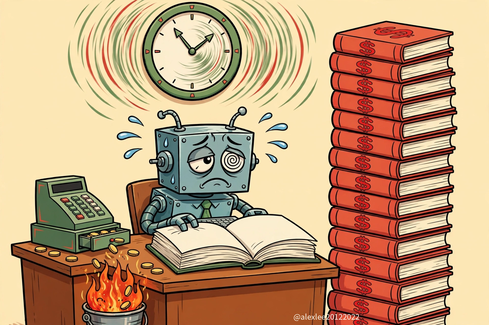
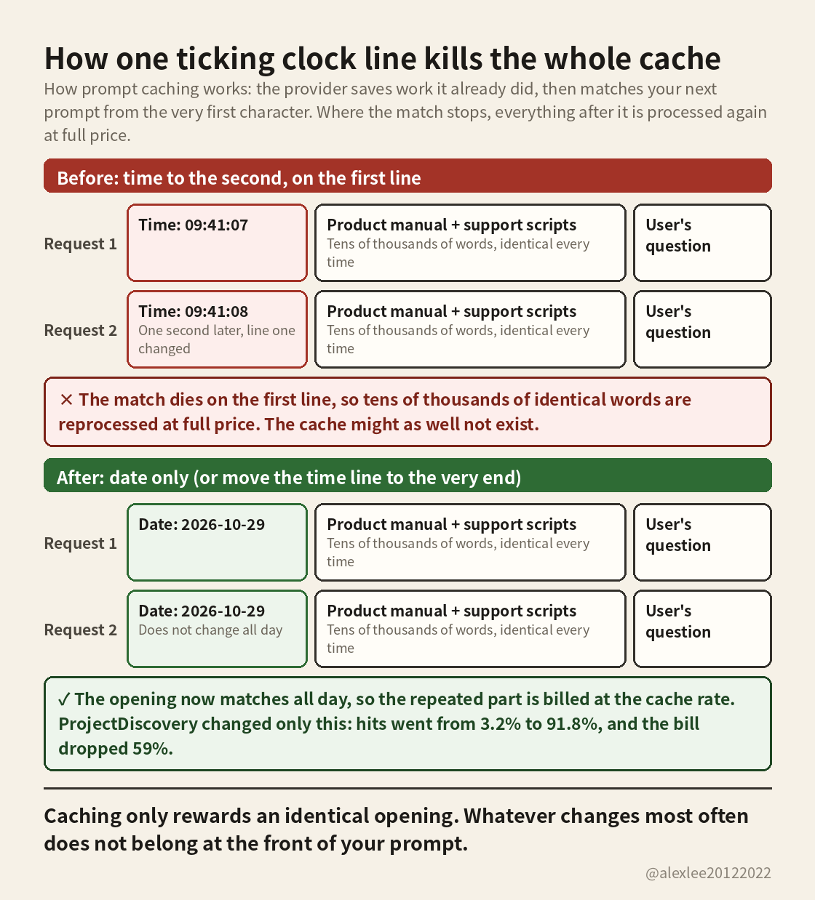

The clock in your prompt is quietly killing your cache

Start with an example, and the whole thing clicks. Say you built a support bot. Every prompt you send looks like this: the first line says "Current time: 2026-10-29 09:41:07", then comes a big fixed block, your product manual and support scripts, tens of thousands of words, identical every time, and only then the user's actual question.

Caching exists exactly for repetition like that. Processing a prompt costs money, and the opening tens of thousands of words never change, so the provider saves the work it already did. On the next request it matches from the first character, and whatever matches is billed at the much cheaper cache rate. That is a cache hit.

The clock on line one ruins it. It changes every second: 09:41:07 on one request, 09:41:08 on the next. The match dies before line one is even finished, and everything after the break point gets processed as brand new and billed at full price, no matter how identical it is. So you pay full price for the same manual on every single request, and the cache might as well not exist.

ProjectDiscovery hit exactly this. They changed one thing: the time now goes to the day instead of the second, so that line stays the same all day and the opening matches all day. Cache hits went from 3.2% to 91.8%, and their LLM bill dropped 59%. Those are their published numbers; I have not verified them independently.

One rule is enough: whatever changes most often does not belong at the front of your prompt. If you truly need the time to the second, move that line to the very end. And next time the bill looks wrong, check your own prompt before you blame the model's price. It takes a minute to check, and the saving repeats on every request after that.

Source: the ProjectDiscovery case, shared in [this post](https://x.com/sugoyona/status/2115757471579222525).
