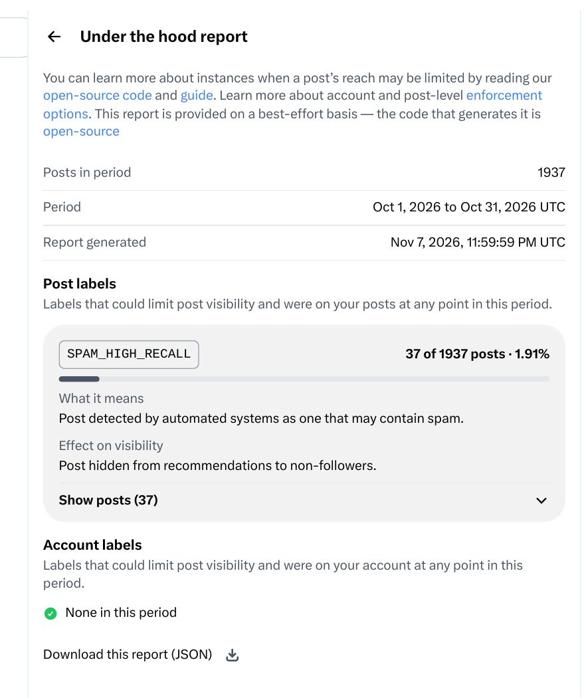
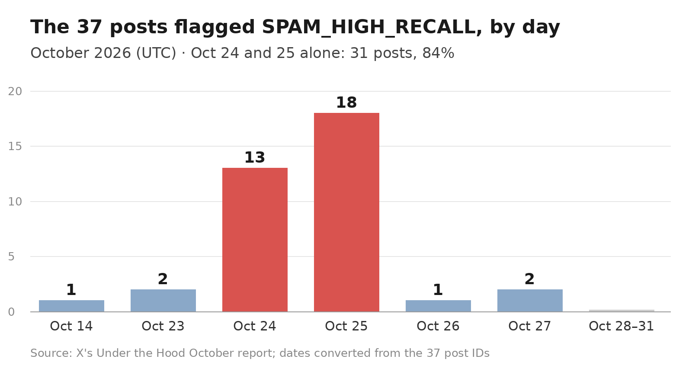

X applies its reach-limiting labels at two levels. One kind lands on a whole account, and the other lands on a single post. In my account report for October, the account-level kind came back at zero. But of the 1,937 posts I sent that month, 37 were flagged as spam, and the reason they were flagged connects directly to how I grew the account that month.

## What the Bot Actually Did That Month

In mid-October, I audited this account. At that point it had 15 followers and 112 posts, and it followed 58 people. On October 21, I finished redoing its positioning and profile. Two days later, on October 23, the bot program that runs the account went live.

It has two main parts. One is scripts, which repeat fixed steps over and over. The other is an agent, which reads posts, makes judgments, and writes replies one by one. The repeated mechanical work is all done by scripts, because their steps never change. A reply only helps if it reads like a person wrote it, so reading a post and writing its reply are the two steps that can only go to the agent.

Of everything it did, growing the follower count took the largest share. Here is how that worked. First, the scripts automatically found the call-out posts that verified users publish openly, the ones that say outright that they want to meet new people and follow each other back. Then the bot did three things on each one: it liked the post, left a comment, and followed the author. Those three things counted as one set, each set contained one comment, and it did at most 120 sets a day. The agent wrote the comments one by one, under rules I set: first say something real about what the post itself said, then bring in a short introduction of me, and then ask the author to follow back.

Besides the friend-making work, it also replied to posts from people in my field, in both Chinese and English. The scripts collected the posts on the timeline, filtered and counted them, and handed them to the agent one at a time. The agent read each post, then wrote a reply and sent it. Likes were a separate small thing. When the scripts spotted a good post from someone in my field while collecting, they dropped a like on it as they passed. That ran to a few dozen a day, with no comment and no follow.

I set the rules. The bot sent me a daily summary, and in the evening I spot-checked how that day's replies read. By November, even the step of sending a reply had moved to the scripts, because sending is itself a mechanical action, and there is no need to open an agent just to send one reply.

On the friend-making work alone, the records show 741 friend-making comments sent over the nine days from October 23 to October 31. On October 24, 25 and 26, the friend-making comments hit the 120-per-day cap on each of the three days.

## Followers Went From 15 to 4,000

The followers came in behind the friend-making work. By November 6, the count was 2,923. By the night of November 12, when I decided to change how I play this, it had reached 4,000. When I looked again while writing this piece, on November 13, it was 4,175.

In under a month the followers went from 15 to 4,000, and that speed was mostly stacked up by the follow-back work. The follow-back method is direct: you follow someone and comment on their post, and the share of them who follow you back is not low. But this way of growing has a problem built into it, because the batch of posts the report later flagged is exactly the batch this method sent out.

## How the Problem Surfaced

At the end of October, what I noticed first was that the view counts on some replies looked wrong. A few replies had been out for a long time and their view count was still 1. A reply that goes out normally picks up some baseline views even if nobody likes it or answers it, so a view count stuck at 1 for that long is not normal in itself.

Later I learned that X has a page meant for the account owner, called Under the Hood, at https://x.com/i/jf/under_the_hood/report . When you open it, it gives you a monthly report that states plainly whether your account and your posts picked up any reach-limiting labels that month. The October report was generated on November 7, and I read it from top to bottom.

The report page says the code that generates it is open source, at https://github.com/xai-org/x-algorithm/tree/main/under-the-hood . The report itself explains what each label means and what it does, and you can also check those explanations against the code yourself.

## What the Report Actually Said

The account-level labels came back at zero. The page reads "None in this period." X did not put any limiting label on the account as a whole.

In the post-level section, 37 posts were flagged, which is 1.91% of all 1,937 posts from October, and all 37 carried a single label, SPAM_HIGH_RECALL. X's explanation of the label is that the post was detected by automated systems as one that may contain spam.

The report is also specific about what this label does, and there is only one consequence: the post will not be recommended to non-followers. People who already follow me can still see the post as usual, and my other posts are not affected by it. So the nature of this is that 37 individual posts each had their recommendations limited, rather than the whole account being throttled.

Those 37 posts also landed on days that were packed tightly together. I converted the 37 post IDs the report gave into posting dates, one by one. There was 1 on October 14 and 2 on October 23. Then 13 on October 24 and 18 on October 25. After that, 1 on October 26 and 2 on October 27, and from October 28 to 31 there were none at all. October 24 and 25 alone account for 31 of the posts, which is 84% of all 37. The other 6 are scattered across four other days.

## I Checked Three of the Posts, and the Originals Are Still Up

The report gives IDs and no reasons, so I pulled three of the posts out and read the originals.

The first, from October 24, was a friend-making comment. Translated, it read: "Day 10 with a verified account and still posting every day. That kind of persistence is not easy. I have followed you. If you are open to it, please follow back. I am a full-stack veteran of 24 years, now learning AI, and I usually share open source and AI material. Let's talk more." It ended with the same follow-back hashtag the batch all used, #蓝V互关. This post had a view count of 1, and its link is https://x.com/alexlee20122022/status/2114071398297522245 .

The second was posted on October 25, and it was the same kind of friend-making comment. One line in it read: "I have followed you. Let's interact more, and if you are open to it, please follow back too. #蓝V互关". Its view count was also 1, and its link is https://x.com/alexlee20122022/status/2114435103732731906 .

The third post is a different kind of problem from the first two. It was an invite-code post I sent on October 14, and translated it read: "Muse is still free to use right now. Register an account while you can. If you would, please use my invite code. Everyone gets one billion tokens. Code: C4TPPK." This post had a view count of 20, and its link is https://x.com/alexlee20122022/status/2110394977910141374 .

This was the only one of the month's 37 flagged posts that was not part of the follow-back batch.

## Why This Batch Got Flagged

The flagged posts were mostly friend-making comments, and as I read them, the reasons came down to three problems, all of them in how that batch of comments was sent.

The first problem was volume. The friend-making work only started on October 23, and on the first day it sent just 18 comments. That afternoon, the sending hit the platform's soft rate limit twice. I paused the comments from 7 p.m. that evening, and they did not resume until 7 a.m. the next morning. On the day it resumed, it went straight to 120, and October 25 and 26 were also 120 each. In the first few days, the friend-making comments ran at or near the cap almost every day.

The second problem was the wording. The skeleton of these comments was much the same across the batch: praise the author once, say that I had already followed them, and then ask them to follow back. The hashtag was also the same on all of them, the one #蓝V互关 tag.

The third problem was the content. The whole comment asked for a follow, and it did not respond to anything specific the author's post had actually said.

The name SPAM_HIGH_RECALL contains HIGH_RECALL, which means high recall. My reading of it is that this kind of detection would rather catch too much than let cases slip through. So once a batch of posts looks like spam in its sending speed, its repetition, and what its content is for, it gets flagged as a batch. That reading is an inference I drew from the label's name and the report, because X did not state the trigger for each post in the report.

The timing lines up as well. The flagged posts concentrated on October 24 and 25, and those are the very days the friend-making comments surged. After October 28, the report contains no flagged posts at all. I can only record that as an observation, because the volume and the rhythm of my posting were also changing over that stretch, and I have no evidence that ties that zero to any single cause.

## What the Report Did Not Say: Two Suspicions I Have About Reach

My first suspicion concerns the part of the recommendation weights that has not been published. I read X's public recommendation algorithm code line by line, and the full write-up is on my blog, at https://blog.go5.si/posts/x-algorithm-teardown/ . Later I distilled the conclusions in it into a skills library called For You Skills, at https://github.com/alexliyu7352/for-you-skills .

That library is for tools that support Skills, such as Claude Code, Codex and Cursor. Once you install it, you can ask your own agent directly whether a piece of advice about running an account actually has support in the code.

In the public code, I did not find a single rule that says running an account with a bot gets you throttled. But the model actually running online is not the same thing as this public code, and the unpublished weights could well contain a judgment of exactly that kind. Let me set that suspicion against my November data. On a few days the bot overran: the friend-making volume hit the cap. On exactly those days, my followers kept growing, while the reach on my posts was only half of usual, and sometimes only a third. It could be a coincidence, but I think it is very likely that I was being throttled.

My second suspicion is that followers who arrived through follow-back simply do not read their timelines. Most of them came in for a follow back, many of them run their own accounts with bots too, and in ordinary life they do not open X and scroll the home feed. When the platform pushes a post out, it pushes it first to your followers and to the people who have interacted with you. My posts got pushed in volume to this group, they did not look, and the posts sank where they landed.

My own numbers look the same way. There were times a post reached 17,000 to 20,000 views, and in the end only 200 to 400 people actually clicked in and interacted with it. The reach does not look low, but very little of it turns into follows and interaction. The follower count went up, and the followers who came in that part of the growth do almost nothing for the posts that come after. That is another reason I stopped the follow-back work.

## What I Changed Next

On the night of November 12, I shut the friend-making line down. The reason lines up with this report. The followers had reached 4,000, and to keep stacking them through follow-back, I would have had to keep sending friend-making comments at that same rate, and that kind of comment is exactly the class of post the report flagged. So the scripts now discard follow-back and friend-making call-out posts whole when they see them: no comment, no like and no follow.

The reply line did not stop, but its rules changed in two places. One is topic: posts that have nothing at all to do with the technical topics I write about over the long term do not get a reply anymore. The other is content: a reply has to bring something new with it. That can be my own experience, or a specific number or example, or a different view, or a real question. What it cannot do is restate the original post in different words.

Following changed its rules too. Now I only follow authors I actually replied to that same day, at most 20 a day. The order has flipped: first there is a real exchange, and then there is a follow. The old way of following first and asking for a follow back afterwards ends here.

A post that offers people a reward for signing up gets flagged even if you send only one of them. The invite-code post is the example, so I will not send that kind of post in that form again.

Whether these changes work is something only the November report can show. Under the Hood reports come out monthly, and the November report will not be visible until early December. When it arrives, I will first check whether posts from the second half of November still carry SPAM_HIGH_RECALL, since the friend-making line was already shut down for that half of the month. Then I will check whether the account-level labels are still at zero. The two suspicions about reach above will also have to be checked slowly against later reports and data.

I do not plan to delete these 37 posts. Deleting them would not change the labels already recorded in the report. If I keep them, then when I read the November report next month I can place the dates of the newly flagged posts and the dates of this batch side by side, and see whether the flagging stopped in October.

Over this month, the bot could push the volume up, but once the volume rose, the platform kept score of it all by its own rules. I took the followers from 15 to 4,000 in a month, and the 37 flagged posts also drew the boundary of the follow-back method for me. Growth from here has to switch to a slower method: get the content and the replies solid first, and only then talk about speed.

If you also run your own account with a bot or with scripts, the checking method in this piece should transfer directly to your own case. If it was useful, subscribe or save this post. I will keep posting the results of the November report and the data from after these changes.

