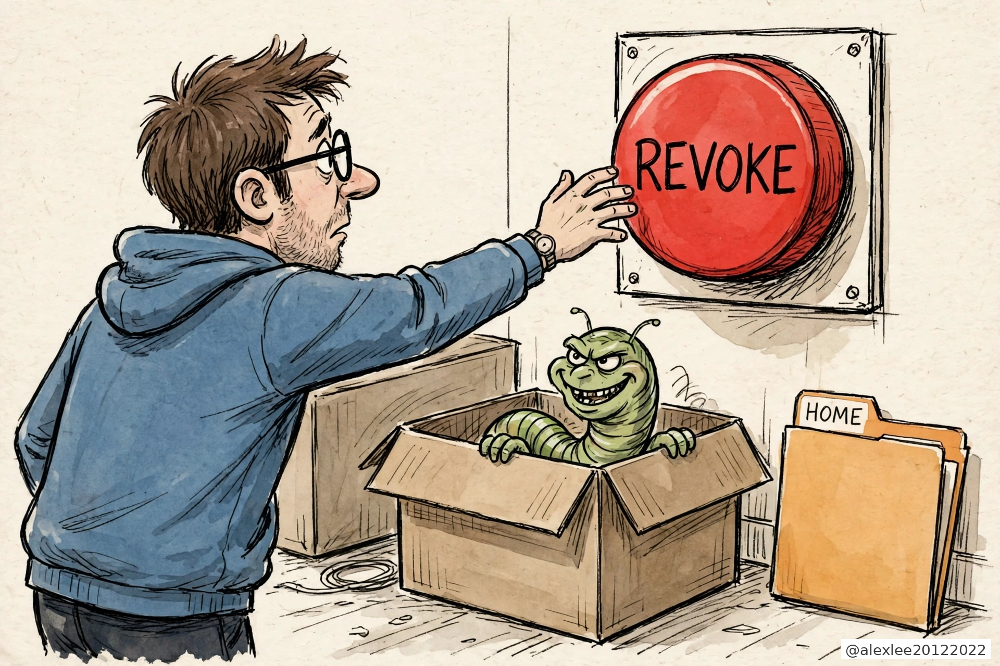
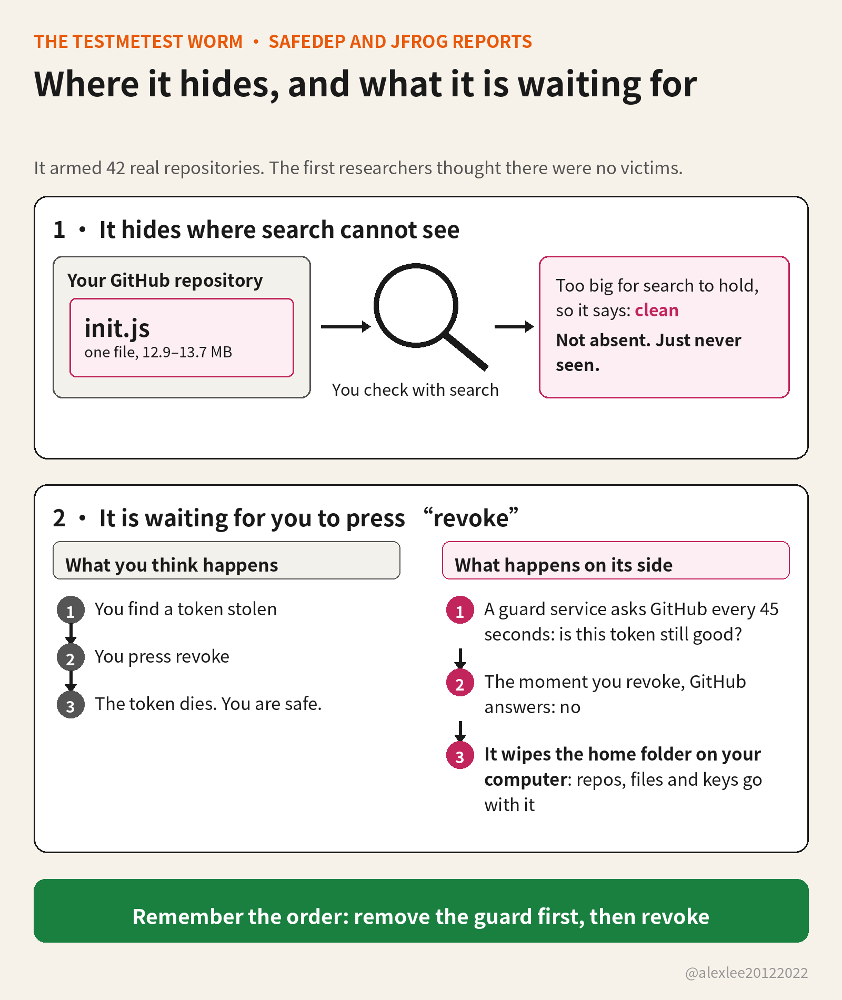

Your home directory got deleted? Don't look for an intruder. It may have been your own hand

Have you ever thought about coming back to your machine and finding files gone from your repository, or in the worst case the whole repository gone? That does not take anyone breaking into GitHub. A worm living on your own machine can do it, and its name is testmetest. The way it deletes is unusual: it is in no hurry to delete anything itself. It waits for you. The second you find a token stolen and press revoke, it wipes the home directory on your computer.

What exactly gets deleted? Not the repository on GitHub's site. That was not deleted in this campaign. What gets wiped is the home directory on your computer, and most developers keep their repository clones in their home directory, along with work they have not pushed yet, their SSH keys and their .env files. When the home directory goes, all of that goes with it. For anyone who does their work in a local clone, that is the same as the repository being deleted.

It is not one package but a family of them: a string of small npm utilities whose names end in -testmetest, things like event-bus-lite-testmetest and data-pipeline-testmetest, names that sound like honest tools. They began appearing on npm on October 19, and some of their versions carry the worm.

I maintain open-source projects. Installing packages, opening repositories and looking after tokens is my ordinary work, and every step of this worm is aimed at that ordinary work. So I read both reports end to end: SafeDep's October 22 teardown of the packages, and JFrog's follow-up through the repositories, published October 26.

SafeDep's reading is that it descends from Miasma, an npm worm from June, with one addition taken from Mini Shai-Hulud: the revocation tripwire. The lineage stops there. Shai-Hulud's source has been public since May, and anyone can build on it, so the code does not establish that the original operators are behind this.

It gets onto a machine at install time. There is no conventional install script. The execution is hidden inside binding.gyp, the build file npm has to process whenever a package ships native code, so the code runs while npm install is still working. SafeDep flagged the consequence directly: --ignore-scripts, the switch that blocks install scripts, does not stop it, because it never relied on a script hook.

Once running, it does three jobs on your machine. The first is stealing credentials, and the range is wide: GitHub and npm tokens, SSH keys, .env files, and the credentials your AI tools keep locally, for Claude, Codex and the rest, all bundled up and taken.

The second job is leaving a guard behind: resident services installed on the machine, one of them named net-health-checker, and it is the heart of the deletion trap. The third job is spreading. With your GitHub token it reaches into repositories you own or collaborate on.

Net-health-checker is the job that matters most. It takes your stolen token and asks GitHub, every 45 seconds, whether it is still valid, and it keeps asking for 48 hours. It is waiting for the answer to turn into a no.

The moment the answer turns, it deletes your home directory. Finding a stolen token and revoking it on the spot is the correct instinct, and every incident guide tells you to do exactly that. This worm was built around that second. Your cleanup is the signal it was waiting for.

So if it happens to you, the order matters more than the speed. JFrog's remediation list states the order without decoration: remove net-health-checker and the other resident service, pkg-runtime, from the machine first, and only then revoke the stolen token. Get the order backwards and the token still dies. Your home directory may already be going with it.

In the repositories on GitHub it deleted nothing. What it did there was plant things. JFrog found 42 real repositories, belonging to 11 owners, planted with hooks for AI coding tools and editors: a Claude Code session-start hook, Gemini and Cursor configuration, and a VS Code task that runs when a folder is opened. All of them point at the same file, init.js, in the .github directory.

That init.js runs 12.9 to 13.7 megabytes, and inside it sits a publisher. The next time you, or a collaborator, opens that repository in one of those tools, the hook runs init.js, and the publisher works under the opener's identity, minting a fresh batch of poisoned packages through npm's trusted publishing. Trusted publishing is a channel a repository registers with npm in advance, so a release can go out without anyone typing a token at the time, which is why a borrowed identity works on the spot. The repository is still there. What is inside it is no longer what you put there.

These repositories were not infected one by one over months. JFrog's timeline has a scripted arming wave on September 28 that pushed through account after account within minutes, with author dates copied from each repository's old history. One hijacked account belonged to an Argentine PHP developer who registered it in 2013. Thirteen of his repositories were armed inside two minutes.

It stayed hidden this long for a simple reason. GitHub's code search does not index files that size, and the contents API cannot return them either. When SafeDep published on October 22, it reported no third-party victims, only the operator's own test accounts. That conclusion came straight from searching: the hooks were visible, the payload was not, so the repositories looked like they held empty placeholders.

JFrog searched differently. It skipped code search, enumerated every repository tree under each account, pulled the oversized files back as raw blobs and decoded them offline. All 42 repositories were armed. Ten different wrapper builds, all different sizes, decode to the same publisher of about 2 megabytes. The size differences are a side effect of the encoding, nothing more.

Late in the campaign it changed shape again. The newer packages carry no JavaScript loader at all, just a precompiled native addon and an encrypted cache file beside it. The addon checks its surroundings first: inside CI, inside a container, with a debugger or a packet sniffer running, it stays asleep. It wakes on a real developer's machine, which is to say it avoids every place automated scanners normally sit.

What stays with me is that both designs aim at the same person: a conscientious maintainer doing the standard thing. You check a repository with the platform's search. You rescue an account by revoking its token first. Both are the standard moves, and both were read in advance. This worm was not counting on anyone making a mistake. It was counting on the order in which we do the right things.

If you installed one of the poisoned versions, and both reports carry the lists, treat that machine as compromised. Follow JFrog's order: remove the two resident services, get anything you cannot afford to lose off the machine, then move to a machine you trust and revoke and rotate every credential the worm could have seen, GitHub, npm, SSH, cloud and AI tools alike.

If you maintain repositories, do not audit them with GitHub search alone, because search is precisely the tool that cannot see this. Walk the tree and look for .github/init.js, then check whether hook files you never wrote have appeared in the .claude, .gemini or .cursor configuration, or in the VS Code tasks. One file out of place is enough to take seriously.

If you never installed these packages and none of the repositories are yours, this one does not touch you directly. The part worth keeping is small: when a token of yours is stolen, before you revoke it from the infected machine, think about what else on that machine might still be watching the token's status.

Everything here comes from SafeDep's and JFrog's reports, and the worm's lineage is unsettled in both, so I am not going to settle it here. JFrog also found a separate toolkit on some of the same hijacked accounts, using GitHub Actions to scan for a cPanel vulnerability. Same accounts, linked activity, and JFrog stops short of calling it one chain run by one crew. So do I.

Supply-chain advice used to start and end with not installing packages from strangers. This worm goes one step further and designs around what you will do after something goes wrong. My own reminder to myself is concrete: keep following the incident guides, but before pressing the first step, check whether anything left on the machine is sitting there waiting for me to press it. In the end it is betting that everyone's first instinct is the same. The second you find out a token of yours is stolen, what does your hand reach for first?

Sources: [JFrog — Beyond testmetest: 42 hijacked GitHub repos](https://research.jfrog.com/post/beyond-testmetest-42-hijacked-github-repos/) ; [SafeDep — testmetest npm worm](https://safedep.io/testmetest-npm-worm-miasma-variant/)

