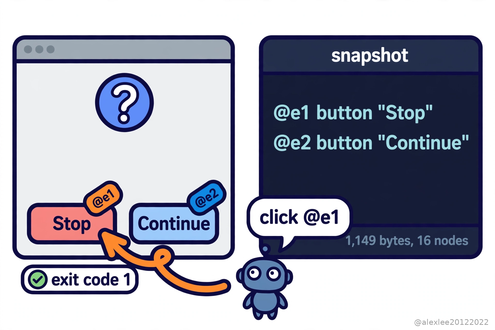

An agent that drives your computer by screenshot is guessing. It takes a picture of your screen, sends the picture to a vision model, and the model guesses where the button is, in pixels. When was the last time you watched one click the wrong button?

Vercel's agent-desktop gives the agent a different way in, because it reads the list of controls that the operating system already keeps. That way of working is drawing a crowd: the tool gained about 2,100 stars in a single day on November 5, and when I checked the next day it was sitting at 17,978 stars, just under 18,000.

The tool is a Rust command line program and a C library, released under the Apache-2.0 license, and it runs on macOS, Windows, and Linux. Version 1.0.0 came out on October 28, and the releases have kept moving since then: 1.1.0 on November 3, and 1.2.0 on November 5. There is no model inside it. The loop that decides what to do lives in your agent, and agent-desktop is the hands, because it sees the screen and it clicks.

It sees the screen through the accessibility tree. That is the structured list of controls the operating system keeps for every application: every button, text field, menu, and checkbox, each with its name and its role. On macOS it comes from the AX API, on Windows from UI Automation, and on Linux from AT-SPI. It is the same list a screen reader uses, and it was built so that blind people can use a computer.

An agent asks for a snapshot, and agent-desktop hands back JSON, with a reference for every element the agent can act on, something like @s8f3k2p9:e8. The agent clicks that reference, and then it takes another snapshot to check what changed. If the screen changed in between, then the action fails with a STALE_REF error, and the agent takes a fresh snapshot instead of clicking blind.

That is a different kind of seeing from a screenshot. A screenshot is a picture, and the agent has to work out from pixels where the button is. A snapshot is text, and the button is named in it, so the agent does not have to guess coordinates, and it does not have to send a picture to a vision model for every step. It works headless by default, which means it talks to the accessibility API without moving your mouse pointer and without stealing the focus from the window you are working in. Since version 1.2.0, it also serves its commands as MCP tools, so an agent harness can call them the same way it calls any other tool.

I downloaded the Linux build of version 1.2.0 and ran it on this machine, a server with no desktop session, because I wanted to see what the tool does when there is nothing for it to read. Its status command answered in plain terms: the accessibility permission was denied, the list of supported surfaces was empty, and the reason it gave was that no D-Bus session bus was reachable. When I gave it a fresh D-Bus session and ran it again, it still said denied, and this time the reason was that AT-SPI, the Linux accessibility layer, is not installed on that machine.

Asking it to list applications failed outright, with an error that said the AT-SPI accessibility bus is not available in this session. So where there is no accessibility layer, this tool sees nothing at all, and it tells you exactly which layer is missing.

So I built the missing layers onto this machine, one at a time. First the AT-SPI layer itself, then a session bus and a virtual screen. After that it could see an application, but it would not accept the window, because it first checks that the window is a real one under a window manager's control, and no window manager was running. Adding a window manager fixed that. The environment this tool expects is an ordinary desktop in daily use, and its own platform guide says it is measured on GNOME.

For a target I used a small dialog program called zenity. It put up a question dialog with two buttons, Continue and Stop. The snapshot came back as 1,149 bytes of JSON with 16 nodes in the tree, and each of the two buttons carried its own reference: e1 for Stop, e2 for Continue. I told agent-desktop to click the Stop reference, and it reported the action delivered. Then I checked the dialog program's exit code, and it was 1, which is the result for the Stop side. So whether the click landed is something the program itself reports, not something anyone has to judge from a picture.

I will not quote you a saving number, because nothing published compares this against a screenshot pipeline on the same tasks, so I have not seen a token saving or a speed number measured anywhere. What saving there is comes from the architecture. The input is text rather than a picture, and the answer is an exact reference rather than a guess at coordinates, so no vision model is needed in between. The architecture has its own cost, though, because a snapshot is text the model has to read. The two dialogs I measured were still small ones: 1,149 bytes, and 3,079 bytes for a list holding 40 rows of data. The more controls an interface has, and the deeper they nest, the longer that text gets.

The tool's own answer to that is the skeleton snapshot: the agent first maps the application with a trimmed tree, and then it drills into one region at a time instead of swallowing the whole tree at once. On that 40-row list, a skeleton snapshot came back at 1,630 bytes, roughly half the full one. The same list showed something else as well: 40 rows of data produced a tree of only 45 nodes, because GTK puts only the rows it has actually drawn into the tree, so a tree grows with the shape of the interface, not with the number of rows behind it. And a user interface that publishes no accessibility tree is invisible to this tool, which the tool itself states plainly.

A snapshot can contain private desktop content, and so can clipboard reads and screenshots, and the README says so in its own words: keep them out of public logs and uploads. So I would grant it only to agents I trust, I would keep snapshots out of logs, and I would try it on a spare application first, before I let it loose on the one with my mail and my bank tab open.

My view is that this is the direction computer use goes, because structured access beats pixel guessing, and the tool that wins will be the one that reads the list instead of photographing the screen. But the access it needs is the part to think about before you install it, because an agent with this access sees everything you see. If this made you look at your own Accessibility permissions, consider subscribing to this blog or bookmarking it. I keep sharing plain-language pieces on AI, security, and open source, and the next one will take another tool apart the same way.

Sources: the repository https://github.com/vercel-labs/agent-desktop · the announcement thread https://x.com/0xSpeter/status/2118512982657556508
