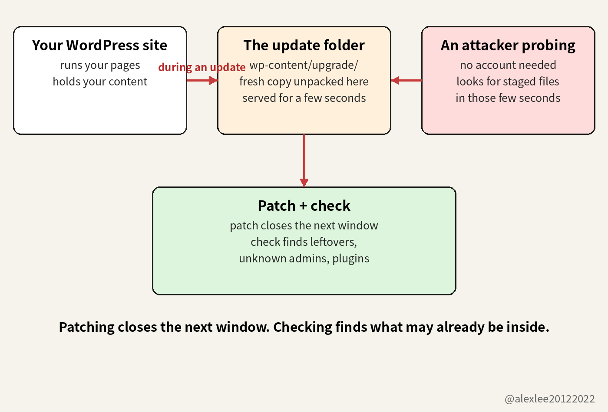

WordPress shipped the patch a week ago. CISA, the Cybersecurity and Infrastructure Security Agency, has told federal agencies to patch this flaw and then check whether anyone already got in. That order was written for federal agencies, so it does not bind you, but the check it asks for is still worth running on your own site.

When did you last sign in to your WordPress dashboard? I mean the dashboard of the site itself, the page that shows the version number, because your hosting company's control panel is a different page and it does not count. If you had to stop and think before you could answer, then this piece is about your site, because the sites this flaw hurts are the ones nobody signs in to: they sit there running old software while their owners assume that somebody else is watching them.

WordPress released version 7.1.4 on October 28, and one of the fixes in it closed a flaw in the core update process. Then, on November 3, CISA put that flaw, CVE-2026-119977, into its Known Exploited Vulnerabilities catalog. The catalog only lists flaws that attackers are already using against real systems, so an entry in it means more than a flaw that merely looks dangerous on paper. This entry also carries an extra instruction, because CISA flagged it for forensic triage. Forensic triage means that the affected systems are to be checked for signs that someone already tampered with them, and not only patched.

The catalog entry comes with a date: November 6 is the deadline CISA set for federal agencies to remediate the flaw. For a WordPress site, remediation is a specific action, because it means updating to version 7.1.4, or to the patched release on the branch the site is running. Your site has no such deadline, because the entry and its date were written for federal systems. But you should not read the date as a grace period either, because the probing never waited for that date. In the first 21 hours after the patch came out on October 28, Wordfence logged more than 18,500 requests aimed at the installer files, and the catalog entry did not exist yet.

A core update replaces the software your site runs on while the server keeps serving pages to visitors. While that replacement is running, WordPress unpacks the new version into a folder called wp-content/upgrade/. On many servers, the web server will hand out files from that folder to anyone who asks, in the same way that it hands out pages. The unpacked copy sits in that folder for a few seconds, installer files included, and then WordPress finishes the update and cleans the folder up.

If a request from an attacker lands inside those few seconds, then the attacker can run the unpacked installer files that are sitting in that folder. From there, the attacker can work up to running their own code on your server, and they can do all of that without ever logging in. That is what remote code execution means in this story: a person who has no account on your site, and no password for it, ends up running code of their choosing on your machine.

Wordfence, a security company that protects WordPress sites and publishes research on WordPress vulnerabilities, scored the flaw 8.1 out of 10, which puts it in the high band. A threat brief published on November 3 on the security blog of Carthage Electronics, a hosting company, explains why the score stops below the top. The reason is that the attacker has to hit a very short timing window. A person sitting at a keyboard, refreshing and hoping, would almost never land inside a window that lasts only a few seconds, because a person can only try so many times. A script is different, because a script can request the installer files again and again, thousands of times, for as long as it takes. And the script only needs one thing to happen while it is asking: your site has to start one core update.

Wordfence logged more than 18,500 requests aimed at the unpacked installer files in the first 21 hours after the release. That first number counts requests, because each request asked the server for one of those files. The Hacker News reported on October 30 that Wordfence had blocked 62,969 attempts in the 24 hours before that report. That second number counts blocked attempts, and it covers a different and later stretch of time than the first number. Neither number proves that any site was taken over, and the Carthage brief records the same limit: as of the brief on November 3, nobody had publicly confirmed a site compromised through this flaw.

The flaw affects every WordPress release from 4.7 through 7.1.3, and version 7.1.4 is the fix. If your site is pinned to an older branch, then you do not have to jump to the newest WordPress to get the fix, because the same repair was backported. Backported means that the repair was carried back into the older branches and released there, as 7.0.8, 6.9.11, 6.8.12, 6.7.11, and so on down to 4.7.39. The Carthage brief says that most sites received 7.1.4 by themselves last week through automatic background updates, so if your site is one of those, then the patching part of this job is already done.

The same brief names the sites it worries about, and it starts with the sites whose automatic updates are switched off, because on those sites no security release arrives on its own, whatever WordPress ships. It also names the sites that are pinned to an old branch. A pinned site is not cut off from the fix, because its branch has a backport with the same repair in it. But a backport still has to be installed by an update that actually runs on that site, and pinned sites are often the sites where updates stopped running a long time ago.

The brief's third group is the one this piece is really about: the site that is managed, at least on paper. A developer built it, or an agency hosts it, and everyone involved believes that it is being looked after. But being looked after only counts when somebody actually signs in, reads the version number, and checks whether the updates landed. So on a managed site where nobody signs in, a missing update can sit unnoticed for months, because there is no moment in anyone's week when the site's state gets checked.

A site that is taken over through a flaw like this rarely announces it. The homepage usually keeps loading and keeps looking normal, because a defaced homepage would get noticed and cleaned up within the day. The quiet version lasts longer: the site starts carrying spam pages, or it stores files for somebody else's scam, or it sends visitors on to a phishing page. The owner typically finds out last. He usually learns it from the outside, when the hosting company suspends the account or when a visitor's browser starts warning people away from the site.

That quiet ending is why the CISA listing asks for more than the patch. CISA flagged this catalog entry for forensic triage, which in plain language means: install the fix, and then go looking for signs that someone already tampered with the system. Installing the patch removes the flaw, so on the next update the unpacked installer files can no longer be used in this way. But the patch does not delete code that an attacker may already have left on your server, and it does not remove an administrator account that an attacker may already have created for themselves.

The check itself has five stops, and the first one is the dashboard. Open Dashboard, then open Updates, and read the version number on the screen. It should say 7.1.4, or the newest release for the branch your site is on. If automatic updates are switched off on your site, then run the update by hand today. But before you run it, check whether you have a recent backup, and if you do not have one, then take the backup first.

Then open the wp-content/upgrade/ folder on the server and look at what is sitting in it. Between updates, that folder should hold nothing, so any leftover folder or PHP file in there deserves an explanation. After that, search your server logs for repeated requests to files under wp-content/upgrade/ at around the times when updates ran. One of the unpacked installer files is called setup-config.php, and that is the name that keeps showing up in those requests.

The last two stops are both lists inside the dashboard. Open the Users list and read through the administrator accounts, because an account that you do not recognize, with a name you never chose, is exactly the kind of leftover an attacker leaves behind. Then open Plugins and read through that list in the same way, looking for anything you never installed yourself. Both lists are short, so this part of the check takes only a few minutes.

If either list turns up something you do not recognize, then treat the site as compromised, and stop treating this as routine maintenance. Restore the site from a clean backup first. Then, on the restored site, change the administrator passwords and the database password, and replace the salts in wp-config.php. A salt is one of the secret strings that WordPress mixes into login sessions to protect them, so replacing the salts signs out every session that is currently logged in. Signing everyone out is a different job from changing a password, and both jobs need doing, and both need doing on the clean copy rather than on the compromised one.

One more change belongs at the server level: tell the web server to refuse browser requests for anything under wp-content/upgrade/. On nginx, that is a location block that denies every request to that path. On Apache, it is a RedirectMatch rule that answers requests to that path with a 403. If you cannot edit the server configuration yourself, then ask your hosting company to add the rule for you. The unpacking still happens during an update, and the unpacked copy still sits in that folder for the same few seconds. But the rule removes the way in from the web, because a request for one of those files now gets a refusal instead of the file, so the installer files cannot be reached from the web at all. Nothing legitimate needs to load files from that folder in a browser.

A web application firewall in front of the site reads each incoming request and blocks the ones that it recognizes as probes for the installer files. That is a different job from the server rule above, because the server rule refuses every request to that path, whoever sent it and whatever it asks for. The firewall refuses only the requests that it recognizes, so a probe that is shaped in a way the firewall does not recognize passes it and reaches the site. And a firewall cannot change the update process inside WordPress, because the unpacking goes on exactly as before behind it. Only updating WordPress removes the flaw itself.

I have spent a long time maintaining other people's software, and I have never learned to trust the phrase "managed site," because the phrase only holds up if somebody can name the person who last signed in and what they saw there. If you run a WordPress site, then go and read its version number today. Of everything in this piece, that is the check I would put first this week. If this got you to open your dashboard, consider subscribing to this blog or bookmarking it. I keep sharing plain-language pieces on AI, security, and open source, and the next one will be another check you can run yourself.

https://carthageelectronics.com/november-3-2026-cve-threat-brief/
