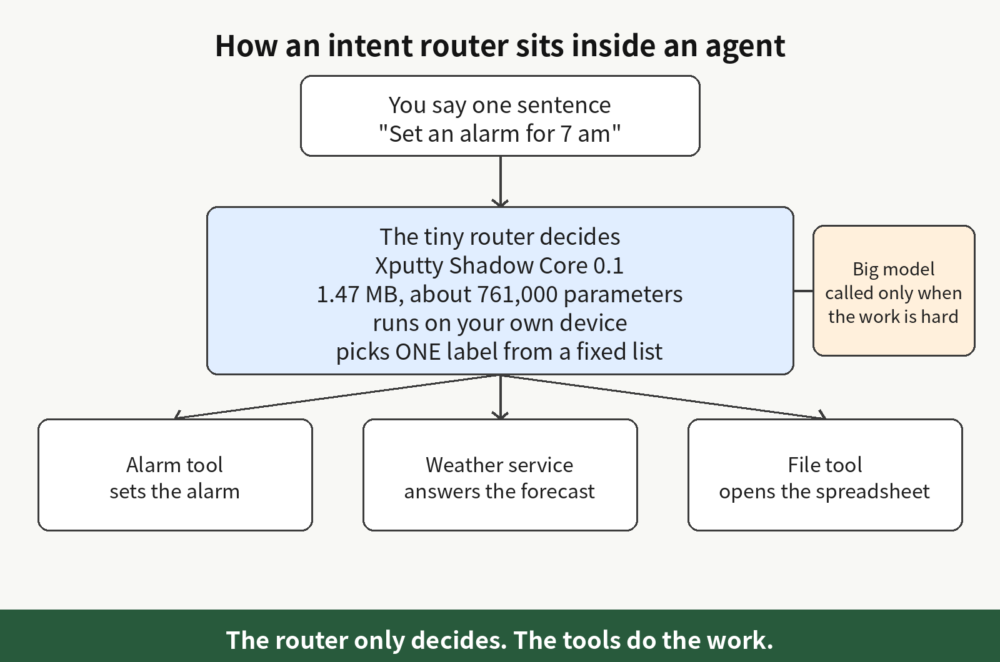
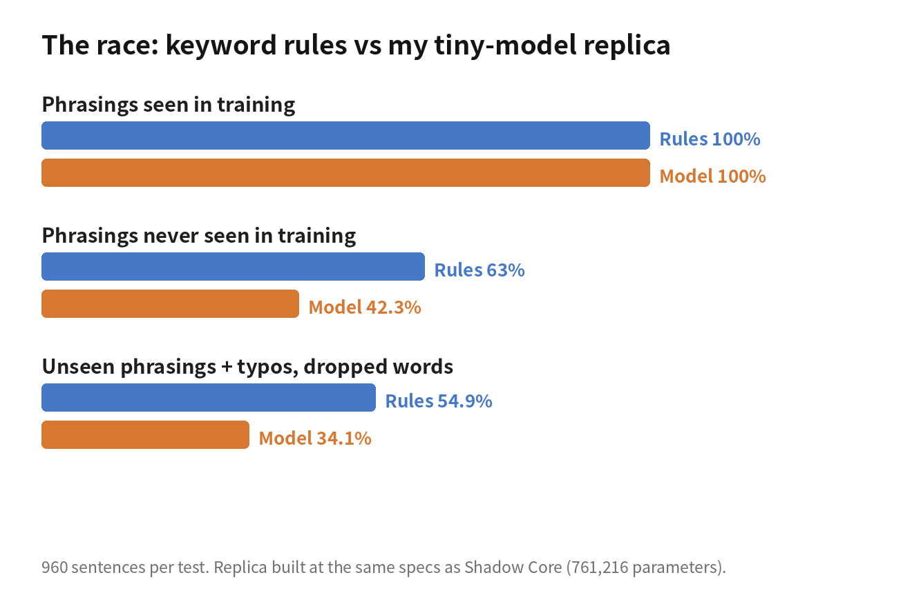
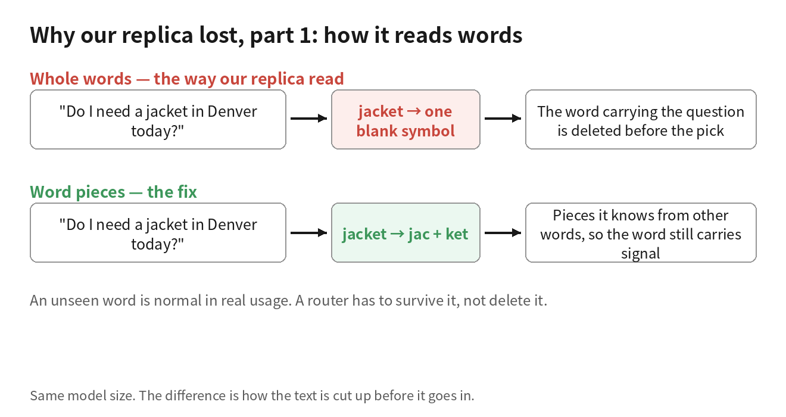
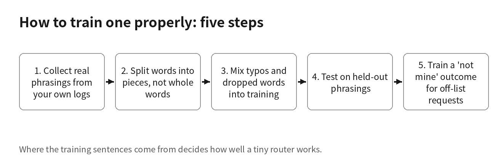
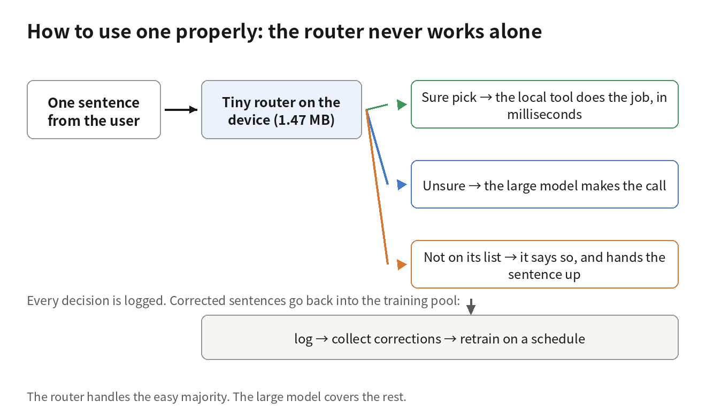

I rebuilt a 1.47 MB, 761,000-parameter intent router and raced it against if statements. The if statements won

On October 31, a small account called @openrunt posted a file-inspection report. The work log in his screenshot shows the inspection took 1 minute 8 seconds, and what it examined was a 1,542,912-byte GGUF file, about 1.47 MB, holding a complete model.

The model is called Xputty Shadow Core 0.1. It is an intent router: it reads one sentence, works out what the person wants done, and sends the sentence to the right tool. The post has no download link and no model page, so the file itself cannot be tested.

We think a small intent router like this is worth having, so we built one to the specs the post published and raced it against a set of keyword rules. The result: on phrasings it had seen in training, both scored 100%. On phrasings it had never seen, the rules scored 63% and our rebuild scored 42%.

## Why we want an intent router this small

Every sentence you say to an assistant passes through the same small judgment before anything happens. You say "set a timer for ten minutes" and it has to know that is a timer. You say "check tomorrow's weather in Denver" and it has to know that is weather. You say "open the spreadsheet I edited yesterday" and it has to know that is opening a file.

Reading what a sentence wants done, then sending it to the right tool, is called intent routing. The intent is the thing the person wants to get done.

Right now this step is mostly done as a side job by the large model that does the real work. That is how the agent software I have taken apart this year is built. A model with billions of parameters reads "set a timer," answers "timer tool," and only then does anything move.

Every sentence costs one full call to the large model, which is slow. The call needs the network, so it stops when the network does. And the sentence has to leave the device before it can be sorted.

Put the intent router on the device itself and none of those three things apply. It answers in a few milliseconds. It runs with no signal, on a plane, in a basement. The user's words never leave the machine to be sorted.

If it is just you using it yourself, the large model gets called a few times a day, and it honestly does not matter. But a voice device, or an agent that serves many people, can mean thousands of calls a day, and that cost adds up. So the thing to do is finish most sentences locally, and call the large model only for the parts that need actual thought.

Sorting a sentence into a fixed list is one of the oldest jobs in language software, and small models have done it for years. Facebook's fastText was already sorting text into labels in 2016, and its compressed models were a few hundred KB.

RouteLLM, from LMSYS and UC Berkeley in 2024, decides whether a question goes to a strong model or a cheap one. Among the approaches it tried was a BERT classifier; BERT is a small language model from 2018, used mostly for sorting text. Another approach worked from a table of past results, recording which model usually gave the better answer for each kind of question.

So what Shadow Core is trying to do is not new. The open question is a narrow one: can a file this small still do the job well? That is a question a test can settle.

## The file that started all this

GGUF is the file format the llama.cpp ecosystem uses for local models, and any software that runs GGUF can load one of these files without new code. The post lists the specs in full:

- Architecture: Llama, 3 layers, 4 attention heads
- Embedding width: 128, meaning every token is stored as a string of 128 numbers
- Feed-forward width: 320, the size of the middle table in each layer
- Parameters: about 761,000 in total
- Vocabulary: 762 tokens. A token is the unit the model reads text in, a chunk of text that is often a word or part of a word, and the vocabulary is every chunk it knows
- How the numbers are stored: mostly F16, at 2 bytes per number; the layer norms are F32, at 4 bytes per number. A layer norm is a short string of numbers whose job is to pull each layer's values back into a normal range
- Context length: 160 tokens, roughly one short instruction at a time
- Tensors: 30 in total. A tensor is one of the tables the file stores numbers in, so this says all of its parameters are packed into 30 tables
- File size: 1,542,912 bytes, about 1.47 MB

We recomputed the headline figure of about 761,000 parameters from the specs ourselves. The token embedding table has one row of 128 numbers per token, and 762 tokens make 97,536 parameters. The output table is the same size again, another 97,536.

In each layer, the four attention tables add up to 65,536. The feed-forward part has two tables of 128 by 320 and one of 320 by 128, adding up to 122,880, plus two normalization vectors of 256. One layer is 188,672, and three layers are 566,016.

Adding the two big tables and the final normalization vector gives 761,216, which matches what the post claims, and the tensor count comes to exactly 30. Nothing in the specs contradicts itself. Our rebuild, exported to GGUF at the same specs, is 1,539,520 bytes with the same 30 tensors.

## The rebuild and its opponent

The rebuild lines up with the published specs one by one: same architecture, same size, and the same parameter total of 761,216. It reads text one whole word at a time. Its vocabulary has 762 slots, and its training sentences contain only 228 different words, so most of the slots are empty.

We gave it 16 intents, all jobs a home or office assistant handles every day: set a timer, set an alarm, check the weather, open a file, search the web, search your own files, send a message, make a call, play music, take a note, set a reminder, turn lights on, turn lights off, read the news, translate, and tell the time.

The training data is 5,120 sentences produced from templates, with times, cities, names, and file names swapped between sentences. We trained it until it had memorized the whole training set.

The opponent was a set of keyword rules. Think of it as a pile of if statements that somebody sat down and organized properly. Each intent owns a set of keywords taken from the words in its training sentences. The scoring follows which intents' sentences a word appears in. A word that appears in only one intent scores high; a word that turns up in all sixteen intents' sentences scores low. A new sentence adds up the points word by word for every intent, and goes to the intent with the highest total. There is no learning in it and nothing to train. A developer can write it in an afternoon, and after that, every new phrasing a user comes up with gets one more rule added.

## The race

Three test groups, 960 sentences each. The first group used the same phrasings as training, with fresh times and names. Rules 100%, rebuild 100%.

The second group's phrasings never appeared in training at all: the same requests phrased a different way. Rules 63.0%, rebuild 42.3%.

The third group took the second group's sentences and added typos and dropped words, the way speech recognition output looks. Rules 54.9%, rebuild 34.1%.

We also fed it 12 sentences that have nothing to do with any of the 16 intents: "What is the capital of France," "write me a poem about the moon," "play chess with me," "will the stock market go up tomorrow." All 12 were sorted into some intent, because sorting a sentence into the list is the only thing it can do.

"Will the stock market go up tomorrow" was sent to check the weather at confidence 1.00, the highest value it can give. "Play chess with me" also went to weather, at 0.94. "What is the capital of France" became open a file, at 0.97. About half of the 12 sat below 0.90 confidence and the rest at 0.90 or above, and all of them were wrong.

## Why it lost

The first reason is that it reads text in whole words. A word that never appeared in training turns into a blank symbol when it reaches the router, and whatever information that word carried is deleted before the router makes its judgment.

Take "do I need a jacket in Denver." That is a weather question, and the word carrying it is "jacket." Our rebuild had never seen "jacket." By the time the sentence reached it, the most useful word had already been taken out, and the words left over could not support a correct answer. All it could do was guess.

The second reason is where the training data came from. All 5,120 sentences come from templates, and their variety is placeholder variety: the same sentence frame with the time, the city, and the name swapped. It learned those frames very well, which is exactly why it scores 100% on phrasings it has seen.

Real people use far more frames than a template set has. Faced with a frame it had never seen, it has very few words to hold on to. What it learned was our template-writing habits, not how a person turns a sentence into an intent.

The rules win on exactly this point. When people rephrase, the words that carry the meaning usually stay put: timer, alarm, weather, call. Keyword rules score only those words, and the frame around them does not matter to them.

This race measured our rebuild. The training data was the 5,120 sentences we generated from templates ourselves, and the reading was whole-word. The file in the post may be trained far better than ours, and none of this result lands on it.

## How to train a router like this properly

Training sentences should come from real use: what your users actually typed and said, collected from your logs, messy phrasings kept in.

 The more phrasing variety each intent has, the better, because variety is the thing templates cannot give you.

Synthetic sentences are for the first day only. A router trained on nothing else falls apart on its first real user: real phrasings change and it cannot keep up, which is what our rebuild did on the held-out test. Real phrasings are the raw material for this kind of model, and if the material is wrong, everything after it is wasted work.

Split words into pieces instead of feeding them whole. An unseen word, once split, arrives as pieces the model recognizes: "jacket" can be split into parts it has seen inside other words, so the word still carries some signal instead of going blank.

Whole-word reading is the failure in the jacket example, and splitting words into pieces removes it without making the router any bigger. The file in the post has a vocabulary of 762 too. A subword vocabulary can be that size, and so can a small whole-word vocabulary like ours, so the number alone cannot tell anyone which of the two it is. Our whole-word result does not transfer to it either.

Train on dirty input as part of training. Real input has typos, missing words, and sentences that stop halfway, and input that came through speech recognition is worst of all. Take a share of your training sentences and dirty them the same way: swap a character, drop a word, cut a word's ending off, then train on them.

A model that has seen dirty input in training treats dirty input as normal input. Ours had seen only clean templates, and when the input got dirty, its score dropped from 42.3% to 34.1%.

When you test, hold out whole phrasings, not random sentences. A randomly held-out sentence may share its frame with a training sentence, and then it passes easily. Hold out an entire way of asking and the router has never seen that way of asking, so the score measures how it handles new phrasings.

After testing, go intent by intent and look at what it confuses with what. In an assistant, searching your own files and searching the web is a pair any router mixes up. Knowing where yours gets confused tells you where to add data, and which intents need an extra confirmation step.

Teach it to say "this one is not mine." A router that can run in production needs an exit outside its list. The way to build one is to treat out-of-list sentences as a class of their own and train on them, so the router learns to refuse instead of forcing every sentence into an intent.

Our rebuild shows why a confidence line alone cannot do this job: of the out-of-list sentences it got wrong, about half carried confidence at 0.90 or above. With a trained refusal exit, plus a confidence line set on held-out data, sentences outside the list get handed off instead of sorted.

## How to use a router like this properly

The arrangement is a small router in front and a large model behind it. Sentences the router does not refuse, with confidence above the line, are processed to completion locally, with no need to pass them to the large model behind. Each one takes only a few milliseconds. Our rebuild took about 9.5 milliseconds per sentence in a small test harness we wrote ourselves, running on a small cloud server.

Everything else, the refused sentences and the unsure ones, goes up to the large model. The large model is slow, and every call costs money. But a hard sentence is the thing it can actually think through, so the unsure ones still go up. The router's job is the easy bulk of the sentences, finished locally.

Log every decision it makes. When the large model overrules it, or a user corrects it, that sentence goes into the training pool together with its correct intent, and the router gets retrained on a cycle. A router starts out sorting roughly. The longer it runs, the better it knows how your users actually phrase things. No file from outside can do this part for you.

One class of action must not be released by the router alone: actions that cannot be taken back once they are done. Playing the wrong song loses nothing, because you can simply play another one. A message, once it is sent, cannot be unsent, and a deleted file or a payment is the same. For actions like these, the router stops and asks for confirmation first, no matter how confident it is.

For intents like those, the router can get the action ready, and the final say belongs to a confirmation step or a hard rule check.

Where phrasings can be listed in full, do not use a router: operators who are trained to say fixed command words, or a device with a dozen buttons in total. Rules are the right tool there, and when something breaks, rules are easy to inspect. A router belongs where phrasing variety is real and new phrasings keep appearing. Ordinary people talking to a machine in their own words are exactly that kind of place.

## Back to the file that started all this

Routers like this should exist, and our test supports that. Whether the Shadow Core file itself is any good is a separate question, and we cannot grade it.

Whether a router was built the right way comes down to three things: its intent list, how it cuts words into pieces, and what phrasings it was trained on. The file has published none of the three. There is no download, and in the metadata, by the author's own reading of it, there is no author name, no license, and no training notes.

The author has not shown it running yet. At the end of the post he says he is going to see what he and Grok Build can do with it. Which is to say, when the post went up, the experiment had not started yet.

If this file was built the right way, trained on real phrasings, words split into pieces, refusal exit trained in, it could well do this job inside a real assistant. But whether it was built that way cannot be checked: none of the three things above are public, there is no download, and nobody has shown it running, so how accurately it sorts cannot be measured either.

We cannot confirm whether it is any good, so we would not put it at the front of a system we are responsible for. If we needed a router like this, we would build our own: trained on the real phrasings in our own logs, with the large-model fallback connected from day one.

Is there a step in something you run where a large model reads a very short sentence and answers with the name of a tool? How do your users actually phrase those requests, and could you pull those phrasings out of your logs this week? Collecting the phrasings is the work everything else in a model like this depends on. I take apart small models and the plumbing inside agents like this regularly; if this kind of teardown is useful to you, consider subscribing or bookmarking this page, and there will be more of them.

Original post: https://x.com/openrunt/status/2116475197603582347