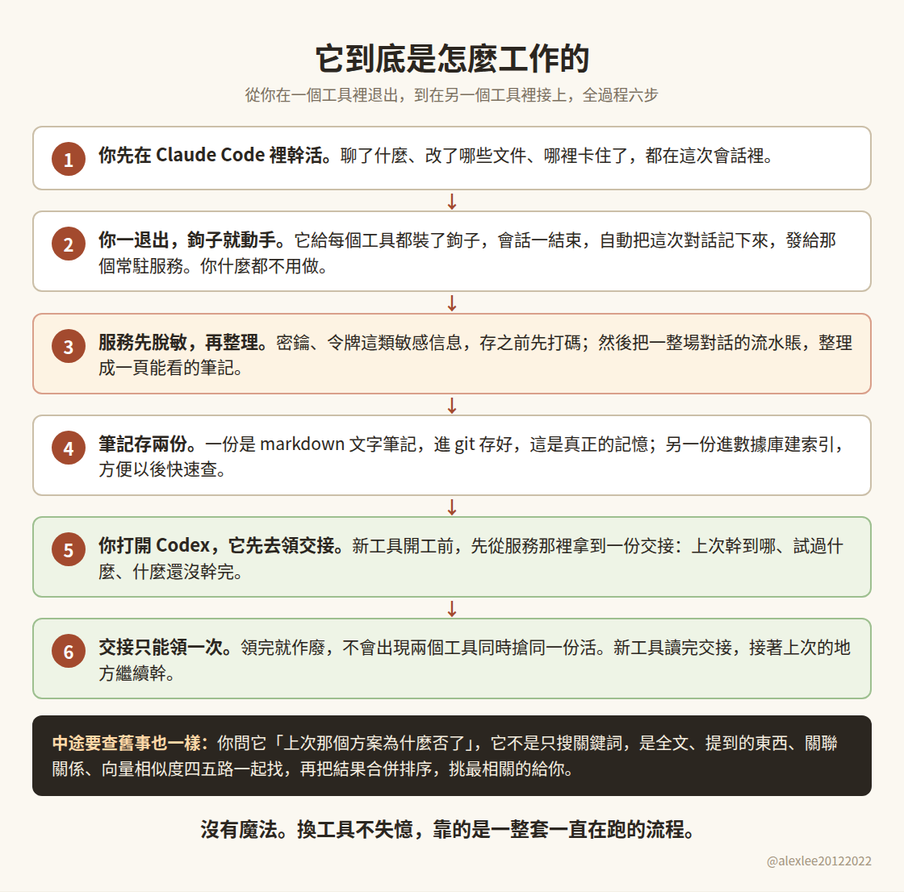
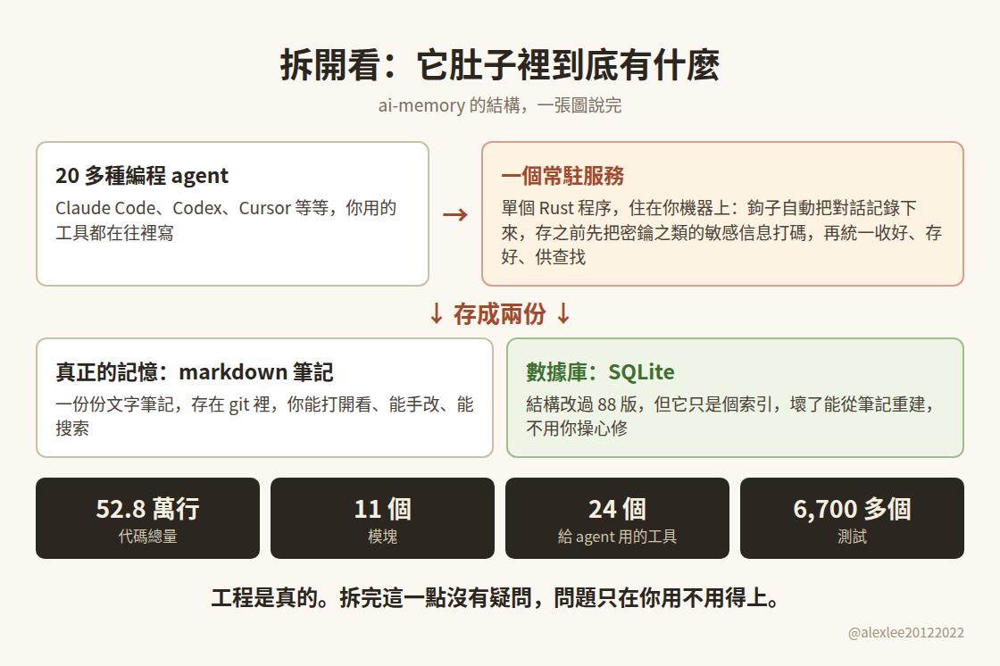
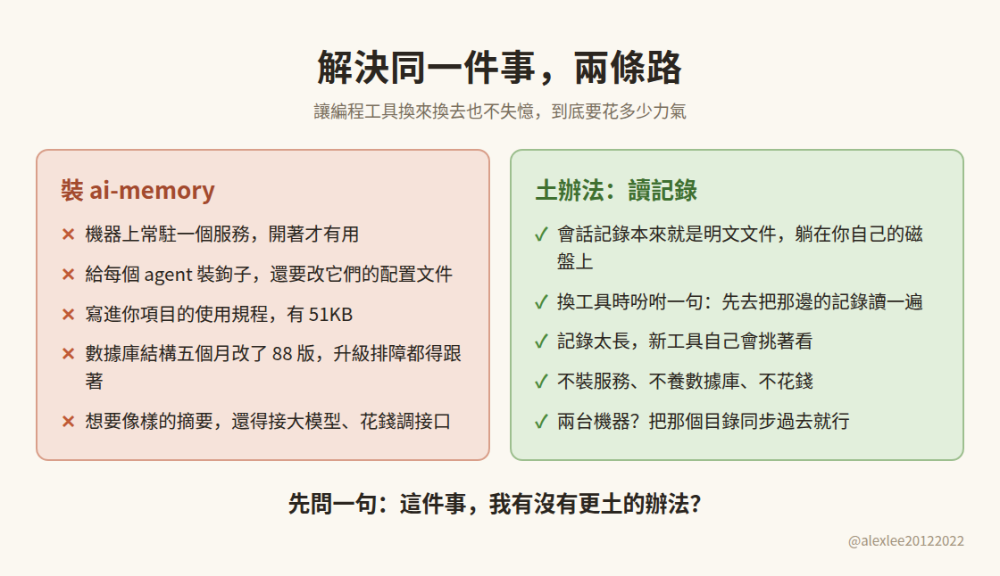

GitHub 上最近有個項目火得不像話：52.8 萬行代碼，掛在全站日榜第 9 名，一萬四千多顆星。我手癢，前兩天把它裝上真跑了一遍，代碼也從頭翻到尾。

這篇拆得有點細，字數不少，我覺得值得看下去。懶得看的，結論就一句：東西是真東西，工程也是真工程，但它要解決的那個問題，你多半有個一分錢不花的土辦法，先別急著裝。而且它不是個例，現在這類又大又漂亮的項目，我是越看越想多問一句：它們對我們，真的有看上去那麼有用嗎？

## 它想解決的麻煩

它打的痛點倒是真的。用 Claude Code 幹一半，換 Codex 接著幹，新工具對你剛才折騰了兩小時的東西一無所知，又得從頭交代一遍，誰用誰煩。原因也不複雜，它們存會話記錄和上下文的地方不一樣，記錄沒法共用。ai-memory 的主意是單獨養一個常駐的記憶服務，二十多種編程 agent 共用一份記憶，你從哪個 agent 退出，下一個 agent 進來就能接上。

## 它是如何工作的

它的做法是這樣的：你在 Claude Code 裡幹完活一退出，裝在 agent 裡的鉤子就把這次會話自動記下來，發給那個常駐服務。服務先把密鑰這類敏感信息打碼，再把一整場對話的流水賬整理成一頁筆記。

筆記存兩份：一份是 markdown 文字，進 git 存好，那是真正的記憶；另一份進數據庫建索引，方便以後查。你再打開 Codex，它開工之前先去服務那裡領一份交接，讀完就知道上次幹到哪了。中途要查舊事也一樣，四五路一起找，再合併排序，挑最相關的給你。

交接還設計了規矩，一份交接只能被領取一次，不會出現兩個 agent 同時搶同一份活的情況。這條規矩我實測過，同一份交接領第二次，它直接回你：沒有待領取的。

## 實測結果

- 一個常駐服務，20 多種編程 agent 共用一份記憶
- 會話一結束就自動記錄，密鑰這類敏感信息存之前先脫敏
- 查舊事時四五路一起找，再合併排序：全文、提到的東西、關聯關係、向量（可選）、它記下來的觀察
- 交接只能被領取一次，領完作廢
- 24 個 MCP 工具、約 70 個命令行子命令
- 真正的記憶是 git 裡的 markdown 筆記，數據庫那份只是能重建的索引

這個項目不是那種說明寫得飛起、代碼是個空殼的東西。52.8 萬行 Rust，11 個模塊，數據庫遷移文件 88 個，測試我實跑了 1,200 多個，全綠。我還特意使了個壞，在一句會被它的鉤子自動記下來的話裡，埋了一個假的 API 密鑰，想看看它存進數據庫之前到底脫不脫敏。結果我直查數據庫，存下來的是打了碼的版本，假密鑰一個字符都沒剩下。這個活，做得是真細。

它的檢索也不是糊弄，四五路信號一起查，再融合排序。而且它公布的跑分裡有個細節我挺喜歡：不用大模型、只靠全文檢索的那條路，得分 0.951，反倒比它自帶的向量檢索 0.945 還高一點。這個跑分是它自報的，我沒有複跑。但一個項目敢把「向量不是最強的那條路」印在自己的成績單上，這種誠實現在不多見了。

## 52.8 萬行是怎麼寫出來的

你可能會說，52.8 萬行代碼、1,200 多個測試全綠，這還不能說明它有分量嗎？放到三年前，能。現在不行了。這個項目大部分代碼是 AI 寫的。作者重度用 AI 這件事，是他自己公開講的，沒藏著；具體佔多少，我拆的時候估過，六七成上下。他說靠 AI 幫忙，他一個週末就把整個項目從 Ruby 移植成了 Rust，項目說明裡也明寫著，是跟 Claude Code 一起建的。

你想想這是為什麼。對我們這些天天用 agent 的人來說，手邊的 agent 越來越像一個許願器：你想要什麼功能，開口許個願，它就自己給你實現了。做項目的成本，就這麼被打到了地板上。於是這一兩年你能看到一批這樣的項目冒出來，功能一個比一個全，說明一個比一個漂亮，星星和 fork 一個比一個多。它們很多不是騙子，代碼是真的，活幹得也不差。

## 用的人要付的賬

許願的人不要錢，用的人要錢。作者多許一個願，項目裡就多一個功能，可你把項目接回自己手裡用的時候，每一個功能都是你要學、要配、要維護的東西。

就拿 ai-memory 這一個算：

- 常駐一個服務，在你機器上一直跑
- 給每個 agent 裝鉤子
- 讓它改你的配置文件
- 它寫進你項目的使用規程，51KB
- 數據庫結構五個月改了 88 版
- 源碼編譯一次，37 分鐘

生產那頭便宜了，採用這頭的賬，一分沒少，最後全記在使用者頭上。

## 宣傳和實物對不上的地方

它主打的一個賣點是，不配大模型也能用，它會自己把你的會話整理成可讀的頁面。我全程沒配任何 API 密鑰，實測它整理出來的頁面，打開一看，就一行流水賬：「1 prompt, over 42s, ended (exit).」翻譯過來就是：一次提問，42 秒，退出。就這。

你要是想要真像樣的摘要，還是得接上大模型、花錢調 API。到那一步，它跟其他要錢的記憶方案比起來，成本上就沒拉開多大了。

## 我的土辦法

而它要解決的那件事，我自己的辦法說出來有點寒磣。Claude、Codex 這些 agent 的會話記錄，本來就是明文的 JSONL 文件，躺在你自己的磁盤上。我換 agent 的時候，就跟新 agent 說一句：先去把那邊的會話記錄讀一遍，把上下文接上。它自己會去翻，記錄太長它會自己挑著看。完事。不用裝服務，不用養數據庫，也不用花錢。

你可能要問，那我兩台機器怎麼辦，記錄不在一起啊。把那個記錄目錄用 git 或者隨便什麼同步工具帶著走就行，半小時配好，一勞永逸。為這點事常駐一個服務，這個賬我算不過來。

我後來發現，這個土辦法背後的道理，不止適用在 ai-memory 身上。很多時候我們遇到一個問題，第一反應是去找一個又大又漂亮的項目來接管它，可問題本身可能小得很，一句吩咐、一個現成的文件、幾行小腳本就辦了。漂亮項目解決的，是它作者許下的那些願，那不等於就是你的問題。

## 它到底適合誰

話說回來，ai-memory 也不是對誰都沒用。如果是團隊，幾個人要共用一份記憶，大家用的 agent 還不一樣，這種場景，自帶的記憶文件是真做不到，它的交接規矩和多人權限就是為這個設計的。長項目、多台機器、多個 agent 天天來回倒手的人，也可以看看。除此之外，對我們這種自己寫代碼、頂多混用兩個 agent 的人來說，它多給的那些東西，全是成本。

所以我的建議是，以後再在熱度榜上看到這種又大又全的項目，先別急著裝。先問自己一句：它要解決的那件事，我是不是已經有個更土的辦法了？有，就別裝。真到了團隊要共用一份記憶的那一天，再回來找 ai-memory 也不遲。

你平時換 agent 的時候，上下文是怎麼搬過去的？要是有比讀記錄更省事的招，我還真想聽聽。

原文／項目：https://github.com/akitaonrails/ai-memory
