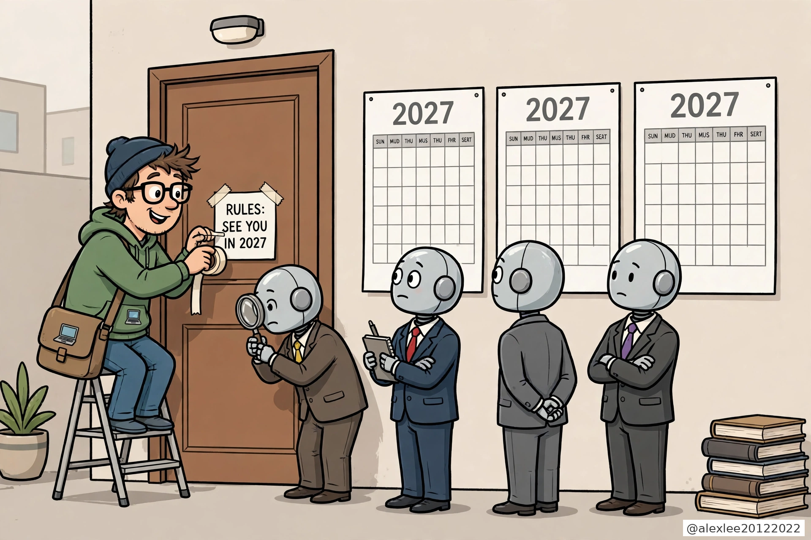
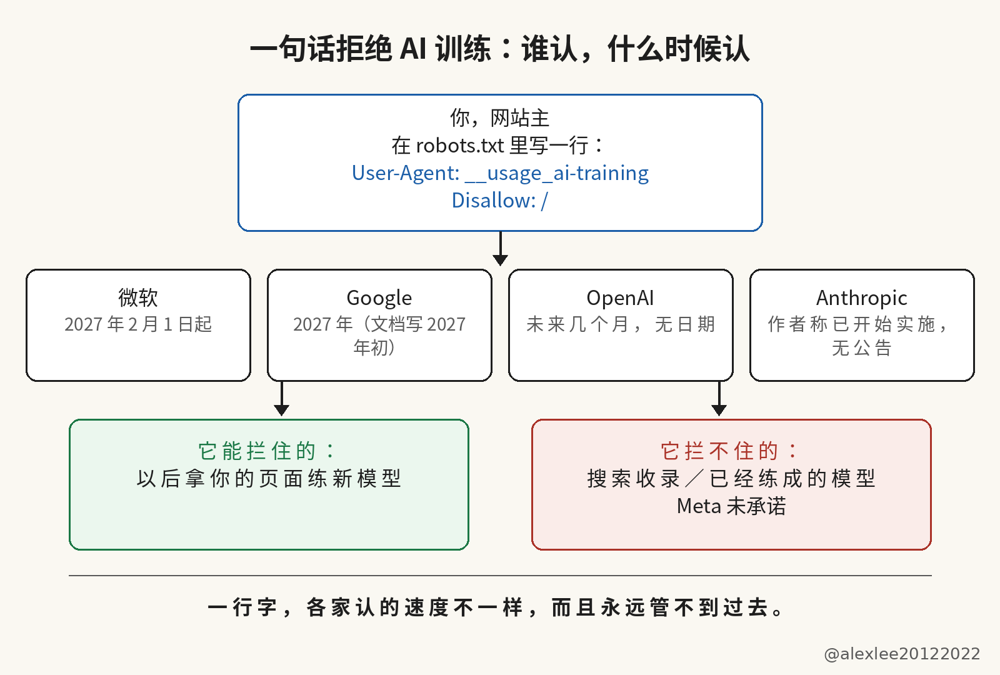

一句话就能拒绝 AI 训练，只是各家开始认它的时间都不一样

你的网站现在可以用一句话拒绝 AI 训练。这件事是真的有进展，但你先别把它当成已经到手的保护。这句话背后的文件还是份草案，大部分公司要到 2027 年才开始认它，而且你现在加的这一行，管不到那些已经拿你的内容练成的模型。

进展和保护之间的缺口，要从 robots.txt 是什么说起：它就是网站根目录的一个纯文本文件，爬虫按惯例先读它再去抓页面。它本身没有强制力，就是网站主贴出来的一张请求，抓取方认才算数。共用的请求有用，在于它把一家一家的写法换成一行。但它没有强制力，所以光有一行共用的请求，什么问题都还没有解决。请求贴出来容易，认不认全看对方，这就是它难管用的地方。

以前想说不，你得一家一家写。Google 从 2023 年起给了 Google-Extended，OpenAI 有 GPTBot，Anthropic 有 ClaudeBot，Bing 还有自己的一套。网站主得给每家各写一行，漏掉哪家，哪家爬虫就收不到你的指示。现在的新信号是一行共用的请求，把这一摞各家的写法换成一行，你写一次，认这套的公司就都按这一行来。

这一行长这样。User-Agent: __usage_ai-training，Disallow: /。这个令牌前面带两个下划线，写在平时放爬虫名字的位置上，但它自己不是爬虫，只是一个用途的标签，专指生成式 AI 训练。它下面的 Disallow 不是「别来我的网站」，而是「抓可以抓，别拿去练模型」。

你也可以用 Allow 行留出口子，比如把 press-kit 那一页放出来。留了口子的页面照样可以抓，只是不拿去练模型——Disallow 管的是用途，不是进门。robots.txt 里按 User-Agent 分组，每组开头就是一行 User-Agent。写在 User-Agent: * 那一组里，它不等于你对这个令牌表了态；文件里根本没有写这个令牌，那就等于什么都没表态。

草案给训练下的定义很窄：它说的训练，是拿你的内容去改模型已经学到的参数。你想一下就明白了，拿你的页面去建搜索索引，那是另一回事；在回答里引用你的页面，那也是另一回事。这个令牌都不管。所以你要是加了这一行，就指望网站从搜索里消失、从 AI 回答里消失，那肯定要失望。

时间表上只有微软给了确定的日期。2027 年 2 月 1 日起，Bingbot 在抓取时开始认新的偏好；旧的 NoArchive 和 NoCache 标签到 2027 年 3 月 1 日之后，就不再被当成训练偏好了。Google 只说了 2027 年，它的爬虫文档写得更具体：2027 年初。

OpenAI 只说了「未来几个月」，没有给日期。关于 Anthropic 何时开始认这个令牌，目前只有草案作者 Kevin Kelley 在 IETF 邮件列表里的说法。Kelley 在 Anthropic 负责标准工作，他说 Anthropic 已经开始实施对这个令牌的支持，但全面铺开这种支持还要时间。Anthropic 自己截至目前并没有发公告。邮件列表里的一句话不是公司公告。

这份文件本身只是一份草案：它是 2026 年 10 月 30 日提交的个人 Internet-Draft，不是 IETF 批准的标准，未经 IETF 背书，2027 年 5 月 3 日到期，除非修订或正式采纳，措辞范围仍可变。草案会过期、robots.txt 又没有强制力，所以说过会认它的公司，承诺的也只是去读这一行字。网站主手里没有能逼对方照办的办法。

搜索收录不受影响，Google 和微软都明说了这一点。已经收集、已经练进去的内容也不受影响，因为草案只在抓取的时候判断偏好，模型已经学进去的东西没有退出键。Meta 截至目前也没有公开承诺要认这个令牌，所以就算到了 2027 年，一行字也盖不住整个网。

我自己也跑着一个网站，我的做法很直接。已经写好的各家规则先留着，因为今天真正管用的是它们。共用的这一行现在就加上，趁你还想着这件事的时候写进去，等各家的开关一个个拨过去的时候，它已经在那里了。Google 那边还有一条要留心：你用共用令牌退出、又没有明写 Google-Extended 的话，Google 会把它当作 Google-Extended 也被禁了来处理。

别为了图文件干净把旧的几行删掉，也别把新的一行当成已经修好、可以挡事的盾。到了 2027 年，等你的页面被重新抓过之后，再去看那些答应过要认它的公司，是不是真的按这一行照做了。

真正要看的不是公告写了什么，而是你自己文件里的几行还在不在、2027 年之后各家是不是真的照做了。你的网站要是有 robots.txt，也可以先收藏这篇，等 2027 年各家的开关拨过去之后，拿出来对一遍。我会继续写这类拆解。

出處：[Search Engine Land（2026-10-30）](https://searchengineland.com/google-also-gives-publishers-more-control-over-how-ai-uses-their-content-499971)；[RR Tech Pulse（2026-10-31 修訂版）](https://rrtechpulse.com/stories/robots-txt-ai-training-opt-out-signal/)；IETF 草案 draft-kelley-aipref-training-preference-signal-00（Kevin Kelley，2026-10-30）。
