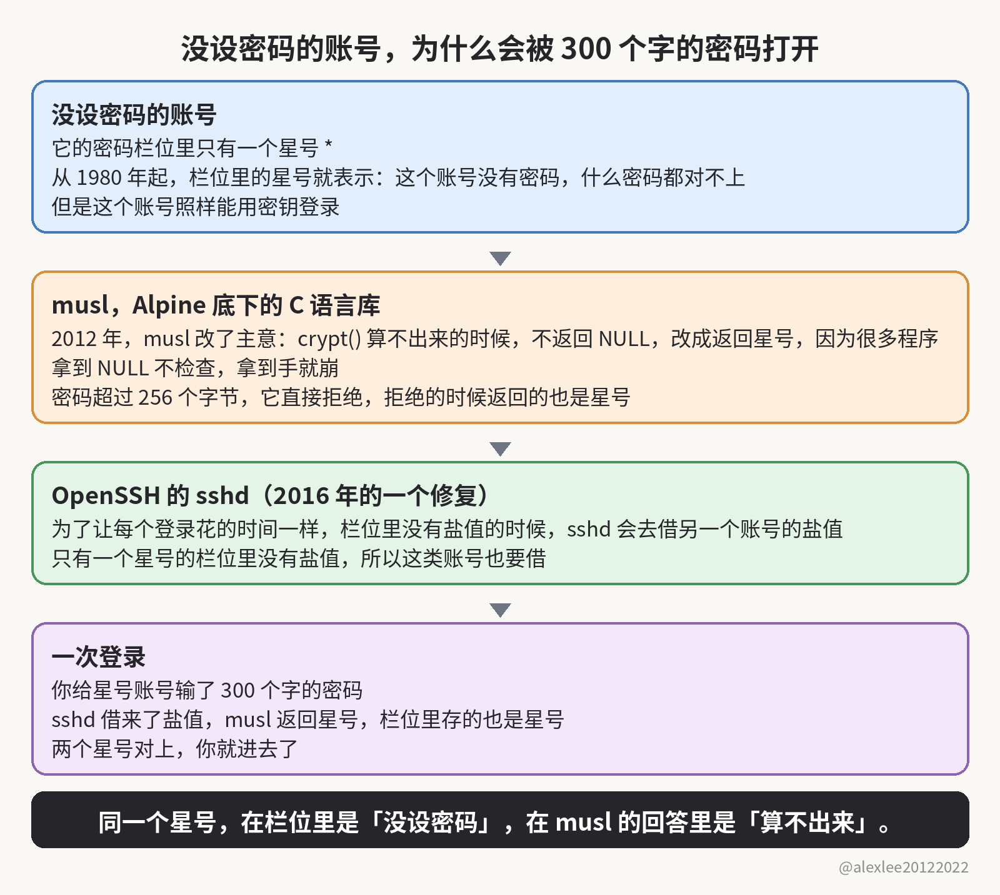
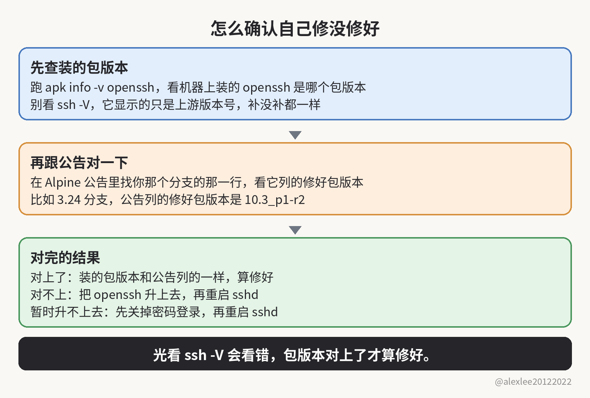

四十多年来，密码栏位里没设密码的账号，一直是输什么密码都进不去的。你自己的 Alpine 机器上，现在还有几个没设密码的账号？密码登录还开着吗？

## 密码栏位里的哈希、盐值与星号

正常账号的密码栏位里存的是一串哈希值，就是密码算过一遍之后的乱码，而密码本身是不存的。这一串里还存着一段盐值，盐值是一小段随机字符，跟哈希值连在一起，算密码的时候掺进去一起算。sshd 验登录的时候，就拿你输的密码掺着这个账号的盐值交给 crypt() 再算一遍，算出来的结果跟栏位里那串一样，才放你进去。

有一类账号的栏位里没有哈希值，只有一个星号。1980 年，Bill Joy 给系统自带的 daemon 账号就这么写，Unix 从此一直这么干。因为星号不是哈希值，输什么密码都算不出它来，所以这种账号用密码永远登不进去，只能用密钥登录。

只用密钥的用户，栏位里也只有一个星号。从目录服务来的用户也一样，他们的密码哈希不存在本地，所以栏位里就只有一个星号。Alpine 从 3.16 起的 root 账号，栏位里也只有一个星号。

## 三件事与一次登录

这个星号用了四十多年，后来有三件事先后撞到了它上面。第一件出在 musl 身上，musl 是 Alpine 底层用的那个 C 语言库。crypt() 算不出结果的时候，本来应该返回 NULL。可是很多程序拿到 NULL 根本不检查，顺手拿来就用，所以直接崩掉。

为了不让程序崩，musl 在 2012 年改了规矩：算不出来的时候不返回 NULL，改成返回一个单独的字符。这个字符永远不会是真密码算出来的样子，所以程序看到它，就只当密码填错了，还能接着往下跑。musl 挑中的这个字符，偏偏就是星号，跟栏位里表示没密码的那个，是同一个字符。

第二件跟第一件只隔了二十天，同在 2012 年，还是 musl。musl 用 sha512 算法给密码算哈希值，算出来的那串字符写进栏位里以 $6$ 开头。这种算法算密码的时候，密码越长算得越慢，所以有人只要发一个超长的密码过来，就能让服务器一直耗在计算上。

musl 于是给长度封了顶，超过 256 个字节的密码直接拒绝不算。麻烦就麻烦在，拒绝也算一种算不出来，所以 crypt() 拒绝的时候返回的，还是那个表示失败的星号。

第三件在 OpenSSH 那边，是 2016 年修另一个洞的时候带进来的。那个洞出在计时上。你去问一个不存在的用户，sshd 立刻就答不行。可是你去问一个真用户，sshd 就得拿哈希值算一遍，所以要慢上几毫秒。别人掐着这个时间差，就能一个一个试出哪些账号是真的，这就是 CVE-2016-6210。

那个洞的修法，是让 sshd 在没有哈希值可对的时候也照样算一遍：它借盐值之前，要先挑一个有哈希值的账号出来。挑好之后，就拿那个账号的盐值算你输的密码，算完再回答，这样问谁都一样慢。可是栏位里只有一个星号的真账号，也跟着走了这条借盐值的路，因为一个字的栏位里，根本放不下它自己的盐值。

三件事凑到一起，一次登录就成了这样。你给一个星号账号输 300 个字的密码，输的全是普通的英文字母和数字。一个字就占一个字节，所以 300 个字就是 300 个字节，已经过了 256 的上限。

栏位里没有盐值，所以 sshd 先从一个存着哈希值的账号那里借来盐值，准备照常算。这种哈希值写进栏位里，是一串以 $5$ 或者 $6$ 开头的长串，其中 $6$ 是前面说的 sha512 算法算出来的那种。可是密码送到 crypt() 那里，因为长度超了，它根本没算，就直接返回一个星号。而栏位里存的也是星号，两个星号一对上，sshd 就把你放进去了。

研究者从 257 个字一路试到 1,024 个字，每一个长度试下来，都是这个结果。也就是说，机器上只要有一个账号设了真密码、能借出盐值，就够了。这台机器上所有的星号账号，也就都可以用这中间任意一个长度的密码登进去了。

把这个洞找出来的，是 Wakefield（一家公司）的 Özgün Kültekin。他试了大约 17,600 次登录，这些登录把他能搭出来的各种 sshd 配置组合都试了一遍。glibc 和 musl 都试了，glibc 是另一个 C 语言库，Debian 那些系统底下用的就是它。

PAM 是大多数发行版验登录时要过的那一层，带 PAM 和不带 PAM 的，他也都试了。最后只有 musl 不带 PAM 的那种，把不该放的登录放了进来。他说，帮他试完 17,600 次登录的，是一群 AI agent。

他在 11 月 5 日公开了这个洞，Alpine 当天就发了公告。

## 这个洞成立的条件

要让这个洞成立，机器还得同时满足几个条件。要么跑的是 Alpine 那个没编 PAM 的 openssh-server，要么跑的是 PAM 版，但是 UsePAM 关着。UsePAM 是 sshd 要不要走 PAM 这一层的开关。密码登录也得是开着的，它默认就是开着的。

机器上还得有栏位里是星号的账号，还得有至少一个本地账号存着真密码的哈希值。真密码的哈希值在栏位里是一串长串，以 $5$ 或者 $6$ 开头。少了存着这种哈希值的账号，sshd 就没有盐值可借，前面那条借盐值的路也就根本走不通。

## Alpine 云镜像与 alpine 用户

最该担心的是 Alpine 自家的云镜像。官方给 AWS 和 Azure 用的那几份 tiny-cloud 镜像里，有一个 alpine 用户，他的栏位里是星号，而且他用 doas 是不用密码的。doas 是 Alpine 上相当于 sudo 的提权工具，能让一个普通用户以 root 的身份跑命令。

这些镜像刚开机的时候是安全的，因为机器上一个带密码的账号都没有，sshd 想借盐值也借不到。可是机器上只要多出第一个 $6$ 哈希值，这个洞就通了。

多出这个哈希值的路不止一条。一条路是管理员在云平台的控制台里给一个账号设上密码，密码一设上，这个账号的栏位里就写进了一个 $6$ 哈希值。另一条路是 user-data，也就是云平台在机器开机时交给它的一份启动数据。这份数据加一个带密码的用户，用户一建出来，栏位里也写进了一个 $6$ 哈希值。

第一个 $6$ 哈希值一出现，攻击者就能先以 alpine 的身份登进来，再用 doas 升到 root，而日志里只多出一行登录成功，跟一次正常登录留下的那一行没有任何区别。

root 本人反而不是最直接的目标。它从 Alpine 3.16 起，栏位里也是星号，可是 OpenSSH 默认不让 root 用密码登录，所以 root 只有在有人改过这个设置的时候，才用密码进得去。不过就算 root 这道门守住了，也挡不住前面那些云镜像里的 alpine 用户，因为他靠 doas 就能升到 root，根本用不着 root 自己的登录。

## 不受影响的系统

反过来，不在这些条件里的就不受影响。容器里要是没跑 sshd，就没有登录入口可以输密码。密码登录已经关了的机器也一样，因为长密码根本走不到验密码那一步。用 PAM 版、而且 UsePAM 开着的，验密码走的是 PAM 那条路，所以不会走到 crypt() 那里，也就碰不到它返回的那个星号。

Debian、Ubuntu、Fedora 这些 glibc 系统也不受影响。一个原因是 glibc 的 crypt() 算不出来的时候，返回的还是 NULL。再一个原因是它们的密码登录大多走 PAM，而 PAM 碰到星号账号不会去调 crypt()。

dropbear 是另一个 SSH 服务器，用的是另一套代码。OpenBSD 这个操作系统也不受这个洞影响，因为它根本不跑 musl，这个洞靠 musl 的 crypt() 返回星号才成立的那一步，在它那里不存在。栏位里还有另一种单字符的写法，写的是感叹号。这种账号整个是被锁死的，所以密码和密钥都登不进去，这次同样没事。

## 藏了十多年的原因与两次擦肩而过

这个洞能藏十多年，就是因为它要凑的条件太多，而且大多数系统平时根本不走这条路。再加上 OpenSSH 自己的测试跑在 OpenBSD 和 glibc 上，musl 那边又不测 sshd，所以两边的测试都正好绕开了这条路。

其实有两次，人已经站到它旁边了。2024 年 12 月，musl 的邮件列表里在吵一个问题，出在 busybox 这套小工具的 passwd 命令上。那个问题里有 257 个字的密码，有同一个星号，也有同一个长度上限，可是整串讨论里没人提到 sshd。还有一次，就在研究者找到这个洞的四天前，OpenSSH 的一次安全审查刚修过挑盐值的那个函数。这个洞不在修的那几行里，而在那几行往下数四行的地方。

## 修复办法与包版本核对

修好的包已经发了，修好这个洞的 OpenSSH 上游版本是 10.6p2。注意，Alpine 的稳定分支用的是打进包里的补丁来修，装没装上要看包版本，光看版本号会看错。你把 openssh 升上去，再重启 sshd。因为只升级包的话，已经在跑的进程不会自己换掉，就一直带着这个洞应答登录。

Alpine 修好的发行版是 3.21.10、3.22.8、3.23.8 和 3.24.4，而且打好补丁的包往回一直发到 3.16。Alpine 写公告时还没给这个洞编 CVE 号，不过我不会等编号再去修机器。

查自己修没修，别看 `ssh -V` 显示的版本号。稳定分支的修复是打进包里的补丁，所以 `ssh -V` 显示的只是上游版本号，补没补都一样。就拿 Alpine 的 3.24 分支来说，它显示的是 10.3p1，可公告里给这个分支列的修好包版本是 10.3_p1-r2。你跑 `apk info -v openssh` 看装的是哪个包版本，再跟公告给这个分支列的修好包版本对一下，对上了才算修好。

动手之前，先确认密钥登录是通的。手头这个会话也先别断，等新开一个登录试过密钥能进，再把旧的关掉。确认完，再说关密码登录的办法：要是暂时升不上去，就先把密码登录关掉，再重启 sshd。Alpine 的公告里把现成的写法给了出来，写法就是往 /etc/ssh/sshd_config.d/00-no-passwords.conf 这个文件里写上一行 PasswordAuthentication no。

不过这个文件夹只有 3.19 起的默认配置才会读，更早的版本根本不看它。跑老版本的话，就把这一行直接写进主配置 /etc/ssh/sshd_config。

## 日志排查与自测

关好之后，再去翻一遍日志，看这个洞是不是已经被人用过了。在 /var/log/messages 里找 sshd 写的 "Accepted password for"，后面跟的账号要是根本没设过密码，那就是有人进来过了。你要是排不掉这样的一次登录，就不要再把这台机器当成干净的，按已经被攻破来处理。

你也可以自己先试一把：拿你机器上一个没设密码的账号，输一个 300 个字的密码去登一次。要是登进去了，那么升级和重启今天就得做，一天都别拖。

要是没登进去，也别急着放心。一种情况是机器上还没有能借的盐值。再一种情况出在密码长度上。前面让你输 300 个字，是因为普通的英文字母和数字，一个字占一个字节，300 个字就是 300 个字节。只有过了 256 个字节，crypt() 才会拒绝，才会返回星号。你输的要是没超过这个数，crypt() 就不会拒绝，也不会返回星号，那等于没试。所以最后还是要回到包版本那一查，对上了才算数。

这种藏在四十年的老规矩里、要三件事凑齐才成立的洞，我还会接着拆。觉得这篇对你有用的话，欢迎订阅这个博客，或者先收藏起来，我接着写 AI、安全和开源这几块的实事。

来源：研究者的文章 https://sshhole.com/ ；Alpine 的公告 https://alpinelinux.org/posts/2026-11-05-openssh-password-authentication-bypass/
