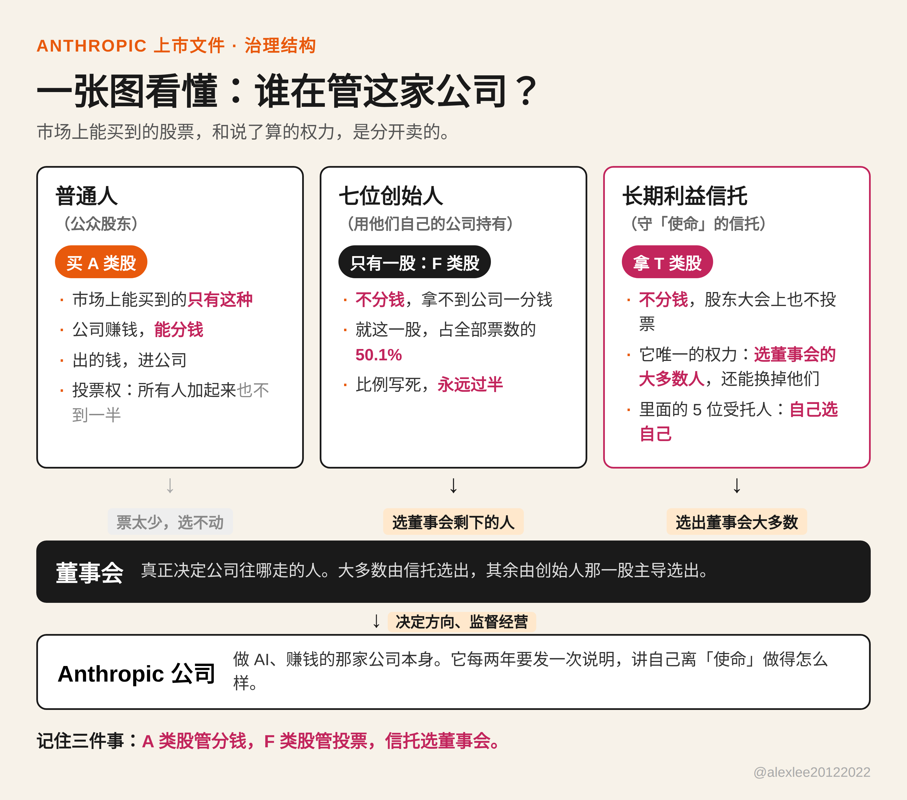

买一家上市公司的股票，钱花出去，通常换回来两样东西：一样是分钱的权利，公司赚了钱有你一份；一样是投票的权利，票数不多，但谁来当这个家，你能投上一票。anthropic 在 10 月 26 日交给 sec 的这份 s-1 里，第一样照卖，第二样留下了。文件里发多少股、价格区间都还空着，所以股票现在还买不到，离上市也还有一段距离。但治理那部分已经全部写死了，而且在我看来，那才是这份文件里最值得慢慢看的地方。

数字本身也大到足够让很多人想买。2026 年上半年营收 163 亿美元，去年同期大约 11 亿美元。净亏损那一栏写着 807 亿美元，看着吓人，翻到脚注就明白了：里面大约 724 亿是可转债的非现金会计处理，钱并没有真的走出公司。上半年经营亏损 6.93 亿美元，第二季度单季经营利润 9.74 亿美元，是它第一次在单季经营上赚到钱。《华尔街日报》报道说，公司瞄准 11 月 16 日那一周上市，募资 1000 亿美元以上，估值在 1.5 到 2 万亿美元之间。这个时间表是《华尔街日报》的报道，文件自己没有这样写。

治理结构是这样的。公众能买到的只有 a 类股，一股一票，外加实实在在的分钱权利：公司赚了钱，这个股是分得到的。创始人留给自己的是另一样东西。上市之前，公司会发行一股 f 类股，注意，是一股，交给一家由七位联合创始人共同持有的公司。这一股能投的票数，等于全公司总投票权的 50.1%，写死在文件里。股东大会上表决的一般事项，包括选董事会里不归信托选的那部分董事，都在它手里。f 类股本身不分钱，没有任何经济权利，没有办法拿它从公司里往外拿钱。它带的只有票，而且票多到这个程度：全体公众股东哪一天全部站到一起，那也是他们票数最多的一天了，加起来还是不到一半。文件在这一点上不绕弯子，值得肯定，它直说 anthropic 上市之后按纳斯达克的规则属于受控公司。我买过不少公司的股票，早就习惯了自己那一票实际上没什么分量。但实际上没分量，和在招股文件里明写着不算数，是两回事。

结构的另一半是一个信托，叫长期利益信托。它手里拿着第三种股票，t 类股，不分钱，在股东大会的一般事项上也没有票。它有的权利是选任和罢免 t 类董事，而 t 类董事将占董事会的大多数。信托的书面任务，是替公司守住三件事之间的平衡：股东的经济利益，受公司行为影响的那些人的利益，还有公司章程里写明的那个目的，为人类的长期利益，负责任地开发和维护先进 ai。信托不管日常经营，文件在这一点上写得很清楚。它管的是选谁去监督经营的人。

那信托的人又是谁选的呢？文件同样写得直白：受托人选受托人。信托一共五个席位，在任的受托人用多数票任命新受托人，也能用多数票把自己人中的一个换掉。任期一年一届，连任次数不设上限。受托人的报酬也是受托人自己定，信托协议把它限制在一个由受托人每年定下的合理现金数额之内。文件还自己多交代了一句：到目前为止，受托人和公司高管在物色、面试和挑选受托人这件事上，一直是密切协作的。现在坐在席位上的人，我不打算装作他们是无名之辈：主席巴迪·沙阿做过 givewell，现在掌管克林顿健康倡议；理查德·方丹在华盛顿管着一家国家安全智库；本·伯南克当过美联储主席；克里斯托弗·斯塔布斯是哈佛的物理学教授。还有一个席位目前空着。这些都是有分量的人。问题从来不是他们有没有分量。问题是，真到了他们看错了的那一天，谁能换掉他们。按文件自己的写法，答案是他们彼此。

把冲突想具体一点，因为这种结构就是为某一天准备的，不是摆着看的。假设几年以后，董事会里信托选出的多数决定，某条非常赚钱的产品线要放慢、甚至砍掉，理由是它跟使命合不来。觉得这个决定错了的公众股东，在一家普通上市公司里办法很多：投票、拉票、把董事换掉。在这里，这些办法在他进场之前就被收走了。他的票投得出去，但赢不了。他最想换掉的那批董事，压根不是股东选出来的。就算他想改结构本身，也比输掉一场投票难得多：只要受托人反对，改信托的条款，就要创始人的那家公司、员工股东（e 类股，创始人之外的员工持有的有限投票股）和公众股东三边同时投票同意，其中几边的门槛还远不止过半数。哪一天 f 类股不在了，也要公众股的 85% 点头，而受托人那时依然在反对。我理解他们为什么要这样设计，其中的一部分理由是真的：公开市场确实会逼着公司为了下一个季度的数字偷工减料，一家能被自己股价推着走的前沿 ai 公司，是另一种危险。anthropic 的解法，是把方向盘从市场手里拿走。文件始终没有回答的是，方向盘为什么非得交给一个自己选自己的小团体，这条链条从头到尾，没有一只外面的手。

聊这种结构，最后总要落到使命上。anthropic 是公益公司，目的写进了章程，信托就是为了守它而设的。写下这些安排的人今天是真心的，我不怀疑。我怀疑的是另一件事：一道换不掉的保障，也是一道纠正不了的保障。而这家公司做的不是卖软件订阅的生意。它在造全世界能力最强的通用 ai，很多人，包括我自己，认为这种技术能聚起来的权力，是过去任何一家公司都不曾聚起来的。如果生意是这样的生意，那么谁能推翻最上面那几个人，就不是公司内部的家务事，它本身就是安全问题的一部分。真到了中心那个小团体把一件大事看错的那一天，或者它慢慢变成自己当年要防的那个东西的那一天，出钱的人，和人数多得多的、要承受后果的公众，手里没有一票能够得着这个问题本身。他们能拿到的，是公司按规定每两年发布一次的说明，讲它离自己的目的做得怎么样。文件说这份说明打算放在公司网站上公开。那已经是事后了。

说白了，如果你本身打算购买他们的股票只是为了赚钱，那么我建议买，因为从长远来看，这绝对能让你赚大钱。但是你抱着作为股东能参与或者影响上市公司的决策，或者监督公司的运营的目的，那么你可能会大失所望。因为那份话语权在第一股公众股定价之前就已经分完了。当然这件事和 99% 的如你我一样的普通人是没关系的。但是这件事情本身，我觉得是每个人都需要关注的，理由很简单——这是一个前沿实验室第一次被要求把公众到底有多少话语权，白纸黑字写进有法律效力的文件里。它也许算是开了一个好头，也许反而打开了一个潘多拉的盒子，这谁知道呢？也许只有时间能证明一切。

出处：Anthropic 2026 年 10 月 26 日向美国 SEC 提交的 S-1 文件，https://www.sec.gov/Archives/edgar/data/2130357/000162828026067168/anthropicpbc-sx1.htm ；Anthropic 官方公告 https://www.anthropic.com/news/s1-sec ；上市时间表与估值数字为《华尔街日报》报道，正文中已标明。
