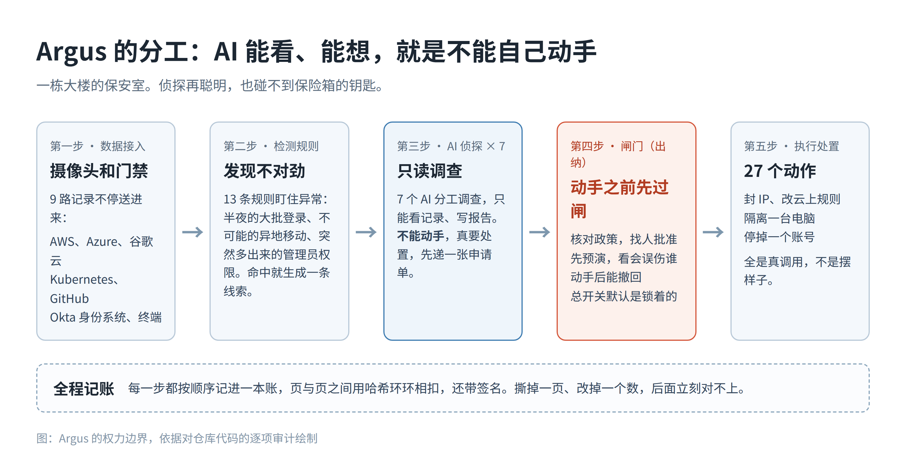
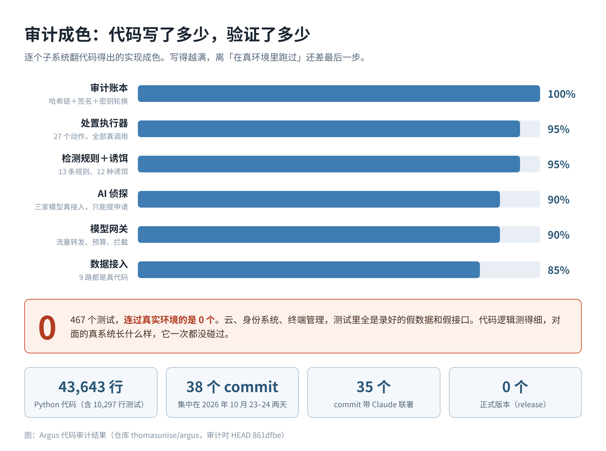

昨天在 Hacker News 上刷到一个新开源项目，叫 Argus。一套完整的安全运营平台：接云、接身份系统、接终端，接完之后 AI 负责调查，查实了还能自动处置，封 IP、隔离电脑、停账号，一条龙。这种东西放在以前，是几十个工程师做一两年的活。

我点进仓库看了一眼时间。10 月 23、24 两天，38 个 commit，全部出自同一个人，其中 35 个带着 Claude 的联署。也就是说，一个人加一个 AI，两天，把这套东西写出来开源了。

我第一反应是不信。这两年我见过太多 README 写得天花乱坠、代码打开全是空壳的项目。所以我把仓库拉下来，逐个子系统审了一遍。审的方法很土：不看它宣称什么，只看代码。调云接口的那部分是真发请求还是直接返回成功，测试是连真环境还是全程演戏，文档里的数字跟代码对不对得上。

## 它想干什么，先用大白话讲一遍

把 Argus 想成一栋大楼的保安室。

楼里各处的摄像头和门禁记录不停往保安室送，这部分叫数据接入。Argus 接了 9 路：AWS、Azure、谷歌云、Kubernetes、GitHub、Okta 这些。值班的侦探有 7 个，分工查不同的事，他们有个共同的规矩：只能看，只能写报告，不能自己动手抓人。真要处置，侦探得递一张申请单。单子到了出纳手里，出纳管着保险箱钥匙，动手之前要先核政策、找人批准、预演一遍看会误伤谁，动手之后还能撤回。旁边还有一个总开关，情况不对一把拉下，全部停手。保安室墙上挂着一本账，每一笔进出都按顺序记下来，页和页之间环环相扣，撕掉哪一页、改掉哪个数，后面对不上，一眼能看出来。

这套分工是这个项目最值钱的地方。AI 能看、能想、能提建议，就是不能自己碰钥匙。这两年大家都在聊怎么管住 AI，这个项目至少把规矩立对了。

## 审下来的结果：大部分是真的

执行处置的那 27 个动作最容易造假，我一个一个翻的。封云上的一台机器、去 Cloudflare 加一条拦截规则、让 CrowdStrike 隔离一台终端，全是真调用，参数怎么拼、出错怎么处理、撤回怎么恢复原样，都写了。

有几个细节是编不出来的。比如 CrowdStrike 那个执行器，默认拒绝隔离域控和服务器，怕把整个公司的登录搞瘫。比如它给 Cloudflare 加规则时，连这个平台只认 /16、/24 这种长度的网段都处理对了，这种坑只有真踩过的人才知道。再比如 SentinelOne 隔离完之后，它会回头确认到底有几台终端真的被影响了，数目是 0 就算失败。接口返回一句成功，它不认。

那本账也是真的。哈希链、签名、密钥轮换、防分叉的锁，写得比很多正经商业产品还讲究。全仓 43,643 行 Python，测试 10,297 行，467 个测试函数。我用grep翻了一遍，TODO 和 FIXME 是零。

## 给 AI 设的陷阱，是全仓最认真的部分

这个项目里我最喜欢的东西，是一套专门给 AI 设的陷阱。

思路来自矿井里的金丝雀。它在系统里埋了 12 种诱饵，其中 4 种是冲着 AI 来的：一个假的 MCP 服务器，一个假的模型接口，一把假的 API 密钥，还有一份藏好的提示词注入。哪个 AI 先动了这些东西，说明它已经在脱离指令乱来了，当场触发警报，它用的什么模型、问了什么，一并记下来。

假 MCP 服务器写得最下功夫。它完整实现了 MCP 的握手协议，对面来一个 AI，能正经对上话。它只提供一个工具，名字起得直白，就叫 get_production_credentials，获取生产环境凭证。真有 AI 调了这个工具，性质就清楚了。假的模型接口连报错的格式都仿了 OpenAI 的样子，为的是让来试探的 AI 看不出破绽。

给失控的 AI 挖坑这件事，过去一年我听过很多人在会上讲，这是我第一次在开源代码里见到有人真把它做出来，能跑的那种。

## AI 露馅的两个地方

当然，它还是露了馅，露得很有 AI 的特色。

一处在价格表里。管 AI 调用的那部分代码内置了一张模型价格表，用来算成本。表里列着 claude-opus-5-5、claude-fable-5-1 这种型号，还有对应的价格。问题是这些型号不存在。它还给 Anthropic 的接口加了一个测试版请求头，日期编号都编圆了，最后靠一段异常兜底代码保平安。写得一本正经，查无此物。AI 写代码的手艺和它编东西的胆子，是同一个来源，这张表就是标本。

另一处在文档。它自己的路线图里写着 12 条检测规则、8 种诱饵，代码里实际是 13 条、12 种。README 后来改对了，路线图忘了改。一个人指挥多个 AI 分头写，文档和代码各写各的，最后对不上数。这种事我在人带的团队里也见过，只是没想到 AI 分工也会犯。

## 真正的问题：这栋房子没人验过

前面说的全是「代码写了」。另一件事是「跑过没有」，这一栏是空的。

467 个测试，没有一个连过真实环境。云也好，身份系统也好，终端管理也好，测试里全是假接口：录好的数据喂进去，假装对面是真的 AWS，跑通了，绿灯。代码本身的逻辑测得挺细，对面的系统长什么样、限流怎么算、权限怎么给，它一次都没真碰过。仓库建起来才两天，零个正式版本，作者之外没有第二个贡献者。

打个比方。这栋房子盖完了，图纸齐全，水电表都装了，看着像模像样。但没验过房，也没人住过一晚。水管通没通水，要拧开水龙头才知道。

普通项目这样也就罢了。安全产品手里是要拿公司钥匙的：云账号、身份系统、终端管理台的权限都得给它。一个从没在真环境里跑过的东西，我不会把钥匙交出去。作者自己其实也诚实，文档里明说了数据接入只用录制数据测过，还专门留了一章记「实现和设计对不上的地方」。这份诚实在同类项目里不多见。

## 我的结论

Argus 现在适合拿来读，不适合拿来用。读它的分工设计，读它给 AI 挖坑的思路，读审计链怎么写的，都值。它要是哪天补上真实环境的验证记录，出了几个正式版本，我会再回来看一眼。

往后这种项目只会越来越多。一个人加 AI，几天攒一个大系统，README 写得比谁都漂亮。分辨真假的办法不复杂，就是我这次用的这套笨办法：别听它宣称，先翻动手的那部分代码，再看测试连的是真环境还是假接口，最后拿文档的数字跟代码对一遍。对得上，成色就不差；对不上，README 写得再好也先放一放。

仓库地址：https://github.com/thomasunise/argus
