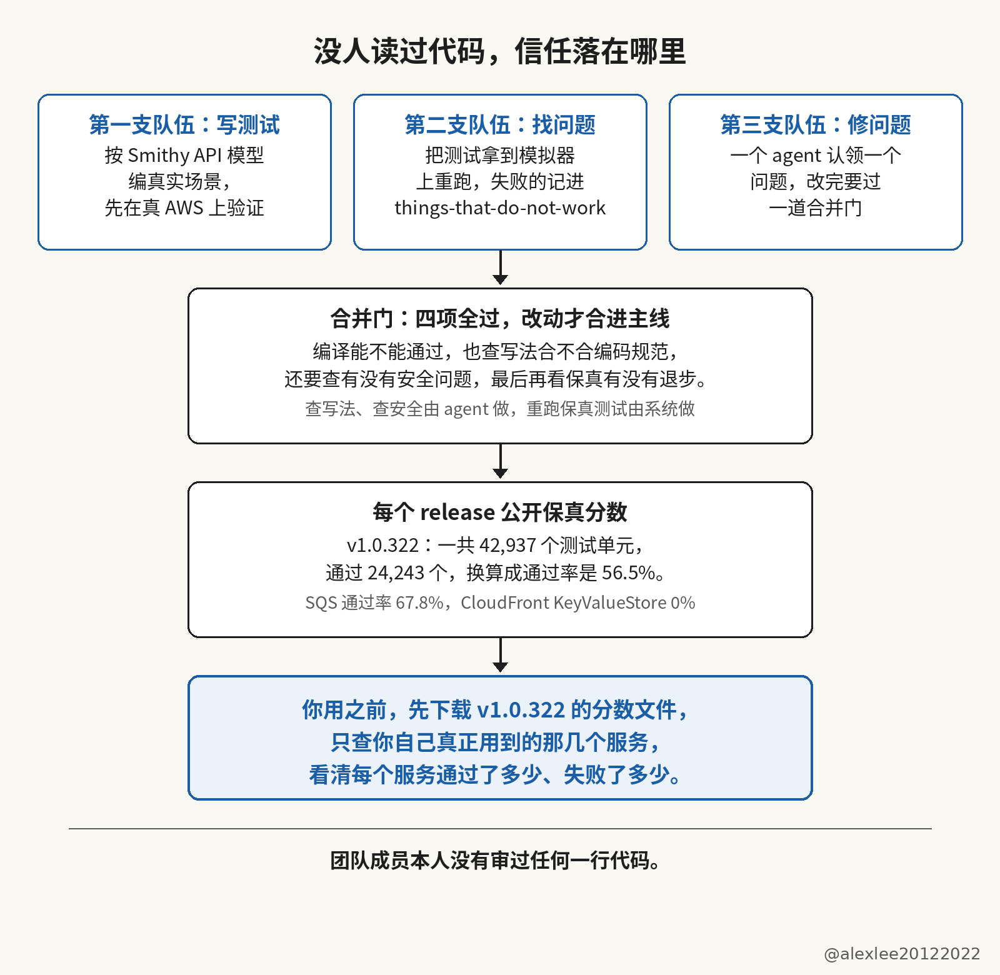

我在本机装了 AWS Emulator 1.0.322。然后我在 SQS 上建了一个队列。接着我把队列列出来确认它已经建好。然后我往队列里发了一条消息。最后我把这条消息收了回来。整个过程没有连真的 AWS。而且收回来的消息正文和我发出去的那条消息的正文一模一样。

2026 年 11 月 11 日，AWS 发布了这个模拟器。它在本机运行，而且它对外提供的接口和真的 AWS 一样，所以你把 SDK 的地址指向本机以后，你就可以在本机测你自己的程序。

它覆盖了 438 个 AWS API 模型，而且它的仓库到今天已经有 30,627 次提交和 5,002 个星。官方博客的作者 Matthew Goldberg 写得非常直接。他说全部代码都是自主 agent 写的。而且他说 AWS 的团队没有写过一行代码，也没有审过一行代码。

## 它是从一个周末实验开始的

这个模拟器是从一个周末实验开始的。Goldberg 先给负责写代码的 agent Kiro 写了三步要求。他让 Kiro 先按照 AWS CLI 的行为写测试。接着他让 Kiro 把这批测试放到真的 AWS 上跑到通过。最后他让 Kiro 再写一份在内存里运行的 SQS 实现，而且这份 SQS 实现也要通过同一批测试。

15 分钟以后，第一版 SQS 实现就跑起来了。而且因为周末结束的时候 Kiro 已经写完了其余服务，所以团队在周一就开始用这个模拟器测他们自己的软件了。

## 三支队伍和一道合并门

后来团队把工作拆成了三支队伍。第一支队伍专门写测试。他们按照公开的 Smithy API 模型编写真实的使用场景。他们先把每个场景放到真的 AWS 上验证。验证通过以后，他们才把这个场景存成保真测试。所以最后攒下来的保真测试有数以万计。

第二支队伍专门找问题。他们把保真测试拿到模拟器上重新跑一遍。他们把跑失败的测试记成一个问题，然后他们把问题放到一个叫 things-that-do-not-work 的目录里。这个目录就在仓库的 issues 文件夹下面。

第三支队伍专门修问题。每个 agent 只认领一个问题来修，而且每个 agent 修完以后都要把改动送进一道合并门，所以没有通过合并门的改动进不了主线。

合并门一共查四项。程序先要能编译通过。然后审查的 agent 要检查写法是否符合编码规范。接着还要做安全检查。负责安全检查的 agent 要确认改动没有引入安全问题。最后系统还要重新跑保真测试。系统要确认通过的数量没有退步。团队成员本人没有审过任何一行代码。门里检查代码写法和安全问题的工作由 agent 做，重新跑保真测试的工作则由系统做。

## 我把保真分数逐条数了一遍

我把 v1.0.322 这个 release 附带的保真分数文件下载下来。然后我把这一份文件里的记录逐条数了一遍。这一份文件里一共有 42,937 个测试单元。其中通过了 24,243 个，所以通过率是 56.5%。而且另外还有 18,614 个单元没有通过。剩下 80 个单元被跳过了。

你把这个通过率看清楚以后，你就会发现它的测试根本没有全过。而且没有通过的单元占了四成多。分数文件里 SQS 一共 1,523 个单元。其中通过了 1,032 个，所以 SQS 的通过率是 67.8%。

另外有些服务的通过率还要低很多。比如 CloudFront KeyValueStore 的 56 个单元一个都没有通过。而且 EndUserMessaging 的通过率只有 3% 左右。EventBridge v2 的通过率也只有 3% 左右。

就算某个服务在这一份文件里全部通过了，你也不能直接推断这个服务就没有问题了。因为保真测试只能覆盖测试编写者已经写出来的场景。所以没有被写进测试里的行为在分数文件里根本不会显示出来。报错细节和边界情况也是一样，它们没有被写进测试就不会显示出来。

我开头在 SQS 上做的建队列、列队列、发消息和收消息这四步也是同样的道理。这四步都走通了只能证明这四个操作在模拟器上返回了预期的结果。其他没有测到的操作仍然需要你自己另外去核对。

## 为什么 AWS 做成了，我的项目却失败了

这一点和我之前带 agent 做游戏的经历正好能对上。那次做了两个月，局部测试也一直在通过。但是游戏整体离能玩越来越远。所以我最后只能推倒重来。我把那次的完整复盘发在了这里：https://x.com/alexlee20122022/status/2120832897825529896

两次经历放在一起看，为什么我失败了，而 AWS 却能用多 agent 协调开发做出一个能用的东西？

关键是 AWS Emulator 本来就是一个模拟器，所以它的范围边界在一开始就确定了。它既有真实数据可以对照，也有真实接口可以对照。输入和输出接口都已经由真实系统定好了。就算代码量再大、内部实现再复杂，agent 也有明确的验收标准。这个标准就是把模拟器的行为对齐真实系统。

在这个边界里面，方向自然漂移的问题就不太存在了。它更可能留下的是另一类问题，比如重复代码和重复逻辑写了一大堆，内部性能有问题，安全问题也可能不少。但是至少，方向漂移不会把它拖到跑不起来，因为每个结果都能拿真实系统来验。

我的项目完全不一样。《汉末行记》是从零开发的，没有现成的真实系统可以参考，也没有真实数据和真实接口可以对照。项目边界没有被一个已经存在的系统定住，我手里只有设计文档。agent 为了达到设计目标，在实现过程中就会不自觉地漂移。这样做下去，整个方向都可能偏离。

## 用之前先处理两件事

你在用这个模拟器之前还有两件事需要先处理。第一件是遥测。遥测默认是打开的。所以我启动的时候加了 --telemetry off 把遥测关掉。而且你也可以通过环境变量把遥测关掉。你也可以通过配置文件把遥测关掉。

第二件是用途。README 里写明了它只供搭建和测试使用。所以你不要拿它跑生产负载。你也不要拿它来测安全问题。而且这个仓库不接受 PR。所以你发现问题以后只能去报 issue。

## 先做两步核对，再把日常测试切过去

如果你准备在自己的项目里用它，我建议你先做两步具体的核对。你先把 v1.0.322 的分数文件下载下来。然后你只查你自己真正用到的那几个服务。你要看清每个服务通过了多少，也要看清每个服务失败了多少。

接着你把你项目里每天都会用到的几个场景挑出来。你把这些场景分别在真的 AWS 上跑一遍。你再把同样的场景在模拟器上跑一遍。你把两边的返回和报错逐条对完以后，你再把日常测试切到模拟器上。

我会继续写我自己动手装过和测过的项目，并且把测出来的数字写在文章里交代清楚。如果你也在用 agent 写代码，而且这篇帮你把测试的数字看得更准一点，欢迎订阅这个博客，或者把它收藏起来。
