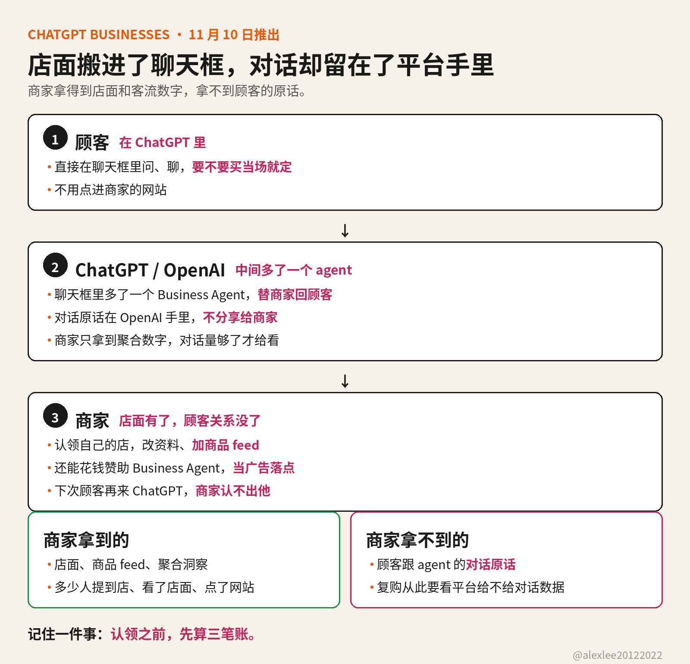

OpenAI 11 月 10 日在 ChatGPT 里推出了商家功能 Businesses，目前还是 beta。商家现在可以在 ChatGPT 里面认领自己的店。认领之后能改资料，也能挂商品。顾客直接在聊天框里发问。Business Agent 替商家回答。聊天框从问答工具，变成了一个能开店的地方。

认领要走一个叫 Business Hub 的工具。商家先认领自己的店。经过 OpenAI 验证之后，才能改店铺名称和地址这类关键资料，也能加商品 feed。商品 feed 就是商品数据。里面带价格和库存状况。OpenAI 还会给商家看聚合洞察：多少人提到这家店、多少人看了店面，和多少人点了商家的网站。这样一来，店面有了，客流数字也有了。

真正变的不是多了一个展示位，而是聊天框里多了一个替商家回顾客的 Business Agent。顾客不用点进商家的网站。比如直接在 ChatGPT 里问这件衣服有没有 M 号。Business Agent 当场回答。首批只向美国符合条件的电商和在线服务企业开放。

但是商家看不到顾客跟 Business Agent 的对话。OpenAI 说了，它不把用户跟 Business Agent 的对话分享给商家，商家只能看到聚合起来的数字。而且要对话量够了，OpenAI 才把聚合数字给商家看。平台手里是顾客的原话，但是商家手里只有汇总数字。同一场对话里，平台和商家看到的东西是不一样的。

商家还能花钱赞助 Business Agent。广告点进去就落到 Business Agent 上。赞助位会标注出来。但是赞助过的回答和自然回答长一个样子，都出现在同一个聊天框里，所以顾客要多留一个心眼，才能分清赞助回答和自然回答。

这件事真正的变化不在功能，在商家和平台之间的关系。以前顾客要买东西，先到商家的网站上看商品，也问客服，也比价格。现在问和比这两步搬进了 ChatGPT，只有最后下单那一下还留在商家的网站上。商家以为多了一个获客渠道，实际上是把自己的店面搬进了 ChatGPT 的聊天框里。顾客做决定的那几分钟，全在 ChatGPT 里。OpenAI 看得见每一句。

还有一层是复购。顾客在商家的网站上买过东西，商家就知道他是谁，下次就能直接找他。顾客在 ChatGPT 里跟 Business Agent 问完，也聊完了。要不要买，就在聊天框里定了。但是对话在 OpenAI 手里，商家只拿到聚合数。下次他再来 ChatGPT，商家就认不出他。从此复购也要看平台给不给商家对话数据。

认领之前，先算三笔账。第一笔：如果商家的商品 feed 停了，店面还在不在 ChatGPT 里，还是说店面本身就是 OpenAI 借给商家的。

第二笔：顾客跟 Business Agent 的对话数据归谁。对话在 OpenAI 手里，商家只拿到聚合数。以后商家想自己做复购和客服，要是没有这些对话数据，拿什么来做。

第三笔：赞助位出现之后，自然回答还剩多少展示位置。今天 Business Agent 是替商家回顾客。如果明天同行花钱买了落点，商家的 Business Agent 的回答还排不排在自然回答前面。

获客渠道每次换地方，规矩都是平台先写好，商家后进来。认领不认领是商家的选择，但是进去之前，先把这三件事想清楚，再决定店面要不要搬进 OpenAI 的聊天框。如果这篇对你有用，请订阅或收藏这个博客。我会继续分享自己在 AI、安全和开源这三方面动手查过和用过的东西。

来源：Reuters，2026 年 11 月 10 日，https://www.reuters.com/technology/openai-lets-businesses-claim-chatgpt-profiles-adds-ai-agents-us-e-commerce-firms-2026-11-10/
