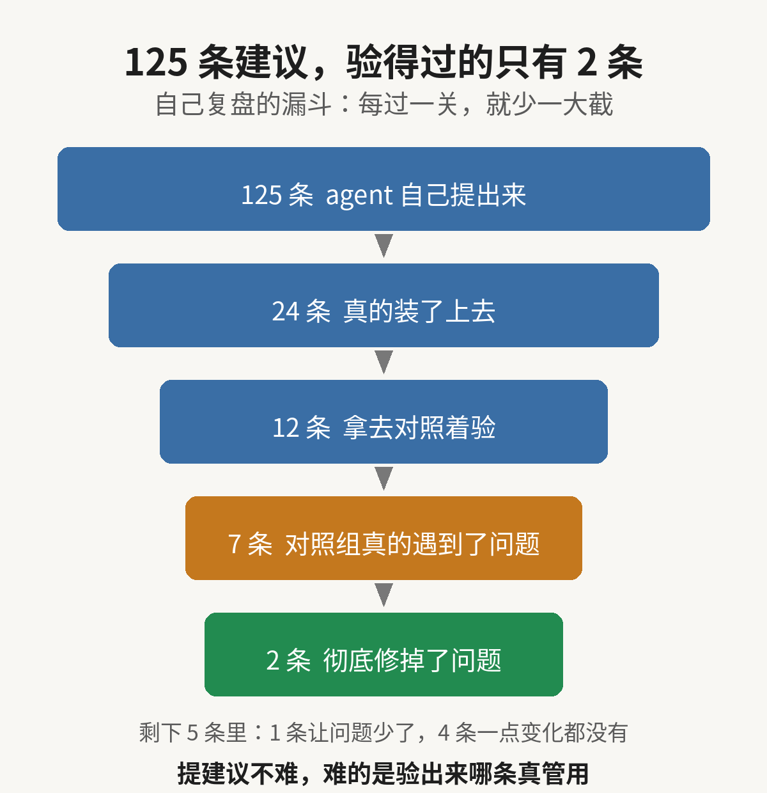
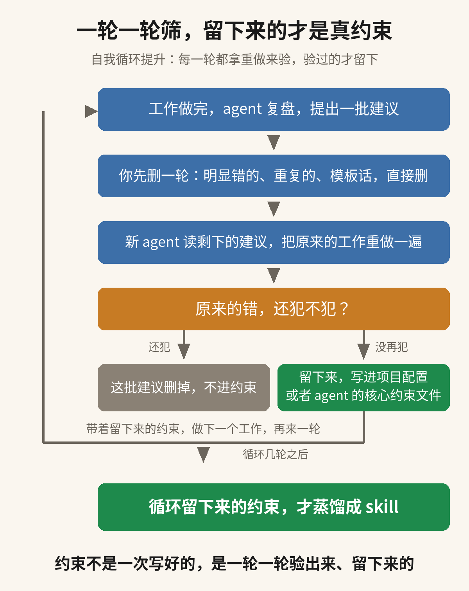

## 大家用 agent，都是这么用的

用 agent 做事，现在很多人都是同一个流程。agent 做着做着跑偏了，你指出来，它改。一次就完全按你的要求做对，基本指望不上，因为 agent 本来就不是许愿机。

等事情做完，你还会让它再总结一遍。它把这次哪里做错了、哪里卡住了，一条一条复盘出来。复盘出来的东西，一般就直接让 agent 写进项目里，或者写进 agent 自己的核心约束文件，下次做事起手就带着。还有人再往前一步，把这些话蒸馏成 skill。

这么做的目的很直白，就是下次别再犯同样的错。下个项目、下个任务一来，agent 能少绕一点路，做得更准一点，也更顺一点。

## 有人把复盘搬上实验台验了一遍

这个习惯听着很顺，顺到很少有人回头问一句，它到底有没有用？最近就有人把这件事搬上实验台，认认真真验了一遍，结果和大多数人的预期对不上。

Treude 和 Baltes 两位研究者先让 Claude Code 跑完 30 个修 bug 的任务，然后让它回头复盘。复盘只问一个问题：这套跑法哪里要改？它一共提了 125 条改进建议。

复盘用的东西叫 /retro，就是跑完一个任务之后，让 agent 把整个会话从头看一遍，再提出改 harness（跑 agent 的那套东西：软件、配置、还有给 agent 的指令）的建议。改 harness，就是改 agent 下次做任务时的起手配置。

实验用的是 SWE-bench Verified 里的 30 个任务，这些任务都是真实仓库里的真实 issue。125 条建议先被一条一条分类。研究者从里面挑了 24 条，并且真的装了上去。再从这 24 条里挑 12 条，就拿到后面的任务里对照着验。

验的办法是对照。针对同一个仓库的后续任务，开两个全新的会话。其中一个带上这条改动，另一个不带，然后比一比，看看带改动的那边是不是真的少做了改动要消掉的那个动作。

12 条拿去验的改动，先被筛掉 5 条，因为不带改动的对照组那边根本没遇到它要修的那个问题。如果没有对照组，这 5 条看起来会像没出问题，其实是没被验过。剩下 7 条里，2 条把那个动作彻底消掉了。另外 1 条让这个动作出现得少了，剩下的 4 条一点变化都没有。

所以回到开头那个问题，复盘总结不是一条都不能用。12 条里，确实有 2 条把问题彻底消掉了，还有 1 条让问题出现得少了。提建议时一口气提了 125 条，最后验得过的只有这么几条。

## 125 条建议，为什么大多没用

建议本身的质量也有问题。125 条里和 lint 有关的有 43 条，其中 18 条是不管每次任务里到底发生了什么，都推荐同一个做法。这样的建议并不是从证据里长出来的，而是 agent 把自己认定的做法又说了一遍。

还有些改动帮了倒忙。论文里写了，有些改动反而让 agent 在无关的任务上多做了事。改动装上去之后没人再验它，它就一直在那里。以后 agent 每次跑任务，都要多做一点额外的事。

问题不在 agent 提了多少建议。问题在它审的是自己刚做完的任务。它只能从自己的视角看自己刚做完的任务，所以它觉得这次卡住的地方下次就该改。可是卡住的地方是一回事，该改的地方是另一回事。

如果没有对照组，agent 就分不清两件事：改动是真修了它要修的那个问题，还是那个问题本来就不会再出现。靠自己审自己，这两件事就分不清。上面那 12 条里，就有 5 条卡在这里，连验都没验成。

上面那 18 条就是模板话的样本。一条建议如果换一个任务还会原样出现，它就和这次任务里到底发生了什么没有关系。你把这样的话存进经验，下次读到的还是这句现成的话，这次的证据并没有跟着一起存进去。

改动撤不掉，就会越堆越多。agent 跑起来，也就离原来的做法越偏。而且每多一条没验过的改动，无关的任务就可能跟着多做一点事。

## 如何做才是正确的

第一步，你自己先把这份复盘过一遍。有开发经验的人，扫一眼就知道哪几条不对劲：明显写错的、和前面重复的、换个任务照样成立的模板话，直接删掉，不用留到后面验。这一步花的是你自己的经验，几分钟就过完了，剩下的才是接下来要验的。

第二步，把剩下的建议交给一个新的 agent 验。开一个全新会话，还是原来那个项目。把剩下的建议写进项目配置里，让它先读完，再把你刚刚做完的那个工作重做一遍。跑的人是它，你不用在旁边记账，也不用等下一个任务出现。

第三步，看重做的结果。你当时指出过的那些错，这次还犯不犯，一眼就看得出来：没再犯的，这批建议里有东西是真管用的；照样犯的，说明留下来的建议没起作用。拿不准的时候，再开一个不带建议的会话把同一个工作跑一遍，两边一比就清楚了。论文里用的就是这个办法，只不过他们比的是后面的任务。

第四步，按结果定去留。重做时错没再犯的，这批建议就留下来，写进项目配置或者 agent 的核心约束文件，长期留着。照样犯错的，删掉，不要留在配置里占位置。想要分清是哪一条起的作用，就把建议拆成一条一条，照这个办法再跑一遍，研究里正是一条一条验的。

下一个工作来了，就带着留下来的约束再走一遍：新的复盘出来，再删一轮、再重跑一遍验。一轮一轮循环下去，约束会越来越干净。最后能蒸馏成 skill 的，就是这么循环几轮还留下来的那一批。

## 蒸馏成 skill，放在最后一步

等建议照上面这个办法验过、确定重做时错没再犯，再把里面真正起作用的写进 skill。写的时候把那次重做记一笔：原来错出在哪里、重做时有没有再犯，后面的人接手时能直接看到它凭什么留下来。

agent 复盘时写下的原文不进 skill。原文里混着没验过的判断，也混着换个任务照样成立的模板话。能进 skill 的，是从原文里挑出来、先删过一轮、又重跑验过的那几条，而且写进去的时候要改写成规矩、带上那次重做的记录。原文整份搬进去，等于把没验过的东西也一起搬了进去。

论文最后的结论也是这个意思：生成改动、装上改动只是第一步。还得有办法知道改动在后面的任务上到底帮没帮上忙，也得有办法修正、撤掉那些没用的改动。

如果你也在让 agent 自己复盘、自己总结，还想把总结蒸馏成 skill，这篇里的验法可以直接套在你自己的配置上。麻烦点个赞，再关注一下。这类实测我后面还会继续发。

来源：Treude 与 Baltes 的论文《How Do Coding-Agent Harnesses Self-Evolve?》，arXiv:2610.34938，https://arxiv.org/abs/2610.34938

#AIAgents #LLM #AIEngineering
