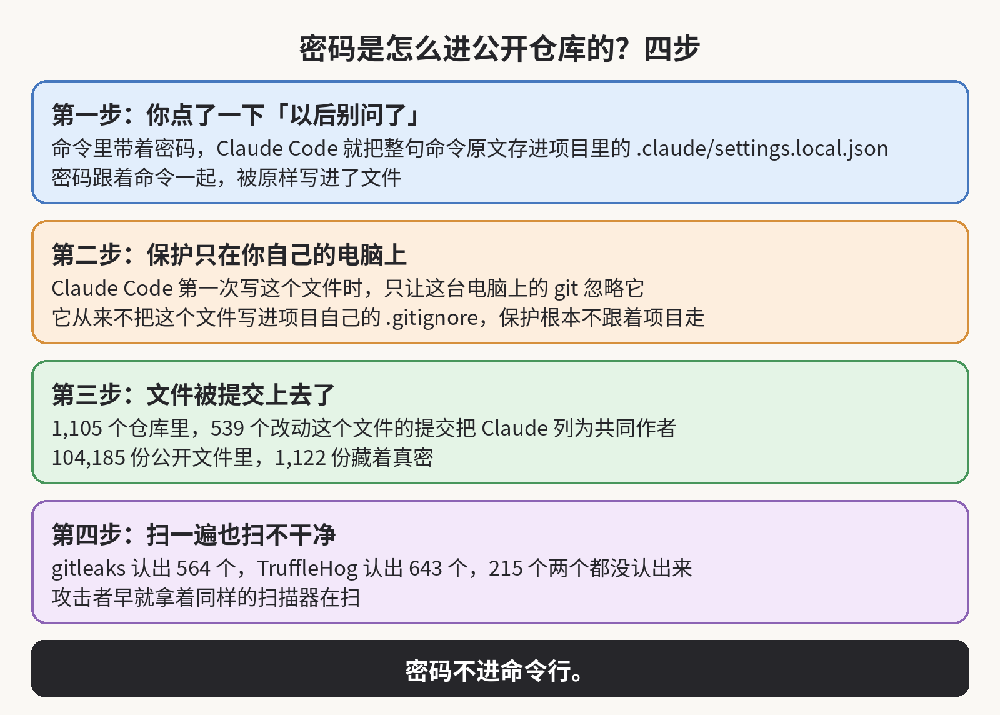

你在 Claude Code 里点过「Yes, and don't ask again」吗？要是点过，而且你当时批准的那条命令里带着密码，那么你的密码有可能就在这 1,122 份文件里面。

## 安全公司 Apiiro 在 2026 年 11 月 5 日发布的研究里，在 GitHub 上按文件名搜 .claude/settings.local.json，一共搜出 104,185 份

里面有密码的是其中的 1,122 份，里面的真的密码加起来有 1,379 个。

## 假设你让 Claude Code 连一次生产数据库，给它的命令里就写着 PGPASSWORD=，后面跟着你的数据库密码

它跑这条命令之前会先问你一句，你点了「以后别问了」，它就把这条命令整句存进项目里的 .claude/settings.local.json，当成一条以后不用再问的规则。下一次再碰到同样的命令，它直接就跑，不再问你了，而那句密码也就一直留在这个文件里，还是明文。

## 存进去的不一定是整句命令

有的时候它存的是一个模式，比如 npm test * 这种，模式里没有密码，那也就没事。但是只要存的是整句命令，那么命令里写了什么，它就存什么。研究者拿最新的两个模型 Opus 5.5 和 Fable 5.1 又试了一遍，试出来的结果是现在的版本照样会这样存，所以这不是老版本才有的问题。

## 这个文件本来就是给你自己这台电脑用的，Claude Code 也确实做了保护

它第一次在某个 git 仓库里写出这个文件时，会把这个文件名写进你这台电脑的一份全域忽略名单，就是 git 设置里的 global git excludes。这台电脑上的 git 看过这份名单之后，在哪个仓库里都会跳过这个文件。

## 可是这份名单只存在于你这台电脑的 git 设置里

这个文件一旦进了仓库，你的同事把项目拉到他自己的电脑上时，就会把它当成一个普通的项目文件，因为他的 git 里没有这份名单。而且 Claude Code 从来没有把这个文件写进项目自己的 .gitignore，所以项目一换电脑，保护就跟着没了。另外，要是这个文件在被忽略之前就已经提交过，那么名单也管不了已经进仓库的那一份。

## 把这个文件提交上去的，可能根本不是你

研究者追了 1,105 个仓库。在其中 539 个仓库里，改动这个文件的提交把 Claude 列成了共同作者。所以研究者认为，很多时候是 Claude 在帮你提交代码的时候，顺手把这个文件一起提交了。也就是说，你就算从来没敲过 git add，这个文件也可能已经在仓库里了。

## 研究者还把这 1,379 个密码按类型数过一遍

数据库密码最多，有 379 个。其次是公网服务器的 SSH 登录，43 个。再往后是 GitHub、GitLab 和 npm 的令牌，42 个。AWS 密钥有 23 个。这四类加起来是 487 个，剩下的 892 个，研究者没有再按类型往下细分数。

## 这些密码里，能直接打开一个数据库的超过三分之一，数据库密码只是其中的一部分

这次一共牵连到 63 个组织。这些密码里最扎眼的一例是数据库厂商自己的管理员级云密钥，另一例是医疗记录数据库的属主密码。研究者对「真的密码」的判定也不宽松：要么这个密码长得像已知的密钥格式，要么密码或者令牌旁边就写着一个公网服务器的地址，而且还要再过一遍 AI 审核员的确认，才算数。

## 不过，Apiiro 没有拿这些密码去逐个试登录，所以他们证明的是这些密码被公开了

至于有没有人已经拿它们登录过，这份研究没有证明，所以你不能把这两件事混在一起说。但是你也不能因此就当没事，因为研究者通知到的组织里面，已经有一家回话确认，自家的密钥在被通知的时候仍然有效。

## 这些文件也不是刚传上去的

截至 2026 年 11 月 2 日，里面有密码的文件全都还在各自仓库的默认分支上，而且有一半已经在那儿放了至少 217 天。你就算现在把文件从仓库里删掉，也解决不了，因为 git 会把旧版本留下来：研究者在旧版本里又找到 734 个密码，分布在 509 个仓库里。

## 旧版本之外还有 fork

有 211 个 fork 出自 74 个仓库，fork 里带着的是同样的密码，是同一批密码的副本。团队成员共用的 .claude/settings.json 里也有密码：研究者一共查了 76,011 份，其中 298 份存着密码。

## 研究者还在一些仓库里存着的聊天记录里找到了密码

当前版本里是 1,379 个，旧版本还多出 734 个，其余的在团队共用文件和这些聊天记录里，这两处研究者没有单独报数。几处加起来，研究者一共数到 2,539 个密码，分布在 1,994 个仓库里。

## 你可能会想，仓库不是有密钥扫描吗，怎么没扫出来

研究者拿 gitleaks 和 TruffleHog 把这 104,185 份文件全扫了一遍。扫完的结果是：在这 1,122 份存着密码的文件里，gitleaks 认出 564 份，TruffleHog 认出的更多，有 643 份。两个工具认出的文件有重叠，合起来一共认出 907 份。剩下 215 份，两个工具都没有认出来。

## 漏掉的主要是写在命令里面的密码

扫描器是按已知的密钥格式去认的。比如一串长得像 AWS 密钥的字符串，它就认得出来。但是写在命令里的密码，比如 PGPASSWORD=、sshpass -p 和 mysql -p 这几种写法后面跟着的那个词，看起来就是命令里一个普通的词。扫描器分不出它跟其他词有什么区别，所以它就直接放过去了。

## 2025 年 9 月出现过一个叫 Shai-Hulud 的蠕虫，它感染电脑之后，会在受害者的电脑上跑 TruffleHog 去翻密钥，而 TruffleHog 正是研究者用的那个扫描器

TruffleHog 能认出这 1,122 份有密码的文件里的 643 份，所以谁拿它去翻这些文件，能认出的也是这 643 份。再加上这个文件名是固定的，任何人只要在 GitHub 上按文件名搜，就能一份一份地翻。

## 2025 年 8 月 11 日，就有人提交了一份 bug 报告，说批准过的命令带着 API 密钥和令牌，被原文存进了这个文件里

这份报告提上去之后，一直没有人回复。到了 2026 年 1 月 3 日，因为已经 60 天没有动静，一个自动机器人以「不打算修」把它关掉了。研究者引的相关报告一共有四份，如今全被同一个机器人关掉了，最近的一份关在 2026 年 11 月 6 日。而且按研究者的说法，做 Claude Code 的 Anthropic 对这四份报告一份都没有回复过。

## 研究者还翻了其他 15 个写代码的 agent 的文档，加上 Claude Code 一共对照了 16 个，最后确认只有 Claude Code 会默认把批准过的整句命令存进项目文件里

所以这不是这一类工具的通病，而是这一个产品的存法有问题。

如果你也天天用 Claude Code，那么我建议你先去搜一遍：到 GitHub 的组织搜索里搜 .claude/settings.local.json 和 .claude/settings.json 这两个文件名，而且要连每个仓库的 git 历史一起搜，因为文件可能已经被删了，但是密码还留在旧版本里。

## 搜到了之后，顺序不要搞反

因为这个文件只要公开过，你就得按它已经被人复制走了来处理。所以先把文件里出现过的每个密码、令牌和密钥都换掉，让外面那份变成废的，然后再回头清理历史。

## 清理的时候，你把这个文件用 git rm --cached 从 git 的追踪里拿出来，并且把文件名写进项目自己的 .gitignore

这一步是为了让保护跟着项目走，因为你自己电脑上的那份名单，换台电脑就不算数了。

## 你自己电脑上现在的那份文件也要打开看一遍，把带着密码的那几条规则删掉

以后再碰到要带密码的命令的话，你应该先把密码放进环境变量，命令里只写变量名，比如 $DB_URL。这样就算这条规则被存下来，存住的也只是变量名。你批规则的时候也尽量批模式，比如 Bash(npm run:*) 这种，因为模式里不可能夹着你的密码。

## 这个文件还会出现在 GitHub 以外的地方

它就是项目文件夹里的一份明文 JSON，所以它也可能跟着 npm 包、Docker 映像、压缩包或者同步文件夹被一起发出去。你清理的时候，要把这几个地方也算进去。

## 我看完这份研究之后，最放不下的是 217 天这个数字

密码在公开仓库里躺了这么久，它的主人却一点都不会知道，因为从文件被提交到被人搜出来，中间没有任何一个环节会回来提醒他。在 Anthropic 改掉这个存法之前，能保护你的就只有你自己敲命令之前的那个停顿：密码要进命令行的时候，你就先把它换成变量，再跑。

要是你也天天和 Claude Code 打交道的话，这类事情我就一篇一篇接着拆给你看。要是你觉得有用，欢迎订阅这个博客，或者先收藏起来。我会持续分享 AI、安全和开源方面的干货。

来源：Apiiro 研究原文 https://apiiro.com/blog/coding-agents-leaking-secrets-github-dont-ask-again ；The Hacker News 报道 https://thehackernews.com/2026/11/claude-codes-dont-ask-again-file.html
