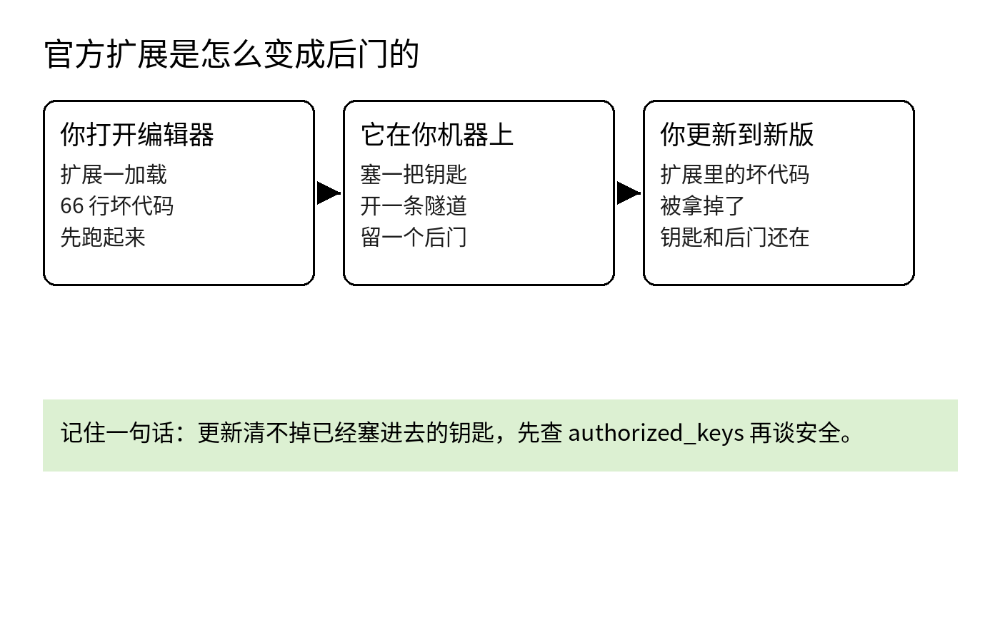

10 月 29 日，Cursor 应用市场里的 Claude Code 扩展有两个版本被人换了芯。2.1.312 和 2.1.313 挂着 Anthropic 的认证账号和名字上架，真正的扩展代码前面塞着一段 66 行的加载器，编辑器一打开它就先跑。这两个版本在市场里待了大约 11 个小时，Cursor 在 X 上说最多 5000 名用户装到或更新到了它们。

加载器不是 Anthropic 写的，这两个版本也不是它发布的。Anthropic 的说法是，一个攻击者「利用了对 Cursor 应用市场的访问权限，发布了一个被篡改的扩展」，它自己「没有参与这版的构建、发布和托管」。动手的人钻进的是 Cursor 的发布渠道，文件是在到你手上之前被换掉的。

你上一次打开自己机器上的 authorized_keys，是什么时候？里面的每一把钥匙，你都认得吗？

问这个，是因为这次出事的路径最后就落在这个文件上。加载器先把这台机器的底细发出去：主机名、用户名、操作系统和架构、home 目录、当前工作目录、公网 IP、Git 全局配置里的邮箱，还有名字里带 KEY、TOKEN、SECRET、PASS、AWS、GCP 这些词的环境变量的名字，最多 40 个，用明文 HTTP 发到攻击者的服务器，端口 8099。

第一波发走的只有变量的名字，值还没有动。名字本身已经够攻击者用了，他能看出这台机器挂着哪几家的云账号、大概存着哪几类凭证。值要等他能登录进来之后才拿得到，所以他接着做了三件事，目的就是给自己开一条能登录进来的路。

第一件是钥匙：往 ~/.ssh/authorized_keys 里加一把攻击者控制的 Ed25519 钥匙，备注写着 svc-telemetry。这个文件就是 SSH 登录的钥匙白名单，写在上面的钥匙都能登录这台机器。第二件是把这台机器的 SSH 服务打开，Mac 上是远程登录，Linux 上是 sshd，Windows 上是 OpenSSH Server。

第三件是一条反向 SSH 隧道，连到 134.209.82.225，断了大约每 60 秒重连一次，攻击者的服务器顺着这条隧道就能反过来连进你的机器。

为了让这条路在重启之后还在，它按系统各留了一种自动恢复的办法。Mac 上是启动代理 com.apple.sysmond，名字仿着苹果起的，跟苹果没有关系。Linux 上是定时任务里一条开机就执行的记录，Windows 上试着建一个叫 SysMon 的计划任务。

早期报道里有一处错，现在已经更正了：最初有分析把源头指成 Open VSX，那不是事实。出事的只有 Cursor 市场里的这两个版本。微软 10 月 30 日的分析也是同一个结论。

其他几个渠道都查过，没有问题。npm 上的官方包、微软市场里的版本、Open VSX 里的版本都是干净的，那几个渠道里的 2.1.312 是正常版本，而被动过手脚的 2.1.312 只在 Cursor 市场里出现过。你要查的是你自己在 Cursor 里装的那个，不是别的渠道的。

先打开 ~/.ssh/authorized_keys，看里面有没有一把备注写着 svc-telemetry 的钥匙。Mac 上再找一遍启动代理的目录，看有没有 com.apple.sysmond 这个文件。Linux 上打开定时任务列表，找一条你没写过的开机执行记录。

Windows 上打开任务计划程序，看有没有一个叫 SysMon 的任务。再看一眼正在跑的进程，里面有没有一个长期挂着的 ssh 或 autossh，参数带着一条把外部连接转回本机 22 端口的反向转发。这几处都没有，你这次就没有被它种下东西。

Cursor 还给了一个限定，能帮你判断自己的风险：在 Mac 和 Windows 上，打开 SSH 服务需要管理员权限，扩展一般拿不到，所以在大多数这类机器上，钥匙就算写进去了，攻击者最后也没有真的登录进来。这个限定讲的是大多数机器，但是你这一台到底是哪种情况，还是要靠上面那几处检查来定。

真在哪一处找到了，先不要急着删。把 authorized_keys 的内容存一份，把找到的启动代理或任务存一份，把还在跑的那个隧道进程用的命令和参数记下来。留完证据再动手：删掉那把钥匙，删掉那几样自动恢复的办法，停掉隧道进程。

然后换一台你信得过的干净机器，把这台机器上存过、输过、用过的凭证全部换掉。OpenSourceMalware 的建议更直接，它说与其删掉已知的几样东西就当信任恢复了，不如把机器重装一遍。我认同它这句，你删得掉的是你找到的那些，但是没找到的还在不在，你没有办法确认。

查完这一次，还有几件平时的事能挡住下一回。第一件就是开头问的那个文件：authorized_keys 是你这台机器的钥匙名单，隔一段时间打开看一眼，里面每一把钥匙你都应该认得。这次的钥匙备注叫 svc-telemetry，下次会换一个名字，所以要认的是「每一把都认得」，不是去搜某一个词。

第二件，不用 SSH 登录这台机器，就把远程登录关掉。钥匙要能用上，前提是机器开着 SSH 服务；服务关着，钥匙写进去也进不来。这次大多数机器没有被真的登录，靠的就是开服务需要管理员权限这一步：你平时把这个开关关着，等于一直把这一步卡在管理员密码上。当然，这挡的是登录那一步，但是挡不住机器信息被发出去那一步，所以它要和别的办法一起用。

第三件，扩展少装，并且知道自己装了哪些。扩展是在编辑器里跑的程序，用的就是你这个账号的权限，能读你的文件，也能执行命令。这次的事也说明，认证徽章能证明的只是发布账号是谁，但是证明不了这一次发出来的文件没有被动过。看徽章这个习惯不用扔，它能挡住起个像官方的名字来骗人的那种；但别把徽章当成文件本身的保证。

第四件，更新要做，但要知道更新管的是哪一半。Anthropic 后来用 2.1.314 换掉了这两个版本，新版本是干净的，加载器不在里面了。可是已经写进 authorized_keys 的钥匙还在，自动恢复的办法还在，发出去的信息也收不回来。出事之后的清理要按清单一项一项对，不能因为看到版本是最新的就当处理完了。

Cursor 事后关掉了市场，换掉自己的钥匙，重建之后才重新上线，还和托管商一起把攻击者的服务器下了线。但是它到现在也没有说清楚，被动过手脚的版本到底是怎么进到市场里面去的。Anthropic 说自己的系统没有被攻破，而 Kevin Beaumont 批评它的做法：它没有通知用户，被动过手脚的版本是悄悄换掉的。

我维护开源项目，发布要用的东西基本都在我这台开发机上：GitHub 令牌、云服务的凭证、还没有发布的代码，全在上面。所以一个陌生人要是能长期用 SSH 进来，他不需要偷走任何文件，因为他要用的东西本来就放在里面。被动过手脚的版本是怎么进市场的，平台那边还没有说法，但是我自己机器上的这几处检查，今天就能做完。

这两个版本在市场里只待了 11 个小时。你 authorized_keys 里那把钥匙能待多久，要看你什么时候去翻它。今天先把别的事情放一放，打开那个文件看一眼，顺手确认一下远程登录的开关是关着的。这篇对你有用的话，收藏一下，订阅一下，我接着写 AI、安全和开源这几块的实事。

出处：OpenSourceMalware 的分析 https://opensourcemalware.com/blog/trojanized-claude-code-extension-plants-persistent-ssh-backdoor ；Cursor 的安全通知 https://cursor.com/blog/claude-code-extension-security-notice

「最多 5000 名用户」这个数字出自 Cursor 在 X 上的声明：https://x.com/cursor_ai/status/2116074289053175808
