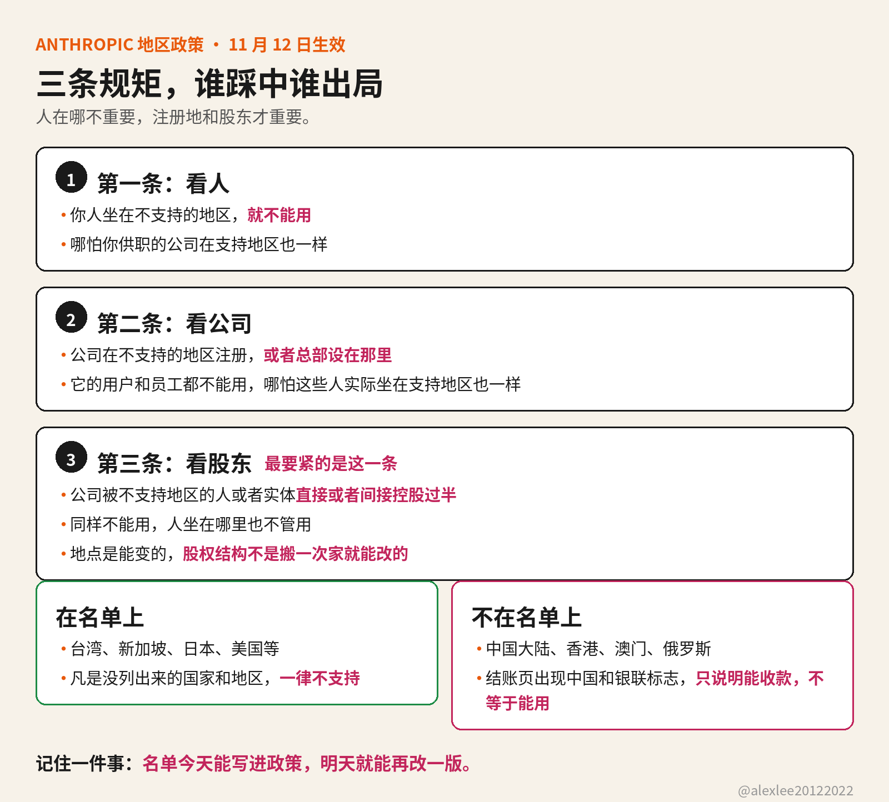

你明天打开 Claude Code，就会发现它可能已经不认你了。Anthropic 的新版地区政策 10 月 8 日就公布了，但是要到 11 月 12 日才生效，也就是明天。

政策的名字叫 Supported Regions Policy。它管的是 Claude.ai、Claude Code 和 Cowork 这些应用。API 也在管辖范围之内。从云平台和授权经销商那里提供的 Claude 模型也一样。

名单上有台湾、新加坡、日本和美国这些地方。但是中国大陆、香港、澳门和俄罗斯不在名单上。政策写得很明白：凡是没列出来的国家和地区，一律不支持。所以这不是"部分受限"，而是名单之外就是没有。

然后它把"不支持"拆成了三条。第一条看人：你人坐在不支持的地区，就不能用，哪怕你供职的公司在支持地区也一样。第二条看公司：公司在不支持的地区注册，或者总部设在那里，它的用户和员工就不能用，哪怕这些人实际坐在支持地区也一样。第三条看股东：公司被不支持地区的人或者实体直接或者间接控股过半，同样不能用，人坐在哪里也不管用。

三条里最要紧的是第三条。前两条针对的都是地点，而地点是能变的：人可以出差，公司也可以设分支。但是第三条针对的是股权：股权结构不是搬一次家就能改的。政策这次划线，划的不是你人在哪里，而是你的公司归谁管。

一家公司注册在香港，员工却坐在新加坡远程办公，照样出局，因为第二条看的是注册地。一家公司注册在美国，员工也都在美国，但是它被中国大陆的资本控股过半，同样出局，因为第三条看的是谁控股。人在支持地区，只是第一条过了关，后面两条照样能把你拦下来。

名单本身也会变。政策里写的是"目前提供"这些国家和地区，"目前"这两个字的意思就是名单还会改。10 月 8 日公布，11 月 12 日就生效。中间只隔了一个多月。所以这次真正该担心的不是某一版名单上有没有你，而是你的工具链是不是经得起名单再变一次。

还有人想走云平台绕过去，这条路政策里也写死了。政策的适用范围写得很明白：经云平台和授权经销商提供的 Claude 模型也在管辖之内。所以你在云市场里买到的 Claude，同样要过这三条判定，换个卖家也解决不了问题。

另外有一个地方很容易误会。最近 Claude 的升级页上出现了中国大陆、香港和澳门这些选项，还带了银联的标志。很多人一看，就以为这是开放了。其实那只是支付处理商能收款，不等于你能用。能不能用，只看 Supported Regions Policy。它按三条算：你人实际在哪里、公司注册在哪里，以及谁控股。结账页上的选项决定不了这个。

11 月 12 日也不是新一轮封号日。这一点很容易被误读。地区限制在这之前就已经存在了，但是这次更新把判定范围写死了，也写全了。生效日一到就按新文本执行。所以不要等到明天才去查，等到账号真出问题再想办法就晚了。

现在就能查三件事。第一，你人现在坐在哪个地区。第二，你的公司注册地和总部所在地是哪里。第三，你的公司有没有被不支持地区的人或者实体控股过半。控股要算直接和间接两层。三条里任何一条踩中，就要准备后路。

后路不是去申诉，而是把工具链做成能换的。去申诉没有用，因为名单是 Anthropic 定的，改不改也由 Anthropic 决定。Claude Code 只是你写代码的一个入口。模型能换一家，agent 工具也能换一家，写代码的流程也能换一套，这样你手里的工作才接着跑。你今天多花一个下午把入口做成能替换的，这样明天名单再变，你手里的工作也不用停。

名单今天能写进政策，明天就能再改一版。你控制不了 Anthropic 在政策里写什么，但是你能控制自己的工具链是不是只押在某一家供应商的名单上。如果这篇对你有用，请订阅或收藏这个博客。我会继续分享 AI、安全和开源方面自己动手查过和用过的东西。

来源：Anthropic 官方 Supported Regions Policy https://www.anthropic.com/supported-countries
