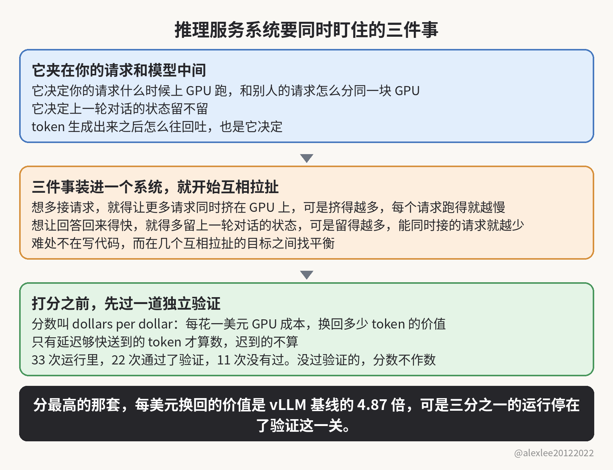

11 月 4 日，CMU 的研究者在 arXiv 上发了一个叫 ServerBench 的新基准。假设你正跑着一套推理服务系统，有人拿一套 agent 设计的版本放到你面前，说它比你现在用的还强。你敢不验一遍，就直接换到线上吗？

这个基准找来 11 个 coding agent 模型（就是平时替你写代码的那种 agent），跑了三种部署，一共 33 次运行。每次都是让模型独立设计一整套 LLM 推理服务系统，再拿真实负载去跑、去打分。

33 次里，22 次交出的系统通过了验证，剩下 11 次没有过。分最高的那套，是 Claude Sonnet 5.5 在 Gemma E4B 上设计出来的：它每花一美元 GPU 成本，能换回 2.97 美元的 token 价值，算下来是 vLLM 基线的 4.87 倍。vLLM 是大家平时跑推理服务最常用的开源系统，所以同行默认拿它作参照。

你的请求发出去之后，先碰到的是推理服务系统，再由它送到后面的模型那里。它决定你的请求什么时候上 GPU 跑、和别人的请求怎么分同一块 GPU，因为 GPU 就那么大，所以分法直接决定你要等多久。它还决定上一轮对话的状态留不留，因为留下来，下一轮就不用从头再算。token 生成出来之后怎么往回吐，也是它决定，因为吐得太碎会多花开销，攒得太久又会让你多等。

把它做好，要同时盯住三件事：第一件是系统一次能接多少请求，第二件是回答回来得有多快，第三件是回答本身对不对。只管一件事的函数不难写，因为它只要把自己那件事做对就行，而且它的输入和输出都是定死的。

可是三件事装进同一个系统、放到真实流量下面，就开始互相牵扯了。你要是想多接请求，就得让更多请求同时挤在 GPU 上，可是挤得越多，每个请求跑得就越慢。你要是想让回答回来得快，就得多留上一轮对话的状态。可是状态占着显存，所以留得越多，能同时接的请求就越少。所以设计这套系统的难处，不在写代码，而在几个互相拉扯的目标之间找平衡，ServerBench 交给 agent 的正是这件事。

打分的尺叫 dollars per dollar：每花一美元 GPU 成本，最后换回多少 token 的价值，分数就是多少。不过它给 token 算价值的时候加了一个条件：只有在延迟够快的前提下送到的 token 才算数，迟到的不算。

这个条件是用来防作弊的。要是不加，系统就能把回答拖着慢慢给。token 一个都不少，可是等答案的人早就等过头了，迟到的 token 对他也就没用了。除了延迟这一条，它还把真实会话连着上下文原样重放，免得 agent 把每个请求都当成第一次见，靠丢掉上下文来省计算。每个系统交上来之后，还得先过一道独立的验证。只有验证过了，它的分数才作数。

通过验证的 22 次里，有 13 次超过了论文所设基线中最强的那个。4.87 倍比的是 vLLM 基线，也就是前面说的那个大家最常用的系统。可是 13 次超过的那个最强基线，是论文另外设的。论文没有说它就是 vLLM，所以这两个数字不能混在一起看。

第一条发现：分最高的那些系统，都是两件事一起做的。一边把容量做大，也就是一次能接的请求做多。另一边挑负载，先看一个请求要占多少 GPU 时间、能换回多少 token 价值，再决定接不接。换得回价值的接进来，换不回的就让它等一等，或者干脆拒掉。

两件事必须一起做，因为只做一边，另一边就漏。光把容量做大也不行，因为请求要是不挑，GPU 的时间就会花在换不回多少价值的请求上。而且容量越大，这样浪费掉的就越多。反过来，你光会挑负载也不行，因为系统本身一次只能接那么几个请求。你挑得再准，能换回来的价值也有个上限。两件事一起做，多出来的容量才正好落在挑出来的请求上，分数就是这么上去的。

第二条发现：agent 是靠做实验、读性能反馈来改设计的，所以实验长什么样，它就学成什么样。你要是拿一套通用测试去调参数，因为那套测试里的流量形状跟真实流量差得远，那么你调出来的参数一上真实流量就是错的，等于实验一直在教它错的东西。论文里说，反馈变得能用，是在实验改成照着真实负载问哪里慢之后。因为哪里最慢，只有真实负载跑起来才看得见。

第三条是我最想说的一条，要是我在带团队，我会把它排在第一位。每次给系统做优化，都会在代码里多走出一条新路，而新路出错的样子，跟老路是不一样的。所以论文说，优化带进来的每条新路，都得单独验一遍，而且不能默认它跟老路一样可靠。

速度这个东西，跑一遍就量出来了。对错就不一样了：你要是不专门去验，那么就算它把答案给错了，你也看不见。所以一个只追分数的 agent，很自然就会拿对错去换速度，因为分数涨了，它就觉得自己做对了，除非旁边有人专门验它交出来的东西。一个系统完全可以跑得飞快，同时把答案给错。

ServerBench 里那道独立验证，拦的就是这个。33 次里那 11 次没通过的，就是倒在这道关上：交上来的系统过不了验证，就等于没交。要是没有这道关，那 11 次里跑得快的那些，分数就照样好看，然后就会被人直接搬去用了。

三条发现串起来，是一个正在合上的圈：agent 开始设计跑模型的系统，而那套系统里跑的模型，又在跑 agent。圈转起来之后，做基础设施的人，手艺的重心就得跟着变。亲手把系统写出来还是要紧的，因为一套系统该验哪些地方，得懂它的人才定得下来。可是接下来更要紧的，是能把一个又快又错的系统验出来，赶在它上线之前拦住。

所以 4.87 倍这个数字，我猜会传得最远，因为它够猛，又好记。可是我自己会记着的，是 22 和 33，因为它们说的事更实在。33 次里有 11 次交不出能通过验证的系统，也就是说，整整三分之一的运行停在了验证这一关。所以这个 4.87 倍，先当一家实验室的结果看（数字是论文作者自己的，我自己也没有重跑这个基准），别当定论。

你要是靠跑推理服务吃饭，那么换上任何一套 agent 设计的系统之前，先回头看看你自己的验证办法。它够不够拦住一个跑得快、答得错的系统，换之前就得看清楚。要是这种把基准拆开讲的文章对你有用，欢迎订阅这个博客，或者先收藏起来。我接着写跑在真实流量下的 AI 系统，也写怎么检查它们。

来源：论文 https://arxiv.org/abs/2611.06841
