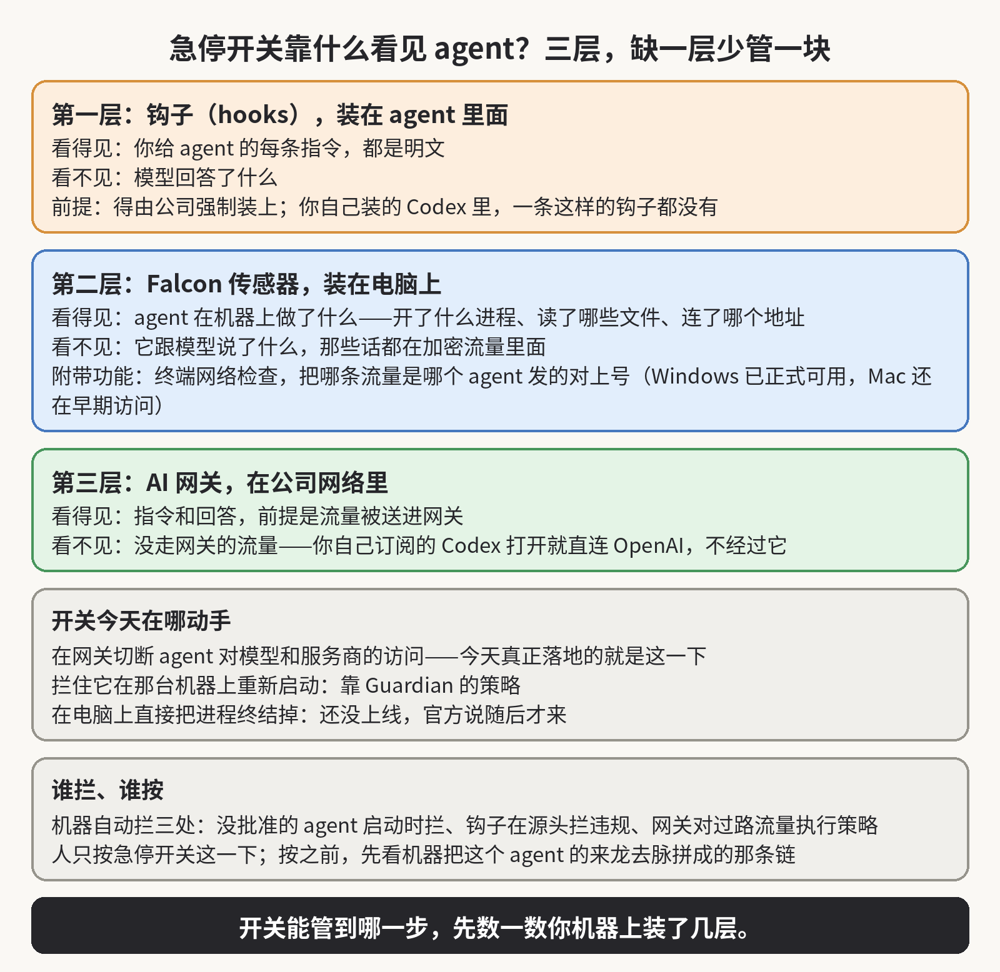

11 月 3 号，CrowdStrike 在巴塞罗那的 Fal.Con Europe 大会上发布了 AI 急停开关，装在它的 Falcon Guardian 里。Falcon Guardian 是它用来发现和管理一家公司里在跑的 agent 的系统。官方的说法是，agent 跑偏的时候，安全管理员可以先把它停掉，再不让它重新启动，最后断掉它访问企业网络的路。听上去，装上这个产品，开关就在手边了。

我拿自己天天用的 Codex 顺着这条线走了一遍。Codex 在我的电脑上跑，它跟 OpenAI 之间的数据走的是 HTTPS，也就是加密之后再发出去的流量。公司网络中间就算摆着一个网关，网关看到的也只是一串加密流量，因为它不知道里面是提示还是回应，所以它更不知道哪一句该拦、哪一句不该拦。

所以我最想弄清楚的是，这个开关到底靠什么看见 agent，又靠什么把它停住。我把急停开关的官方稿、产品页和同一天那份讲 Guardian 整体的公告都读完之后，答案是，它靠的不是网关解密，而是事先在三个地方布置好的东西。少了哪一层，它能管的范围就少哪一块。

第一层装在 agent 里面，叫 hooks，中文就是钩子。Claude Code、Codex、GitHub Copilot、Cursor 这些主流 agent 都留了钩子的接口。

agent 每收到一条指令、每准备调用一个工具，钩子都能先看一眼，如果违规，就当场拦下。CrowdStrike 的 Guardian，就是把自己的检查装进这些钩子里。因为钩子是在 agent 内部看的，所以它看得见明文的提示，HTTPS 加密不加密跟它没有关系。

但是钩子有两个前提。第一个前提是得有人把钩子装进去，而在公司管的电脑上，这件事可以强制。以 Codex 为例，OpenAI 的企业文档写明，管理员可以在一份叫 requirements.toml 的受管配置里定好钩子，再由公司的设备管理工具下发到每台机器上，员工自己关不掉，甚至可以设成只跑公司下发的钩子。

反过来，如果公司没有部署这一套，你自己装的 Codex 里一条这样的钩子都没有，所以它干了什么，不会向任何人报告。第二个前提是钩子本身看不全。CrowdStrike 在公告里自己承认，钩子看得见提示，但是看不见模型的回应，而且拦不下 agent 的每一个动作。OpenAI 的文档里还有一句，钩子的回调如果出错或者超时，钩子可能就这么失败了，而工具照样执行。

第二层是装在电脑上的 Falcon 传感器。传感器在操作系统这一层看 agent：它拉起了哪些进程，读了哪些文件，又往外面连了哪些地址。这些它都看得见，所以哪怕一个 agent 没有装钩子，它在机器上做过什么，传感器也能记下来。

但是传感器看不见它跟模型说了什么，因为对话内容在 HTTPS 里面，而传感器在外面。它能对上的，只是这个进程在某个时间连了某个地址、发了多少数据。Falcon 传感器还带一个终端网络检查的功能，做的就是把网络上发的东西和机器上做的事对起来：哪条网络流量是哪个 agent 发的，它发完之后又在机器上做了什么。这个功能在 Windows 上已经正式可用，Mac 还在早期访问。

CrowdStrike 也承认，只靠网络这一层有盲区。如果 agent 用的是跑在本机的开源模型，它跟外界根本没有网络往来，那么这一层就什么都看不见。

第三层才是网关。Guardian 里带一个 AI Gateway，公司可以把 AI 流量导进网关。流量从网关过的时候，提示和回应都能被检查，用量能被统计，策略也能在这一层执行。网关能看见内容，不是因为它能解开 HTTPS，而是因为流量被主动送到了它面前。

你的 Codex 如果是自己订阅的，打开就直接连 OpenAI，中间不经过任何公司网关，那么这一层对它就等于不存在。这不是网关技术不行，而是它根本不在这条路上。

哪一层都不在的机器，比如你自己家里电脑上那个 Codex，这个产品连它存在都不知道。而机器上装了哪几层，也决定了这个开关对这个 agent 能做到哪一步。

急停开关今天真正落地的动手点，是在网关上切断 agent 对指定模型和服务商的访问，产品页上就是这么写的。走网关的 agent，被切断之后拿不到模型的回应，所以正在跑的任务也就继续不下去了。另外还有两件。一件是阻止它在那台机器或者那一组机器上重新启动，这一件靠的是 Guardian 的策略。另一件是切断它访问企业网络的路。

而名字最容易让人以为的那件事，也就是直接在终端上把 agent 的进程终结掉，官方稿里写的是先在网关停，终端那一下随后才来，现在还没有上线。所以今天按下这个开关，能不能直接停住一个 agent，先要看它走不走网关。如果它走网关，模型访问会被切断，任务就停了。如果它不走网关，你手里能用的就只有拦重启和断网。

拦的这一下到底是人按的，还是系统自动的？得分开看，因为这个系统里自动和人工是分工的。自动拦的有三处。不在批准名单上的 agent，启动的时候就被拦下。钩子在源头拦违规的提示和工具调用。网关对过路的流量执行策略，该遮的敏感数据遮掉，该拦的拦掉。

人按的部分只有急停开关这一下，而且这是 CrowdStrike 明说的设计。官方原话是人在控制、全程留痕，意思是有权限的管理员来触发这一下，每一次操作都记进审计日志，也就是记着谁在什么时候做了什么的那份记录。

可是量级摆在这里。CrowdStrike 自己的演示里提过一个客户，是一家财富 500 强公司，在终端上盘出来 18,000 个 agent，真正批准过的只有 300 个。在这种量级下，靠人盯着每一个 agent 看是不可能的，所以它的管法是让机器先做筛选。没批准的在启动那一关就过不去，所以不需要人操心。

被 Guardian 的检测标出来的那些，系统会把这个 agent 的来龙去脉拼成一条链，再递给管理员：谁把它部署到这台机器上的、它收到过什么指令、调用了哪些工具、读了哪些文件、又往外发过什么，全都在这条链上，而且每个 agent 还带一个风险分数。事情正在发生的时候，系统还能估算波及范围。自动的那几层先把自己能判断的都判断完了，所以真正递到管理员面前的，只剩这一个判断：这一条链是不是已经越界了。

不过，这个分工有一个绕不过去的前提：人能看到的，只是被检测标出来的那一部分。如果一个 agent 拿着合法的权限，在权限范围里做错了事，比如把一份不该发的文件发给了名单上的收件人，那么前面的自动层不会觉得它违规，检测也不一定会标它，所以这条链就不会递到任何人面前。

它停的是还没发生的事。agent 在被停掉之前已经发出去的数据、删掉的文件、执行完的操作，开关按下去也收不回来。

我的看法是，看这类产品的时候，先不要被按钮的名字带着走，而是先看清楚它在哪一层看、在哪一层动手，然后再对着自己的环境数一数，这几层到底在不在。

如果你是在公司里负责推 agent 的话，那么你应该在自己的机器上查三件事：公司机器上的传感器和强制钩子装了没有，agent 的流量到底走不走网关，不在批准名单上的 agent 启动时是不是真的被拦。等你把这三件都查完，你就知道这个开关对你手里那批 agent 能管到哪一步了。

如果这篇对你有帮助，欢迎订阅或收藏，我会继续写 AI、安全和开源这类题目。

来源：https://www.crowdstrike.com/en-us/press-releases/crowdstrike-introduces-ai-kill-switch-for-ai-safety/
