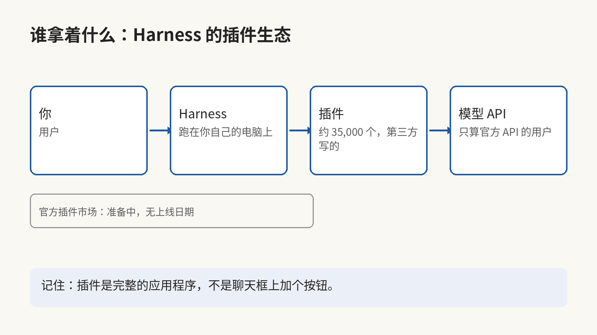

11 月 4 日那天，有 154 万人打开了 DeepSeek Harness。不管你用的是哪个 agent 助手，里面有多少功能是别人写的插件？

Harness 是 DeepSeek 今年 8 月 13 日推出的 agent 应用，9 月 29 日出了桌面版。它跑在你自己的电脑上，浏览器就是它的界面：你打开它，给它一个任务。它接着调模型、跑工具，把任务做完。11 月 5 日晚，DeepSeek 的产品团队公布了它的第一组数字：11 月 4 日的每日活跃用户是 154 万，而且只算了走官方 API 的用户，接第三方 API 的人还没算进去。

9 月 30 日的七日均值还是 27.1 万，五周后的 11 月 4 日，单日数字到了 154 万，约 5.7 倍。同一批数字里还有一组：这些用户一天要消耗约 92 万亿个 token，第三方插件已经有约 35,000 个，而且约 60% 的活跃用户装过或自己写过至少一个插件。

这组数字真正说明的事，不是 DeepSeek 的模型又变聪明了。模型本身的差距正在缩小，因为各家手里的模型已经够用，真正拉开距离的，是模型外面那一圈别人给 Harness 写的插件。

这里说的插件，不是给聊天框加一个按钮那种小东西。Harness 的插件是一个完整的应用。官方举的例子里，有一个创作者工作台。它把灵感笔记、写稿、封面设计和分镜放在同一个界面。另一个是设计插件，它把设计和文案打磨合在一起。第三个是阅读插件，帮你读论文、划重点、翻译和记笔记。这三个插件能做的事，已经可以顶掉官方自己内建的功能。

所以增长的逻辑变了。以前一个 agent 工具好不好用，看的是它自己的模型和功能。现在 Harness 的用户有一多半已经在用第三方插件，这个工具好不好用，很大程度上要看别人给它写了什么。DeepSeek 自己也看明白了这一点，所以它在准备一个官方插件市场，还要给插件作者发 token 额度一类的支持，只是上线日期还没公布。

92 万亿这个数还可以再算一步。我自己拿它除以 154 万，大概是每个每日活跃用户一天烧掉约 6,000 万个 token。这不是官方公布的人均数，只是一个量级的估算，但是它说明了一件事：agent 不是在替你聊几句天，而是在替你做一整天的工作，所以花的算力跟聊天完全不是一个量级。

但是生态长得越快，安全那一面的事就越实在。插件是第三方写的代码，它跑在你的 agent 里，用的是你的权限，读的是你交给 agent 的文件。Harness 自己的安全说明写得很直接：这个软件还没有通过安全审计，不应该把它当成安全、能直接用在生产环境里的东西。它还写了，这个项目能执行模型生成的代码和命令，也能加载第三方插件。它能接触到的东西，包括网络、进程、凭据和文件。交到它手里的，它都能碰到。

插件可以装，但是 35,000 个也没人能把每个插件的代码读完再装。所以装之前先看它要读哪些文件、要调哪些工具。这一步不要省，因为装完之后它就用你的权限在跑了。带着真凭据的工作，先别交给还没通过安全审计的 Harness，等官方市场和审查机制出来之后，再看这套审查管不管用。

往远了看，agent 工具的竞争已经换了赛场：模型人人都有，差别在谁的生态里装着你要用的东西。生态一旦长起来，审查、抽成和恶意插件这些问题都会跟着来。如果这篇对你有用，请订阅或收藏这个博客。我会继续分享 AI、安全和开源方面自己动手查过、用过的东西。插件市场上线之后，我再写一篇它到底管不管用。

来源：DeepSeek 产品团队 11 月 5 日晚公布的数字，Bloomberg 与南华早报 11 月 8–9 日报道，数字原帖见 https://x.com/Fangzm168/status/2119773866260103170 ；安全说明见 https://github.com/deepseek-ai/deepseek-harness/blob/master/SAFETY.md
